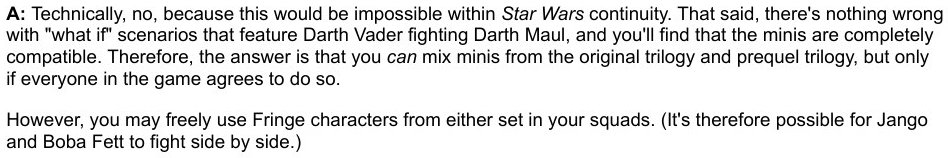
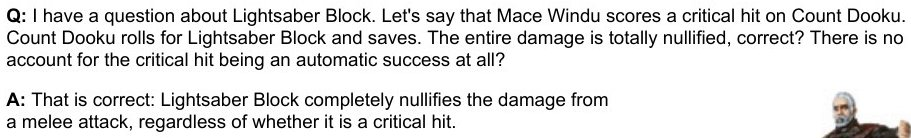
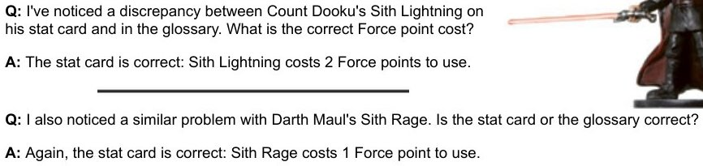
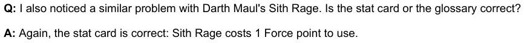
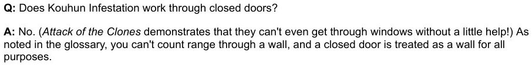
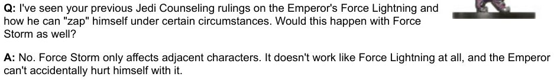
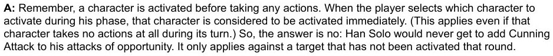

# Owner Material 037 — Star Wars D20 Drive folder (Core, Revised Core and Saga Edition): Jedi Counselling/Jedi Counseling 57.pdf [Star Wars Roleplaying Game Revised Core (d20, 2002)]

- **Source:** Wizards of the Coast Star Wars Roleplaying Game books, web enhancements, Living Force campaign modules and articles (2000–2010), from the owner's "Star Wars D20" Drive folder (only the three edition subfolders; "General" was not read, as instructed). Secondary source (licensed Legends reference). Scan OCR'd on the box; the scan stays box-only and is **not** published.
- **Method:** every scanned page was OCR'd and machine-screened sentence by sentence for power-relevant statements (fights, kills, defeats, Force feats, rankings, superweapons) that name a character on our roster; each kept sentence is quoted verbatim from the OCR text and has a crop of the printed passage directly under it. Pages with nothing power-relevant are still listed with what is on them.
- **Citation:** "*Jedi Counseling 57* (SWRPG d20 Revised Core), p.X" by printed page ("scan p.X" where no printed number applies). **Weight:** Licensed RPG material: a secondary source. Narrative text sums up Legends lore; game statistics are rules for players, not canon power levels, and rank lowest.

## scan p.1 (scan page 1)

Page contents: Natural armor and DR, fringer class skills, Weapon Specialization errata (hand-read)

## scan p.2 (scan page 2)

Page contents: Ammo, lightsaber cells, slug costs, Craft ammo, super battle droid errata; Miniatures mixing sets (hand-read)

- **Darth Vader (Anakin Skywalker); Darth Maul; Jango Fett; Boba Fett** — entry/section: Mixing eras: Vader vs Maul, Jango and Boba side by side: "A: Technically, no, because this would be impossible within Star Wars continuity. That said, there's nothing wrong with "what if" scenarios that feature Darth Vader fighting Darth Maul, and you'll find that the minis are completely compatible. Therefore, the answer is that you can mix minis from the original trilogy and prequel trilogy, but only if everyone in the game agrees to do so.
However, you may freely use Fringe characters from either set in your squads. (It's therefore possible for Jango and Boba Fett to fight side by side.)" Source: *Jedi Counseling 57* (SWRPG d20 Revised Core), scan p.2
  

## scan p.3 (scan page 3)

Page contents: Lightsaber Block, Dooku/Maul costs, Zam Wesell Kouhun, Emperor Force Storm, Han Cunning Attack; author bio (hand-read)

- **Mace Windu; Count Dooku** — entry/section: Dooku's Lightsaber Block nullifies Mace Windu's critical hit: "Q: I have a question about Lightsaber Block. Let's say that Mace Windu scores a critical hit on Count Dooku. Count Dooku rolls for Lightsaber Block and saves. The entire damage is totally nullified, correct? There is no account for the critical hit being an automatic success at all?
A: That is correct: Lightsaber Block completely nullifies the damage from a melee attack, regardless of whether it is a critical hit." Source: *Jedi Counseling 57* (SWRPG d20 Revised Core), scan p.3
  
- **Count Dooku** — entry/section: Count Dooku's Sith Lightning costs 2 Force points: "Q: I've noticed a discrepancy between Count Dooku's Sith Lightning on his stat card and in the glossary. What is the correct Force point cost?
A: The stat card is correct: Sith Lightning costs 2 Force points to use." Source: *Jedi Counseling 57* (SWRPG d20 Revised Core), scan p.3
  
- **Darth Maul** — entry/section: Darth Maul's Sith Rage costs 1 Force point: "Q: I also noticed a similar problem with Darth Maul's Sith Rage. Is the stat card or the glossary correct?
A: Again, the stat card is correct: Sith Rage costs 1 Force point to use." Source: *Jedi Counseling 57* (SWRPG d20 Revised Core), scan p.3
  
- **Zam Wesell** — entry/section: Zam Wesell's kouhuns can't get through closed doors: "Q: Does Kouhun Infestation work through closed doors?
A: No. (Attack of the Clones demonstrates that they can't even get through windows without a little help!) As noted in the glossary, you can't count range through a wall, and a closed door is treated as a wall for all purposes." Source: *Jedi Counseling 57* (SWRPG d20 Revised Core), scan p.3
  
- **Palpatine (Darth Sidious)** — entry/section: The Emperor's Force Storm can't hurt himself: "Q: I've seen your previous Jedi Counseling rulings on the Emperor's Force Lightning and how he can "zap" himself under certain circumstances. Would this happen with Force Storm as well?
A: No. Force Storm only affects adjacent characters. It doesn't work like Force Lightning at all, and the Emperor can't accidentally hurt himself with it." Source: *Jedi Counseling 57* (SWRPG d20 Revised Core), scan p.3
  
- **Han Solo** — entry/section: Han Solo's Cunning Attack doesn't apply to AoOs: "A: Remember, a character is activated before taking any actions. When the player selects which character to activate during his phase, that character is considered to be activated immediately. (This applies even if that character takes no actions at all during its turn.) So, the answer is no: Han Solo would never get to add Cunning Attack to his attacks of opportunity. It only applies against a target that has not been activated that round." Source: *Jedi Counseling 57* (SWRPG d20 Revised Core), scan p.3
  

## scan p.4 (scan page 4)

Page contents: Author bio end (hand-read)

