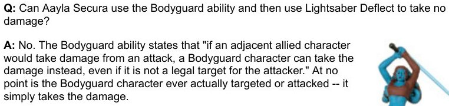
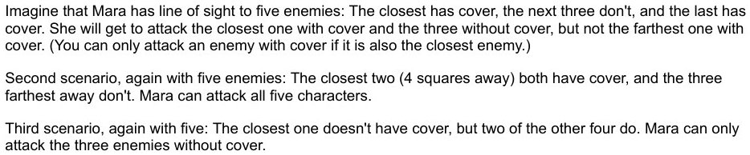
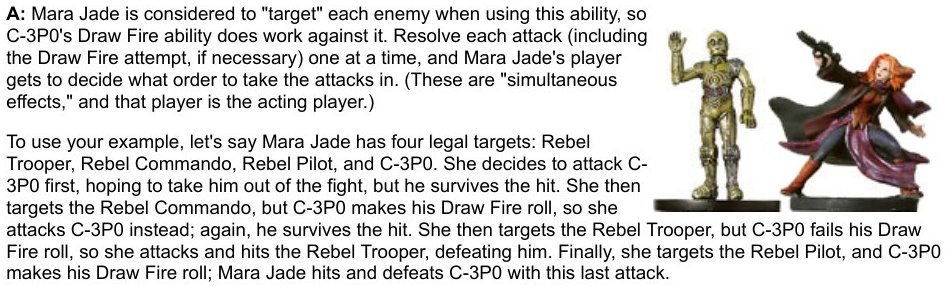

# Owner Material 037 — Star Wars D20 Drive folder (Core, Revised Core and Saga Edition): Jedi Counselling/Jedi Counseling 58.pdf [Star Wars Roleplaying Game Revised Core (d20, 2002)]

- **Source:** Wizards of the Coast Star Wars Roleplaying Game books, web enhancements, Living Force campaign modules and articles (2000–2010), from the owner's "Star Wars D20" Drive folder (only the three edition subfolders; "General" was not read, as instructed). Secondary source (licensed Legends reference). Scan OCR'd on the box; the scan stays box-only and is **not** published.
- **Method:** every scanned page was OCR'd and machine-screened sentence by sentence for power-relevant statements (fights, kills, defeats, Force feats, rankings, superweapons) that name a character on our roster; each kept sentence is quoted verbatim from the OCR text and has a crop of the printed passage directly under it. Pages with nothing power-relevant are still listed with what is on them.
- **Citation:** "*Jedi Counseling 58* (SWRPG d20 Revised Core), p.X" by printed page ("scan p.X" where no printed number applies). **Weight:** Licensed RPG material: a secondary source. Narrative text sums up Legends lore; game statistics are rules for players, not canon power levels, and rank lowest.

## scan p.1 (scan page 1)

Page contents: Targeting scopes, weapon DR, Jedi consular lightsaber proficiency (hand-read)

## scan p.2 (scan page 2)

Page contents: Delaying feats, vehicle turrets and AoOs, one-handed repeaters; Battle Droid Officer (hand-read)

## scan p.3 (scan page 3)

Page contents: Aayla Secura Bodyguard, Spotter, Mara Jade Blaster Barrage targeting, C-3PO Draw Fire (hand-read)

- **Aayla Secura** — entry/section: Aayla Secura can't Bodyguard then Deflect: "Q: Can Aayla Secura use the Bodyguard ability and then use Lightsaber Deflect to take no damage?
A: No. The Bodyguard ability states that "if an adjacent allied character would take damage from an attack, a Bodyguard character can take the damage instead, even if it is not a legal target for the attacker." At no point is the Bodyguard character ever actually targeted or attacked -- it simply takes the damage." Source: *Jedi Counseling 58* (SWRPG d20 Revised Core), scan p.3
  
- **Mara Jade Skywalker** — entry/section: Mara Jade's Blaster Barrage target scenarios: "Imagine that Mara has line of sight to five enemies: The closest has cover, the next three don't, and the last has cover. She will get to attack the closest one with cover and the three without cover, but not the farthest one with cover. (You can only attack an enemy with cover if it is also the closest enemy.)
Second scenario, again with five enemies: The closest two (4 squares away) both have cover, and the three farthest away don't. Mara can attack all five characters.
Third scenario, again with five: The closest one doesn't have cover, but two of the other four do. Mara can only attack the three enemies without cover." Source: *Jedi Counseling 58* (SWRPG d20 Revised Core), scan p.3
  
- **Mara Jade Skywalker; C-3PO** — entry/section: C-3PO's Draw Fire vs Mara Jade's Blaster Barrage: "A: Mara Jade is considered to "target" each enemy when using this ability, so C-3P0's Draw Fire ability does work against it. Resolve each attack (including the Draw Fire attempt, if necessary) one at a time, and Mara Jade's player gets to decide what order to take the attacks in. (These are "simultaneous effects," and that player is the acting player.)
To use your example, let's say Mara Jade has four legal targets: Rebel Trooper, Rebel Commando, Rebel Pilot, and C-3P0. She decides to attack C- 3P0 first, hoping to take him out of the fight, but he survives the hit. She then targets the Rebel Commando, but C-3P0 makes his Draw Fire roll, so she attacks C-3P0 instead; again, he survives the hit. She then targets the Rebel Trooper, but C-3P0 fails his Draw Fire roll, so she attacks and hits the Rebel Trooper, defeating him. Finally, she targets the Rebel Pilot, and C-3P0 makes his Draw Fire roll; Mara Jade hits and defeats C-3P0 with this last attack." Source: *Jedi Counseling 58* (SWRPG d20 Revised Core), scan p.3
  

## scan p.4 (scan page 4)

Page contents: Strafe landing; author bio (hand-read)

