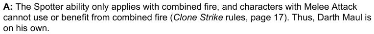
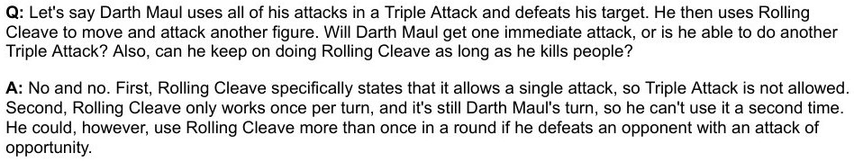
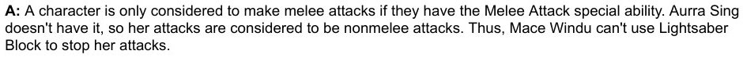
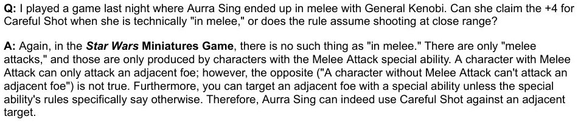
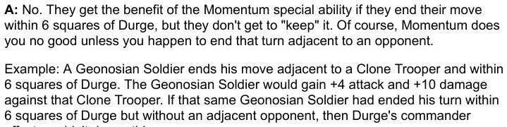
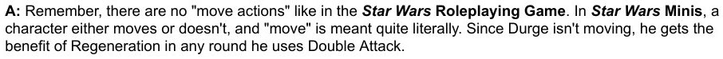
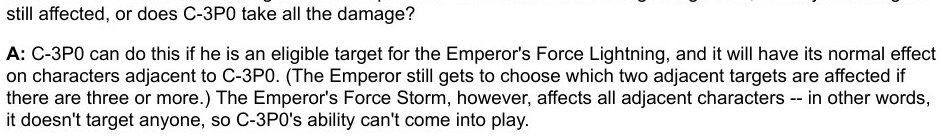
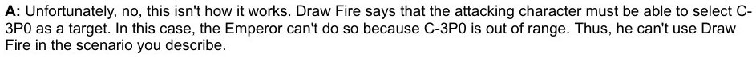

# Owner Material 037 — Star Wars D20 Drive folder (Core, Revised Core and Saga Edition): Jedi Counselling/Jedi Counseling 59.pdf [Star Wars Roleplaying Game Revised Core (d20, 2002)]

- **Source:** Wizards of the Coast Star Wars Roleplaying Game books, web enhancements, Living Force campaign modules and articles (2000–2010), from the owner's "Star Wars D20" Drive folder (only the three edition subfolders; "General" was not read, as instructed). Secondary source (licensed Legends reference). Scan OCR'd on the box; the scan stays box-only and is **not** published.
- **Method:** every scanned page was OCR'd and machine-screened sentence by sentence for power-relevant statements (fights, kills, defeats, Force feats, rankings, superweapons) that name a character on our roster; each kept sentence is quoted verbatim from the OCR text and has a crop of the printed passage directly under it. Pages with nothing power-relevant are still listed with what is on them.
- **Citation:** "*Jedi Counseling 59* (SWRPG d20 Revised Core), p.X" by printed page ("scan p.X" where no printed number applies). **Weight:** Licensed RPG material: a secondary source. Narrative text sums up Legends lore; game statistics are rules for players, not canon power levels, and rank lowest.

## scan p.1 (scan page 1)

Page contents: Marauder corvette, aiming, starship defense, Zeison Sha discblade (hand-read)

## scan p.2 (scan page 2)

Page contents: Discblade stacking, Enhance Senses vs ysalamiri/Vong; Spotter, Maul Rolling Cleave, Aurra Sing, Durge (hand-read)

- **Darth Maul** — entry/section: Darth Maul is on his own (no Spotter combined fire): "A: The Spotter ability only applies with combined fire, and characters with Melee Attack cannot use or benefit from combined fire (Clone Strike rules, page 17). Thus, Darth Maul is on his own." Source: *Jedi Counseling 59* (SWRPG d20 Revised Core), scan p.2
  
- **Darth Maul** — entry/section: Darth Maul's Triple Attack and Rolling Cleave: "Q: Let's say Darth Maul uses all of his attacks in a Triple Attack and defeats his target. He then uses Rolling Cleave to move and attack another figure. Will Darth Maul get one immediate attack, or is he able to do another Triple Attack? Also, can he keep on doing Rolling Cleave as long as he kills people?
A: No and no. First, Rolling Cleave specifically states that it allows a single attack, so Triple Attack is not allowed. Second, Rolling Cleave only works once per turn, and it's still Darth Maul's turn, so he can't use it a second time. He could, however, use Rolling Cleave more than once in a round if he defeats an opponent with an attack of opportunity." Source: *Jedi Counseling 59* (SWRPG d20 Revised Core), scan p.2
  
- **Aurra Sing; Mace Windu** — entry/section: Aurra Sing's lightsaber attacks aren't melee: "A: A character is only considered to make melee attacks if they have the Melee Attack special ability. Aurra Sing doesn't have it, so her attacks are considered to be nonmelee attacks. Thus, Mace Windu can't use Lightsaber Block to stop her attacks." Source: *Jedi Counseling 59* (SWRPG d20 Revised Core), scan p.2
  
- **Aurra Sing; Obi-Wan Kenobi** — entry/section: Aurra Sing's Careful Shot against an adjacent General Kenobi: "Q: I played a game last night where Aurra Sing ended up in melee with General Kenobi. Can she claim the +4 for Careful Shot when she is technically "in melee," or does the rule assume shooting at close range?
A: Again, in the Star Wars Miniatures Game, there is no such thing as "in melee." There are only "melee attacks," and those are only produced by characters with the Melee Attack special ability. A character with Melee Attack can only attack an adjacent foe; however, the opposite ("A character without Melee Attack can't attack an adjacent foe") is not true. Furthermore, you can target an adjacent foe with a special ability unless the special ability's rules specifically say otherwise. Therefore, Aurra Sing can indeed use Careful Shot against an adjacent target." Source: *Jedi Counseling 59* (SWRPG d20 Revised Core), scan p.2
  

## scan p.3 (scan page 3)

Page contents: Durge Momentum/Regeneration, C-3PO Draw Fire vs Emperor; author bio (hand-read)

- **Durge** — entry/section: Durge's commander effect Momentum isn't kept: "A: No. They get the benefit of the Momentum special ability if they end their move within 6 squares of Durge, but they don't get to "keep" it. Of course, Momentum does you no good unless you happen to end that turn adjacent to an opponent." Source: *Jedi Counseling 59* (SWRPG d20 Revised Core), scan p.3
  
- **Durge** — entry/section: Durge regenerates while using Double Attack: "A: Remember, there are no "move actions" like in the Star Wars Roleplaying Game. In Star Wars Minis, a character either moves or doesn't, and "move" is meant quite literally. Since Durge isn't moving, he gets the benefit of Regeneration in any round he uses Double Attack." Source: *Jedi Counseling 59* (SWRPG d20 Revised Core), scan p.3
  
- **C-3PO; Palpatine (Darth Sidious)** — entry/section: C-3PO's Draw Fire vs the Emperor's Force Lightning and Force Storm: "A: C-3P0 can do this if he is an eligible target for the Emperor's Force Lightning, and it will have its normal effect on characters adjacent to C-3P0. (The Emperor still gets to choose which two adjacent targets are affected if there are three or more.) The Emperor's Force Storm, however, affects all adjacent characters -- in other words, it doesn't target anyone, so C-3P0's ability can't come into play." Source: *Jedi Counseling 59* (SWRPG d20 Revised Core), scan p.3
  
- **C-3PO; Palpatine (Darth Sidious); Luke Skywalker** — entry/section: C-3PO out of the Emperor's range can't Draw Fire: "A: Unfortunately, no, this isn't how it works. Draw Fire says that the attacking character must be able to select C- 3P0 as a target. In this case, the Emperor can't do so because C-3P0 is out of range. Thus, he can't use Draw Fire in the scenario you describe." Source: *Jedi Counseling 59* (SWRPG d20 Revised Core), scan p.3
  
