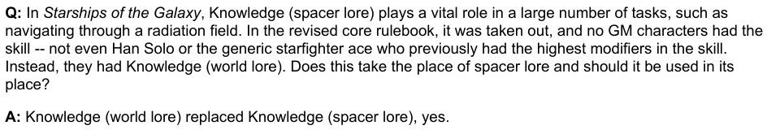

# Owner Material 037 — Star Wars D20 Drive folder (Core, Revised Core and Saga Edition): Jedi Counselling/Jedi Counseling 6 - Shipbuilding.pdf [Star Wars Roleplaying Game Revised Core (d20, 2002)]

- **Source:** Wizards of the Coast Star Wars Roleplaying Game books, web enhancements, Living Force campaign modules and articles (2000–2010), from the owner's "Star Wars D20" Drive folder (only the three edition subfolders; "General" was not read, as instructed). Secondary source (licensed Legends reference). Scan OCR'd on the box; the scan stays box-only and is **not** published.
- **Method:** every scanned page was OCR'd and machine-screened sentence by sentence for power-relevant statements (fights, kills, defeats, Force feats, rankings, superweapons) that name a character on our roster; each kept sentence is quoted verbatim from the OCR text and has a crop of the printed passage directly under it. Pages with nothing power-relevant are still listed with what is on them.
- **Citation:** "*Jedi Counseling 6 - Shipbuilding* (SWRPG d20 Revised Core), p.X" by printed page ("scan p.X" where no printed number applies). **Weight:** Licensed RPG material: a secondary source. Narrative text sums up Legends lore; game statistics are rules for players, not canon power levels, and rank lowest.

## scan p.1 (scan page 1)

Page contents: Deflect progression, Craft starships, upgrade costs, world lore, AAT weapons (hand-read)

- **Han Solo** — entry/section: Knowledge (world lore) replaced spacer lore, even for Han Solo: "Q: In Starships of the Galaxy, Knowledge (spacer lore) plays a vital role in a large number of tasks, such as navigating through a radiation field. In the revised core rulebook, it was taken out, and no GM characters had the skill -- not even Han Solo or the generic starfighter ace who previously had the highest modifiers in the skill. Instead, they had Knowledge (world lore). Does this take the place of spacer lore and should it be used in its place?
A: Knowledge (world lore) replaced Knowledge (spacer lore), yes." Source: *Jedi Counseling 6 - Shipbuilding* (SWRPG d20 Revised Core), scan p.1
  

## scan p.2 (scan page 2)

Page contents: AAT weapon stats, lowering Defense, voluntary wound damage (hand-read)

