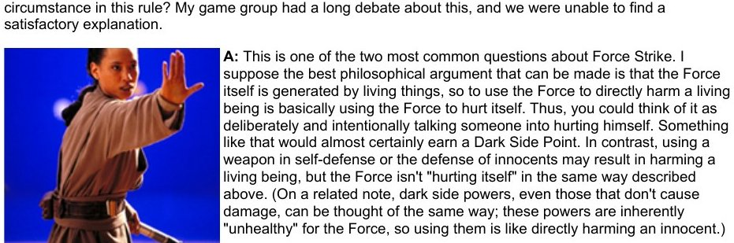
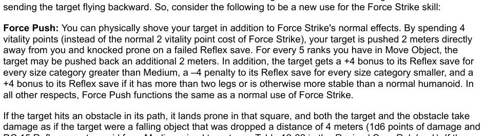
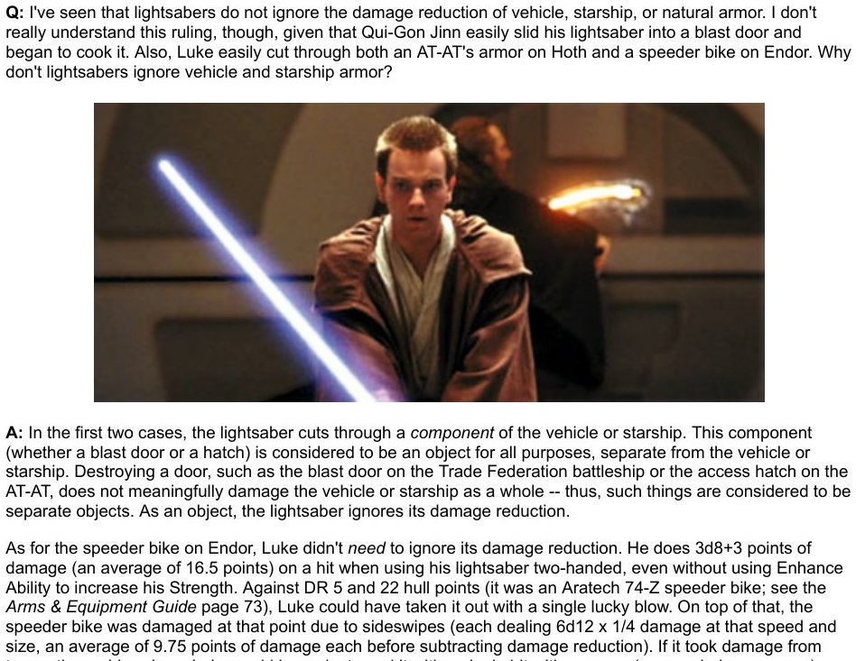
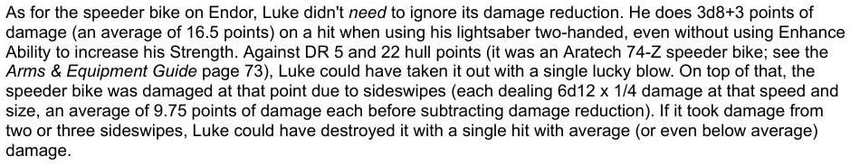
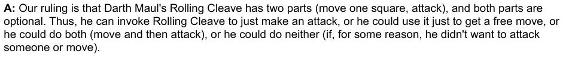
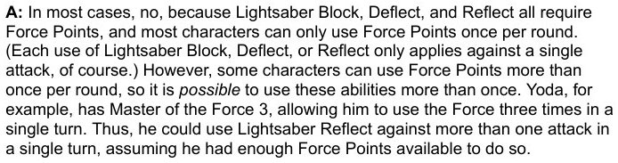
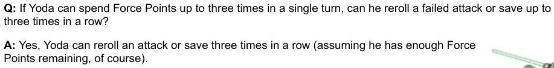
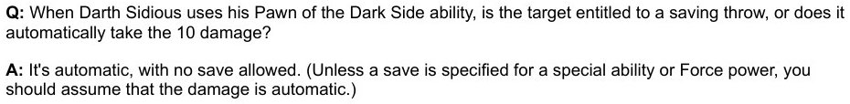

# Owner Material 037 — Star Wars D20 Drive folder (Core, Revised Core and Saga Edition): Jedi Counselling/Jedi Counseling 60.pdf [Star Wars Roleplaying Game Revised Core (d20, 2002)]

- **Source:** Wizards of the Coast Star Wars Roleplaying Game books, web enhancements, Living Force campaign modules and articles (2000–2010), from the owner's "Star Wars D20" Drive folder (only the three edition subfolders; "General" was not read, as instructed). Secondary source (licensed Legends reference). Scan OCR'd on the box; the scan stays box-only and is **not** published.
- **Method:** every scanned page was OCR'd and machine-screened sentence by sentence for power-relevant statements (fights, kills, defeats, Force feats, rankings, superweapons) that name a character on our roster; each kept sentence is quoted verbatim from the OCR text and has a crop of the printed passage directly under it. Pages with nothing power-relevant are still listed with what is on them.
- **Citation:** "*Jedi Counseling 60* (SWRPG d20 Revised Core), p.X" by printed page ("scan p.X" where no printed number applies). **Weight:** Licensed RPG material: a secondary source. Narrative text sums up Legends lore; game statistics are rules for players, not canon power levels, and rank lowest.

## scan p.1 (scan page 1)

Page contents: Force Strike morality, Force Push variant (hand-read)

- **No single roster character (rules/setting/general)** — entry/section: Why Force Strike earns a Dark Side Point: "A: This is one of the two most common questions about Force Strike. I suppose the best philosophical argument that can be made is that the Force itself is generated by living things, so to use the Force to directly harm a living being is basically using the Force to hurt itself. Thus, you could think of it as deliberately and intentionally talking someone into hurting himself. Something like that would almost certainly earn a Dark Side Point. In contrast, using a weapon in self-defense or the defense of innocents may result in harming a living being, but the Force isn't "hurting itself" in the same way described above. (On a related note, dark side powers, even those that don't cause damage, can be thought of the same way; these powers are inherently "unhealthy" for the Force, so using them is like directly harming an innocent.)" Source: *Jedi Counseling 60* (SWRPG d20 Revised Core), scan p.1
  
- **No single roster character (rules/setting/general)** — entry/section: Force Push (new use of Force Strike): "Force Push: You can physically shove your target in addition to Force Strike's normal effects. By spending 4 vitality points (instead of the normal 2 vitality point cost of Force Strike), your target is pushed 2 meters directly away from you and knocked prone on a failed Reflex save. For every 5 ranks you have in Move Object, the target may be pushed back an additional 2 meters. In addition, the target gets a +4 bonus to its Reflex save for every size category greater than Medium, a —4 penalty to its Reflex save for every size category smaller, and a +4 bonus to its Reflex save if it has more than two legs or is otherwise more stable than a normal humanoid. In all other respects, Force Push functions the same as a normal use of Force Strike." Source: *Jedi Counseling 60* (SWRPG d20 Revised Core), scan p.1
  

## scan p.2 (scan page 2)

Page contents: Grenade Defense errata, lightsabers vs vehicle DR (Qui-Gon, Luke); Maul Rolling Cleave, Sith Lightning (hand-read)

- **Qui-Gon Jinn; Luke Skywalker** — entry/section: Lightsabers vs vehicle DR: Qui-Gon's blast door and Luke's AT-AT: "Q: I've seen that lightsabers do not ignore the damage reduction of vehicle, starship, or natural armor. I don't really understand this ruling, though, given that Qui-Gon Jinn easily slid his lightsaber into a blast door and began to cook it. Also, Luke easily cut through both an AT-AT's armor on Hoth and a speeder bike on Endor. Why don't lightsabers ignore vehicle and starship armor?
A: In the first two cases, the lightsaber cuts through a component of the vehicle or starship. This component (whether a blast door or a hatch) is considered to be an object for all purposes, separate from the vehicle or starship. Destroying a door, such as the blast door on the Trade Federation battleship or the access hatch on the AT-AT, does not meaningfully damage the vehicle or starship as a whole -- thus, such things are considered to be separate objects. As an object, the lightsaber ignores its damage reduction." Source: *Jedi Counseling 60* (SWRPG d20 Revised Core), scan p.2
  
- **Luke Skywalker** — entry/section: Luke vs the speeder bike on Endor: "As for the speeder bike on Endor, Luke didn't need to ignore its damage reduction. He does 3d8+3 points of damage (an average of 16.5 points) on a hit when using his lightsaber two-handed, even without using Enhance Ability to increase his Strength. Against DR 5 and 22 hull points (it was an Aratech 74-Z speeder bike; see the Arms & Equipment Guide page 73), Luke could have taken it out with a single lucky blow. On top of that, the speeder bike was damaged at that point due to sideswipes (each dealing 6d12 x 1/4 damage at that speed and size, an average of 9.75 points of damage each before subtracting damage reduction). If it took damage from two or three sideswipes, Luke could have destroyed it with a single hit with average (or even below average) damage." Source: *Jedi Counseling 60* (SWRPG d20 Revised Core), scan p.2
  
- **Darth Maul** — entry/section: Darth Maul's Rolling Cleave parts are optional: "A: Our ruling is that Darth Maul's Rolling Cleave has two parts (move one square, attack), and both parts are optional. Thus, he can invoke Rolling Cleave to just make an attack, or he could use it just to get a free move, or he could do both (move and then attack), or he could do neither (if, for some reason, he didn't want to attack someone or move)." Source: *Jedi Counseling 60* (SWRPG d20 Revised Core), scan p.2
  

## scan p.3 (scan page 3)

Page contents: Yoda multiple Force uses, Riposte, Sidious Pawn, combined fire, Imperial Officers (hand-read)

- **Yoda** — entry/section: Yoda's Master of the Force 3 and multiple Lightsaber Reflects: "A: In most cases, no, because Lightsaber Block, Deflect, and Reflect all require Force Points, and most characters can only use Force Points once per round. (Each use of Lightsaber Block, Deflect, or Reflect only applies against a single attack, of course.) However, some characters can use Force Points more than once per round, so it is possible to use these abilities more than once. Yoda, for example, has Master of the Force 3, allowing him to use the Force three times in a single turn. Thus, he could use Lightsaber Reflect against more than one attack in a single turn, assuming he had enough Force Points available to do so." Source: *Jedi Counseling 60* (SWRPG d20 Revised Core), scan p.3
  
- **Yoda** — entry/section: Yoda can reroll three times in a row: "Q: If Yoda can spend Force Points up to three times in a single turn, can he reroll a failed attack or save up to three times in a row?
A: Yes, Yoda can reroll an attack or save three times in a row (assuming he has enough Force Points remaining, of course)." Source: *Jedi Counseling 60* (SWRPG d20 Revised Core), scan p.3
  
- **Palpatine (Darth Sidious)** — entry/section: Darth Sidious's Pawn of the Dark Side is automatic: "Q: When Darth Sidious uses his Pawn of the Dark Side ability, is the target entitled to a saving throw, or does it automatically take the 10 damage?
A: It's automatic, with no save allowed. (Unless a save is specified for a special ability or Force power, you should assume that the damage is automatic.)" Source: *Jedi Counseling 60* (SWRPG d20 Revised Core), scan p.3
  

## scan p.4 (scan page 4)

Page contents: Heavy Stormtrooper squad vulnerabilities; author bio (hand-read)

