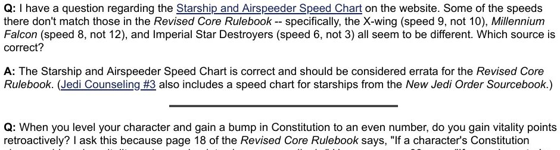
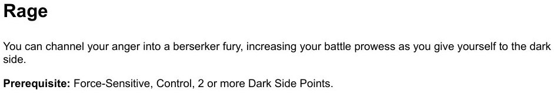
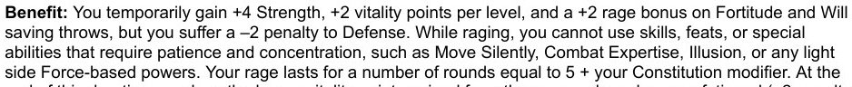
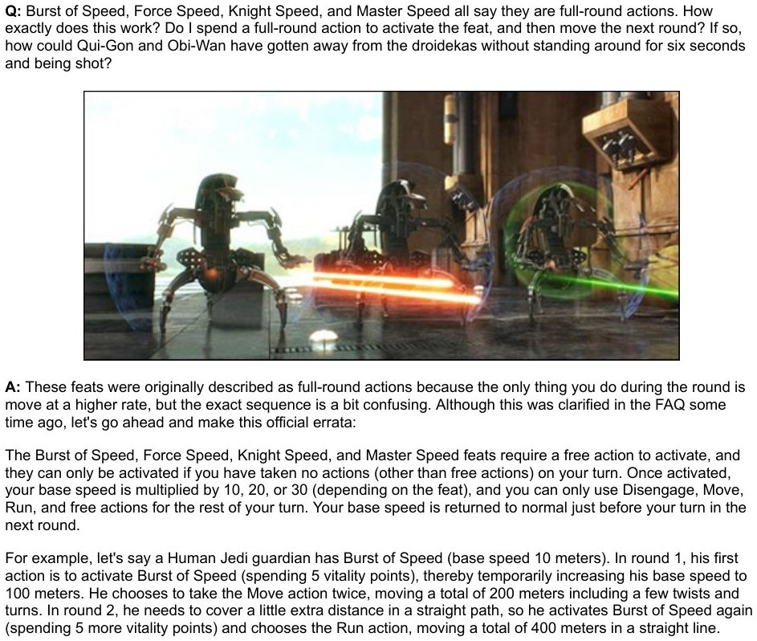
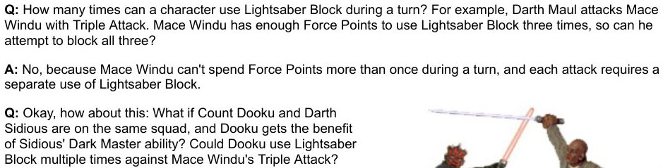
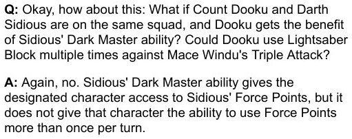
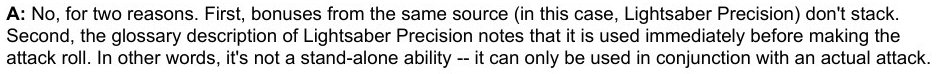
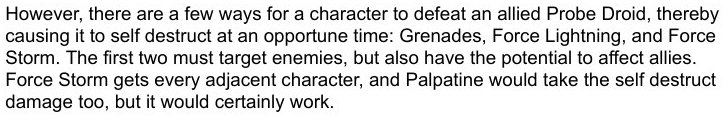

# Owner Material 037 — Star Wars D20 Drive folder (Core, Revised Core and Saga Edition): Jedi Counselling/Jedi Counseling 61.pdf [Star Wars Roleplaying Game Revised Core (d20, 2002)]

- **Source:** Wizards of the Coast Star Wars Roleplaying Game books, web enhancements, Living Force campaign modules and articles (2000–2010), from the owner's "Star Wars D20" Drive folder (only the three edition subfolders; "General" was not read, as instructed). Secondary source (licensed Legends reference). Scan OCR'd on the box; the scan stays box-only and is **not** published.
- **Method:** every scanned page was OCR'd and machine-screened sentence by sentence for power-relevant statements (fights, kills, defeats, Force feats, rankings, superweapons) that name a character on our roster; each kept sentence is quoted verbatim from the OCR text and has a crop of the printed passage directly under it. Pages with nothing power-relevant are still listed with what is on them.
- **Citation:** "*Jedi Counseling 61* (SWRPG d20 Revised Core), p.X" by printed page ("scan p.X" where no printed number applies). **Weight:** Licensed RPG material: a secondary source. Narrative text sums up Legends lore; game statistics are rules for players, not canon power levels, and rank lowest.

## scan p.1 (scan page 1)

Page contents: Speed chart errata, Constitution errata, EWP prerequisite, Rage feat (hand-read)

- **Han Solo** — entry/section: Millennium Falcon speed errata: "Q: I have a question regarding the Starship and Airspeeder Speed Chart on the website. Some of the speeds there don't match those in the Revised Core Rulebook -- specifically, the X-wing (speed 9, not 10), Millennium Falcon (speed 8, not 12), and Imperial Star Destroyers (speed 6, not 3) all seem to be different. Which source is correct?
A: The Starship and Airspeeder Speed Chart is correct and should be considered errata for the Revised Core Rulebook." Source: *Jedi Counseling 61* (SWRPG d20 Revised Core), scan p.1
  
- **No single roster character (rules/setting/general)** — entry/section: Rage feat (revised): "Rage
You can channel your anger into a berserker fury, increasing your battle prowess as you give yourself to the dark side.
Prerequisite: Force-Sensitive, Control, 2 or more Dark Side Points." Source: *Jedi Counseling 61* (SWRPG d20 Revised Core), scan p.1
  

## scan p.2 (scan page 2)

Page contents: Rage feat text, rage while fatigued, speed feats errata (Qui-Gon/Obi-Wan), movement skills errata (hand-read)

- **No single roster character (rules/setting/general)** — entry/section: Rage feat benefit (revised): "Benefit: You temporarily gain +4 Strength, +2 vitality points per level, and a +2 rage bonus on Fortitude and Will saving throws, but you suffer a —2 penalty to Defense. While raging, you cannot use skills, feats, or special abilities that require patience and concentration, such as Move Silently, Combat Expertise, Illusion, or any light side Force-based powers. Your rage lasts for a number of rounds equal to 5 + your Constitution modifier. At the end of this duration, you lose the bonus vitality points gained from the rage and you become fatigued (—2 penalty to effective Strength and Dexterity, can't run or charge) for a number of rounds equal to the rage's duration.
The benefits granted by this feat are not cumulative with the benefits granted by Wookiee rage. Using this feat does not cost vitality points. Activating this ability grants a Dark Side Point; maintaining it does not. (You may, however, gain additional Dark Side Points for evil actions you perform while using Rage.)" Source: *Jedi Counseling 61* (SWRPG d20 Revised Core), scan p.2
  
- **Qui-Gon Jinn; Obi-Wan Kenobi** — entry/section: Speed feats and Qui-Gon and Obi-Wan escaping the droidekas: "Q: Burst of Speed, Force Speed, Knight Speed, and Master Speed all say they are full-round actions. How exactly does this work? Do I spend a full-round action to activate the feat, and then move the next round? If so, how could Qui-Gon and Obi-Wan have gotten away from the droidekas without standing around for six seconds and being shot?
A: These feats were originally described as full-round actions because the only thing you do during the round is move at a higher rate, but the exact sequence is a bit confusing. Although this was clarified in the FAQ some time ago, let's go ahead and make this official errata:
The Burst of Speed, Force Speed, Knight Speed, and Master Speed feats require a free action to activate, and they can only be activated if you have taken no actions (other than free actions) on your turn. Once activated, your base speed is multiplied by 10, 20, or 30 (depending on the feat), and you can only use Disengage, Move, Run, and free actions for the rest of your turn. Your base speed is returned to normal just before your turn in the next round." Source: *Jedi Counseling 61* (SWRPG d20 Revised Core), scan p.2
  

## scan p.3 (scan page 3)

Page contents: Galloping Attack, Lightsaber Block limits (Mace, Maul, Dooku, Sidious), Lightsaber Precision, speeder bike tiles (hand-read)

- **Mace Windu; Darth Maul** — entry/section: Mace Windu can't block all three of Maul's Triple Attack: "Q: How many times can a character use Lightsaber Block during a turn? For example, Darth Maul attacks Mace Windu with Triple Attack. Mace Windu has enough Force Points to use Lightsaber Block three times, so can he attempt to block all three?
A: No, because Mace Windu can't spend Force Points more than once during a turn, and each attack requires a separate use of Lightsaber Block." Source: *Jedi Counseling 61* (SWRPG d20 Revised Core), scan p.3
  
- **Count Dooku; Palpatine (Darth Sidious); Mace Windu** — entry/section: Dooku with Sidious' Dark Master still blocks only once: "Q: Okay, how about this: What if Count Dooku and Darth Sidious are on the same squad, and Dooku gets the benefit of Sidious' Dark Master ability? Could Dooku use Lightsaber Block multiple times against Mace Windu's Triple Attack?
A: Again, no. Sidious' Dark Master ability gives the designated character access to Sidious' Force Points, but it does not give that character the ability to use Force Points more than once per turn." Source: *Jedi Counseling 61* (SWRPG d20 Revised Core), scan p.3
  
- **Darth Vader (Anakin Skywalker); Plo Koon** — entry/section: Anakin's Lightsaber Precision doesn't stack: "A: No, for two reasons. First, bonuses from the same source (in this case, Lightsaber Precision) don't stack. Second, the glossary description of Lightsaber Precision notes that it is used immediately before making the attack roll. In other words, it's not a stand-alone ability -- it can only be used in conjunction with an actual attack." Source: *Jedi Counseling 61* (SWRPG d20 Revised Core), scan p.3
  

## scan p.4 (scan page 4)

Page contents: Speeder bikes, Probe Droid self destruct; author bio (hand-read)

- **Palpatine (Darth Sidious)** — entry/section: Palpatine's Force Storm to trigger an allied Probe Droid: "However, there are a few ways for a character to defeat an allied Probe Droid, thereby causing it to self destruct at an opportune time: Grenades, Force Lightning, and Force Storm. The first two must target enemies, but also have the potential to affect allies. Force Storm gets every adjacent character, and Palpatine would take the self destruct damage too, but it would certainly work." Source: *Jedi Counseling 61* (SWRPG d20 Revised Core), scan p.4
  
