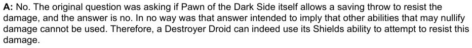
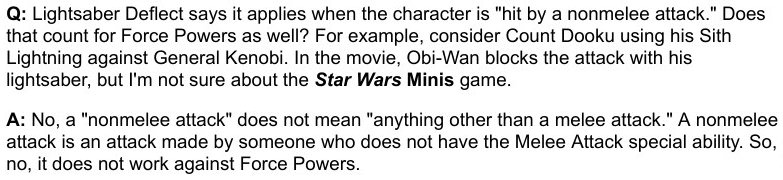
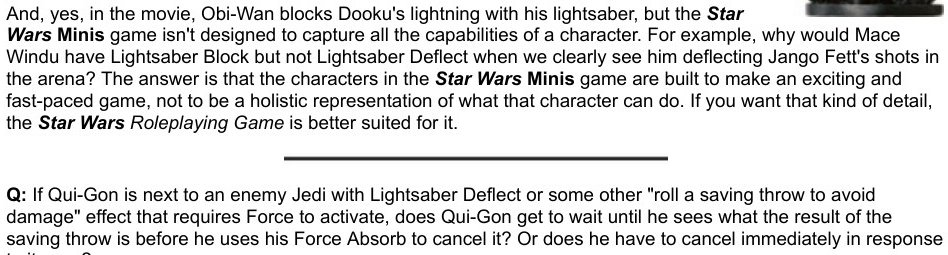
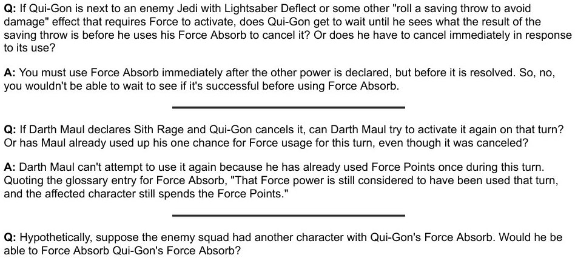
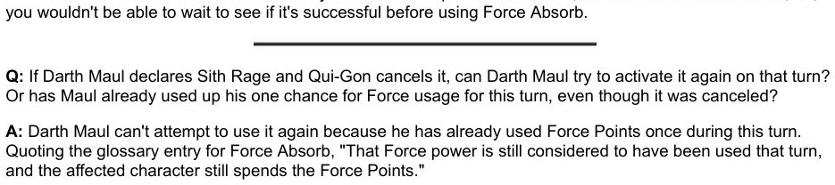
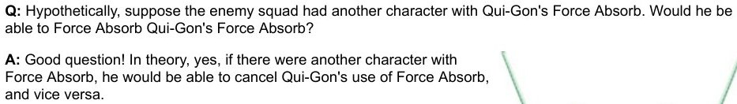
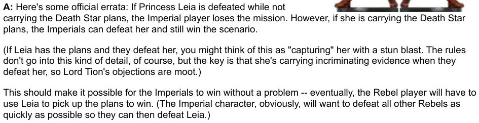
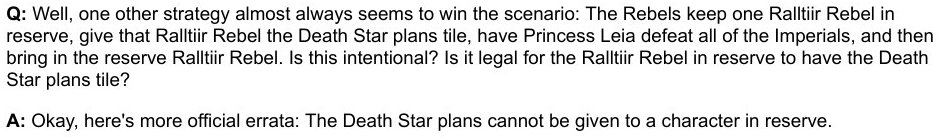

# Owner Material 037 — Star Wars D20 Drive folder (Core, Revised Core and Saga Edition): Jedi Counselling/Jedi Counseling 62.pdf [Star Wars Roleplaying Game Revised Core (d20, 2002)]

- **Source:** Wizards of the Coast Star Wars Roleplaying Game books, web enhancements, Living Force campaign modules and articles (2000–2010), from the owner's "Star Wars D20" Drive folder (only the three edition subfolders; "General" was not read, as instructed). Secondary source (licensed Legends reference). Scan OCR'd on the box; the scan stays box-only and is **not** published.
- **Method:** every scanned page was OCR'd and machine-screened sentence by sentence for power-relevant statements (fights, kills, defeats, Force feats, rankings, superweapons) that name a character on our roster; each kept sentence is quoted verbatim from the OCR text and has a crop of the printed passage directly under it. Pages with nothing power-relevant are still listed with what is on them.
- **Citation:** "*Jedi Counseling 62* (SWRPG d20 Revised Core), p.X" by printed page ("scan p.X" where no printed number applies). **Weight:** Licensed RPG material: a secondary source. Narrative text sums up Legends lore; game statistics are rules for players, not canon power levels, and rank lowest.

## scan p.1 (scan page 1)

Page contents: Vehicle speed errata, Air-2 swoop, V-wing range, atmosphere ranges (hand-read)

## scan p.2 (scan page 2)

Page contents: Atmosphere ranges, missile lock rules, nonheroic Force-Sensitive vitality; Pawn vs Shields (hand-read)

- **Palpatine (Darth Sidious)** — entry/section: A Destroyer Droid's Shields vs Sidious' Pawn of the Dark Side: "A: No. The original question was asking if Pawn of the Dark Side itself allows a saving throw to resist the damage, and the answer is no. In no way was that answer intended to imply that other abilities that may nullify damage cannot be used. Therefore, a Destroyer Droid can indeed use its Shields ability to attempt to resist this damage." Source: *Jedi Counseling 62* (SWRPG d20 Revised Core), scan p.2
  

## scan p.3 (scan page 3)

Page contents: Deflect vs Force powers (Dooku/Kenobi/Mace/Jango), Qui-Gon Force Absorb vs Maul, Rescue at Ralltiir errata (Leia/Tion) (hand-read)

- **Count Dooku; Obi-Wan Kenobi** — entry/section: Lightsaber Deflect vs Dooku's Sith Lightning: "Q: Lightsaber Deflect says it applies when the character is "hit by a nonmelee attack." Does that count for Force Powers as well? For example, consider Count Dooku using his Sith Lightning against General Kenobi. In the movie, Obi-Wan blocks the attack with his lightsaber, but I'm not sure about the Star Wars Minis game.
A: No, a "nonmelee attack" does not mean "anything other than a melee attack." A nonmelee attack is an attack made by someone who does not have the Melee Attack special ability. So, no, it does not work against Force Powers." Source: *Jedi Counseling 62* (SWRPG d20 Revised Core), scan p.3
  
- **Obi-Wan Kenobi; Count Dooku; Mace Windu; Jango Fett** — entry/section: Minis characters aren't holistic (Mace Windu vs Jango Fett): "And, yes, in the movie, Obi-Wan blocks Dooku's lightning with his lightsaber, but the Star Wars Minis game isn't designed to capture all the capabilities of a character. For example, why would Mace Windu have Lightsaber Block but not Lightsaber Deflect when we clearly see him deflecting Jango Fett's shots in the arena? The answer is that the characters in the Star Wars Minis game are built to make an exciting and fast-paced game, not to be a holistic representation of what that character can do. If you want that kind of detail, the Star Wars Roleplaying Game is better suited for it." Source: *Jedi Counseling 62* (SWRPG d20 Revised Core), scan p.3
  
- **Qui-Gon Jinn** — entry/section: Qui-Gon's Force Absorb timing: "Q: If Qui-Gon is next to an enemy Jedi with Lightsaber Deflect or some other "roll a saving throw to avoid damage" effect that requires Force to activate, does Qui-Gon get to wait until he sees what the result of the saving throw is before he uses his Force Absorb to cancel it? Or does he have to cancel immediately in response to its use?
A: You must use Force Absorb immediately after the other power is declared, but before it is resolved. So, no, you wouldn't be able to wait to see if it's successful before using Force Absorb." Source: *Jedi Counseling 62* (SWRPG d20 Revised Core), scan p.3
  
- **Darth Maul; Qui-Gon Jinn** — entry/section: Qui-Gon cancels Darth Maul's Sith Rage: "Q: If Darth Maul declares Sith Rage and Qui-Gon cancels it, can Darth Maul try to activate it again on that turn? Or has Maul already used up his one chance for Force usage for this turn, even though it was canceled?
A: Darth Maul can't attempt to use it again because he has already used Force Points once during this turn. Quoting the glossary entry for Force Absorb, "That Force power is still considered to have been used that turn, and the affected character still spends the Force Points."" Source: *Jedi Counseling 62* (SWRPG d20 Revised Core), scan p.3
  
- **Qui-Gon Jinn** — entry/section: Force Absorb Qui-Gon's Force Absorb: "Q: Hypothetically, suppose the enemy squad had another character with Qui-Gon's Force Absorb. Would he be able to Force Absorb Qui-Gon's Force Absorb?
A: Good question! In theory, yes, if there were another character with Force Absorb, he would be able to cancel Qui-Gon's use of Force Absorb, and vice versa." Source: *Jedi Counseling 62* (SWRPG d20 Revised Core), scan p.3
  
- **Leia Organa Solo; Lord Tion** — entry/section: Rescue at Ralltiir errata: defeating Leia with the Death Star plans: "A: Here's some official errata: If Princess Leia is defeated while not carrying the Death Star plans, the Imperial player loses the mission. However, if she is carrying the Death Star plans, the Imperials can defeat her and still win the scenario.
(If Leia has the plans and they defeat her, you might think of this as "capturing" her with a stun blast. The rules don't go into this kind of detail, of course, but the key is that she's carrying incriminating evidence when they defeat her, so Lord Tion's objections are moot.)
This should make it possible for the Imperials to win without a problem -- eventually, the Rebel player will have to use Leia to pick up the plans to win. (The Imperial character, obviously, will want to defeat all other Rebels as quickly as possible so they can then defeat Leia.)" Source: *Jedi Counseling 62* (SWRPG d20 Revised Core), scan p.3
  
- **Leia Organa Solo** — entry/section: Ralltiir reserve-Rebel strategy errata: "Q: Well, one other strategy almost always seems to win the scenario: The Rebels keep one Ralltiir Rebel in reserve, give that Ralltiir Rebel the Death Star plans tile, have Princess Leia defeat all of the Imperials, and then bring in the reserve Ralltiir Rebel. Is this intentional? Is it legal for the Ralltiir Rebel in reserve to have the Death Star plans tile?
A: Okay, here's more official errata: The Death Star plans cannot be given to a character in reserve." Source: *Jedi Counseling 62* (SWRPG d20 Revised Core), scan p.3
  

## scan p.4 (scan page 4)

Page contents: Fringe Reinforcements; author bio (hand-read)

