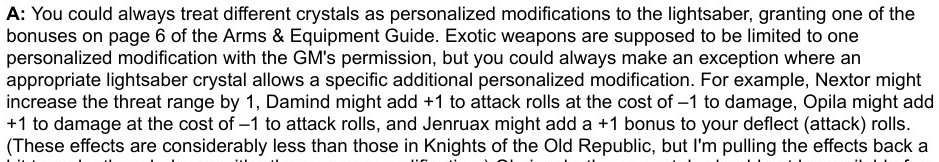
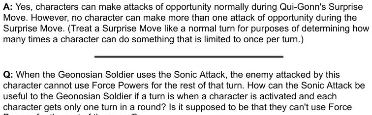
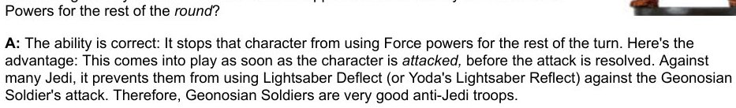
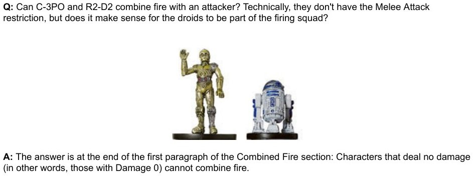
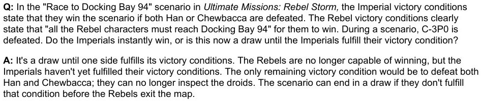

# Owner Material 037 — Star Wars D20 Drive folder (Core, Revised Core and Saga Edition): Jedi Counselling/Jedi Counseling 63.pdf [Star Wars Roleplaying Game Revised Core (d20, 2002)]

- **Source:** Wizards of the Coast Star Wars Roleplaying Game books, web enhancements, Living Force campaign modules and articles (2000–2010), from the owner's "Star Wars D20" Drive folder (only the three edition subfolders; "General" was not read, as instructed). Secondary source (licensed Legends reference). Scan OCR'd on the box; the scan stays box-only and is **not** published.
- **Method:** every scanned page was OCR'd and machine-screened sentence by sentence for power-relevant statements (fights, kills, defeats, Force feats, rankings, superweapons) that name a character on our roster; each kept sentence is quoted verbatim from the OCR text and has a crop of the printed passage directly under it. Pages with nothing power-relevant are still listed with what is on them.
- **Citation:** "*Jedi Counseling 63* (SWRPG d20 Revised Core), p.X" by printed page ("scan p.X" where no printed number applies). **Weight:** Licensed RPG material: a secondary source. Narrative text sums up Legends lore; game statistics are rules for players, not canon power levels, and rank lowest.

## scan p.1 (scan page 1)

Page contents: Rage and martial arts/skills, spice Telepathy, KOTOR crystals, dropping grenades (hand-read)

- **No single roster character (rules/setting/general)** — entry/section: KOTOR lightsaber crystals as personalized modifications: "A: You could always treat different crystals as personalized modifications to the lightsaber, granting one of the bonuses on page 6 of the Arms & Equipment Guide. Exotic weapons are supposed to be limited to one personalized modification with the GM's permission, but you could always make an exception where an appropriate lightsaber crystal allows a specific additional personalized modification. For example, Nextor might increase the threat range by 1, Damind might add +1 to attack rolls at the cost of —-1 to damage, Opila might add +1 to damage at the cost of —1 to attack rolls, and Jenruax might add a +1 bonus to your deflect (attack) rolls. (These effects are considerably less than those in Knights of the Old Republic, but I'm pulling the effects back a bit to make them balance with other weapon modification.) Obviously, these crystals should not be available for purchase and should only be available at the GM's discretion." Source: *Jedi Counseling 63* (SWRPG d20 Revised Core), scan p.1
  

## scan p.2 (scan page 2)

Page contents: Dropped object rules, variant scatter; Qui-Gon Surprise Move, Geonosian Sonic Attack, Stormtrooper Officer (hand-read)

- **Qui-Gon Jinn** — entry/section: Qui-Gon's Surprise Move provokes AoOs: "A: Yes, characters can make attacks of opportunity normally during Qui-Gonn's Surprise Move. However, no character can make more than one attack of opportunity during the Surprise Move. (Treat a Surprise Move like a normal turn for purposes of determining how many times a character can do something that is limited to once per turn.)" Source: *Jedi Counseling 63* (SWRPG d20 Revised Core), scan p.2
  
- **Yoda** — entry/section: Geonosian Sonic Attack stops Yoda's Lightsaber Reflect: "A: The ability is correct: It stops that character from using Force powers for the rest of the turn. Here's the advantage: This comes into play as soon as the character is attacked, before the attack is resolved. Against many Jedi, it prevents them from using Lightsaber Deflect (or Yoda's Lightsaber Reflect) against the Geonosian Soldier's attack. Therefore, Geonosian Soldiers are very good anti-Jedi troops." Source: *Jedi Counseling 63* (SWRPG d20 Revised Core), scan p.2
  

## scan p.3 (scan page 3)

Page contents: Flight and AoOs, C-3PO/R2-D2 combined fire, Rolling Cleave, Docking Bay 94, commander effects; author bio (hand-read)

- **C-3PO; R2-D2** — entry/section: C-3PO and R2-D2 can't combine fire: "Q: Can C-3PO and R2-D2 combine fire with an attacker? Technically, they don't have the Melee Attack restriction, but does it make sense for the droids to be part of the firing squad?
A: The answer is at the end of the first paragraph of the Combined Fire section: Characters that deal no damage (in other words, those with Damage 0) cannot combine fire." Source: *Jedi Counseling 63* (SWRPG d20 Revised Core), scan p.3
  
- **Han Solo; Chewbacca; C-3PO** — entry/section: Race to Docking Bay 94 draw: "Q: In the "Race to Docking Bay 94" scenario in Ultimate Missions: Rebel Storm, the Imperial victory conditions state that they win the scenario if both Han or Chewbacca are defeated. The Rebel victory conditions clearly state that "all the Rebel characters must reach Docking Bay 94" for them to win. During a scenario, C-3P0 is defeated. Do the Imperials instantly win, or is this now a draw until the Imperials fulfill their victory condition?
A: It's a draw until one side fulfills its victory conditions. The Rebels are no longer capable of winning, but the Imperials haven't yet fulfilled their victory conditions. The only remaining victory condition would be to defeat both Han and Chewbacca; they can no longer inspect the droids. The scenario can end in a draw if they don't fulfill that condition before the Rebels exit the map." Source: *Jedi Counseling 63* (SWRPG d20 Revised Core), scan p.3
  

## scan p.4 (scan page 4)

Page contents: Blank page (horizontal rule only) (hand-read)

