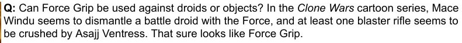
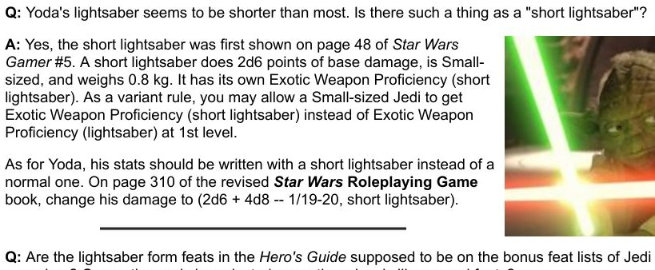
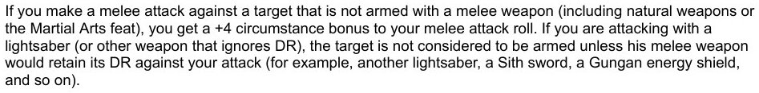
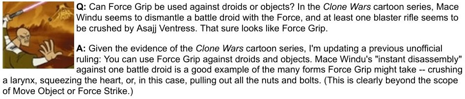
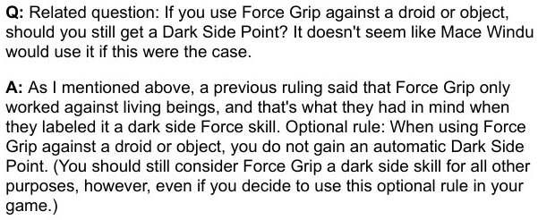
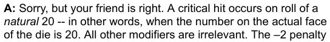
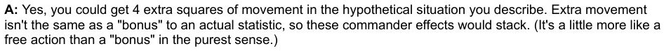
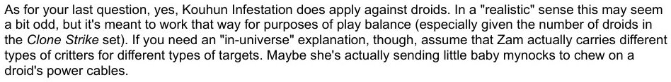
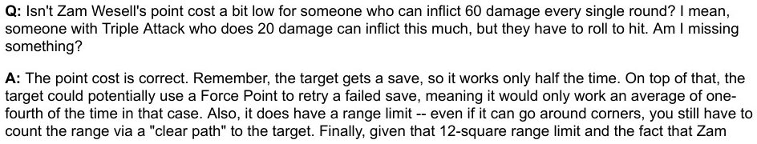

# Owner Material 037 — Star Wars D20 Drive folder (Core, Revised Core and Saga Edition): Jedi Counselling/Jedi Counseling 64.pdf [Star Wars Roleplaying Game Revised Core (d20, 2002)]

- **Source:** Wizards of the Coast Star Wars Roleplaying Game books, web enhancements, Living Force campaign modules and articles (2000–2010), from the owner's "Star Wars D20" Drive folder (only the three edition subfolders; "General" was not read, as instructed). Secondary source (licensed Legends reference). Scan OCR'd on the box; the scan stays box-only and is **not** published.
- **Method:** every scanned page was OCR'd and machine-screened sentence by sentence for power-relevant statements (fights, kills, defeats, Force feats, rankings, superweapons) that name a character on our roster; each kept sentence is quoted verbatim from the OCR text and has a crop of the printed passage directly under it. Pages with nothing power-relevant are still listed with what is on them.
- **Citation:** "*Jedi Counseling 64* (SWRPG d20 Revised Core), p.X" by printed page ("scan p.X" where no printed number applies). **Weight:** Licensed RPG material: a secondary source. Narrative text sums up Legends lore; game statistics are rules for players, not canon power levels, and rank lowest.

## scan p.1 (scan page 1)

Page contents: Short lightsaber and Yoda errata, form feats, lightsaber vs unarmed variant, Force Grip vs droids (hand-read)

- **Asajj Ventress; Mace Windu** — entry/section: Jedi Counseling 64: "In the Clone Wars cartoon series, Mace Windu seems to dismantle a battle droid with the Force, and at least one blaster rifle seems to be crushed by Asajj Ventress." Source: *Jedi Counseling 64* (SWRPG d20 Revised Core), scan p.1
  
- **Yoda** — entry/section: Yoda's short lightsaber errata: "A: Yes, the short lightsaber was first shown on page 48 of Star Wars Gamer #5. A short lightsaber does 2d6 points of base damage, is Smallsized, and weighs 0.8 kg. It has its own Exotic Weapon Proficiency (short lightsaber). As a variant rule, you may allow a Small-sized Jedi to get Exotic Weapon Proficiency (short lightsaber) instead of Exotic Weapon Proficiency (lightsaber) at 1st level.
As for Yoda, his stats should be written with a short lightsaber instead of a normal one. On page 310 of the revised Star Wars Roleplaying Game book, change his damage to (2d6 + 4d8 -- 1/19-20, short lightsaber)." Source: *Jedi Counseling 64* (SWRPG d20 Revised Core), scan p.1
  
- **No single roster character (rules/setting/general)** — entry/section: Optional lightsaber vs unarmed rule (KOTOR): "If you make a melee attack against a target that is not armed with a melee weapon (including natural weapons or the Martial Arts feat), you get a +4 circumstance bonus to your melee attack roll. If you are attacking with a lightsaber (or other weapon that ignores DR), the target is not considered to be armed unless his melee weapon would retain its DR against your attack (for example, another lightsaber, a Sith sword, a Gungan energy shield, and so on)." Source: *Jedi Counseling 64* (SWRPG d20 Revised Core), scan p.1
  
- **Mace Windu; Asajj Ventress** — entry/section: Force Grip vs droids and objects (Mace Windu, Asajj Ventress): "Q: Can Force Grip be used against droids or objects? In the Clone Wars cartoon series, Mace Windu seems to dismantle a battle droid with the Force, and at least one blaster rifle seems to be crushed by Asajj Ventress. That sure looks like Force Grip.
A: Given the evidence of the Clone Wars cartoon series, I'm updating a previous unofficial ruling: You can use Force Grip against droids and objects. Mace Windu's "instant disassembly" against one battle droid is a good example of the many forms Force Grip might take -- crushing a larynx, squeezing the heart, or, in this case, pulling out all the nuts and bolts. (This is clearly beyond the scope of Move Object or Force Strike.)" Source: *Jedi Counseling 64* (SWRPG d20 Revised Core), scan p.1
  

## scan p.2 (scan page 2)

Page contents: Force Grip DSP option, Defense roll variant; Force Push AoO, Kamino natural 20, General Kenobi CE (hand-read)

- **Mace Windu** — entry/section: Force Grip on droids without a Dark Side Point: "Q: Related question: If you use Force Grip against a droid or object, should you still get a Dark Side Point? It doesn't seem like Mace Windu would use it if this were the case.
A: As I mentioned above, a previous ruling said that Force Grip only worked against living beings, and that's what they had in mind when they labeled it a dark side Force skill. Optional rule: When using Force Grip against a droid or object, you do not gain an automatic Dark Side Point. (You should still consider Force Grip a dark side skill for all other purposes, however, even if you decide to use this optional rule in your game.)" Source: *Jedi Counseling 64* (SWRPG d20 Revised Core), scan p.2
  
- **Jango Fett; Obi-Wan Kenobi** — entry/section: Jango's natural 20 in the Kamino rain: "A: Sorry, but your friend is right. A critical hit occurs on roll of a natural 20 -- in other words, when the number on the actual face of the die is 20. All other modifiers are irrelevant. The —2 penalty in that scenario applies to the total roll (to determine if your attack actually hits), but it doesn't change the natural roll. A natural 20 is a critical hit, and a natural 1 is an automatic miss." Source: *Jedi Counseling 64* (SWRPG d20 Revised Core), scan p.2
  

## scan p.3 (scan page 3)

Page contents: Kenobi CE followers (Mace), Leia stacking, Spotter, Kouhun Infestation, Zam cost (hand-read)

- **Leia Organa Solo; Obi-Wan Kenobi** — entry/section: Leia, Senator and General Kenobi movement stacks: "A: Yes, you could get 4 extra squares of movement in the hypothetical situation you describe. Extra movement isn't the same as a "bonus" to an actual statistic, so these commander effects would stack. (It's a little more like a free action than a "bonus" in the purest sense.)" Source: *Jedi Counseling 64* (SWRPG d20 Revised Core), scan p.3
  
- **Zam Wesell** — entry/section: Zam's Kouhun Infestation vs droids: "As for your last question, yes, Kouhun Infestation does apply against droids. In a "realistic" sense this may seem a bit odd, but it's meant to work that way for purposes of play balance (especially given the number of droids in the Clone Strike set). If you need an "in-universe" explanation, though, assume that Zam actually carries different types of critters for different types of targets. Maybe she's actually sending little baby mynocks to chew on a droid's power cables." Source: *Jedi Counseling 64* (SWRPG d20 Revised Core), scan p.3
  
- **Zam Wesell** — entry/section: Zam Wesell's point cost: "Q: Isn't Zam Wesell's point cost a bit low for someone who can inflict 60 damage every single round? I mean, someone with Triple Attack who does 20 damage can inflict this much, but they have to roll to hit. Am I missing something?
A: The point cost is correct. Remember, the target gets a save, so it works only half the time. On top of that, the target could potentially use a Force Point to retry a failed save, meaning it would only work an average of onefourth of the time in that case. Also, it does have a range limit -- even if it can go around corners, you still have to count the range via a "clear path" to the target. Finally, given that 12-square range limit and the fact that Zam Wesell must spend her entire turn to use this ability, she must end her last turn within 12 squares of her intended target. In other words, most characters will get a chance to move out of range before she'll get a chance to use her ability. (The only way you don't get a chance to move away is if she were the last character to be activated in one round and the first character activated in the next round -- a potent strategy, but not always easy to pull off.) Taken together, we feel these limitations make the ability appropriately balanced for her point cost." Source: *Jedi Counseling 64* (SWRPG d20 Revised Core), scan p.3
  

## scan p.4 (scan page 4)

Page contents: Zam Wesell cost balance; author bio (hand-read)

