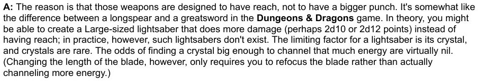
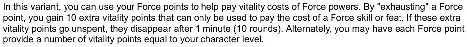
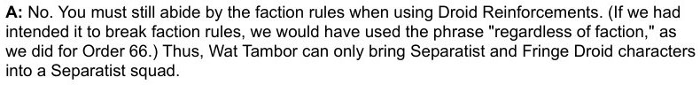
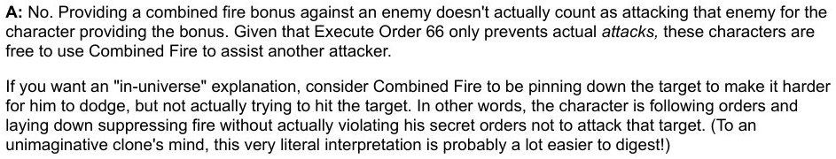

# Owner Material 037 — Star Wars D20 Drive folder (Core, Revised Core and Saga Edition): Jedi Counselling/Jedi Counseling 65.pdf [Star Wars Roleplaying Game Revised Core (d20, 2002)]

- **Source:** Wizards of the Coast Star Wars Roleplaying Game books, web enhancements, Living Force campaign modules and articles (2000–2010), from the owner's "Star Wars D20" Drive folder (only the three edition subfolders; "General" was not read, as instructed). Secondary source (licensed Legends reference). Scan OCR'd on the box; the scan stays box-only and is **not** published.
- **Method:** every scanned page was OCR'd and machine-screened sentence by sentence for power-relevant statements (fights, kills, defeats, Force feats, rankings, superweapons) that name a character on our roster; each kept sentence is quoted verbatim from the OCR text and has a crop of the printed passage directly under it. Pages with nothing power-relevant are still listed with what is on them.
- **Citation:** "*Jedi Counseling 65* (SWRPG d20 Revised Core), p.X" by printed page ("scan p.X" where no printed number applies). **Weight:** Licensed RPG material: a secondary source. Narrative text sums up Legends lore; game statistics are rules for players, not canon power levels, and rank lowest.

## scan p.1 (scan page 1)

Page contents: Double-bladed lightsaber errata, lightsaber crystals, Jedi vs on-screen power (hand-read)

- **No single roster character (rules/setting/general)** — entry/section: Why lightsabers can't be bigger: crystals: "A: The reason is that those weapons are designed to have reach, not to have a bigger punch. It's somewhat like the difference between a longspear and a greatsword in the Dungeons & Dragons game. In theory, you might be able to create a Large-sized lightsaber that does more damage (perhaps 2d10 or 2d12 points) instead of having reach; in practice, however, such lightsabers don't exist. The limiting factor for a lightsaber is its crystal, and crystals are rare. The odds of finding a crystal big enough to channel that much energy are virtually nil. (Changing the length of the blade, however, only requires you to refocus the blade rather than actually channeling more energy.)" Source: *Jedi Counseling 65* (SWRPG d20 Revised Core), scan p.1
  

## scan p.2 (scan page 2)

Page contents: Variant rules Unlearn What You Have Learned, My Ally Is the Force, The Force Is Strong in This One (table start) (hand-read)

- **No single roster character (rules/setting/general)** — entry/section: Variant Rule: My Ally Is the Force: "In this variant, you can use your Force points to help pay vitality costs of Force powers. By "exhausting" a Force point, you gain 10 extra vitality points that can only be used to pay the cost of a Force skill or feat. If these extra vitality points go unspent, they disappear after 1 minute (10 rounds). Alternately, you may have each Force point provide a number of vitality points equal to your character level." Source: *Jedi Counseling 65* (SWRPG d20 Revised Core), scan p.2
  

## scan p.3 (scan page 3)

Page contents: VP cost table (image-read), The Deepest Commitment; Miniatures attack sequence steps 1-9 (hand-read)

## scan p.4 (scan page 4)

Page contents: Attack sequence 10-11, Wat Tambor Droid Reinforcements, Palpatine Execute Order 66, ARC Trooper; author bio (hand-read)

- **Wat Tambor** — entry/section: Wat Tambor's Droid Reinforcements follow faction rules: "A: No. You must still abide by the faction rules when using Droid Reinforcements. (If we had intended it to break faction rules, we would have used the phrase "regardless of faction," as we did for Order 66.) Thus, Wat Tambor can only bring Separatist and Fringe Droid characters into a Separatist squad." Source: *Jedi Counseling 65* (SWRPG d20 Revised Core), scan p.4
  
- **Palpatine (Darth Sidious)** — entry/section: Execute Order 66 vs Combined Fire on Emperor Palpatine, Sith Lord: "A: No. Providing a combined fire bonus against an enemy doesn't actually count as attacking that enemy for the character providing the bonus. Given that Execute Order 66 only prevents actual attacks, these characters are free to use Combined Fire to assist another attacker.
If you want an "in-universe" explanation, consider Combined Fire to be pinning down the target to make it harder for him to dodge, but not actually trying to hit the target. In other words, the character is following orders and laying down suppressing fire without actually violating his secret orders not to attack that target. (To an unimaginative clone's mind, this very literal interpretation is probably a lot easier to digest!)" Source: *Jedi Counseling 65* (SWRPG d20 Revised Core), scan p.4
  
