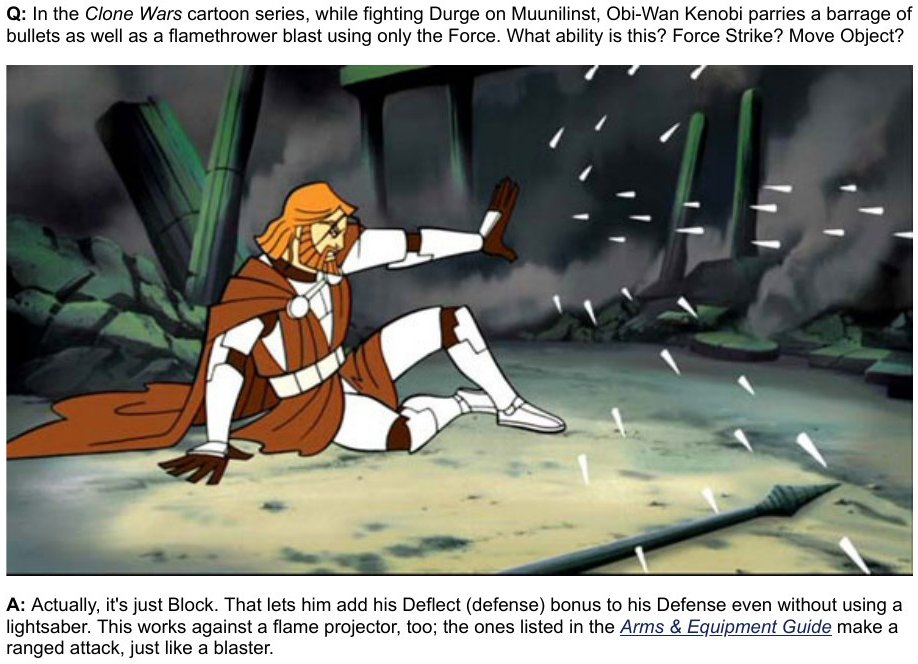
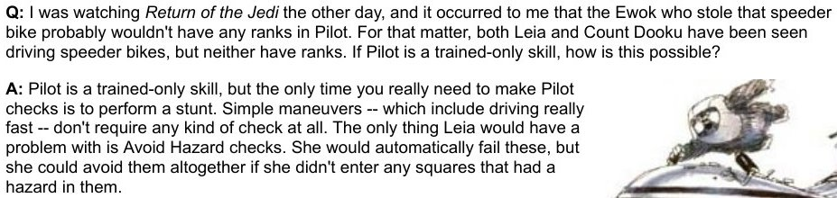
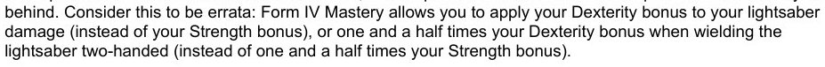
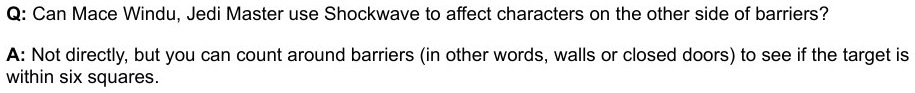
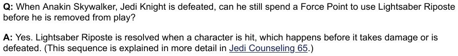
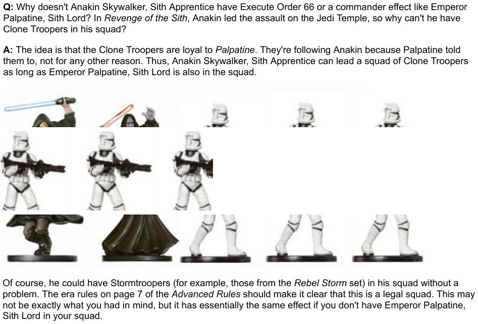
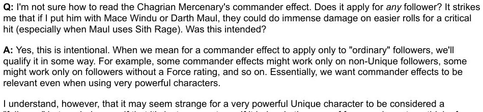

# Owner Material 037 — Star Wars D20 Drive folder (Core, Revised Core and Saga Edition): Jedi Counselling/Jedi Counseling 66.pdf [Star Wars Roleplaying Game Revised Core (d20, 2002)]

- **Source:** Wizards of the Coast Star Wars Roleplaying Game books, web enhancements, Living Force campaign modules and articles (2000–2010), from the owner's "Star Wars D20" Drive folder (only the three edition subfolders; "General" was not read, as instructed). Secondary source (licensed Legends reference). Scan OCR'd on the box; the scan stays box-only and is **not** published.
- **Method:** every scanned page was OCR'd and machine-screened sentence by sentence for power-relevant statements (fights, kills, defeats, Force feats, rankings, superweapons) that name a character on our roster; each kept sentence is quoted verbatim from the OCR text and has a crop of the printed passage directly under it. Pages with nothing power-relevant are still listed with what is on them.
- **Citation:** "*Jedi Counseling 66* (SWRPG d20 Revised Core), p.X" by printed page ("scan p.X" where no printed number applies). **Weight:** Licensed RPG material: a secondary source. Narrative text sums up Legends lore; game statistics are rules for players, not canon power levels, and rank lowest.

## scan p.1 (scan page 1)

Page contents: Obi-Wan Block vs Durge, Gamble abuse and casinos (hand-read)

- **Obi-Wan Kenobi; Durge** — entry/section: Obi-Wan blocks Durge's bullets and flamethrower with the Force: "Q: In the Clone Wars cartoon series, while fighting Durge on Muunilinst, Obi-Wan Kenobi parries a barrage of bullets as well as a flamethrower blast using only the Force. What ability is this? Force Strike? Move Object?
A: Actually, it's just Block. That lets him add his Deflect (defense) bonus to his Defense even without using a lightsaber. This works against a flame projector, too; the ones listed in the Arms & Equipment Guide make a ranged attack, just like a blaster." Source: *Jedi Counseling 66* (SWRPG d20 Revised Core), scan p.1
  

## scan p.2 (scan page 2)

Page contents: Casino limits, untrained Pilot (Ewok/Leia/Dooku), martial arts styles, Form IV errata; Betrayal, Mace Shockwave (hand-read)

- **Leia Organa Solo; Count Dooku** — entry/section: Untrained speeder bike pilots: the Ewok, Leia, and Dooku: "Q: I was watching Return of the Jedi the other day, and it occurred to me that the Ewok who stole that speeder bike probably wouldn't have any ranks in Pilot. For that matter, both Leia and Count Dooku have been seen driving speeder bikes, but neither have ranks. If Pilot is a trained-only skill, how is this possible?
A: Pilot is a trained-only skill, but the only time you really need to make Pilot checks is to perform a stunt. Simple maneuvers -- which include driving really fast -- don't require any kind of check at all. The only thing Leia would have a problem with is Avoid Hazard checks. She would automatically fail these, but she could avoid them altogether if she didn't enter any squares that had a hazard in them." Source: *Jedi Counseling 66* (SWRPG d20 Revised Core), scan p.2
  
- **No single roster character (rules/setting/general)** — entry/section: Form IV Mastery errata: "Consider this to be errata: Form IV Mastery allows you to apply your Dexterity bonus to your lightsaber damage (instead of your Strength bonus), or one and a half times your Dexterity bonus when wielding the lightsaber two-handed (instead of one and a half times your Strength bonus)." Source: *Jedi Counseling 66* (SWRPG d20 Revised Core), scan p.2
  
- **Mace Windu** — entry/section: Mace Windu, Jedi Master's Shockwave around barriers: "Q: Can Mace Windu, Jedi Master use Shockwave to affect characters on the other side of barriers?
A: Not directly, but you can count around barriers (in other words, walls or closed doors) to see if the target is within six squares." Source: *Jedi Counseling 66* (SWRPG d20 Revised Core), scan p.2
  

## scan p.3 (scan page 3)

Page contents: Anakin Riposte, Anakin Sith Apprentice and clones, Chagrian Mercenary, Force Assault, cover stacking (hand-read)

- **Darth Vader (Anakin Skywalker)** — entry/section: Anakin Skywalker, Jedi Knight's Riposte when defeated: "Q: When Anakin Skywalker, Jedi Knight is defeated, can he still spend a Force Point to use Lightsaber Riposte before he is removed from play?
A: Yes. Lightsaber Riposte is resolved when a character is hit, which happens before it takes damage or is defeated. (This sequence is explained in more detail in Jedi Counseling 65.)" Source: *Jedi Counseling 66* (SWRPG d20 Revised Core), scan p.3
  
- **Darth Vader (Anakin Skywalker); Palpatine (Darth Sidious)** — entry/section: Anakin, Sith Apprentice and the Clone Troopers: "Q: Why doesn't Anakin Skywalker, Sith Apprentice have Execute Order 66 or a commander effect like Emperor Palpatine, Sith Lord? In Revenge of the Sith, Anakin led the assault on the Jedi Temple, so why can't he have Clone Troopers in his squad?
A: The idea is that the Clone Troopers are loyal to Palpatine. They're following Anakin because Palpatine told them to, not for any other reason. Thus, Anakin Skywalker, Sith Apprentice can lead a squad of Clone Troopers as long as Emperor Palpatine, Sith Lord is also in the squad." Source: *Jedi Counseling 66* (SWRPG d20 Revised Core), scan p.3
  
- **Mace Windu; Darth Maul** — entry/section: Chagrian Mercenary's commander effect with Mace Windu or Darth Maul: "Q: I'm not sure how to read the Chagrian Mercenary's commander effect. Does it apply for any follower? It strikes me that if I put him with Mace Windu or Darth Maul, they could do immense damage on easier rolls for a critical hit (especially when Maul uses Sith Rage). Was this intended?
A: Yes, this is intentional. When we mean for a commander effect to apply only to "ordinary" followers, we'll qualify it in some way. For example, some commander effects might work only on non-Unique followers, some might work only on followers without a Force rating, and so on. Essentially, we want commander effects to be relevant even when using very powerful characters." Source: *Jedi Counseling 66* (SWRPG d20 Revised Core), scan p.3
  

## scan p.4 (scan page 4)

Page contents: Author bio (hand-read)

