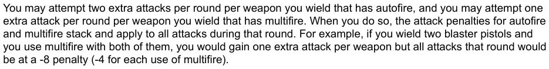
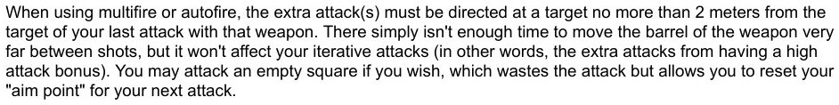
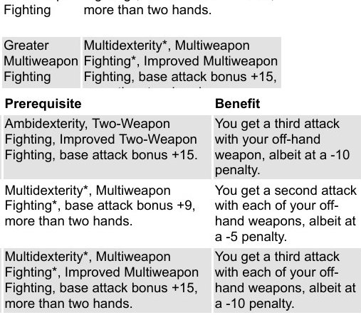
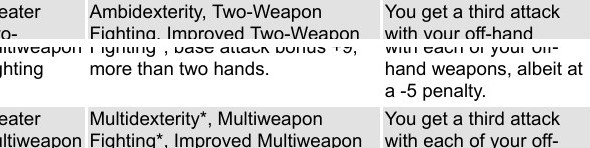
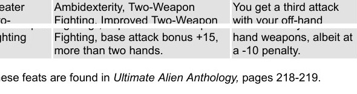
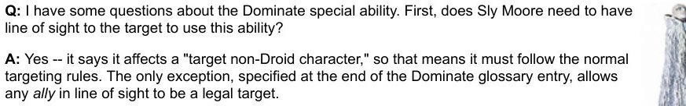
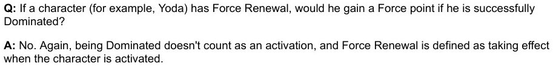
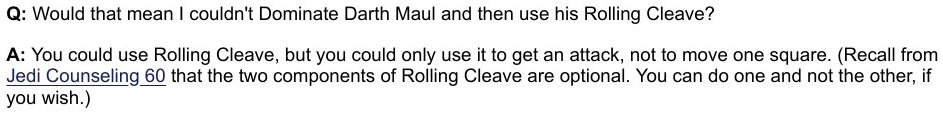
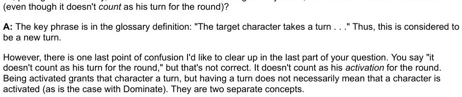
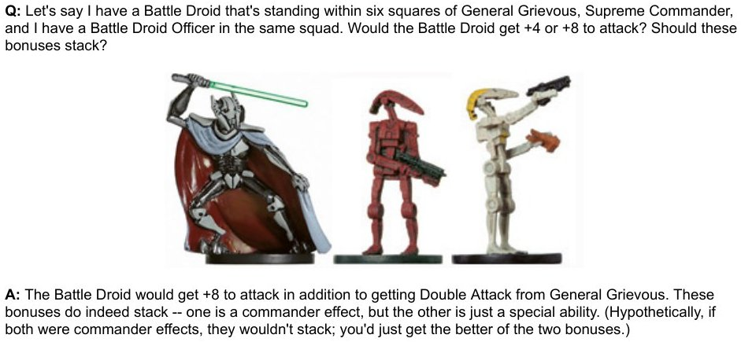

# Owner Material 037 — Star Wars D20 Drive folder (Core, Revised Core and Saga Edition): Jedi Counselling/Jedi Counseling 67.pdf [Star Wars Roleplaying Game Revised Core (d20, 2002)]

- **Source:** Wizards of the Coast Star Wars Roleplaying Game books, web enhancements, Living Force campaign modules and articles (2000–2010), from the owner's "Star Wars D20" Drive folder (only the three edition subfolders; "General" was not read, as instructed). Secondary source (licensed Legends reference). Scan OCR'd on the box; the scan stays box-only and is **not** published.
- **Method:** every scanned page was OCR'd and machine-screened sentence by sentence for power-relevant statements (fights, kills, defeats, Force feats, rankings, superweapons) that name a character on our roster; each kept sentence is quoted verbatim from the OCR text and has a crop of the printed passage directly under it. Pages with nothing power-relevant are still listed with what is on them.
- **Citation:** "*Jedi Counseling 67* (SWRPG d20 Revised Core), p.X" by printed page ("scan p.X" where no printed number applies). **Weight:** Licensed RPG material: a secondary source. Narrative text sums up Legends lore; game statistics are rules for players, not canon power levels, and rank lowest.

## scan p.1 (scan page 1)

Page contents: Multifire/autofire with two weapons (official + variant), limited targets variant (hand-read)

- **No single roster character (rules/setting/general)** — entry/section: Variant Rule: Multifire and Autofire with Two or More Weapons: "You may attempt two extra attacks per round per weapon you wield that has autofire, and you may attempt one extra attack per round per weapon you wield that has multifire. When you do so, the attack penalties for autofire and multifire stack and apply to all attacks during that round. For example, if you wield two blaster pistols and you use multifire with both of them, you would gain one extra attack per weapon but all attacks that round would be at a -8 penalty (-4 for each use of multifire)." Source: *Jedi Counseling 67* (SWRPG d20 Revised Core), scan p.1
  
- **No single roster character (rules/setting/general)** — entry/section: Variant Rule: Limited Autofire and Multifire Targets: "When using multifire or autofire, the extra attack(s) must be directed at a target no more than 2 meters from the target of your last attack with that weapon. There simply isn't enough time to move the barrel of the weapon very far between shots, but it won't affect your iterative attacks (in other words, the extra attacks from having a high attack bonus). You may attack an empty square if you wish, which wastes the attack but allows you to reset your "aim point" for your next attack." Source: *Jedi Counseling 67* (SWRPG d20 Revised Core), scan p.1
  

## scan p.2 (scan page 2)

Page contents: M/A-only weapons, D&D two-weapon feats table; Sly Moore Dominate questions, Yoda Force Renewal (hand-read)

- **No single roster character (rules/setting/general)** — entry/section: Feat: Greater Two-Weapon Fighting: "Greater Two-Weapon Fighting. Prerequisite: Ambidexterity, Two-Weapon Fighting, Improved Two-Weapon Fighting, base attack bonus +15. Benefit: You get a third attack with your off-hand weapon, albeit at a -10 penalty." Source: *Jedi Counseling 67* (SWRPG d20 Revised Core), scan p.2
  
- **No single roster character (rules/setting/general)** — entry/section: Feat: Improved Multiweapon Fighting: "Improved Multiweapon Fighting. Prerequisite: Multidexterity*, Multiweapon Fighting*, base attack bonus +9, more than two hands. Benefit: You get a second attack with each of your off-hand weapons, albeit at a -5 penalty." Source: *Jedi Counseling 67* (SWRPG d20 Revised Core), scan p.2
  
- **No single roster character (rules/setting/general)** — entry/section: Feat: Greater Multiweapon Fighting: "Greater Multiweapon Fighting. Prerequisite: Multidexterity*, Multiweapon Fighting*, Improved Multiweapon Fighting, base attack bonus +15, more than two hands. Benefit: You get a third attack with each of your off-hand weapons, albeit at a -10 penalty." Source: *Jedi Counseling 67* (SWRPG d20 Revised Core), scan p.2
  
- **Sly Moore** — entry/section: Sly Moore's Dominate needs line of sight: "Q: I have some questions about the Dominate special ability. First, does Sly Moore need to have a line of sight to the target to use this ability?
A: Yes -- it says it affects a "target non-Droid character," so that means it must follow the normal targeting rules. The only exception, specified at the end of the Dominate glossary entry, allows any ally in line of sight to be a legal target." Source: *Jedi Counseling 67* (SWRPG d20 Revised Core), scan p.2
  
- **Yoda** — entry/section: Yoda's Force Renewal under Dominate: "Q: If a character (for example, Yoda) has Force Renewal, would he gain a Force point if he is successfully Dominated?
A: No. Again, being Dominated doesn't count as an activation, and Force Renewal is defined as taking effect when the character is activated." Source: *Jedi Counseling 67* (SWRPG d20 Revised Core), scan p.2
  

## scan p.3 (scan page 3)

Page contents: Dominate Maul Rolling Cleave, Dominate turn vs activation, Grievous + Battle Droid Officer; author bio (hand-read)

- **Darth Maul; Sly Moore** — entry/section: Dominating Darth Maul to use Rolling Cleave: "Q: Would that mean I couldn't Dominate Darth Maul and then use his Rolling Cleave?
A: You could use Rolling Cleave, but you could only use it to get an attack, not to move one square. (Recall from Jedi Counseling 60 that the two components of Rolling Cleave are optional. You can do one and not the other, if you wish.)" Source: *Jedi Counseling 67* (SWRPG d20 Revised Core), scan p.3
  
- **Sly Moore** — entry/section: Dominate: a new turn, not an activation: "A: The key phrase is in the glossary definition: "The target character takes a turn. . ." Thus, this is considered to be a new turn.
However, there is one last point of confusion I'd like to clear up in the last part of your question. You say "it doesn't count as his turn for the round," but that's not correct. It doesn't count as his activation for the round. Being activated grants that character a turn, but having a turn does not necessarily mean that a character is activated (as is the case with Dominate). They are two separate concepts." Source: *Jedi Counseling 67* (SWRPG d20 Revised Core), scan p.3
  
- **General Grievous** — entry/section: General Grievous, Supreme Commander and Battle Droid Officer stack: "Q: Let's say I have a Battle Droid that's standing within six squares of General Grievous, Supreme Commander, and I have a Battle Droid Officer in the same squad. Would the Battle Droid get +4 or +8 to attack? Should these bonuses stack?
A: The Battle Droid would get +8 to attack in addition to getting Double Attack from General Grievous. These bonuses do indeed stack -- one is a commander effect, but the other is just a special ability. (Hypothetically, if both were commander effects, they wouldn't stack; you'd just get the better of the two bonuses.)" Source: *Jedi Counseling 67* (SWRPG d20 Revised Core), scan p.3
  
