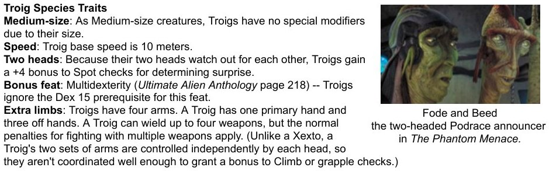
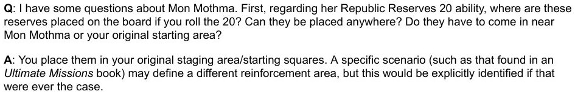
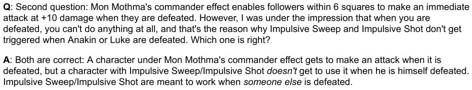
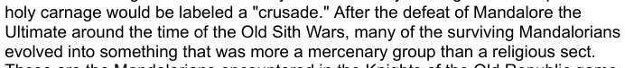
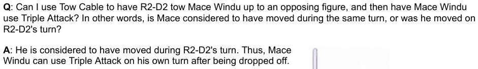
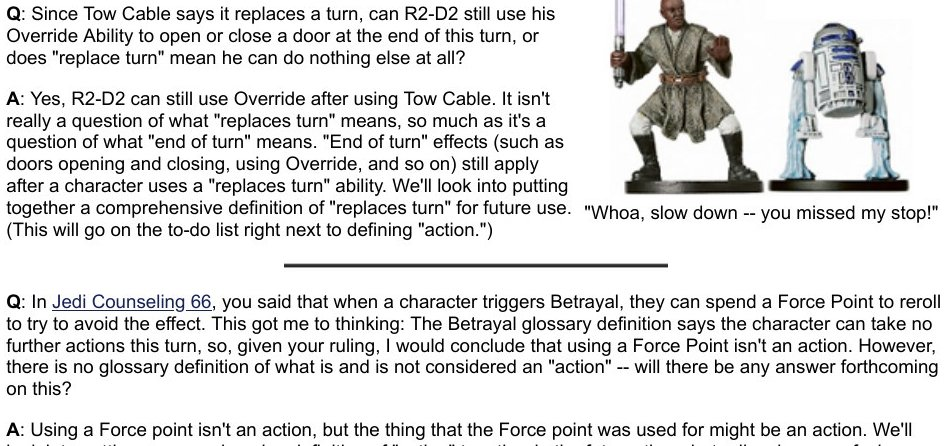
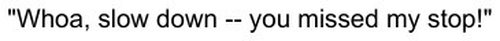
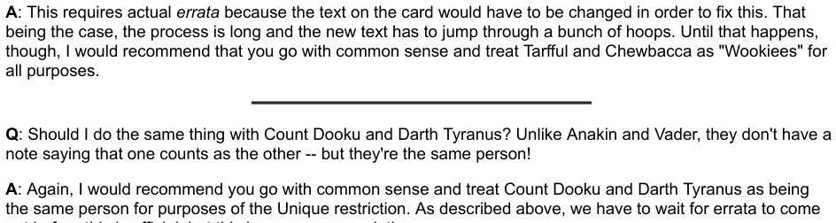
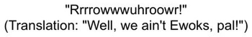
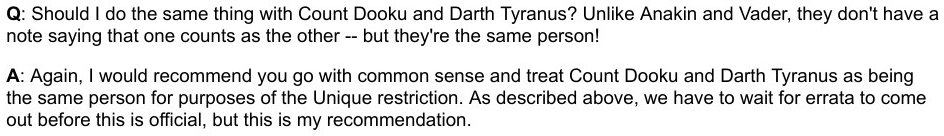

# Owner Material 037 — Star Wars D20 Drive folder (Core, Revised Core and Saga Edition): Jedi Counselling/Jedi Counseling 68.pdf [Star Wars Roleplaying Game Revised Core (d20, 2002)]

- **Source:** Wizards of the Coast Star Wars Roleplaying Game books, web enhancements, Living Force campaign modules and articles (2000–2010), from the owner's "Star Wars D20" Drive folder (only the three edition subfolders; "General" was not read, as instructed). Secondary source (licensed Legends reference). Scan OCR'd on the box; the scan stays box-only and is **not** published.
- **Method:** every scanned page was OCR'd and machine-screened sentence by sentence for power-relevant statements (fights, kills, defeats, Force feats, rankings, superweapons) that name a character on our roster; each kept sentence is quoted verbatim from the OCR text and has a crop of the printed passage directly under it. Pages with nothing power-relevant are still listed with what is on them.
- **Citation:** "*Jedi Counseling 68* (SWRPG d20 Revised Core), p.X" by printed page ("scan p.X" where no printed number applies). **Weight:** Licensed RPG material: a secondary source. Narrative text sums up Legends lore; game statistics are rules for players, not canon power levels, and rank lowest.

## scan p.1 (scan page 1)

Page contents: Shi'ido telepathy DC, droids; Mandalorian template question (hand-read)

## scan p.2 (scan page 2)

Page contents: Mandalorian history, Defel, Besalisk, Troig traits; Mon Mothma reserves and commander effect (hand-read)

- **Fode and Beed** — entry/section: Troig species traits (caption: Fode and Beed): "Troig Species Traits
Medium-size: As Medium-size creatures, Troigs have no special modifiers due to their size.
Speed: Troig base speed is 10 meters.
Two heads: Because their two heads watch out for each other, Troigs gain a +4 bonus to Spot checks for determining surprise.
Bonus feat: Multidexterity (Ultimate Alien Anthology page 218) -- Troigs ignore the Dex 15 prerequisite for this feat.
Extra limbs: Troigs have four arms. A Troig has one primary hand and three off hands. A Troig can wield up to four weapons, but the normal penalties for fighting with multiple weapons apply. (Unlike a Xexto, a Troig's two sets of arms are controlled independently by each head, so they aren't coordinated well enough to grant a bonus to Climb or grapple checks.)" Source: *Jedi Counseling 68* (SWRPG d20 Revised Core), scan p.2
  
- **Mon Mothma** — entry/section: Mon Mothma's Republic Reserves placement: "Q: I have some questions about Mon Mothma. First, regarding her Republic Reserves 20 ability, where are these reserves placed on the board if you roll the 20? Can they be placed anywhere? Do they have to come in near Mon Mothma or your original starting area?
A: You place them in your original staging area/starting squares. A specific scenario (such as that found in an Ultimate Missions book) may define a different reinforcement area, but this would be explicitly identified if that were ever the case." Source: *Jedi Counseling 68* (SWRPG d20 Revised Core), scan p.2
  
- **Mon Mothma; Darth Vader (Anakin Skywalker); Luke Skywalker** — entry/section: Mon Mothma's commander effect vs Impulsive Sweep/Shot: "Q: Second question: Mon Mothma's commander effect enables followers within 6 squares to make an immediate attack at +10 damage when they are defeated. However, I was under the impression that when you are defeated, you can't do anything at all, and that's the reason why Impulsive Sweep and Impulsive Shot don't get triggered when Anakin or Luke are defeated. Which one is right?
A: Both are correct: A character under Mon Mothma's commander effect gets to make an attack when it is defeated, but a character with Impulsive Sweep/Impulsive Shot doesn't get to use it when he is himself defeated. Impulsive Sweep/Impulsive Shot are meant to work when someone else is defeated." Source: *Jedi Counseling 68* (SWRPG d20 Revised Core), scan p.2
  
- **Mandalore the Ultimate**: "After the defeat of Mandalore the Ultimate around the time of the Old Sith Wars, many of the surviving Mandalorians evolved into something that was more a mercenary group than a religious sect." Source: *Jedi Counseling 68* (SWRPG d20 Revised Core), scan p.2
  

## scan p.3 (scan page 3)

Page contents: R2-D2 Tow Cable + Mace, Override, Force Point/Betrayal, Tarfful/Chewbacca Wookiees, Dooku/Tyranus (hand-read)

- **R2-D2; Mace Windu** — entry/section: R2-D2 tows Mace Windu, then Triple Attack: "Q: Can I use Tow Cable to have R2-D2 tow Mace Windu up to an opposing figure, and then have Mace Windu use Triple Attack? In other words, is Mace considered to have moved during the same turn, or was he moved on R2-D2's turn?
A: He is considered to have moved during R2-D2's turn. Thus, Mace Windu can use Triple Attack on his own turn after being dropped off." Source: *Jedi Counseling 68* (SWRPG d20 Revised Core), scan p.3
  
- **R2-D2** — entry/section: R2-D2: Override after Tow Cable: "Q: Since Tow Cable says it replaces a turn, can R2-D2 still use his Override Ability to open or close a door at the end of this turn, or does "replace turn" mean he can do nothing else at all?
A: Yes, R2-D2 can still use Override after using Tow Cable. It isn't really a question of what "replaces turn" means, so much as it's a question of what "end of turn" means. "End of turn" effects (such as doors opening and closing, using Override, and so on) still apply after a character uses a "replaces turn" ability. We'll look into putting together a comprehensive definition of "replaces turn" for future use." Source: *Jedi Counseling 68* (SWRPG d20 Revised Core), scan p.3
  
- **R2-D2** — entry/section: Caption quote for R2-D2: ""Whoa, slow down -- you missed my stop!"" Source: *Jedi Counseling 68* (SWRPG d20 Revised Core), scan p.3
  
- **Tarfful; Chewbacca** — entry/section: Tarfful and Chewbacca of Kashyyyk count as Wookiees: "A: This requires actual errata because the text on the card would have to be changed in order to fix this. That being the case, the process is long and the new text has to jump through a bunch of hoops. Until that happens, though, I would recommend that you go with common sense and treat Tarfful and Chewbacca as "Wookiees" for all purposes." Source: *Jedi Counseling 68* (SWRPG d20 Revised Core), scan p.3
  
- **Chewbacca** — entry/section: Wookiee caption: ""Rrrrowwwuhroowr!" (Translation: "Well, we ain't Ewoks, pal!")" Source: *Jedi Counseling 68* (SWRPG d20 Revised Core), scan p.3
  
- **Count Dooku** — entry/section: Count Dooku and Darth Tyranus as the same Unique: "Q: Should I do the same thing with Count Dooku and Darth Tyranus? Unlike Anakin and Vader, they don't have a note saying that one counts as the other -- but they're the same person!
A: Again, I would recommend you go with common sense and treat Count Dooku and Darth Tyranus as being the same person for purposes of the Unique restriction. As described above, we have to wait for errata to come out before this is official, but this is my recommendation." Source: *Jedi Counseling 68* (SWRPG d20 Revised Core), scan p.3
  

## scan p.4 (scan page 4)

Page contents: Author bio (hand-read)

