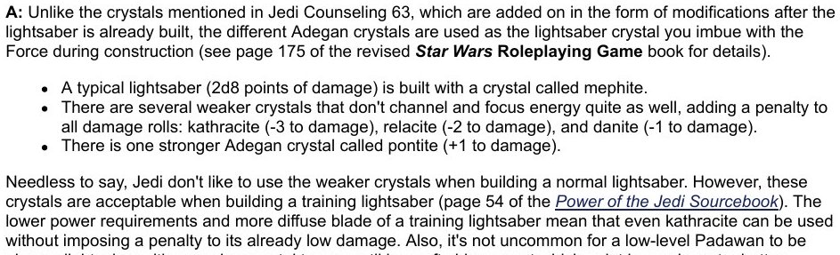
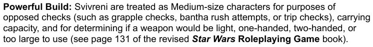
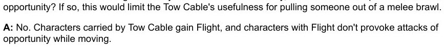
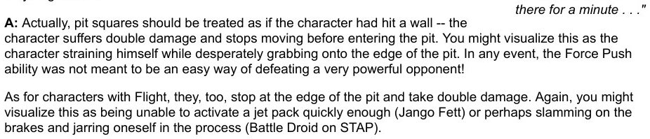
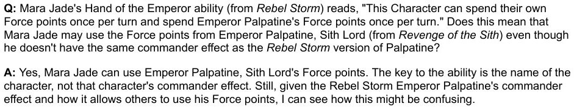
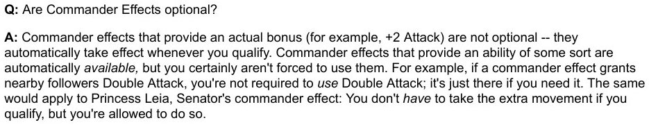

# Owner Material 037 — Star Wars D20 Drive folder (Core, Revised Core and Saga Edition): Jedi Counselling/Jedi Counseling 69.pdf [Star Wars Roleplaying Game Revised Core (d20, 2002)]

- **Source:** Wizards of the Coast Star Wars Roleplaying Game books, web enhancements, Living Force campaign modules and articles (2000–2010), from the owner's "Star Wars D20" Drive folder (only the three edition subfolders; "General" was not read, as instructed). Secondary source (licensed Legends reference). Scan OCR'd on the box; the scan stays box-only and is **not** published.
- **Method:** every scanned page was OCR'd and machine-screened sentence by sentence for power-relevant statements (fights, kills, defeats, Force feats, rankings, superweapons) that name a character on our roster; each kept sentence is quoted verbatim from the OCR text and has a crop of the printed passage directly under it. Pages with nothing power-relevant are still listed with what is on them.
- **Citation:** "*Jedi Counseling 69* (SWRPG d20 Revised Core), p.X" by printed page ("scan p.X" where no printed number applies). **Weight:** Licensed RPG material: a secondary source. Narrative text sums up Legends lore; game statistics are rules for players, not canon power levels, and rank lowest.

## scan p.1 (scan page 1)

Page contents: Adegan crystals, rarity; Ilum caption (hand-read)

- **No single roster character (rules/setting/general)** — entry/section: Adegan crystals for lightsabers: "A: Unlike the crystals mentioned in Jedi Counseling 63, which are added on in the form of modifications after the lightsaber is already built, the different Adegan crystals are used as the lightsaber crystal you imbue with the Force during construction (see page 175 of the revised Star Wars Roleplaying Game book for details).
A typical lightsaber (2d8 points of damage) is built with a crystal called mephite.
There are several weaker crystals that don't channel and focus energy quite as well, adding a penalty to all damage rolls: kathracite (-3 to damage), relacite (-2 to damage), and danite (-1 to damage).
There is one stronger Adegan crystal called pontite (+1 to damage)." Source: *Jedi Counseling 69* (SWRPG d20 Revised Core), scan p.1
  

## scan p.2 (scan page 2)

Page contents: Crystal colors (Mace Windu purple), synthetic crystals, knife/machete, Svivreni, Kushiban; Lightsaber glossary (hand-read)

- **No single roster character (rules/setting/general)** — entry/section: Svivreni species trait: Powerful Build: "Powerful Build: Svivreni are treated as Medium-size characters for purposes of opposed checks (such as grapple checks, bantha rush attempts, or trip checks), carrying capacity, and for determining if a weapon would be light, one-handed, two-handed, or too large to use (see page 131 of the revised Star Wars Roleplaying Game book)." Source: *Jedi Counseling 69* (SWRPG d20 Revised Core), scan p.2
  

## scan p.3 (scan page 3)

Page contents: R2-D2 Tow Cable, Dark Side Adept errata, Force Push pits, Mara Jade Hand of the Emperor, optional commander effects (hand-read)

- **R2-D2** — entry/section: Characters carried by Tow Cable don't provoke: "A: No. Characters carried by Tow Cable gain Flight, and characters with Flight don't provoke attacks of opportunity while moving." Source: *Jedi Counseling 69* (SWRPG d20 Revised Core), scan p.3
  
- **Jango Fett** — entry/section: Force Push into pits, with Flight (Jango Fett): "A: Actually, pit squares should be treated as if the character had hit a wall -- the character suffers double damage and stops moving before entering the pit. You might visualize this as the character straining himself while desperately grabbing onto the edge of the pit. In any event, the Force Push ability was not meant to be an easy way of defeating a very powerful opponent!
As for characters with Flight, they, too, stop at the edge of the pit and take double damage. Again, you might visualize this as being unable to activate a jet pack quickly enough (Jango Fett) or perhaps slamming on the brakes and jarring oneself in the process (Battle Droid on STAP)." Source: *Jedi Counseling 69* (SWRPG d20 Revised Core), scan p.3
  
- **Mara Jade Skywalker; Palpatine (Darth Sidious)** — entry/section: Mara Jade's Hand of the Emperor with Emperor Palpatine, Sith Lord: "Q: Mara Jade's Hand of the Emperor ability (from Rebel Storm) reads, "This Character can spend their own Force points once per turn and spend Emperor Palpatine's Force points once per turn." Does this mean that Mara Jade may use the Force points from Emperor Palpatine, Sith Lord (from Revenge of the Sith) even though he doesn't have the same commander effect as the Rebel Storm version of Palpatine?
A: Yes, Mara Jade can use Emperor Palpatine, Sith Lord's Force points. The key to the ability is the name of the character, not that character's commander effect. Still, given the Rebel Storm Emperor Palpatine's commander effect and how it allows others to use his Force points, I can see how this might be confusing." Source: *Jedi Counseling 69* (SWRPG d20 Revised Core), scan p.3
  
- **Leia Organa Solo** — entry/section: Commander effects optional (Princess Leia, Senator): "A: Commander effects that provide an actual bonus (for example, +2 Attack) are not optional -- they automatically take effect whenever you qualify. Commander effects that provide an ability of some sort are automatically available, but you certainly aren't forced to use them. For example, if a commander effect grants nearby followers Double Attack, you're not required to use Double Attack; it's just there if you need it. The same would apply to Princess Leia, Senator's commander effect: You don't have to take the extra movement if you qualify, but you're allowed to do so." Source: *Jedi Counseling 69* (SWRPG d20 Revised Core), scan p.3
  

## scan p.4 (scan page 4)

Page contents: Copyright line only (from image) (hand-read)

