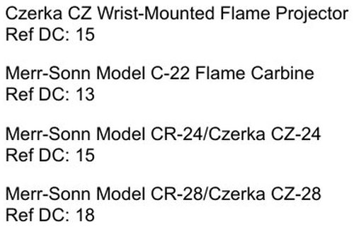
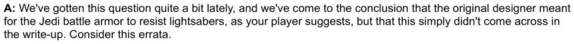
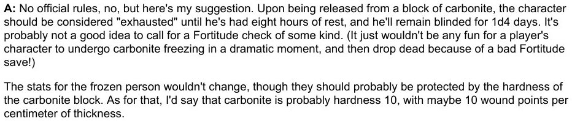

# Owner Material 037 — Star Wars D20 Drive folder (Core, Revised Core and Saga Edition): Jedi Counselling/Jedi Counseling 7 - Carbonite Freezing.pdf [Star Wars Roleplaying Game Revised Core (d20, 2002)]

- **Source:** Wizards of the Coast Star Wars Roleplaying Game books, web enhancements, Living Force campaign modules and articles (2000–2010), from the owner's "Star Wars D20" Drive folder (only the three edition subfolders; "General" was not read, as instructed). Secondary source (licensed Legends reference). Scan OCR'd on the box; the scan stays box-only and is **not** published.
- **Method:** every scanned page was OCR'd and machine-screened sentence by sentence for power-relevant statements (fights, kills, defeats, Force feats, rankings, superweapons) that name a character on our roster; each kept sentence is quoted verbatim from the OCR text and has a crop of the printed passage directly under it. Pages with nothing power-relevant are still listed with what is on them.
- **Citation:** "*Jedi Counseling 7 - Carbonite Freezing* (SWRPG d20 Revised Core), p.X" by printed page ("scan p.X" where no printed number applies). **Weight:** Licensed RPG material: a secondary source. Narrative text sums up Legends lore; game statistics are rules for players, not canon power levels, and rank lowest.

## scan p.1 (scan page 1)

Page contents: Sense Surroundings, ryyk blade, Battlemind + Enhance Ability, Deflect range, XJ X-wing (hand-read)

## scan p.2 (scan page 2)

Page contents: Flame projector DCs, Jedi battle armor errata, carbonite freezing, Cathar, Illusion, Transfer Essence (hand-read)

- **No single roster character (rules/setting/general)** — entry/section: Flame projector Reflex DCs (errata): "Czerka CZ Wrist-Mounted Flame Projector Ref DC: 15
Merr-Sonn Model C-22 Flame Carbine Ref DC: 13
Merr-Sonn Model CR-24/Czerka CZ-24 Ref DC: 15
Merr-Sonn Model CR-28/Czerka CZ-28 Ref DC: 18" Source: *Jedi Counseling 7 - Carbonite Freezing* (SWRPG d20 Revised Core), scan p.2
  
- **No single roster character (rules/setting/general)** — entry/section: Jedi battle armor resists lightsabers (errata): "A: We've gotten this question quite a bit lately, and we've come to the conclusion that the original designer meant for the Jedi battle armor to resist lightsabers, as your player suggests, but that this simply didn't come across in the write-up. Consider this errata." Source: *Jedi Counseling 7 - Carbonite Freezing* (SWRPG d20 Revised Core), scan p.2
  
- **No single roster character (rules/setting/general)** — entry/section: Carbonite freezing rules: "A: No official rules, no, but here's my suggestion. Upon being released from a block of carbonite, the character should be considered "exhausted" until he's had eight hours of rest, and he'll remain blinded for 1d4 days. It's probably not a good idea to call for a Fortitude check of some kind. (It just wouldn't be any fun for a player's character to undergo carbonite freezing in a dramatic moment, and then drop dead because of a bad Fortitude save!)
The stats for the frozen person wouldn't change, though they should probably be protected by the hardness of the carbonite block. As for that, I'd say that carbonite is probably hardness 10, with maybe 10 wound points per centimeter of thickness." Source: *Jedi Counseling 7 - Carbonite Freezing* (SWRPG d20 Revised Core), scan p.2
  

## scan p.3 (scan page 3)

Page contents: Starship Challenge Codes (hand-read)

