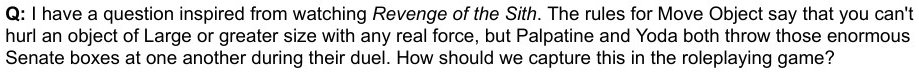
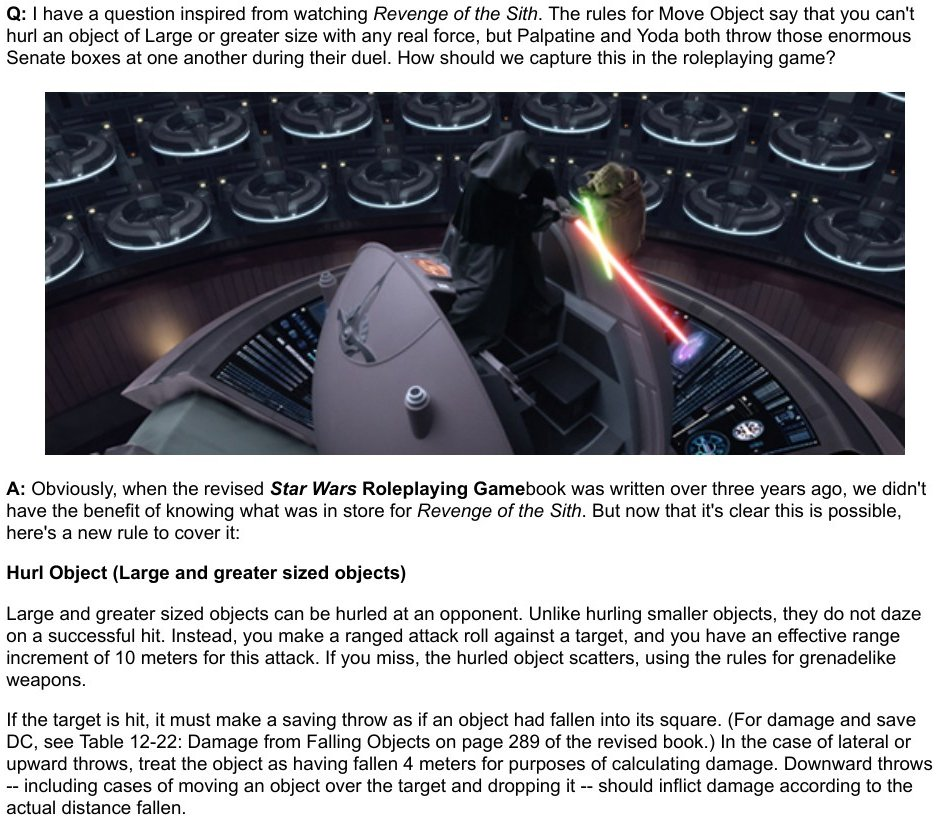
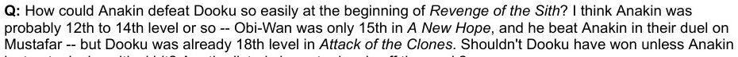
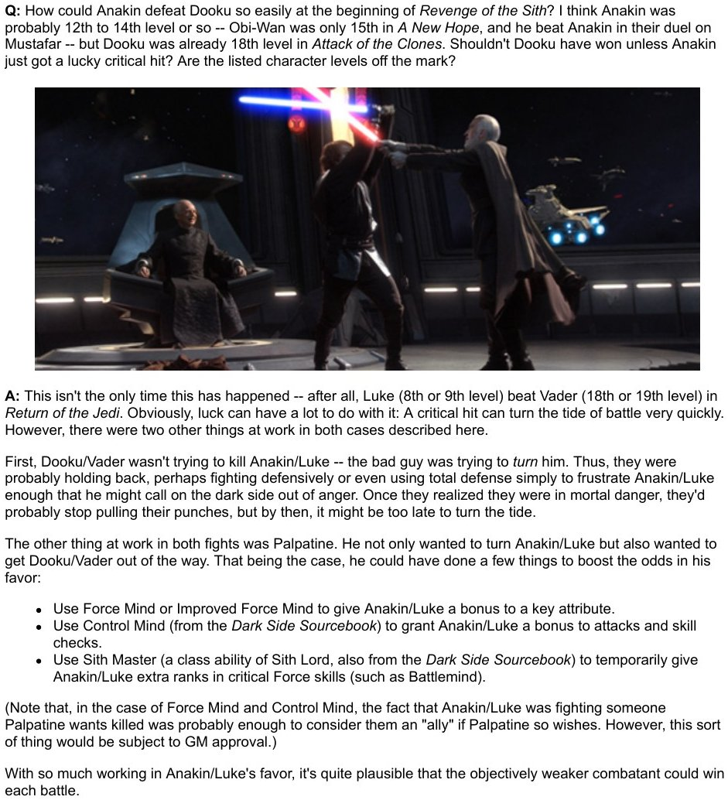
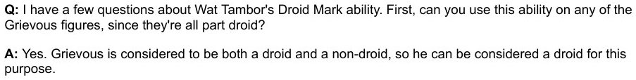
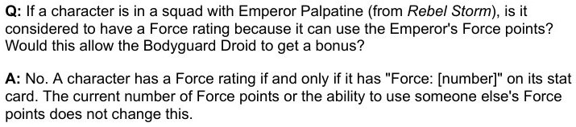
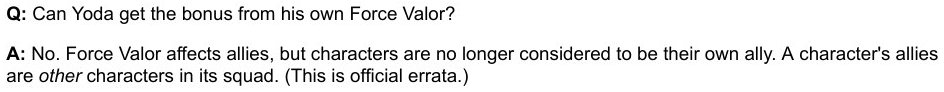
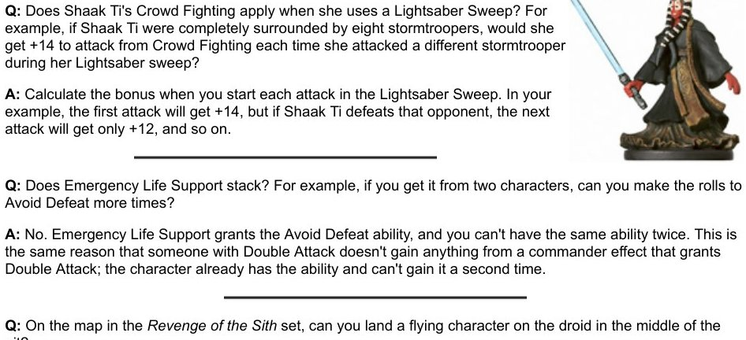

# Owner Material 037 — Star Wars D20 Drive folder (Core, Revised Core and Saga Edition): Jedi Counselling/Jedi Counseling 70.pdf [Star Wars Roleplaying Game Revised Core (d20, 2002)]

- **Source:** Wizards of the Coast Star Wars Roleplaying Game books, web enhancements, Living Force campaign modules and articles (2000–2010), from the owner's "Star Wars D20" Drive folder (only the three edition subfolders; "General" was not read, as instructed). Secondary source (licensed Legends reference). Scan OCR'd on the box; the scan stays box-only and is **not** published.
- **Method:** every scanned page was OCR'd and machine-screened sentence by sentence for power-relevant statements (fights, kills, defeats, Force feats, rankings, superweapons) that name a character on our roster; each kept sentence is quoted verbatim from the OCR text and has a crop of the printed passage directly under it. Pages with nothing power-relevant are still listed with what is on them.
- **Citation:** "*Jedi Counseling 70* (SWRPG d20 Revised Core), p.X" by printed page ("scan p.X" where no printed number applies). **Weight:** Licensed RPG material: a secondary source. Narrative text sums up Legends lore; game statistics are rules for players, not canon power levels, and rank lowest.

## scan p.1 (scan page 1)

Page contents: Hurl Object rule (Palpatine/Yoda Senate boxes); Yoda spinning box (hand-read)

- **Palpatine (Darth Sidious); Yoda** — entry/section: Jedi Counseling 70: "The rules for Move Object say that you can't hurl an object of Large or greater size with any real force, but Palpatine and Yoda both throw those enormous Senate boxes at one another during their duel." Source: *Jedi Counseling 70* (SWRPG d20 Revised Core), scan p.1
  
- **Palpatine (Darth Sidious); Yoda** — entry/section: New rule: Hurl Object (Large and greater), from the Senate duel: "Q: I have a question inspired from watching Revenge of the Sith. The rules for Move Object say that you can't hurl an object of Large or greater size with any real force, but Palpatine and Yoda both throw those enormous Senate boxes at one another during their duel. How should we capture this in the roleplaying game?
A: Obviously, when the revised Star Wars Roleplaying Gamebook was written over three years ago, we didn't have the benefit of knowing what was in store for Revenge of the Sith. But now that it's clear this is possible, here's a new rule to cover it:
Hurl Object (Large and greater sized objects)
Large and greater sized objects can be hurled at an opponent. Unlike hurling smaller objects, they do not daze on a successful hit. Instead, you make a ranged attack roll against a target, and you have an effective range increment of 10 meters for this attack. If you miss, the hurled object scatters, using the rules for grenadelike weapons.
If the target is hit, it must make a saving throw as if an object had fallen into its square. (For damage and save DC, see Table 12-22: Damage from Falling Objects on page 289 of the revised book.) In the case of lateral or upward throws, treat the object as having fallen 4 meters for purposes of calculating damage. Downward throws -- including cases of moving an object over the target and dropping it -- should inflict damage according to the actual distance fallen." Source: *Jedi Counseling 70* (SWRPG d20 Revised Core), scan p.1
  

## scan p.2 (scan page 2)

Page contents: Maximize cost; Anakin vs Dooku, Luke vs Vader; Wat Tambor Droid Mark (hand-read)

- **Obi-Wan Kenobi; Darth Vader (Anakin Skywalker); Count Dooku** — entry/section: Jedi Counseling 70: "|think Anakin was probably 12th to 14th level or so -- Obi-Wan was only 15th in A New Hope, and he beat Anakin in their duel on Mustafar -- but Dooku was already 18th level in Attack of the Clones." Source: *Jedi Counseling 70* (SWRPG d20 Revised Core), scan p.2
  
- **Darth Vader (Anakin Skywalker); Count Dooku; Luke Skywalker; Obi-Wan Kenobi; Palpatine (Darth Sidious)** — entry/section: How Anakin beat Dooku and Luke beat Vader: "Q: How could Anakin defeat Dooku so easily at the beginning of Revenge of the Sith? I think Anakin was probably 12th to 14th level or so -- Obi-Wan was only 15th in A New Hope, and he beat Anakin in their duel on Mustafar -- but Dooku was already 18th level in Attack of the Clones. Shouldn't Dooku have won unless Anakin just got a lucky critical hit? Are the listed character levels off the mark?
A: This isn't the only time this has happened -- after all, Luke (8th or 9th level) beat Vader (18th or 19th level) in Return of the Jedi. Obviously, luck can have a lot to do with it: A critical hit can turn the tide of battle very quickly. However, there were two other things at work in both cases described here.
First, Dooku/Vader wasn't trying to kill Anakin/Luke -- the bad guy was trying to turn him. Thus, they were probably holding back, perhaps fighting defensively or even using total defense simply to frustrate Anakin/Luke enough that he might call on the dark side out of anger. Once they realized they were in mortal danger, they'd probably stop pulling their punches, but by then, it might be too late to turn the tide.
The other thing at work in both fights was Palpatine. He not only wanted to turn Anakin/Luke but also wanted to get Dooku/Vader out of the way. That being the case, he could have done a few things to boost the odds in his favor:
Use Force Mind or Improved Force Mind to give Anakin/Luke a bonus to a key attribute.
Use Control Mind (from the Dark Side Sourcebook) to grant Anakin/Luke a bonus to attacks and skill checks.
Use Sith Master (a class ability of Sith Lord, also from the Dark Side Sourcebook) to temporarily give Anakin/Luke extra ranks in critical Force skills (such as Battlemind).
(Note that, in the case of Force Mind and Control Mind, the fact that Anakin/Luke was fighting someone Palpatine wants killed was probably enough to consider them an "ally" if Palpatine so wishes. However, this sort of thing would be subject to GM approval.)
With so much working in Anakin/Luke's favor, it's quite plausible that the objectively weaker combatant could win each battle." Source: *Jedi Counseling 70* (SWRPG d20 Revised Core), scan p.2
  
- **Wat Tambor; General Grievous** — entry/section: Wat Tambor's Droid Mark on Grievous: "Q: I have a few questions about Wat Tambor's Droid Mark ability. First, can you use this ability on any of the Grievous figures, since they're all part droid?
A: Yes. Grievous is considered to be both a droid and a non-droid, so he can be considered a droid for this purpose." Source: *Jedi Counseling 70* (SWRPG d20 Revised Core), scan p.2
  

## scan p.3 (scan page 3)

Page contents: Bodyguard Droid, Palpatine FP, Yoda Force Valor errata, Force Renewal, Reflect, Shaak Ti, ELS, pit droid, combined fire (hand-read)

- **Palpatine (Darth Sidious)** — entry/section: Using Emperor Palpatine's Force points doesn't give a Force rating: "Q: If a character is in a squad with Emperor Palpatine (from Rebel Storm), is it considered to have a Force rating because it can use the Emperor's Force points? Would this allow the Bodyguard Droid to get a bonus?
A: No. A character has a Force rating if and only if it has "Force: [number]" on its stat card. The current number of Force points or the ability to use someone else's Force points does not change this." Source: *Jedi Counseling 70* (SWRPG d20 Revised Core), scan p.3
  
- **Yoda** — entry/section: Yoda's Force Valor errata: "Q: Can Yoda get the bonus from his own Force Valor?
A: No. Force Valor affects allies, but characters are no longer considered to be their own ally. A character's allies are other characters in its squad. (This is official errata.)" Source: *Jedi Counseling 70* (SWRPG d20 Revised Core), scan p.3
  
- **Shaak Ti** — entry/section: Shaak Ti's Crowd Fighting with Lightsaber Sweep: "Q: Does Shaak Ti's Crowd Fighting apply when she uses a Lightsaber Sweep? For example, if Shaak Ti were completely surrounded by eight stormtroopers, would she get +14 to attack from Crowd Fighting each time she attacked a different stormtrooper during her Lightsaber sweep?
A: Calculate the bonus when you start each attack in the Lightsaber Sweep. In your example, the first attack will get +14, but if Shaak Ti defeats that opponent, the next attack will get only +12, and so on." Source: *Jedi Counseling 70* (SWRPG d20 Revised Core), scan p.3
  

## scan p.4 (scan page 4)

Page contents: Author bio (hand-read)

