# Owner Material 037 — Star Wars D20 Drive folder (Core, Revised Core and Saga Edition): Jedi Counselling/Jedi Counseling 71.pdf [Star Wars Roleplaying Game Revised Core (d20, 2002)]

- **Source:** Wizards of the Coast Star Wars Roleplaying Game books, web enhancements, Living Force campaign modules and articles (2000–2010), from the owner's "Star Wars D20" Drive folder (only the three edition subfolders; "General" was not read, as instructed). Secondary source (licensed Legends reference). Scan OCR'd on the box; the scan stays box-only and is **not** published.
- **Method:** every scanned page was OCR'd and machine-screened sentence by sentence for power-relevant statements (fights, kills, defeats, Force feats, rankings, superweapons) that name a character on our roster; each kept sentence is quoted verbatim from the OCR text and has a crop of the printed passage directly under it. Pages with nothing power-relevant are still listed with what is on them.
- **Citation:** "*Jedi Counseling 71* (SWRPG d20 Revised Core), p.X" by printed page ("scan p.X" where no printed number applies). **Weight:** Licensed RPG material: a secondary source. Narrative text sums up Legends lore; game statistics are rules for players, not canon power levels, and rank lowest.

## scan p.1 (scan page 1)

Page contents: Palpatine's face (Insider quotes), Mask alchemy rule (hand-read)

- **Palpatine (Darth Sidious); Mace Windu; Luke Skywalker** — entry/section: What happened to Palpatine's face: "Q: In his fight with Mace Windu, what exactly happens to Palpatine's face? Some say he was scarred by the Force lightning, but others say he was dropping some sort of illusion and revealing his true face. Which is it?
A: Ah, the mysteries of the Force. There are problems with both of these ideas: The idea that he was being physically damaged by the Force lightning doesn't match Return of the Jedi. Luke was being hit by Force lightning for quite some time, and he wasn't scarred like that. On the other hand, if Palpatine was using an Illusion-assisted Disguise check (see Jedi Counseling 19), he couldn't possibly keep it up continually. Moreover, Illusion is a mind-influencing Force power. It doesn't work on droids or recordings (in other words, someone might notice that he doesn't look the same in recorded speeches), nor would it work when projecting a holographic image halfway across the galaxy. Finally, one would have wonder why he maintained the illusion in his earlier holographic appearances as Darth Sidious. It would seem more prudent to "turn it off" to preserve the Palpatine identity. You are quite justified in being puzzled by this turn of events!" Source: *Jedi Counseling 71* (SWRPG d20 Revised Core), scan p.1
  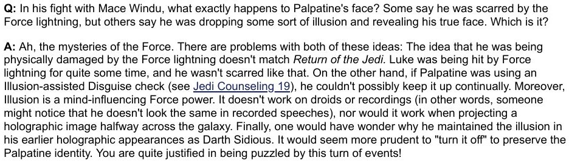
- **Palpatine (Darth Sidious)** — entry/section: Insider quotes on Palpatine's true face: "[The] real Palpatine is the one who bursts forth at a calculated moment . . . That is when the true person comes out, letting the evil fully manifest itself. The Emperor . . . looks like he does because he's very old and very evil -- it is what he always looked like. [Star Wars Insider 82 (page 58)]
[It's] the intensity of reflected lightning and the channeling of such raw dark side power that are the catalysts for Palpatine's transformation. Perhaps the face that boils up to the surface is shaped by his dark side corruption, but the lightning is definitely the cause. [Star Wars Insider 83" Source: *Jedi Counseling 71* (SWRPG d20 Revised Core), scan p.1
  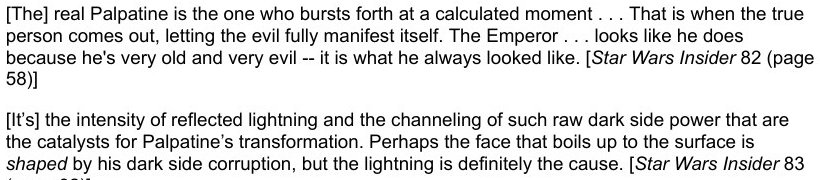
- **Palpatine (Darth Sidious)** — entry/section: Mask (Alchemy application): "Palpatine, who has delved extensively into Sith lore, was using an almost-forgotten technique to hide his true self. In game terms, this is an application of the Alchemy skill from the Dark Side Sourcebook (page 13):
Mask
Just as Sith alchemical techniques can be used to make a subject appear more horrific, they can be used to conceal its true appearance. This requires an Alchemy check (DC 20), and your skill check is modified by all the same modifiers that would apply to a Disguise check. On a success, your Alchemy check is treated as a Disguise check for the purpose of concealing your true appearance (or adopting someone else's), opposed by an observer's Spot check as normal. Each check requires 1 minute, costs the user 5 vitality points, and gives the user 1 Dark Side Point." Source: *Jedi Counseling 71* (SWRPG d20 Revised Core), scan p.1
  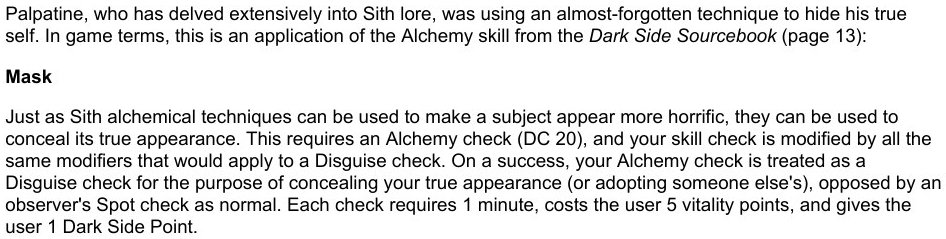

## scan p.2 (scan page 2)

Page contents: Mask dropped; Palpatine block errata; Lightning + push on Yoda; Mustafar limbs; optional rule; ally errata (hand-read)

- **Darth Vader (Anakin Skywalker); Obi-Wan Kenobi** — entry/section: Jedi Counseling 71: "Q: At the end of the duel on Mustafar, Anakin (now Darth Vader) loses three limbs at once, seemingly from a single sweep of Obi-Wan's lightsaber." Source: *Jedi Counseling 71* (SWRPG d20 Revised Core), scan p.2
  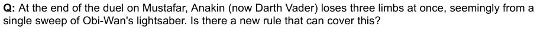
- **Palpatine (Darth Sidious); Darth Vader (Anakin Skywalker); Mace Windu** — entry/section: Palpatine drops the mask: "It is not clear whether Palpatine loses his mask intentionally or unintentionally, but it is certain that his Force lightning was the triggering event. It is possible that Palpatine voluntarily fails the save and drops the mask when it no longer suits his purpose using it to convince Anakin to intervene against Mace Windu and showing his "scars" to the galaxy as evidence of Jedi betrayal." Source: *Jedi Counseling 71* (SWRPG d20 Revised Core), scan p.2
  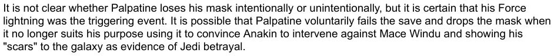
- **Palpatine (Darth Sidious); Mace Windu; Yoda** — entry/section: Palpatine uses block (errata): "Q: Another question about that scene: I know that Mace Windu was using deflect (attack) to bounce the lightning back at Palpatine, but it looks like Palpatine was bouncing at least some of it back as well. This phenomenon is even more apparent in the duel between Palpatine and Yoda. Visually, it looks a lot like when Yoda used the block ability in Attack of the Clones, but Palpatine isn't a Jedi and doesn't have it. What's happening here?
A: Palpatine is indeed using block. At the time that was written for the Jedi guardian and Jedi consular, it wasn't known that it would find its way into such wide use! So, consider this to be errata: Any character with a deflect (defense) bonus of at least +2 immediately gains the block ability (page 59 of the revised Star Wars Roleplaying Game book, and updated in Jedi Counseling 10)." Source: *Jedi Counseling 71* (SWRPG d20 Revised Core), scan p.2
  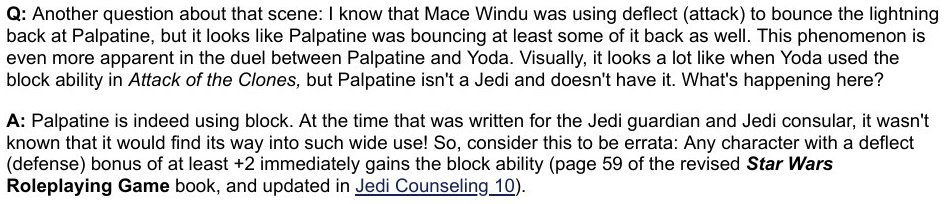
- **Palpatine (Darth Sidious); Yoda** — entry/section: Palpatine sends Yoda flying: "Q: How does Palpatine send Yoda flying into the wall when he hits him with Force Lighting? Does Force Lightning cause some sort of knock-back effect?
A: No, Palpatine was actually doing two separate things. First, he used Force Lightning (attack action) against Yoda. Then, he used Force Mastery to perform a Force push (Jedi Counseling 60) as a free action. Thus, Yoda gets zapped (2d10 points of damage), dazed (from the Force Lightning), slammed (3d4 points of damage), and thrown into a wall (1d6 points of falling damage) all at once. No one said taking on a Sith lord would be easy." Source: *Jedi Counseling 71* (SWRPG d20 Revised Core), scan p.2
  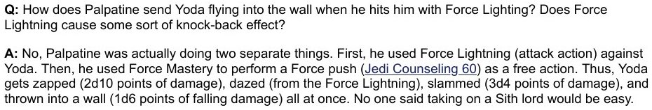
- **Darth Vader (Anakin Skywalker); Obi-Wan Kenobi** — entry/section: Anakin loses three limbs on Mustafar: "Q: At the end of the duel on Mustafar, Anakin (now Darth Vader) loses three limbs at once, seemingly from a single sweep of Obi-Wan's lightsaber. Is there a new rule that can cover this?
A: Actually, the existing rules can explain this. Obi-Wan gets on higher ground (+1 attack bonus) and readies an action to attack if Anakin tries to reach him -- and, as a free action, he warns him not to try it. Anakin decides he can do it anyway, so he makes a combination Force jump (Hero's Guide page 37, Jedi Counseling 47) with a Tumble check (DC 25) to move through Obi-Wan's square so that he could get the higher ground for himself. Given that he moves out of two threatened squares -- once for leaving the square adjacent to Obi-Wan, and once for leaving Obi-Wan's square -- Anakin will provoke two attacks of opportunity if he fails the Tumble check. Thus, it unfolds like this:
1. Anakin makes his Jump check and succeeds.
2. Anakin enters a square adjacent to Obi-Wan, triggering his readied action.
3. Obi-Wan rolls a critical hit, lopping off one limb.
4. Anakin's jump continues, moving into another square and provoking an attack of opportunity.
5. Obi-Wan hits, eliminating the rest of Anakin's vitality and doing wound damage, and removing another limb.
6. Anakin's jump continues again, moving out of Obi-Wan's square and provoking a final attack of opportunity.
7. Obi-Wan hits one last time, all wound damage, removing the last limb." Source: *Jedi Counseling 71* (SWRPG d20 Revised Core), scan p.2
  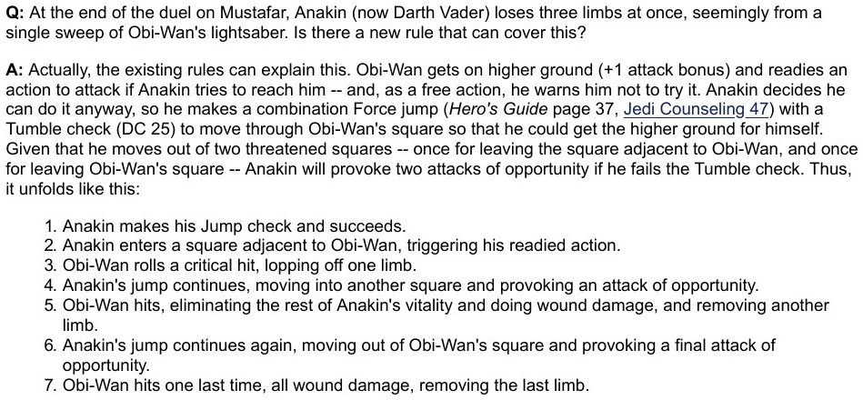
- **Darth Vader (Anakin Skywalker)** — entry/section: Optional rule: limb loss caps wound damage: "Optional Rule (for use with either system): You can't lose more than half your maximum wound points when you have a limb removed. You may be mortally wounded, but it won't kill you immediately. With this rule in place, Anakin would have a very good chance to survive being so seriously maimed. Each hit would only remove half his maximum wound points, so he would be dying (-1 to -9 points) but not yet dead (-10 points)." Source: *Jedi Counseling 71* (SWRPG d20 Revised Core), scan p.2
  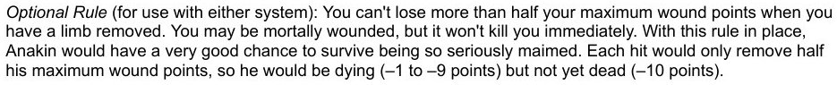

## scan p.3 (scan page 3)

Page contents: Probe Droid Recon, commander self-ally overruled (Yoda), Chagrian Mercenary, Rolling Cleave/Triple Attack, Grievous Wheel Bike (hand-read)

- **Yoda** — entry/section: Yoda doesn't benefit from his own Force Valor: "A: Yes. Because the commander is no longer his own ally, he would not benefit from such a commander effect. For example, Yoda's Force Valor grants a commander effect that applies to all allies within six squares, but Yoda is not his own ally and therefore does not gain the benefit of this commander effect." Source: *Jedi Counseling 71* (SWRPG d20 Revised Core), scan p.3
  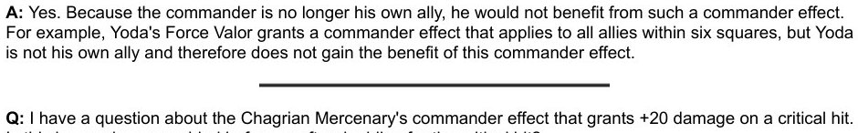
- **General Grievous; Darth Maul** — entry/section: Grievous's Wheel Bike movement: "Q: I have a question about Grievous's Wheel Bike. I know the Wheeled ability allows him to move 18 squares and attack, but can he just move 18 squares and not attack?
A: Yes. Much like Darth Maul's Rolling Cleave, the separate components of the ability (move, attack) can be used separately. Thus, the attack is optional.
Q: Can he move 36 squares if he doesn't attack? A: No. Q: Can he attack and then move the 18 squares?
A: No. According to the glossary definition, the movement has to come first." Source: *Jedi Counseling 71* (SWRPG d20 Revised Core), scan p.3
  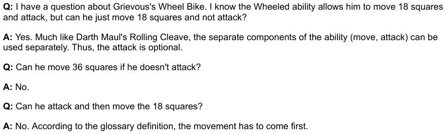

## scan p.4 (scan page 4)

Page contents: Closing line, copyright (hand-read)

