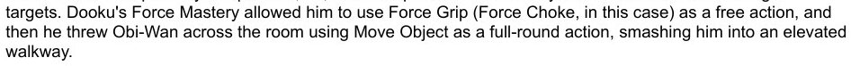
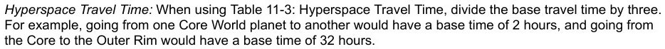
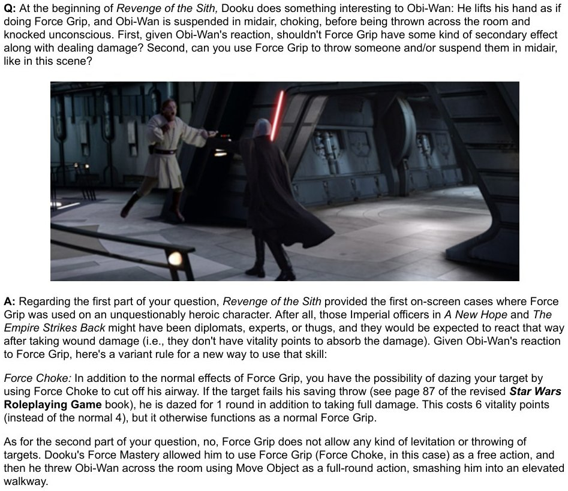
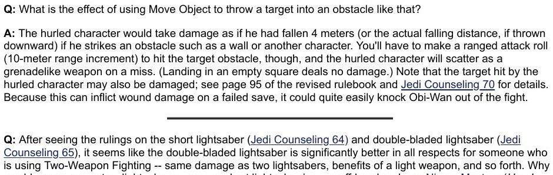
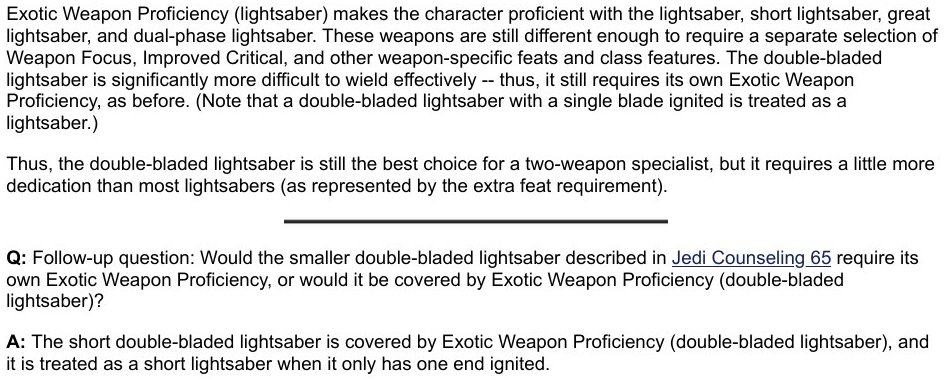
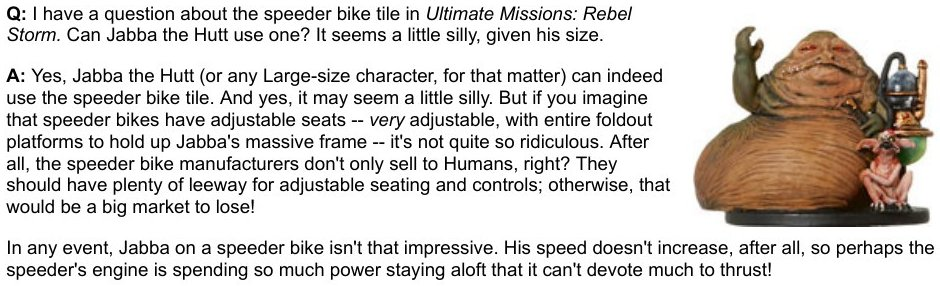
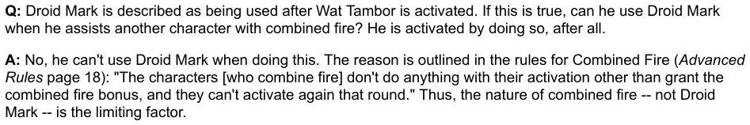
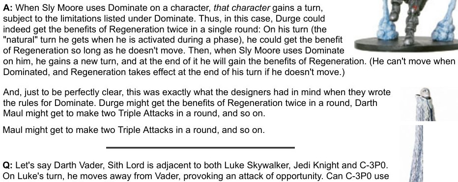
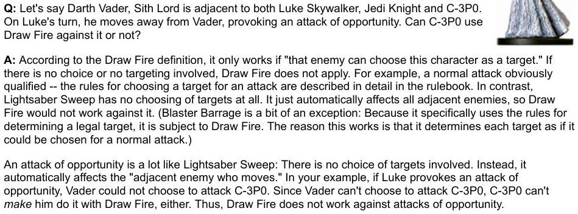

# Owner Material 037 — Star Wars D20 Drive folder (Core, Revised Core and Saga Edition): Jedi Counselling/Jedi Counseling 72.pdf [Star Wars Roleplaying Game Revised Core (d20, 2002)]

- **Source:** Wizards of the Coast Star Wars Roleplaying Game books, web enhancements, Living Force campaign modules and articles (2000–2010), from the owner's "Star Wars D20" Drive folder (only the three edition subfolders; "General" was not read, as instructed). Secondary source (licensed Legends reference). Scan OCR'd on the box; the scan stays box-only and is **not** published.
- **Method:** every scanned page was OCR'd and machine-screened sentence by sentence for power-relevant statements (fights, kills, defeats, Force feats, rankings, superweapons) that name a character on our roster; each kept sentence is quoted verbatim from the OCR text and has a crop of the printed passage directly under it. Pages with nothing power-relevant are still listed with what is on them.
- **Citation:** "*Jedi Counseling 72* (SWRPG d20 Revised Core), p.X" by printed page ("scan p.X" where no printed number applies). **Weight:** Licensed RPG material: a secondary source. Narrative text sums up Legends lore; game statistics are rules for players, not canon power levels, and rank lowest.

## scan p.1 (scan page 1)

Page contents: Hyperspace travel variant; Dooku's Force Grip on Obi-Wan, Force Choke variant (hand-read)

- **Obi-Wan Kenobi; Count Dooku** — entry/section: Jedi Counseling 72: "Dooku's Force Mastery allowed him to use Force Grip (Force Choke, in this case) as a free action, and then he threw Obi-Wan across the room using Move Object as a full-round action, smashing him into an elevated walkway." Source: *Jedi Counseling 72* (SWRPG d20 Revised Core), scan p.1
  
- **No single roster character (rules/setting/general)** — entry/section: Variant: Hyperspace Travel Time: "Hyperspace Travel Time: When using Table 11-3: Hyperspace Travel Time, divide the base travel time by three. For example, going from one Core World planet to another would have a base time of 2 hours, and going from the Core to the Outer Rim would have a base time of 32 hours." Source: *Jedi Counseling 72* (SWRPG d20 Revised Core), scan p.1
  
- **Count Dooku; Obi-Wan Kenobi** — entry/section: Dooku's Force Grip on Obi-Wan and the Force Choke variant: "Q: At the beginning of Revenge of the Sith, Dooku does something interesting to Obi-Wan: He lifts his hand as if doing Force Grip, and Obi-Wan is suspended in midair, choking, before being thrown across the room and knocked unconscious. First, given Obi-Wan's reaction, shouldn't Force Grip have some kind of secondary effect along with dealing damage? Second, can you use Force Grip to throw someone and/or suspend them in midair, like in this scene?
A: Regarding the first part of your question, Revenge of the Sith provided the first on-screen cases where Force Grip was used on an unquestionably heroic character. After all, those Imperial officers in A New Hope and The Empire Strikes Back might have been diplomats, experts, or thugs, and they would be expected to react that way after taking wound damage (i.e., they don't have vitality points to absorb the damage). Given Obi-Wan's reaction to Force Grip, here's a variant rule for a new way to use that skill:
Force Choke: In addition to the normal effects of Force Grip, you have the possibility of dazing your target by using Force Choke to cut off his airway. If the target fails his saving throw (see page 87 of the revised Star Wars Roleplaying Game book), he is dazed for 1 round in addition to taking full damage. This costs 6 vitality points (instead of the normal 4), but it otherwise functions as a normal Force Grip.
As for the second part of your question, no, Force Grip does not allow any kind of levitation or throwing of targets. Dooku's Force Mastery allowed him to use Force Grip (Force Choke, in this case) as a free action, and then he threw Obi-Wan across the room using Move Object as a full-round action, smashing him into an elevated walkway." Source: *Jedi Counseling 72* (SWRPG d20 Revised Core), scan p.1
  

## scan p.2 (scan page 2)

Page contents: Hurled characters; double-bladed lightsaber/EWP errata; Jabba speeder bike; Wat Tambor Droid Mark (hand-read)

- **Obi-Wan Kenobi** — entry/section: Hurling a character into an obstacle: "A: The hurled character would take damage as if he had fallen 4 meters (or the actual falling distance, if thrown downward) if he strikes an obstacle such as a wall or another character. You'll have to make a ranged attack roll (10-meter range increment) to hit the target obstacle, though, and the hurled character will scatter as a grenadelike weapon on a miss. (Landing in an empty square deals no damage.) Note that the target hit by the hurled character may also be damaged; see page 95 of the revised rulebook and Jedi Counseling 70 for details. Because this can inflict wound damage on a failed save, it could quite easily knock Obi-Wan out of the fight." Source: *Jedi Counseling 72* (SWRPG d20 Revised Core), scan p.2
  
- **No single roster character (rules/setting/general)** — entry/section: Errata: Exotic Weapon Proficiency (lightsaber): "Exotic Weapon Proficiency (lightsaber) makes the character proficient with the lightsaber, short lightsaber, great lightsaber, and dual-phase lightsaber. These weapons are still different enough to require a separate selection of Weapon Focus, Improved Critical, and other weapon-specific feats and class features. The double-bladed lightsaber is significantly more difficult to wield effectively -- thus, it still requires its own Exotic Weapon Proficiency, as before. (Note that a double-bladed lightsaber with a single blade ignited is treated as a lightsaber.)" Source: *Jedi Counseling 72* (SWRPG d20 Revised Core), scan p.2
  
- **Jabba the Hutt** — entry/section: Jabba the Hutt on a speeder bike: "Q: I have a question about the speeder bike tile in Ultimate Missions: Rebel Storm. Can Jabba the Hutt use one? It seems a little silly, given his size.
A: Yes, Jabba the Hutt (or any Large-size character, for that matter) can indeed use the speeder bike tile. And yes, it may seem a little silly. But if you imagine that speeder bikes have adjustable seats -- very adjustable, with entire foldout platforms to hold up Jabba's massive frame -- it's not quite so ridiculous. After all, the speeder bike manufacturers don't only sell to Humans, right? They should have plenty of leeway for adjustable seating and controls; otherwise, that would be a big market to lose!
In any event, Jabba on a speeder bike isn't that impressive. His speed doesn't increase, after all, so perhaps the speeder's engine is spending so much power staying aloft that it can't devote much to thrust!" Source: *Jedi Counseling 72* (SWRPG d20 Revised Core), scan p.2
  
- **Wat Tambor** — entry/section: Wat Tambor's Droid Mark vs combined fire: "Q: Droid Mark is described as being used after Wat Tambor is activated. If this is true, can he use Droid Mark when he assists another character with combined fire? He is activated by doing so, after all.
A: No, he can't use Droid Mark when doing this. The reason is outlined in the rules for Combined Fire (Advanced Rules page 18): "The characters [who combine fire] don't do anything with their activation other than grant the combined fire bonus, and they can't activate again that round." Thus, the nature of combined fire -- not Droid Mark -- is the limiting factor." Source: *Jedi Counseling 72* (SWRPG d20 Revised Core), scan p.2
  

## scan p.3 (scan page 3)

Page contents: Evade vs Force Lightning, Durge + Sly Moore, Vader/Luke/C-3PO Draw Fire vs AoO; author bio (hand-read)

- **Durge; Sly Moore; Darth Maul** — entry/section: Durge regenerates twice under Sly Moore's Dominate: "A: When Sly Moore uses Dominate on a character, that character gains a turn, subject to the limitations listed under Dominate. Thus, in this case, Durge could indeed get the benefits of Regeneration twice in a single round: On his turn (the "natural" turn he gets when he is activated during a phase), he could get the benefit of Regeneration so long as he doesn't move. Then, when Sly Moore uses Dominate on him, he gains a new turn, and at the end of it he will gain the benefits of Regeneration. (He can't move when Dominated, and Regeneration takes effect at the end of his turn if he doesn't move.)
And, just to be perfectly clear, this was exactly what the designers had in mind when they wrote the rules for Dominate. Durge might get the benefits of Regeneration twice in a round, Darth Maul might get to make two Triple Attacks in a round, and so on." Source: *Jedi Counseling 72* (SWRPG d20 Revised Core), scan p.3
  
- **Darth Vader (Anakin Skywalker); Luke Skywalker; C-3PO** — entry/section: C-3PO's Draw Fire vs Vader's attack of opportunity: "Q: Let's say Darth Vader, Sith Lord is adjacent to both Luke Skywalker, Jedi Knight and C-3PO. On Luke's turn, he moves away from Vader, provoking an attack of opportunity. Can C-3PO use Draw Fire against it or not?
A: According to the Draw Fire definition, it only works if "that enemy can choose this character as a target." If there is no choice or no targeting involved, Draw Fire does not apply.
An attack of opportunity is a lot like Lightsaber Sweep: There is no choice of targets involved. Instead, it automatically affects the "adjacent enemy who moves." In your example, if Luke provokes an attack of opportunity, Vader could not choose to attack C-3PO. Since Vader can't choose to attack C-3PO, C-3PO can't make him do it with Draw Fire, either. Thus, Draw Fire does not work against attacks of opportunity." Source: *Jedi Counseling 72* (SWRPG d20 Revised Core), scan p.3
  
