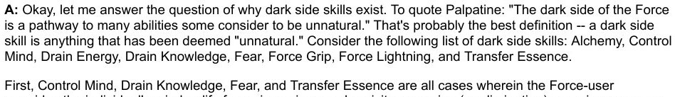
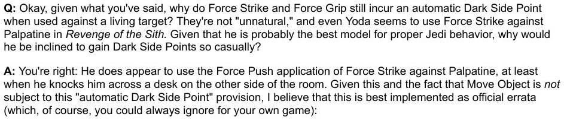
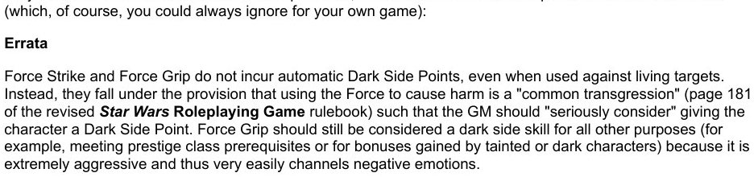
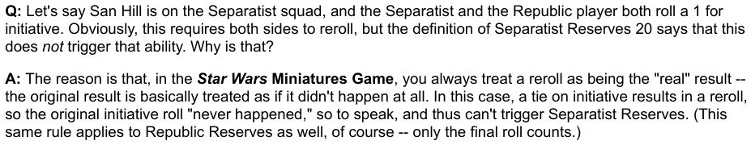
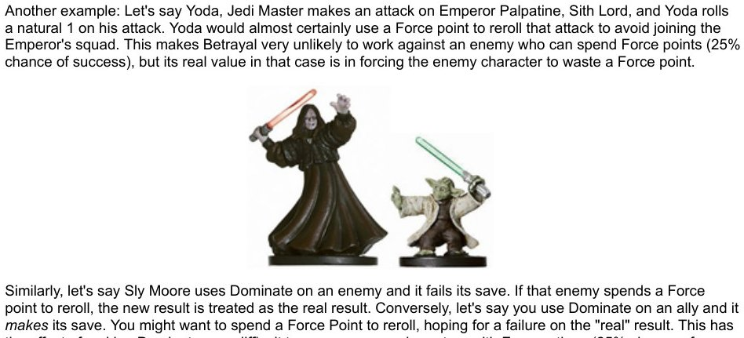
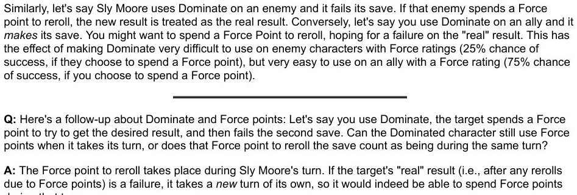
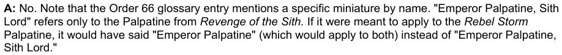
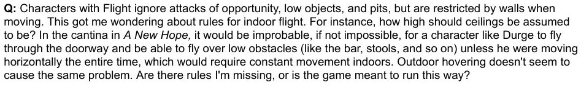

# Owner Material 037 — Star Wars D20 Drive folder (Core, Revised Core and Saga Edition): Jedi Counselling/Jedi Counseling 73.pdf [Star Wars Roleplaying Game Revised Core (d20, 2002)]

- **Source:** Wizards of the Coast Star Wars Roleplaying Game books, web enhancements, Living Force campaign modules and articles (2000–2010), from the owner's "Star Wars D20" Drive folder (only the three edition subfolders; "General" was not read, as instructed). Secondary source (licensed Legends reference). Scan OCR'd on the box; the scan stays box-only and is **not** published.
- **Method:** every scanned page was OCR'd and machine-screened sentence by sentence for power-relevant statements (fights, kills, defeats, Force feats, rankings, superweapons) that name a character on our roster; each kept sentence is quoted verbatim from the OCR text and has a crop of the printed passage directly under it. Pages with nothing power-relevant are still listed with what is on them.
- **Citation:** "*Jedi Counseling 73* (SWRPG d20 Revised Core), p.X" by printed page ("scan p.X" where no printed number applies). **Weight:** Licensed RPG material: a secondary source. Narrative text sums up Legends lore; game statistics are rules for players, not canon power levels, and rank lowest.

## scan p.1 (scan page 1)

Page contents: Weapon Focus scope, variant flexible Weapon Focus, lightsaber variants (hand-read)

## scan p.2 (scan page 2)

Page contents: Weapon master damage, why dark side skills are dark (Palpatine quote), Force Strike/Grip DSP errata (Yoda, Luke) (hand-read)

- **Palpatine (Darth Sidious)** — entry/section: Why dark side skills exist (quoting Palpatine): "A: Okay, let me answer the question of why dark side skills exist. To quote Palpatine: "The dark side of the Force is a pathway to many abilities some consider to be unnatural." That's probably the best definition -- a dark side skill is anything that has been deemed "unnatural." Consider the following list of dark side skills: Alchemy, Control Mind, Drain Energy, Drain Knowledge, Fear, Force Grip, Force Lightning, and Transfer Essence." Source: *Jedi Counseling 73* (SWRPG d20 Revised Core), scan p.2
  
- **Yoda; Palpatine (Darth Sidious)** — entry/section: Yoda's Force Push on Palpatine: "Q: Okay, given what you've said, why do Force Strike and Force Grip still incur an automatic Dark Side Point when used against a living target? They're not "unnatural," and even Yoda seems to use Force Strike against Palpatine in Revenge of the Sith. Given that he is probably the best model for proper Jedi behavior, why would he be inclined to gain Dark Side Points so casually?
A: You're right: He does appear to use the Force Push application of Force Strike against Palpatine, at least when he knocks him across a desk on the other side of the room. Given this and the fact that Move Object is not subject to this "automatic Dark Side Point" provision, I believe that this is best implemented as official errata (which, of course, you could always ignore for your own game):" Source: *Jedi Counseling 73* (SWRPG d20 Revised Core), scan p.2
  
- **No single roster character (rules/setting/general)** — entry/section: Errata: Force Strike and Force Grip Dark Side Points: "Force Strike and Force Grip do not incur automatic Dark Side Points, even when used against living targets. Instead, they fall under the provision that using the Force to cause harm is a "common transgression" (page 181 of the revised Star Wars Roleplaying Game rulebook) such that the GM should "seriously consider" giving the character a Dark Side Point. Force Grip should still be considered a dark side skill for all other purposes (for example, meeting prestige class prerequisites or for bonuses gained by tainted or dark characters) because it is extremely aggressive and thus very easily channels negative emotions." Source: *Jedi Counseling 73* (SWRPG d20 Revised Core), scan p.2
  

## scan p.3 (scan page 3)

Page contents: Luke/Gamorreans/Bib Fortuna; San Hill reserves and rerolls, Yoda vs Palpatine Betrayal, Sly Moore Dominate; Palpatine Order 66; Durge indoor flight Q (hand-read)

- **San Hill** — entry/section: San Hill's Separatist Reserves and initiative rerolls: "Q: Let's say San Hill is on the Separatist squad, and the Separatist and the Republic player both roll a 1 for initiative. Obviously, this requires both sides to reroll, but the definition of Separatist Reserves 20 says that this does not trigger that ability. Why is that?
A: The reason is that, in the Star Wars Miniatures Game, you always treat a reroll as being the "real" result -the original result is basically treated as if it didn't happen at all. In this case, a tie on initiative results in a reroll, so the original initiative roll "never happened," so to speak, and thus can't trigger Separatist Reserves. (This same rule applies to Republic Reserves as well, of course -- only the final roll counts.)" Source: *Jedi Counseling 73* (SWRPG d20 Revised Core), scan p.3
  
- **Yoda; Palpatine (Darth Sidious)** — entry/section: Yoda vs Palpatine's Betrayal: "Another example: Let's say Yoda, Jedi Master makes an attack on Emperor Palpatine, Sith Lord, and Yoda rolls a natural 1 on his attack. Yoda would almost certainly use a Force point to reroll that attack to avoid joining the Emperor's squad. This makes Betrayal very unlikely to work against an enemy who can spend Force points (25% chance of success), but its real value in that case is in forcing the enemy character to waste a Force point." Source: *Jedi Counseling 73* (SWRPG d20 Revised Core), scan p.3
  
- **Sly Moore** — entry/section: Sly Moore's Dominate and Force point rerolls: "Similarly, let's say Sly Moore uses Dominate on an enemy and it fails its save. If that enemy spends a Force point to reroll, the new result is treated as the real result. Conversely, let's say you use Dominate on an ally and it makes its save. You might want to spend a Force Point to reroll, hoping for a failure on the "real" result. This has the effect of making Dominate very difficult to use on enemy characters with Force ratings (25% chance of success, if they choose to spend a Force point), but very easy to use on an ally with a Force rating (75% chance of success, if you choose to spend a Force point)." Source: *Jedi Counseling 73* (SWRPG d20 Revised Core), scan p.3
  
- **Palpatine (Darth Sidious)** — entry/section: Rebel Storm Palpatine can't lead Order 66 units: "A: No. Note that the Order 66 glossary entry mentions a specific miniature by name. "Emperor Palpatine, Sith Lord" refers only to the Palpatine from Revenge of the Sith. If it were meant to apply to the Rebel Storm Palpatine, it would have said "Emperor Palpatine" (which would apply to both) instead of "Emperor Palpatine, Sith Lord."" Source: *Jedi Counseling 73* (SWRPG d20 Revised Core), scan p.3
  
- **Durge** — entry/section: Durge flying indoors in the cantina: "Q: Characters with Flight ignore attacks of opportunity, low objects, and pits, but are restricted by walls when moving. This got me wondering about rules for indoor flight. For instance, how high should ceilings be assumed to be? In the cantina in A New Hope, it would be improbable, if not impossible, for a character like Durge to fly through the doorway and be able to fly over low obstacles (like the bar, stools, and so on) unless he were moving horizontally the entire time, which would require constant movement indoors. Outdoor hovering doesn't seem to cause the same problem. Are there rules I'm missing, or is the game meant to run this way?" Source: *Jedi Counseling 73* (SWRPG d20 Revised Core), scan p.3
  

## scan p.4 (scan page 4)

Page contents: Indoor flight house-rule ideas; author bio (hand-read)

