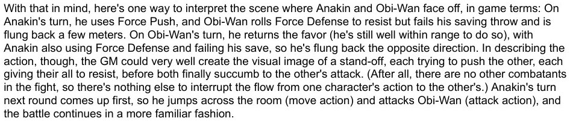
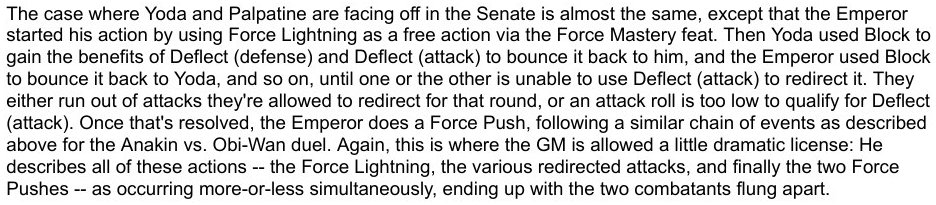
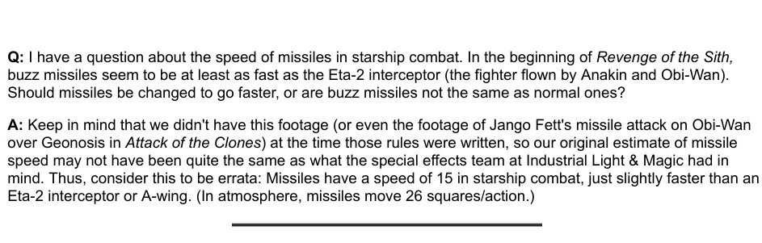
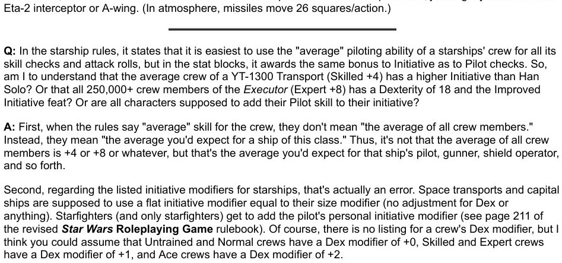
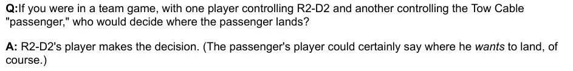
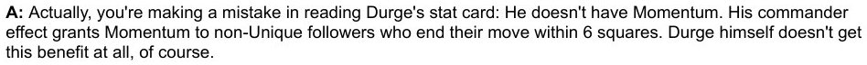
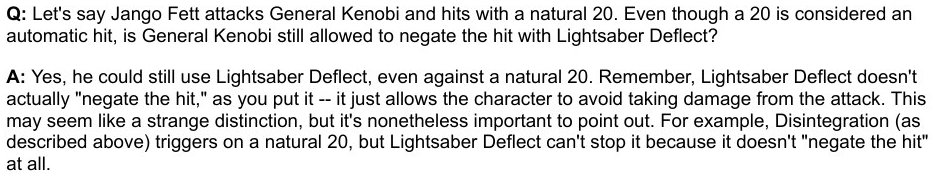

# Owner Material 037 — Star Wars D20 Drive folder (Core, Revised Core and Saga Edition): Jedi Counselling/Jedi Counseling 74.pdf [Star Wars Roleplaying Game Revised Core (d20, 2002)]

- **Source:** Wizards of the Coast Star Wars Roleplaying Game books, web enhancements, Living Force campaign modules and articles (2000–2010), from the owner's "Star Wars D20" Drive folder (only the three edition subfolders; "General" was not read, as instructed). Secondary source (licensed Legends reference). Scan OCR'd on the box; the scan stays box-only and is **not** published.
- **Method:** every scanned page was OCR'd and machine-screened sentence by sentence for power-relevant statements (fights, kills, defeats, Force feats, rankings, superweapons) that name a character on our roster; each kept sentence is quoted verbatim from the OCR text and has a crop of the printed passage directly under it. Pages with nothing power-relevant are still listed with what is on them.
- **Citation:** "*Jedi Counseling 74* (SWRPG d20 Revised Core), p.X" by printed page ("scan p.X" where no printed number applies). **Weight:** Licensed RPG material: a secondary source. Narrative text sums up Legends lore; game statistics are rules for players, not canon power levels, and rank lowest.

## scan p.1 (scan page 1)

Page contents: Force stand-offs: Anakin/Obi-Wan, Yoda/Palpatine (hand-read)

- **Darth Vader (Anakin Skywalker); Obi-Wan Kenobi** — entry/section: Anakin and Obi-Wan's Force stand-off in game terms: "With that in mind, here's one way to interpret the scene where Anakin and Obi-Wan face off, in game terms: On Anakin's turn, he uses Force Push, and Obi-Wan rolls Force Defense to resist but fails his saving throw and is flung back a few meters. On Obi-Wan's turn, he returns the favor (he's still well within range to do so), with Anakin also using Force Defense and failing his save, so he's flung back the opposite direction. In describing the action, though, the GM could very well create the visual image of a stand-off, each trying to push the other, each giving their all to resist, before both finally succumb to the other's attack. (After all, there are no other combatants in the fight, so there's nothing else to interrupt the flow from one character's action to the other's.) Anakin's turn next round comes up first, so he jumps across the room (move action) and attacks Obi-Wan (attack action), and the battle continues in a more familiar fashion." Source: *Jedi Counseling 74* (SWRPG d20 Revised Core), scan p.1
  
- **Yoda; Palpatine (Darth Sidious)** — entry/section: Yoda and Palpatine's stand-off in the Senate: "The case where Yoda and Palpatine are facing off in the Senate is almost the same, except that the Emperor started his action by using Force Lightning as a free action via the Force Mastery feat. Then Yoda used Block to gain the benefits of Deflect (defense) and Deflect (attack) to bounce it back to him, and the Emperor used Block to bounce it back to Yoda, and so on, until one or the other is unable to use Deflect (attack) to redirect it. They either run out of attacks they're allowed to redirect for that round, or an attack roll is too low to qualify for Deflect (attack). Once that's resolved, the Emperor does a Force Push, following a similar chain of events as described above for the Anakin vs. Obi-Wan duel. Again, this is where the GM is allowed a little dramatic license: He describes all of these actions -- the Force Lightning, the various redirected attacks, and finally the two Force Pushes -- as occurring more-or-less simultaneously, ending up with the two combatants flung apart." Source: *Jedi Counseling 74* (SWRPG d20 Revised Core), scan p.1
  

## scan p.2 (scan page 2)

Page contents: Missile speed errata, crew skill/initiative errata; Disintegration, low objects, Tow Cable (hand-read)

- **Jango Fett; Obi-Wan Kenobi; Darth Vader (Anakin Skywalker)** — entry/section: Missile speed errata (buzz missiles, Jango's missiles): "Q: I have a question about the speed of missiles in starship combat. In the beginning of Revenge of the Sith, buzz missiles seem to be at least as fast as the Eta-2 interceptor (the fighter flown by Anakin and Obi-Wan). Should missiles be changed to go faster, or are buzz missiles not the same as normal ones?
A: Keep in mind that we didn't have this footage (or even the footage of Jango Fett's missile attack on Obi-Wan over Geonosis in Attack of the Clones) at the time those rules were written, so our original estimate of missile speed may not have been quite the same as what the special effects team at Industrial Light & Magic had in mind. Thus, consider this to be errata: Missiles have a speed of 15 in starship combat, just slightly faster than an Eta-2 interceptor or A-wing. (In atmosphere, missiles move 26 squares/action.)" Source: *Jedi Counseling 74* (SWRPG d20 Revised Core), scan p.2
  
- **Han Solo** — entry/section: Starship crew initiative errata (YT-1300 vs Han Solo): "Q: In the starship rules, it states that it is easiest to use the "average" piloting ability of a starships' crew for all its skill checks and attack rolls, but in the stat blocks, it awards the same bonus to Initiative as to Pilot checks. So, am I to understand that the average crew of a YT-1300 Transport (Skilled +4) has a higher Initiative than Han Solo? Or that all 250,000+ crew members of the Executor (Expert +8) has a Dexterity of 18 and the Improved Initiative feat? Or are all characters supposed to add their Pilot skill to their initiative?
A: First, when the rules say "average" skill for the crew, they don't mean "the average of all crew members." Instead, they mean "the average you'd expect for a ship of this class." Thus, it's not that the average of all crew members is +4 or +8 or whatever, but that's the average you'd expect for that ship's pilot, gunner, shield operator, and so forth.
Second, regarding the listed initiative modifiers for starships, that's actually an error. Space transports and capital ships are supposed to use a flat initiative modifier equal to their size modifier (no adjustment for Dex or anything). Starfighters (and only starfighters) get to add the pilot's personal initiative modifier (see page 211 of the revised Star Wars Roleplaying Game rulebook). Of course, there is no listing for a crew's Dex modifier, but I think you could assume that Untrained and Normal crews have a Dex modifier of +0, Skilled and Expert crews have a Dex modifier of +1, and Ace crews have a Dex modifier of +2." Source: *Jedi Counseling 74* (SWRPG d20 Revised Core), scan p.2
  

## scan p.3 (scan page 3)

Page contents: R2-D2 Tow Cable passenger, Riposte limit, Durge Momentum, Jango vs Kenobi natural 20, Gungan Cavalry; author bio (hand-read)

- **R2-D2** — entry/section: R2-D2's player decides where the passenger lands: "Q: If you were in a team game, with one player controlling R2-D2 and another controlling the Tow Cable "passenger," who would decide where the passenger lands?
A: R2-D2's player makes the decision. (The passenger's player could certainly say where he wants to land, of course.)" Source: *Jedi Counseling 74* (SWRPG d20 Revised Core), scan p.3
  
- **Durge** — entry/section: Durge doesn't have Momentum: "A: Actually, you're making a mistake in reading Durge's stat card: He doesn't have Momentum. His commander effect grants Momentum to non-Unique followers who end their move within 6 squares. Durge himself doesn't get this benefit at all, of course." Source: *Jedi Counseling 74* (SWRPG d20 Revised Core), scan p.3
  
- **Jango Fett; Obi-Wan Kenobi** — entry/section: Jango Fett's natural 20 vs General Kenobi's Lightsaber Deflect: "Q: Let's say Jango Fett attacks General Kenobi and hits with a natural 20. Even though a 20 is considered an automatic hit, is General Kenobi still allowed to negate the hit with Lightsaber Deflect?
A: Yes, he could still use Lightsaber Deflect, even against a natural 20. Remember, Lightsaber Deflect doesn't actually "negate the hit," as you put it -- it just allows the character to avoid taking damage from the attack. This may seem like a strange distinction, but it's nonetheless important to point out. For example, Disintegration (as described above) triggers on a natural 20, but Lightsaber Deflect can't stop it because it doesn't "negate the hit" at all." Source: *Jedi Counseling 74* (SWRPG d20 Revised Core), scan p.3
  

## scan p.4 (scan page 4)

Page contents: Copyright line only (hand-read)

