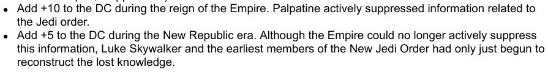
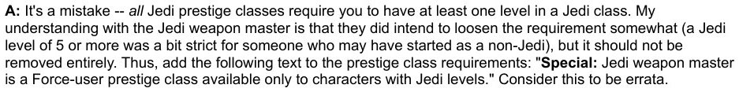
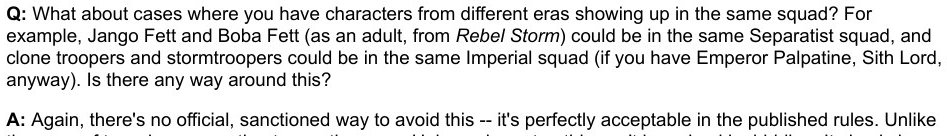
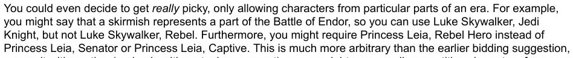
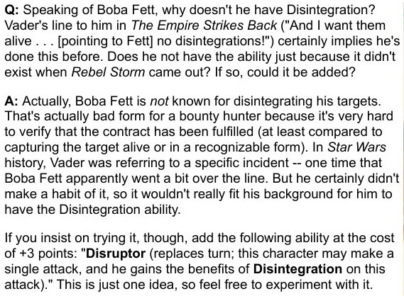

# Owner Material 037 — Star Wars D20 Drive folder (Core, Revised Core and Saga Edition): Jedi Counselling/Jedi Counseling 75.pdf [Star Wars Roleplaying Game Revised Core (d20, 2002)]

- **Source:** Wizards of the Coast Star Wars Roleplaying Game books, web enhancements, Living Force campaign modules and articles (2000–2010), from the owner's "Star Wars D20" Drive folder (only the three edition subfolders; "General" was not read, as instructed). Secondary source (licensed Legends reference). Scan OCR'd on the box; the scan stays box-only and is **not** published.
- **Method:** every scanned page was OCR'd and machine-screened sentence by sentence for power-relevant statements (fights, kills, defeats, Force feats, rankings, superweapons) that name a character on our roster; each kept sentence is quoted verbatim from the OCR text and has a crop of the printed passage directly under it. Pages with nothing power-relevant are still listed with what is on them.
- **Citation:** "*Jedi Counseling 75* (SWRPG d20 Revised Core), p.X" by printed page ("scan p.X" where no printed number applies). **Weight:** Licensed RPG material: a secondary source. Narrative text sums up Legends lore; game statistics are rules for players, not canon power levels, and rank lowest.

## scan p.1 (scan page 1)

Page contents: Lightsaber crystal search: Table 1 and modifiers, Table 2 (hand-read)

- **Palpatine (Darth Sidious); Luke Skywalker** — entry/section: Knowledge (Jedi lore) DC modifiers by era: "Add +10 to the DC during the reign of the Empire. Palpatine actively suppressed information related to the Jedi order.
Add +5 to the DC during the New Republic era. Although the Empire could no longer actively suppress this information, Luke Skywalker and the earliest members of the New Jedi Order had only just begun to reconstruct the lost knowledge." Source: *Jedi Counseling 75* (SWRPG d20 Revised Core), scan p.1
  

## scan p.2 (scan page 2)

Page contents: Size modifiers; ability checks; Jedi weapon master errata; Force warrior feats; continuity Q on Unique figures (hand-read)

- **No single roster character (rules/setting/general)** — entry/section: Heavy lightsaber crystal: "Add +10 to the DC for a "heavy lightsaber" crystal (Large, 2d10 damage, 1.8 kg, otherwise the same as a normal lightsaber). These are much larger and extremely rare." Source: *Jedi Counseling 75* (SWRPG d20 Revised Core), scan p.2
  
- **No single roster character (rules/setting/general)** — entry/section: Errata: Jedi weapon master requires Jedi levels: "A: It's a mistake -- all Jedi prestige classes require you to have at least one level in a Jedi class. My understanding with the Jedi weapon master is that they did intend to loosen the requirement somewhat (a Jedi level of 5 or more was a bit strict for someone who may have started as a non-Jedi), but it should not be removed entirely. Thus, add the following text to the prestige class requirements: "Special: Jedi weapon master is a Force-user prestige class available only to characters with Jedi levels." Consider this to be errata." Source: *Jedi Counseling 75* (SWRPG d20 Revised Core), scan p.2
  

## scan p.3 (scan page 3)

Page contents: Imposters and bidding house rule; eras; Boba Fett Disintegration; author bio (hand-read)

- **Jango Fett; Boba Fett; Palpatine (Darth Sidious)** — entry/section: Mixing eras in one squad: "Q: What about cases where you have characters from different eras showing up in the same squad? For example, Jango Fett and Boba Fett (as an adult, from Rebel Storm) could be in the same Separatist squad, and clone troopers and stormtroopers could be in the same Imperial squad (if you have Emperor Palpatine, Sith Lord, anyway). Is there any way around this?" Source: *Jedi Counseling 75* (SWRPG d20 Revised Core), scan p.3
  
- **Luke Skywalker; Leia Organa Solo** — entry/section: Era-restricted skirmish: the Battle of Endor: "You could even decide to get really picky, only allowing characters from particular parts of an era. For example, you might say that a skirmish represents a part of the Battle of Endor, so you can use Luke Skywalker, Jedi Knight, but not Luke Skywalker, Rebel. Furthermore, you might require Princess Leia, Rebel Hero instead of Princess Leia, Senator or Princess Leia, Captive." Source: *Jedi Counseling 75* (SWRPG d20 Revised Core), scan p.3
  
- **Boba Fett; Darth Vader (Anakin Skywalker)** — entry/section: Why Boba Fett doesn't have Disintegration: "Q: Speaking of Boba Fett, why doesn't he have Disintegration? Vader's line to him in The Empire Strikes Back ("And I want them alive . . . [pointing to Fett] no disintegrations!") certainly implies he's done this before. Does he not have the ability just because it didn't exist when Rebel Storm came out? If so, could it be added?
A: Actually, Boba Fett is not known for disintegrating his targets. That's actually bad form for a bounty hunter because it's very hard to verify that the contract has been fulfilled (at least compared to capturing the target alive or in a recognizable form). In Star Wars history, Vader was referring to a specific incident -- one time that Boba Fett apparently went a bit over the line. But he certainly didn't make a habit of it, so it wouldn't really fit his background for him to have the Disintegration ability.
If you insist on trying it, though, add the following ability at the cost of +3 points: "Disruptor (replaces turn; this character may make a single attack, and he gains the benefits of Disintegration on this attack)." This is just one idea, so feel free to experiment with it." Source: *Jedi Counseling 75* (SWRPG d20 Revised Core), scan p.3
  

## scan p.4 (scan page 4)

Page contents: Closing, copyright (hand-read)

