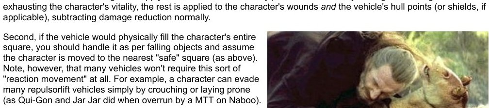
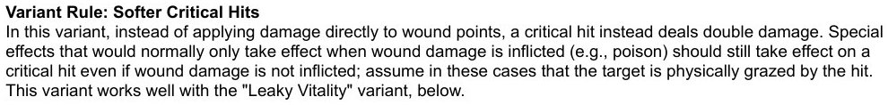
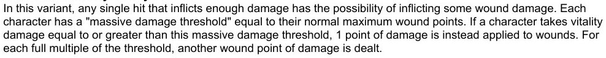
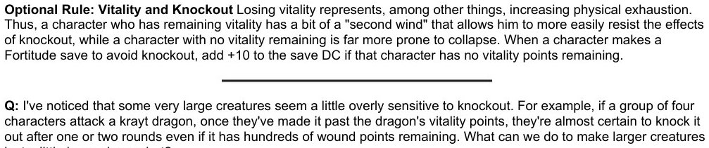
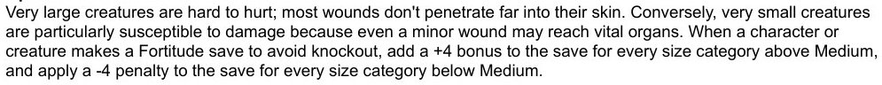
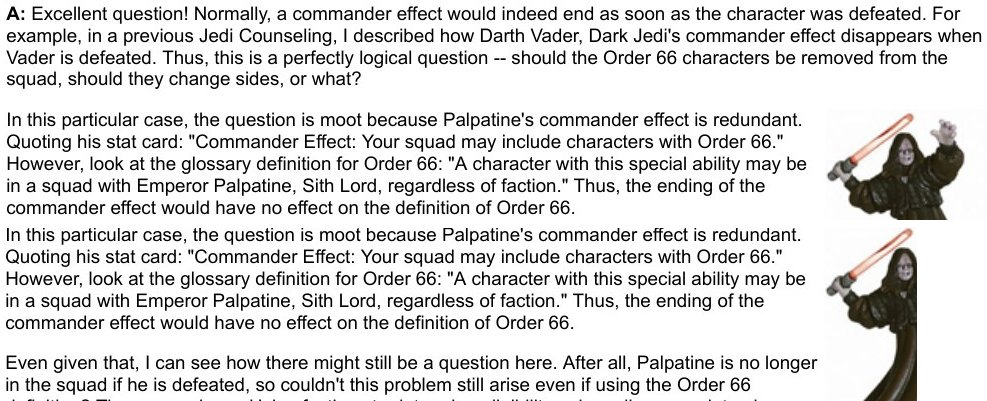
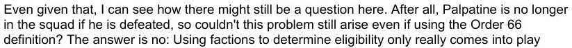

# Owner Material 037 — Star Wars D20 Drive folder (Core, Revised Core and Saga Edition): Jedi Counselling/Jedi Counseling 76.pdf [Star Wars Roleplaying Game Revised Core (d20, 2002)]

- **Source:** Wizards of the Coast Star Wars Roleplaying Game books, web enhancements, Living Force campaign modules and articles (2000–2010), from the owner's "Star Wars D20" Drive folder (only the three edition subfolders; "General" was not read, as instructed). Secondary source (licensed Legends reference). Scan OCR'd on the box; the scan stays box-only and is **not** published.
- **Method:** every scanned page was OCR'd and machine-screened sentence by sentence for power-relevant statements (fights, kills, defeats, Force feats, rankings, superweapons) that name a character on our roster; each kept sentence is quoted verbatim from the OCR text and has a crop of the printed passage directly under it. Pages with nothing power-relevant are still listed with what is on them.
- **Citation:** "*Jedi Counseling 76* (SWRPG d20 Revised Core), p.X" by printed page ("scan p.X" where no printed number applies). **Weight:** Licensed RPG material: a secondary source. Narrative text sums up Legends lore; game statistics are rules for players, not canon power levels, and rank lowest.

## scan p.1 (scan page 1)

Page contents: Hurled-object saves, falling slab, vehicle rams; vitality/wounds complaints (hand-read)

- **Qui-Gon Jinn; Jar Jar Binks** — entry/section: Vehicle rams: Qui-Gon and Jar Jar under the MTT: "Second, if the vehicle would physically fill the character's entire square, you should handle it as per falling objects and assume the character is moved to the nearest "safe" square (as above). Note, however, that many vehicles won't require this sort of "reaction movement" at all. For example, a character can evade many repulsorlift vehicles simply by crouching or laying prone (as Qui-Gon and Jar Jar did when overrun by a MTT on Naboo)." Source: *Jedi Counseling 76* (SWRPG d20 Revised Core), scan p.1
  

## scan p.2 (scan page 2)

Page contents: Variants Softer Critical Hits, Leaky Vitality, Vitality and Knockout; krayt dragon knockout; DR table (Large/Huge) (hand-read)

- **No single roster character (rules/setting/general)** — entry/section: Variant Rule: Softer Critical Hits: "In this variant, instead of applying damage directly to wound points, a critical hit instead deals double damage. Special effects that would normally only take effect when wound damage is inflicted (e.g., poison) should still take effect on a critical hit even if wound damage is not inflicted; assume in these cases that the target is physically grazed by the hit. This variant works well with the "Leaky Vitality" variant, below." Source: *Jedi Counseling 76* (SWRPG d20 Revised Core), scan p.2
  
- **No single roster character (rules/setting/general)** — entry/section: Variant Rule: Leaky Vitality: "In this variant, any single hit that inflicts enough damage has the possibility of inflicting some wound damage. Each character has a "massive damage threshold" equal to their normal maximum wound points. If a character takes vitality damage equal to or greater than this massive damage threshold, 1 point of damage is instead applied to wounds. For each full multiple of the threshold, another wound point of damage is dealt." Source: *Jedi Counseling 76* (SWRPG d20 Revised Core), scan p.2
  
- **No single roster character (rules/setting/general)** — entry/section: Optional Rule: Vitality and Knockout: "Losing vitality represents, among other things, increasing physical exhaustion. Thus, a character who has remaining vitality has a bit of a "second wind" that allows him to more easily resist the effects of knockout, while a character with no vitality remaining is far more prone to collapse. When a character makes a Fortitude save to avoid knockout, add +10 to the save DC if that character has no vitality points remaining." Source: *Jedi Counseling 76* (SWRPG d20 Revised Core), scan p.2
  

## scan p.3 (scan page 3)

Page contents: DR table (Gargantuan/Colossal), Size and Knockout; Palpatine Order 66 defeated; Viper Droid; Rancor reach (hand-read)

- **No single roster character (rules/setting/general)** — entry/section: Optional Rule: Size and Knockout: "Very large creatures are hard to hurt; most wounds don't penetrate far into their skin. Conversely, very small creatures are particularly susceptible to damage because even a minor wound may reach vital organs. When a character or creature makes a Fortitude save to avoid knockout, add a +4 bonus to the save for every size category above Medium, and apply a -4 penalty to the save for every size category below Medium." Source: *Jedi Counseling 76* (SWRPG d20 Revised Core), scan p.3
  
- **Palpatine (Darth Sidious); Darth Vader (Anakin Skywalker)** — entry/section: Order 66 characters after Palpatine is defeated: "A: Excellent question! Normally, a commander effect would indeed end as soon as the character was defeated. For example, in a previous Jedi Counseling, I described how Darth Vader, Dark Jedi's commander effect disappears when Vader is defeated. Thus, this is a perfectly logical question -- should the Order 66 characters be removed from the squad, should they change sides, or what?
In this particular case, the question is moot because Palpatine's commander effect is redundant. Quoting his stat card: "Commander Effect: Your squad may include characters with Order 66." However, look at the glossary definition for Order 66: "A character with this special ability may be in a squad with Emperor Palpatine, Sith Lord, regardless of faction." Thus, the ending of the commander effect would have no effect on the definition of Order 66." Source: *Jedi Counseling 76* (SWRPG d20 Revised Core), scan p.3
  
- **Palpatine (Darth Sidious)**: "After all, Palpatine is no longer in the squad if he is defeated, so couldn't this problem still arise even if using the Order 66 definition?" Source: *Jedi Counseling 76* (SWRPG d20 Revised Core), scan p.3
  

## scan p.4 (scan page 4)

Page contents: Rancor cover/Savage; RPG stats for minis; author bio (hand-read)

