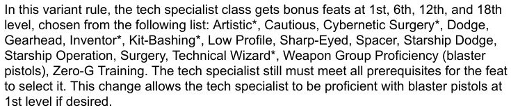
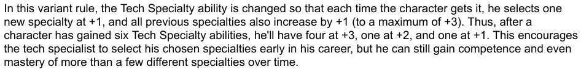
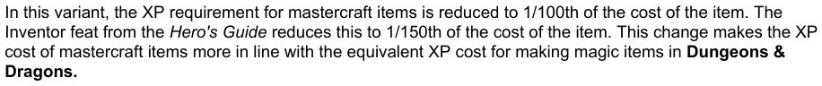
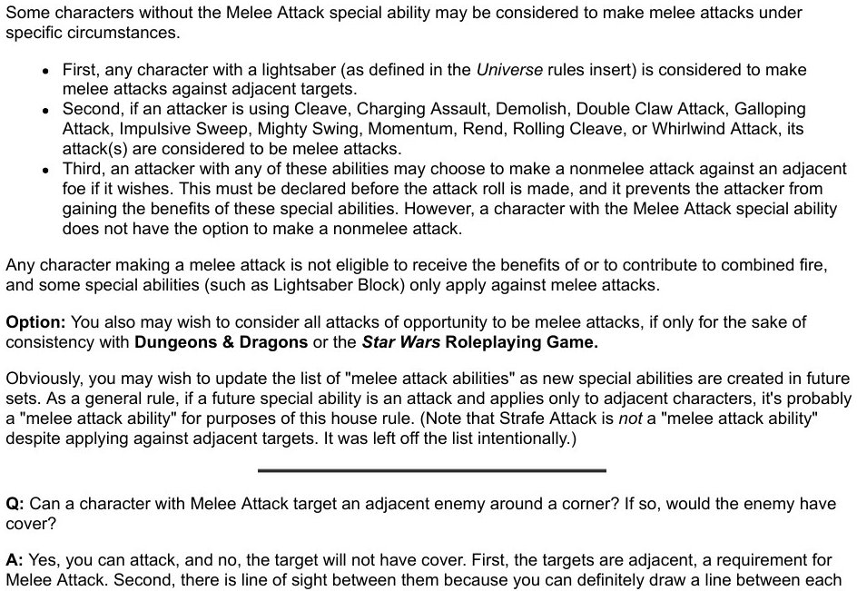

# Owner Material 037 — Star Wars D20 Drive folder (Core, Revised Core and Saga Edition): Jedi Counselling/Jedi Counseling 77.pdf [Star Wars Roleplaying Game Revised Core (d20, 2002)]

- **Source:** Wizards of the Coast Star Wars Roleplaying Game books, web enhancements, Living Force campaign modules and articles (2000–2010), from the owner's "Star Wars D20" Drive folder (only the three edition subfolders; "General" was not read, as instructed). Secondary source (licensed Legends reference). Scan OCR'd on the box; the scan stays box-only and is **not** published.
- **Method:** every scanned page was OCR'd and machine-screened sentence by sentence for power-relevant statements (fights, kills, defeats, Force feats, rankings, superweapons) that name a character on our roster; each kept sentence is quoted verbatim from the OCR text and has a crop of the printed passage directly under it. Pages with nothing power-relevant are still listed with what is on them.
- **Citation:** "*Jedi Counseling 77* (SWRPG d20 Revised Core), p.X" by printed page ("scan p.X" where no printed number applies). **Weight:** Licensed RPG material: a secondary source. Narrative text sums up Legends lore; game statistics are rules for players, not canon power levels, and rank lowest.

## scan p.1 (scan page 1)

Page contents: Tech specialist variants (bonus feats, stacking specialties, cheaper mastercrafting) (hand-read)

- **No single roster character (rules/setting/general)** — entry/section: Variant: Tech Specialist Bonus Feats: "In this variant rule, the tech specialist class gets bonus feats at 1st, 6th, 12th, and 18th level, chosen from the following list: Artistic*, Cautious, Cybernetic Surgery*, Dodge, Gearhead, Inventor*, Kit-Bashing*, Low Profile, Sharp-Eyed, Spacer, Starship Dodge, Starship Operation, Surgery, Technical Wizard*, Weapon Group Proficiency (blaster pistols), Zero-G Training. The tech specialist still must meet all prerequisites for the feat to select it. This change allows the tech specialist to be proficient with blaster pistols at 1st level if desired." Source: *Jedi Counseling 77* (SWRPG d20 Revised Core), scan p.1
  
- **No single roster character (rules/setting/general)** — entry/section: Variant: Stacking Tech Specialties: "In this variant rule, the Tech Specialty ability is changed so that each time the character gets it, he selects one new specialty at +1, and all previous specialties also increase by +1 (to a maximum of +3). Thus, after a character has gained six Tech Specialty abilities, he'll have four at +3, one at +2, and one at +1. This encourages the tech specialist to select his chosen specialties early in his career, but he can still gain competence and even mastery of more than a few different specialties over time." Source: *Jedi Counseling 77* (SWRPG d20 Revised Core), scan p.1
  
- **No single roster character (rules/setting/general)** — entry/section: Variant: Cheaper Mastercrafting: "In this variant, the XP requirement for mastercraft items is reduced to 1/100th of the cost of the item. The Inventor feat from the Hero's Guide reduces this to 1/150th of the cost of the item. This change makes the XP cost of mastercraft items more in line with the equivalent XP cost for making magic items in Dungeons & Dragons." Source: *Jedi Counseling 77* (SWRPG d20 Revised Core), scan p.1
  

## scan p.2 (scan page 2)

Page contents: More skill points variant; Deadly Strike; threat range; Anakin AoOs; Dark Side Adept; IG-88/4-LOM Q (hand-read)

- **Darth Vader (Anakin Skywalker); Obi-Wan Kenobi** — entry/section: Anakin's two attacks of opportunity clarified: "A: Actually, Jedi Counseling 71 is still correct, but I wasn't clear about the source of each attack of opportunity. The first attack of opportunity is provoked by moving into an opponent's space (Obi-Wan's), and the second attack of opportunity is provoked by leaving a threatened square." Source: *Jedi Counseling 77* (SWRPG d20 Revised Core), scan p.2
  

## scan p.3 (scan page 3)

Page contents: Jabba commander effect answer; Tusken Raider on Bantha; house rule Other Melee Attacks; corners (hand-read)

- **No single roster character (rules/setting/general)** — entry/section: House Rule: Other Melee Attacks: "Some characters without the Melee Attack special ability may be considered to make melee attacks under specific circumstances.
First, any character with a lightsaber (as defined in the Universe rules insert) is considered to make melee attacks against adjacent targets.
Second, if an attacker is using Cleave, Charging Assault, Demolish, Double Claw Attack, Galloping Attack, Impulsive Sweep, Mighty Swing, Momentum, Rend, Rolling Cleave, or Whirlwind Attack, its attack(s) are considered to be melee attacks.
Third, an attacker with any of these abilities may choose to make a nonmelee attack against an adjacent foe if it wishes. This must be declared before the attack roll is made, and it prevents the attacker from gaining the benefits of these special abilities. However, a character with the Melee Attack special ability does not have the option to make a nonmelee attack.
Any character making a melee attack is not eligible to receive the benefits of or to contribute to combined fire, and some special abilities (such as Lightsaber Block) only apply against melee attacks." Source: *Jedi Counseling 77* (SWRPG d20 Revised Core), scan p.3
  

## scan p.4 (scan page 4)

Page contents: Corner cover; author bio (hand-read)

