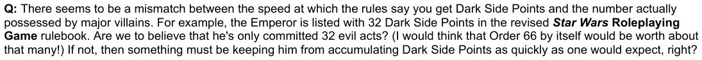
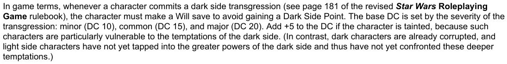
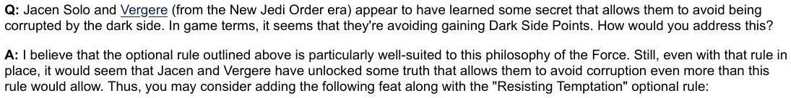
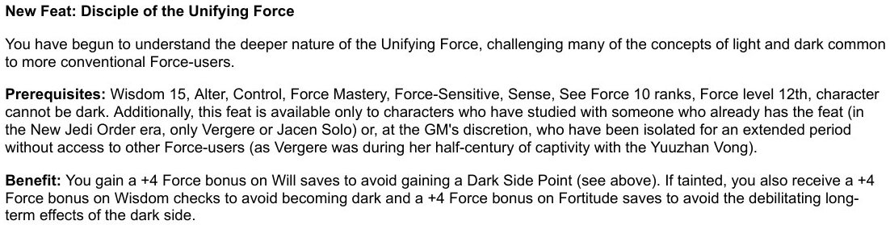
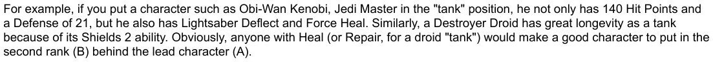
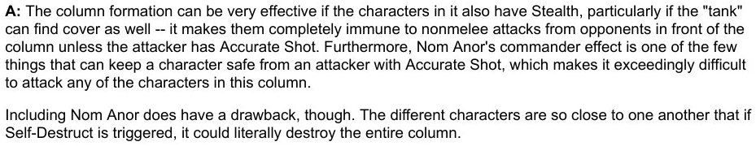

# Owner Material 037 — Star Wars D20 Drive folder (Core, Revised Core and Saga Edition): Jedi Counselling/Jedi Counseling 78.pdf [Star Wars Roleplaying Game Revised Core (d20, 2002)]

- **Source:** Wizards of the Coast Star Wars Roleplaying Game books, web enhancements, Living Force campaign modules and articles (2000–2010), from the owner's "Star Wars D20" Drive folder (only the three edition subfolders; "General" was not read, as instructed). Secondary source (licensed Legends reference). Scan OCR'd on the box; the scan stays box-only and is **not** published.
- **Method:** every scanned page was OCR'd and machine-screened sentence by sentence for power-relevant statements (fights, kills, defeats, Force feats, rankings, superweapons) that name a character on our roster; each kept sentence is quoted verbatim from the OCR text and has a crop of the printed passage directly under it. Pages with nothing power-relevant are still listed with what is on them.
- **Citation:** "*Jedi Counseling 78* (SWRPG d20 Revised Core), p.X" by printed page ("scan p.X" where no printed number applies). **Weight:** Licensed RPG material: a secondary source. Narrative text sums up Legends lore; game statistics are rules for players, not canon power levels, and rank lowest.

## scan p.1 (scan page 1)

Page contents: Emperor's DSPs; optional rule Resisting Temptation (hand-read)

- **Palpatine (Darth Sidious)** — entry/section: The Emperor has only 32 Dark Side Points?: "Q: There seems to be a mismatch between the speed at which the rules say you get Dark Side Points and the number actually possessed by major villains. For example, the Emperor is listed with 32 Dark Side Points in the revised Star Wars Roleplaying Game rulebook. Are we to believe that he's only committed 32 evil acts? (I would think that Order 66 by itself would be worth about that many!) If not, then something must be keeping him from accumulating Dark Side Points as quickly as one would expect, right?" Source: *Jedi Counseling 78* (SWRPG d20 Revised Core), scan p.1
  
- **No single roster character (rules/setting/general)** — entry/section: Optional Rule: Resisting Temptation: "In game terms, whenever a character commits a dark side transgression (see page 181 of the revised Star Wars Roleplaying Game rulebook), the character must make a Will save to avoid gaining a Dark Side Point. The base DC is set by the severity of the transgression: minor (DC 10), common (DC 15), and major (DC 20). Add +5 to the DC if the character is tainted, because such characters are particularly vulnerable to the temptations of the dark side. (In contrast, dark characters are already corrupted, and light side characters have not yet tapped into the greater powers of the dark side and thus have not yet confronted these deeper temptations.)" Source: *Jedi Counseling 78* (SWRPG d20 Revised Core), scan p.1
  

## scan p.2 (scan page 2)

Page contents: Jacen Solo and Vergere; feat Disciple of the Unifying Force; Kushiban reach, Tiny lightsabers; gambit range Q (hand-read)

- **Jacen Solo (Darth Caedus); Vergere** — entry/section: Jacen Solo and Vergere avoid corruption: "Q: Jacen Solo and Vergere (from the New Jedi Order era) appear to have learned some secret that allows them to avoid being corrupted by the dark side. In game terms, it seems that they're avoiding gaining Dark Side Points. How would you address this?
A: I believe that the optional rule outlined above is particularly well-suited to this philosophy of the Force. Still, even with that rule in place, it would seem that Jacen and Vergere have unlocked some truth that allows them to avoid corruption even more than this rule would allow. Thus, you may consider adding the following feat along with the "Resisting Temptation" optional rule:" Source: *Jedi Counseling 78* (SWRPG d20 Revised Core), scan p.2
  
- **Jacen Solo (Darth Caedus); Vergere** — entry/section: Feat: Disciple of the Unifying Force: "New Feat: Disciple of the Unifying Force
You have begun to understand the deeper nature of the Unifying Force, challenging many of the concepts of light and dark common to more conventional Force-users.
Prerequisites: Wisdom 15, Alter, Control, Force Mastery, Force-Sensitive, Sense, See Force 10 ranks, Force level 12th, character cannot be dark. Additionally, this feat is available only to characters who have studied with someone who already has the feat (in the New Jedi Order era, only Vergere or Jacen Solo) or, at the GM's discretion, who have been isolated for an extended period without access to other Force-users (as Vergere was during her half-century of captivity with the Yuuzhan Vong).
Benefit: You gain a +4 Force bonus on Will saves to avoid gaining a Dark Side Point (see above). If tainted, you also receive a +4 Force bonus on Wisdom checks to avoid becoming dark and a +4 Force bonus on Fortitude saves to avoid the debilitating longterm effects of the dark side." Source: *Jedi Counseling 78* (SWRPG d20 Revised Core), scan p.2
  

## scan p.3 (scan page 3)

Page contents: Figure 1; adjacent allies cover, Figure 2; column formation, Figure 3 (hand-read)

## scan p.4 (scan page 4)

Page contents: Column tank (Obi-Wan), Nom Anor, Sniper; author bio (hand-read)

- **Obi-Wan Kenobi** — entry/section: Obi-Wan Kenobi, Jedi Master as the column's tank: "For example, if you put a character such as Obi-Wan Kenobi, Jedi Master in the "tank" position, he not only has 140 Hit Points and a Defense of 21, but he also has Lightsaber Deflect and Force Heal. Similarly, a Destroyer Droid has great longevity as a tank because of its Shields 2 ability. Obviously, anyone with Heal (or Repair, for a droid "tank") would make a good character to put in the second rank (B) behind the lead character (A)." Source: *Jedi Counseling 78* (SWRPG d20 Revised Core), scan p.4
  
- **Nom Anor** — entry/section: Column formation with Nom Anor: "A: The column formation can be very effective if the characters in it also have Stealth, particularly if the "tank" can find cover as well -- it makes them completely immune to nonmelee attacks from opponents in front of the column unless the attacker has Accurate Shot. Furthermore, Nom Anor's commander effect is one of the few things that can keep a character safe from an attacker with Accurate Shot, which makes it exceedingly difficult to attack any of the characters in this column.
Including Nom Anor does have a drawback, though. The different characters are so close to one another that if Self-Destruct is triggered, it could literally destroy the entire column." Source: *Jedi Counseling 78* (SWRPG d20 Revised Core), scan p.4
  
