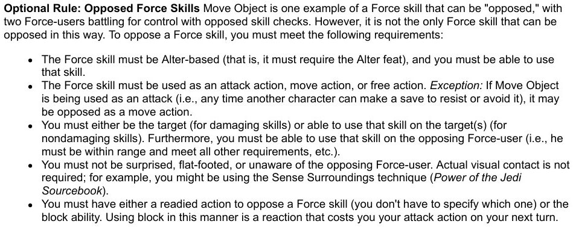
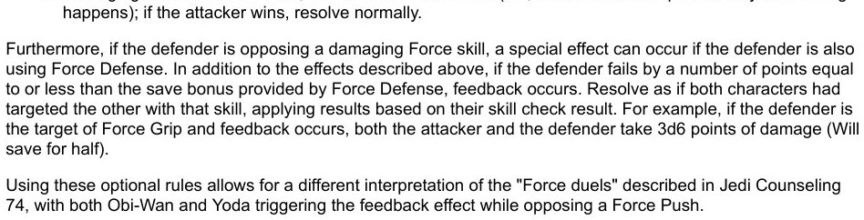
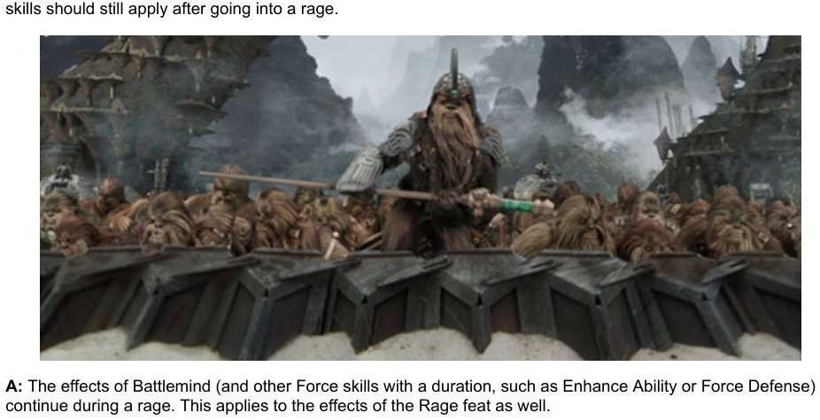
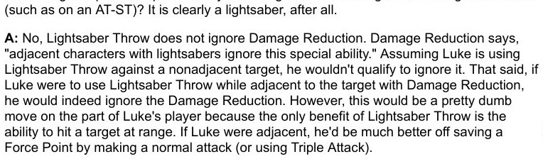
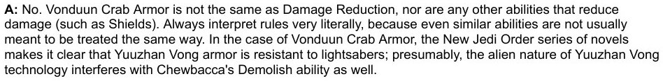
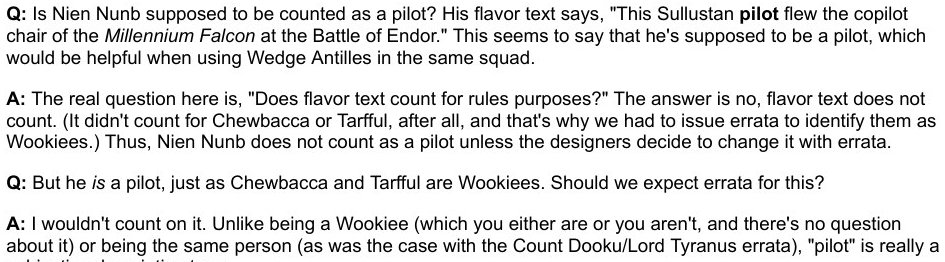
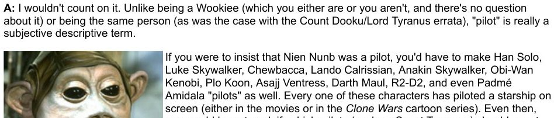

# Owner Material 037 — Star Wars D20 Drive folder (Core, Revised Core and Saga Edition): Jedi Counselling/Jedi Counseling 79.pdf [Star Wars Roleplaying Game Revised Core (d20, 2002)]

- **Source:** Wizards of the Coast Star Wars Roleplaying Game books, web enhancements, Living Force campaign modules and articles (2000–2010), from the owner's "Star Wars D20" Drive folder (only the three edition subfolders; "General" was not read, as instructed). Secondary source (licensed Legends reference). Scan OCR'd on the box; the scan stays box-only and is **not** published.
- **Method:** every scanned page was OCR'd and machine-screened sentence by sentence for power-relevant statements (fights, kills, defeats, Force feats, rankings, superweapons) that name a character on our roster; each kept sentence is quoted verbatim from the OCR text and has a crop of the printed passage directly under it. Pages with nothing power-relevant are still listed with what is on them.
- **Citation:** "*Jedi Counseling 79* (SWRPG d20 Revised Core), p.X" by printed page ("scan p.X" where no printed number applies). **Weight:** Licensed RPG material: a secondary source. Narrative text sums up Legends lore; game statistics are rules for players, not canon power levels, and rank lowest.

## scan p.1 (scan page 1)

Page contents: Optional Rule: Opposed Force Skills requirements and results (hand-read)

- **No single roster character (rules/setting/general)** — entry/section: Optional Rule: Opposed Force Skills (requirements): "Move Object is one example of a Force skill that can be "opposed," with two Force-users battling for control with opposed skill checks. However, it is not the only Force skill that can be opposed in this way. To oppose a Force skill, you must meet the following requirements:
The Force skill must be Alter-based (that is, it must require the Alter feat), and you must be able to use that skill.
The Force skill must be used as an attack action, move action, or free action. Exception: If Move Object is being used as an attack (i.e., any time another character can make a save to resist or avoid it), it may be opposed as a move action.
You must either be the target (for damaging skills) or able to use that skill on the target(s) (for nondamaging skills). Furthermore, you must be able to use that skill on the opposing Force-user (i.e., he must be within range and meet all other requirements, etc.).
You must not be surprised, flat-footed, or unaware of the opposing Force-user. Actual visual contact is not required; for example, you might be using the Sense Surroundings technique (Power of the Jedi Sourcebook).
You must have either a readied action to oppose a Force skill (you don't have to specify which one) or the block ability. Using block in this manner is a reaction that costs you your attack action on your next turn." Source: *Jedi Counseling 79* (SWRPG d20 Revised Core), scan p.1
  

## scan p.2 (scan page 2)

Page contents: Damaging results and feedback; Obi-Wan/Yoda; Wookiee rage; Agile Riposte combos; total defense; Triple Attack Q (hand-read)

- **Obi-Wan Kenobi; Yoda** — entry/section: Force feedback and the Force duels: "Furthermore, if the defender is opposing a damaging Force skill, a special effect can occur if the defender is also using Force Defense. In addition to the effects described above, if the defender fails by a number of points equal to or less than the save bonus provided by Force Defense, feedback occurs. Resolve as if both characters had targeted the other with that skill, applying results based on their skill check result. For example, if the defender is the target of Force Grip and feedback occurs, both the attacker and the defender take 3d6 points of damage (Will save for half).
Using these optional rules allows for a different interpretation of the "Force duels" described in Jedi Counseling 74, with both Obi-Wan and Yoda triggering the feedback effect while opposing a Force Push." Source: *Jedi Counseling 79* (SWRPG d20 Revised Core), scan p.2
  
- **Chewbacca** — entry/section: Wookiee rage and Battlemind: "A: The effects of Battlemind (and other Force skills with a duration, such as Enhance Ability or Force Defense) continue during a rage. This applies to the effects of the Rage feat as well." Source: *Jedi Counseling 79* (SWRPG d20 Revised Core), scan p.2
  

## scan p.3 (scan page 3)

Page contents: Triple Attack answer; Lightsaber Throw vs DR; Vonduun Crab Armor; Hailfire Missiles; Nien Nunb pilot (hand-read)

- **Luke Skywalker** — entry/section: Luke's Lightsaber Throw vs Damage Reduction: "A: No, Lightsaber Throw does not ignore Damage Reduction. Damage Reduction says, "adjacent characters with lightsabers ignore this special ability." Assuming Luke is using Lightsaber Throw against a nonadjacent target, he wouldn't qualify to ignore it. That said, if Luke were to use Lightsaber Throw while adjacent to the target with Damage Reduction, he would indeed ignore the Damage Reduction. However, this would be a pretty dumb move on the part of Luke's player because the only benefit of Lightsaber Throw is the ability to hit a target at range. If Luke were adjacent, he'd be much better off saving a Force Point by making a normal attack (or using Triple Attack)." Source: *Jedi Counseling 79* (SWRPG d20 Revised Core), scan p.3
  
- **Chewbacca** — entry/section: Vonduun Crab Armor vs Chewbacca's Demolish: "A: No. Vonduun Crab Armor is not the same as Damage Reduction, nor are any other abilities that reduce damage (such as Shields). Always interpret rules very literally, because even similar abilities are not usually meant to be treated the same way. In the case of Vonduun Crab Armor, the New Jedi Order series of novels makes it clear that Yuuzhan Vong armor is resistant to lightsabers; presumably, the alien nature of Yuuzhan Vong technology interferes with Chewbacca's Demolish ability as well." Source: *Jedi Counseling 79* (SWRPG d20 Revised Core), scan p.3
  
- **Nien Nunb; Wedge Antilles; Chewbacca; Tarfful** — entry/section: Is Nien Nunb a pilot?: "Q: Is Nien Nunb supposed to be counted as a pilot? His flavor text says, "This Sullustan pilot flew the copilot chair of the Millennium Falcon at the Battle of Endor." This seems to say that he's supposed to be a pilot, which would be helpful when using Wedge Antilles in the same squad.
A: The real question here is, "Does flavor text count for rules purposes?" The answer is no, flavor text does not count. (It didn't count for Chewbacca or Tarfful, after all, and that's why we had to issue errata to identify them as Wookiees.) Thus, Nien Nunb does not count as a pilot unless the designers decide to change it with errata." Source: *Jedi Counseling 79* (SWRPG d20 Revised Core), scan p.3
  
- **Nien Nunb; Han Solo; Luke Skywalker; Chewbacca; Lando Calrissian; Darth Vader (Anakin Skywalker); Obi-Wan Kenobi; Plo Koon; Asajj Ventress; Darth Maul; R2-D2; Padmé Amidala** — entry/section: "Pilot" is a subjective term: "A: I wouldn't count on it. Unlike being a Wookiee (which you either are or you aren't, and there's no question about it) or being the same person (as was the case with the Count Dooku/Lord Tyranus errata), "pilot" is really a subjective descriptive term.
If you were to insist that Nien Nunb was a pilot, you'd have to make Han Solo, Luke Skywalker, Chewbacca, Lando Calrissian, Anakin Skywalker, Obi-Wan Kenobi, Plo Koon, Asajj Ventress, Darth Maul, R2-D2, and even Padmé Amidala "pilots" as well. Every one of these characters has piloted a starship on screen (either in the movies or in the Clone Wars cartoon series)." Source: *Jedi Counseling 79* (SWRPG d20 Revised Core), scan p.3
  

## scan p.4 (scan page 4)

Page contents: Slippery slope; author bio (hand-read)

