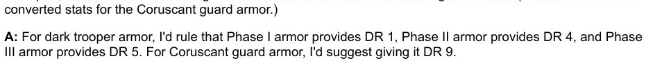
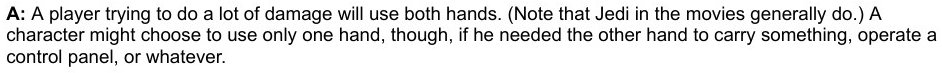
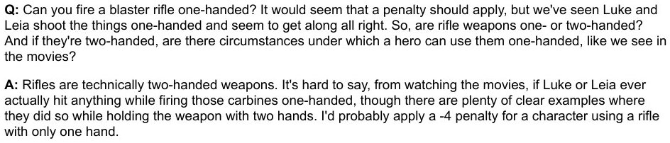
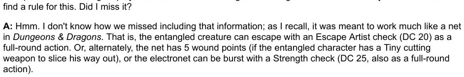
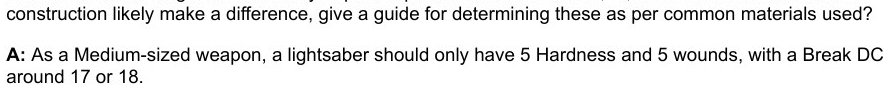

# Owner Material 037 — Star Wars D20 Drive folder (Core, Revised Core and Saga Edition): Jedi Counselling/Jedi Counseling 8 - One-Handed!.pdf [Star Wars Roleplaying Game Revised Core (d20, 2002)]

- **Source:** Wizards of the Coast Star Wars Roleplaying Game books, web enhancements, Living Force campaign modules and articles (2000–2010), from the owner's "Star Wars D20" Drive folder (only the three edition subfolders; "General" was not read, as instructed). Secondary source (licensed Legends reference). Scan OCR'd on the box; the scan stays box-only and is **not** published.
- **Method:** every scanned page was OCR'd and machine-screened sentence by sentence for power-relevant statements (fights, kills, defeats, Force feats, rankings, superweapons) that name a character on our roster; each kept sentence is quoted verbatim from the OCR text and has a crop of the printed passage directly under it. Pages with nothing power-relevant are still listed with what is on them.
- **Citation:** "*Jedi Counseling 8 - One-Handed!* (SWRPG d20 Revised Core), p.X" by printed page ("scan p.X" where no printed number applies). **Weight:** Licensed RPG material: a secondary source. Narrative text sums up Legends lore; game statistics are rules for players, not canon power levels, and rank lowest.

## scan p.1 (scan page 1)

Page contents: Angled shields; dark trooper armor; one/two-handed lightsabers; one-handed rifles; electronets (hand-read)

- **No single roster character (rules/setting/general)** — entry/section: Converted dark trooper and Coruscant guard armor: "A: For dark trooper armor, I'd rule that Phase I armor provides DR 1, Phase II armor provides DR 4, and Phase III armor provides DR 5. For Coruscant guard armor, I'd suggest giving it DR 9." Source: *Jedi Counseling 8 - One-Handed!* (SWRPG d20 Revised Core), scan p.1
  
- **No single roster character (rules/setting/general)** — entry/section: One- or two-handed lightsabers: "A: A player trying to do a lot of damage will use both hands. (Note that Jedi in the movies generally do.) A character might choose to use only one hand, though, if he needed the other hand to carry something, operate a control panel, or whatever." Source: *Jedi Counseling 8 - One-Handed!* (SWRPG d20 Revised Core), scan p.1
  
- **Luke Skywalker; Leia Organa Solo** — entry/section: Firing a blaster rifle one-handed: "Q: Can you fire a blaster rifle one-handed? It would seem that a penalty should apply, but we've seen Luke and Leia shoot the things one-handed and seem to get along all right. So, are rifle weapons one- or two-handed? And if they're two-handed, are there circumstances under which a hero can use them one-handed, like we see in the movies?
A: Rifles are technically two-handed weapons. It's hard to say, from watching the movies, if Luke or Leia ever actually hit anything while firing those carbines one-handed, though there are plenty of clear examples where they did so while holding the weapon with two hands. I'd probably apply a -4 penalty for a character using a rifle with only one hand." Source: *Jedi Counseling 8 - One-Handed!* (SWRPG d20 Revised Core), scan p.1
  
- **No single roster character (rules/setting/general)** — entry/section: Escaping an electronet: "A: Hmm. I don't know how we missed including that information; as I recall, it was meant to work much like a net in Dungeons & Dragons. That is, the entangled creature can escape with an Escape Artist check (DC 20) as a full-round action. Or, alternately, the net has 5 wound points (if the entangled character has a Tiny cutting weapon to slice his way out), or the electronet can be burst with a Strength check (DC 25, also as a full-round action)." Source: *Jedi Counseling 8 - One-Handed!* (SWRPG d20 Revised Core), scan p.1
  

## scan p.2 (scan page 2)

Page contents: Knocked out/pinned; lightsaber hardness; amphistaff poison; jury-rig; Firespray-31; ion vs DR; Rapid Strike; Jacen vitality Q (hand-read)

- **No single roster character (rules/setting/general)** — entry/section: Lightsaber Hardness and wounds: "A: As a Medium-sized weapon, a lightsaber should only have 5 Hardness and 5 wounds, with a Break DC around 17 or 18." Source: *Jedi Counseling 8 - One-Handed!* (SWRPG d20 Revised Core), scan p.2
  
- **No single roster character (rules/setting/general)** — entry/section: Firespray-31 blasters not fire-linked: "A: No, they're not. The Firespray-31's blasters are not fire-linked, and thus should only deal 4d10x2 damage. Good eye!" Source: *Jedi Counseling 8 - One-Handed!* (SWRPG d20 Revised Core), scan p.2
  

## scan p.3 (scan page 3)

Page contents: Jacen vitality 59; skill point discrepancies; copyright (hand-read)

