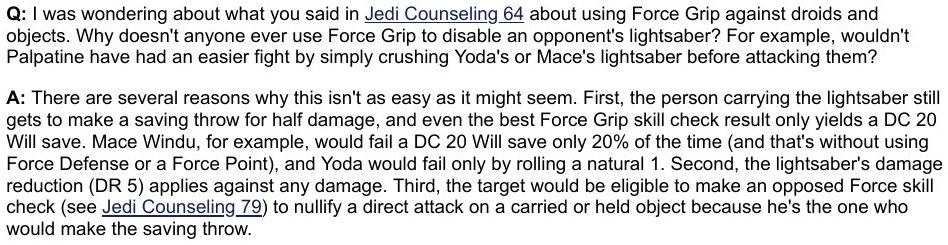
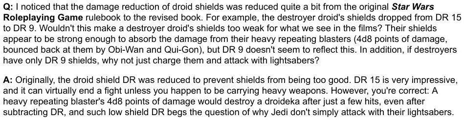
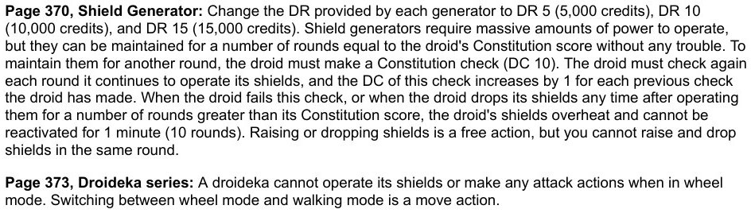
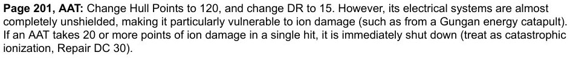
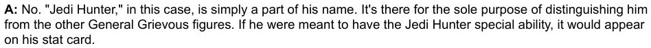
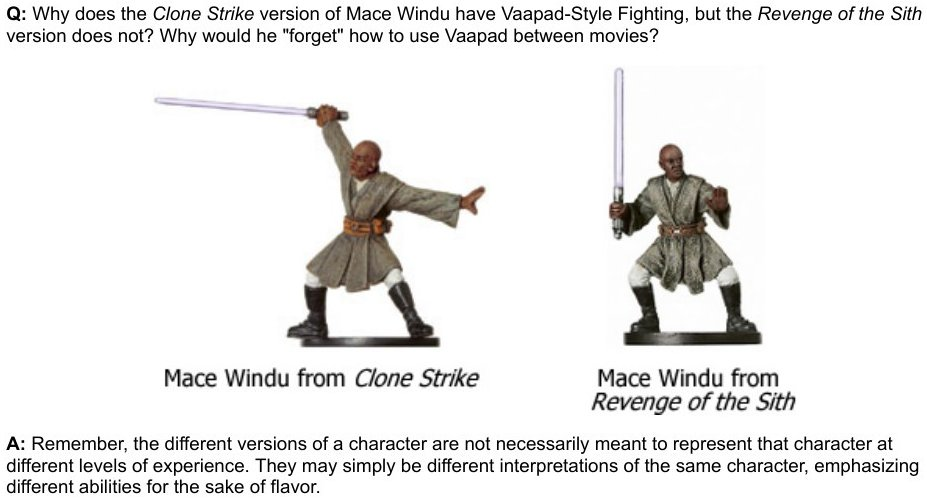
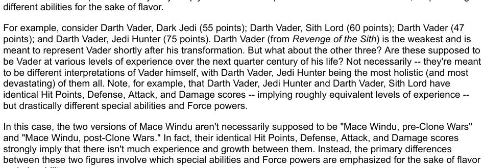
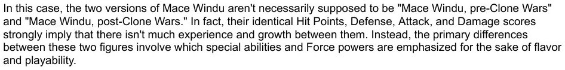

# Owner Material 037 — Star Wars D20 Drive folder (Core, Revised Core and Saga Edition): Jedi Counselling/Jedi Counseling 80.pdf [Star Wars Roleplaying Game Revised Core (d20, 2002)]

- **Source:** Wizards of the Coast Star Wars Roleplaying Game books, web enhancements, Living Force campaign modules and articles (2000–2010), from the owner's "Star Wars D20" Drive folder (only the three edition subfolders; "General" was not read, as instructed). Secondary source (licensed Legends reference). Scan OCR'd on the box; the scan stays box-only and is **not** published.
- **Method:** every scanned page was OCR'd and machine-screened sentence by sentence for power-relevant statements (fights, kills, defeats, Force feats, rankings, superweapons) that name a character on our roster; each kept sentence is quoted verbatim from the OCR text and has a crop of the printed passage directly under it. Pages with nothing power-relevant are still listed with what is on them.
- **Citation:** "*Jedi Counseling 80* (SWRPG d20 Revised Core), p.X" by printed page ("scan p.X" where no printed number applies). **Weight:** Licensed RPG material: a secondary source. Narrative text sums up Legends lore; game statistics are rules for players, not canon power levels, and rank lowest.

## scan p.1 (scan page 1)

Page contents: Force Grip vs lightsabers (Palpatine/Yoda/Mace); Force Grip vs destroyer droids (hand-read)

- **Palpatine (Darth Sidious); Yoda; Mace Windu** — entry/section: Why not Force Grip an opponent's lightsaber?: "Q: I was wondering about what you said in Jedi Counseling 64 about using Force Grip against droids and objects. Why doesn't anyone ever use Force Grip to disable an opponent's lightsaber? For example, wouldn't Palpatine have had an easier fight by simply crushing Yoda's or Mace's lightsaber before attacking them?
A: There are several reasons why this isn't as easy as it might seem. First, the person carrying the lightsaber still gets to make a saving throw for half damage, and even the best Force Grip skill check result only yields a DC 20 Will save. Mace Windu, for example, would fail a DC 20 Will save only 20% of the time (and that's without using Force Defense or a Force Point), and Yoda would fail only by rolling a natural 1. Second, the lightsaber's damage reduction (DR 5) applies against any damage. Third, the target would be eligible to make an opposed Force skill check (see Jedi Counseling 79) to nullify a direct attack on a carried or held object because he's the one who would make the saving throw." Source: *Jedi Counseling 80* (SWRPG d20 Revised Core), scan p.1
  

## scan p.2 (scan page 2)

Page contents: Destroyer DR; shield generator and droideka errata; AAT errata; ion vs vehicles (hand-read)

- **Obi-Wan Kenobi; Qui-Gon Jinn** — entry/section: Droideka shields too weak?: "Q: I noticed that the damage reduction of droid shields was reduced quite a bit from the original Star Wars Roleplaying Game rulebook to the revised book. For example, the destroyer droid's shields dropped from DR 15 to DR 9. Wouldn't this make a destroyer droid's shields too weak for what we see in the films? Their shields appear to be strong enough to absorb the damage from their heavy repeating blasters (4d8 points of damage, bounced back at them by Obi-Wan and Qui-Gon), but DR 9 doesn't seem to reflect this. In addition, if destroyers have only DR 9 shields, why not just charge them and attack with lightsabers?" Source: *Jedi Counseling 80* (SWRPG d20 Revised Core), scan p.2
  
- **No single roster character (rules/setting/general)** — entry/section: Errata: Shield Generator and Droideka series: "Page 370, Shield Generator: Change the DR provided by each generator to DR 5 (5,000 credits), DR 10 (10,000 credits), and DR 15 (15,000 credits). Shield generators require massive amounts of power to operate, but they can be maintained for a number of rounds equal to the droid's Constitution score without any trouble. To maintain them for another round, the droid must make a Constitution check (DC 10). The droid must check again each round it continues to operate its shields, and the DC of this check increases by 1 for each previous check the droid has made. When the droid fails this check, or when the droid drops its shields any time after operating them for a number of rounds greater than its Constitution score, the droid's shields overheat and cannot be reactivated for 1 minute (10 rounds). Raising or dropping shields is a free action, but you cannot raise and drop shields in the same round.
Page 373, Droideka series: A droideka cannot operate its shields or make any attack actions when in wheel mode. Switching between wheel mode and walking mode is a move action." Source: *Jedi Counseling 80* (SWRPG d20 Revised Core), scan p.2
  
- **No single roster character (rules/setting/general)** — entry/section: Errata: AAT: "Page 201, AAT: Change Hull Points to 120, and change DR to 15. However, its electrical systems are almost completely unshielded, making it particularly vulnerable to ion damage (such as from a Gungan energy catapult). If an AAT takes 20 or more points of ion damage in a single hit, it is immediately shut down (treat as catastrophic ionization, Repair DC 30)." Source: *Jedi Counseling 80* (SWRPG d20 Revised Core), scan p.2
  

## scan p.3 (scan page 3)

Page contents: Grievous Jedi Hunter; Mace versions/Vaapad; Vader versions; Dark Side Adept crit; Tow Cable (hand-read)

- **General Grievous** — entry/section: General Grievous, Jedi Hunter lacks Jedi Hunter: "A: No. "Jedi Hunter," in this case, is simply a part of his name. It's there for the sole purpose of distinguishing him from the other General Grievous figures. If he were meant to have the Jedi Hunter special ability, it would appear on his stat card." Source: *Jedi Counseling 80* (SWRPG d20 Revised Core), scan p.3
  
- **Mace Windu** — entry/section: Why did Mace Windu "forget" Vaapad?: "Q: Why does the Clone Strike version of Mace Windu have Vaapad-Style Fighting, but the Revenge of the Sith version does not? Why would he "forget" how to use Vaapad between movies?
A: Remember, the different versions of a character are not necessarily meant to represent that character at different levels of experience. They may simply be different interpretations of the same character, emphasizing different abilities for the sake of flavor." Source: *Jedi Counseling 80* (SWRPG d20 Revised Core), scan p.3
  
- **Darth Vader (Anakin Skywalker)** — entry/section: The four Darth Vader figures as interpretations: "For example, consider Darth Vader, Dark Jedi (55 points); Darth Vader, Sith Lord (60 points); Darth Vader (47 points); and Darth Vader, Jedi Hunter (75 points). Darth Vader (from Revenge of the Sith) is the weakest and is meant to represent Vader shortly after his transformation. But what about the other three? Are these supposed to be Vader at various levels of experience over the next quarter century of his life? Not necessarily -- they're meant to be different interpretations of Vader himself, with Darth Vader, Jedi Hunter being the most holistic (and most devastating) of them all. Note, for example, that Darth Vader, Jedi Hunter and Darth Vader, Sith Lord have identical Hit Points, Defense, Attack, and Damage scores -- implying roughly equivalent levels of experience -- but drastically different special abilities and Force powers." Source: *Jedi Counseling 80* (SWRPG d20 Revised Core), scan p.3
  
- **Mace Windu** — entry/section: Two Mace Windus, same experience: "In this case, the two versions of Mace Windu aren't necessarily supposed to be "Mace Windu, pre-Clone Wars" and "Mace Windu, post-Clone Wars." In fact, their identical Hit Points, Defense, Attack, and Damage scores strongly imply that there isn't much experience and growth between them. Instead, the primary differences between these two figures involve which special abilities and Force powers are emphasized for the sake of flavor and playability." Source: *Jedi Counseling 80* (SWRPG d20 Revised Core), scan p.3
  

## scan p.4 (scan page 4)

Page contents: Tow Cable example; author bio (hand-read)

