# Owner Material 037 — Star Wars D20 Drive folder (Core, Revised Core and Saga Edition): Jedi Counselling/Jedi Counseling 81.pdf [Star Wars Roleplaying Game Revised Core (d20, 2002)]

- **Source:** Wizards of the Coast Star Wars Roleplaying Game books, web enhancements, Living Force campaign modules and articles (2000–2010), from the owner's "Star Wars D20" Drive folder (only the three edition subfolders; "General" was not read, as instructed). Secondary source (licensed Legends reference). Scan OCR'd on the box; the scan stays box-only and is **not** published.
- **Method:** every scanned page was OCR'd and machine-screened sentence by sentence for power-relevant statements (fights, kills, defeats, Force feats, rankings, superweapons) that name a character on our roster; each kept sentence is quoted verbatim from the OCR text and has a crop of the printed passage directly under it. Pages with nothing power-relevant are still listed with what is on them.
- **Citation:** "*Jedi Counseling 81* (SWRPG d20 Revised Core), p.X" by printed page ("scan p.X" where no printed number applies). **Weight:** Licensed RPG material: a secondary source. Narrative text sums up Legends lore; game statistics are rules for players, not canon power levels, and rank lowest.

## scan p.1 (scan page 1)

Page contents: Jedi sentinel question; archetype intro and roleplaying (hand-read)

- **No single roster character (rules/setting/general)** — entry/section: New Archetype: Jedi Sentinel: "The Jedi sentinel uses stealth and subterfuge to accomplish the will of the Force, seeking out evil in the very shadows it calls home. This archetype strikes a balance between the Jedi consular (focusing on diplomacy and a mastery of the Force) and the Jedi guardian (focusing on physical abilities and mastery of the lightsaber) while being oriented more toward infiltration skills. Jedi sentinels are most common during the Sith Wars (4,000+ years before A New Hope) and in the millennium leading up to the Battle of Ruusan (1,000 years before A New Hope) because of the permeating and insidious influence of the Sith throughout the galaxy in these eras. However, they are almost unknown in the Jedi Order by the time of Palpatine's rise to Supreme Chancellor." Source: *Jedi Counseling 81* (SWRPG d20 Revised Core), scan p.1
  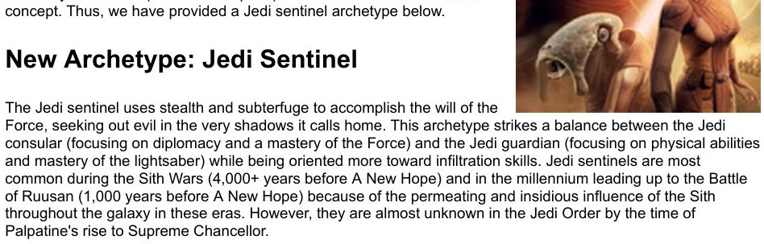
- **No single roster character (rules/setting/general)** — entry/section: Jedi sentinels: roleplaying: "Jedi sentinels are notoriously independent, most comfortable acting alone and without backup in the galaxy's most wretched hives of scum and villainy. While some take this independent streak to the extreme -- questioning the authority and wisdom of the Jedi Council -- most are perfectly willing to take orders, as long as they can carry out such orders via their preferred methods. Unfortunately, some sentinels adopt the mentality that "the ends justify the means," which can lead them to become the very evil they seek to destroy." Source: *Jedi Counseling 81* (SWRPG d20 Revised Core), scan p.1
  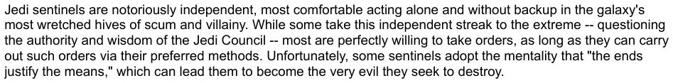

## scan p.2 (scan page 2)

Page contents: Jedi Sentinel archetype table (garbled) (hand-read)

## scan p.3 (scan page 3)

Page contents: Variants Unorthodox Training, Bonus Feat, Fearless; Celerity optional rule; Force camouflage errata; stealth field generator (hand-read)

- **No single roster character (rules/setting/general)** — entry/section: Variant: Fearless: "Because they operate independently (often deep in the bowels of a Sith stronghold), Jedi sentinels develop a fearless temperament. Instead of the Jedi consular's healing ability (at 12th character level), she gains immunity to all fear effects, such as the skills Fear and Intimidate. This includes any effect that would cause her to become shaken, frightened, or panicked, such as the Frightful Presence feat or the starweird's telepathic scream (see Ultimate Adversaries, page 122)." Source: *Jedi Counseling 81* (SWRPG d20 Revised Core), scan p.3
  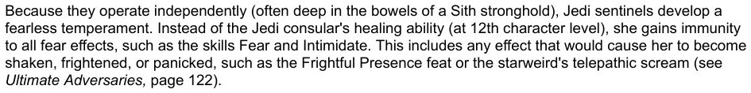
- **No single roster character (rules/setting/general)** — entry/section: Optional Rule: Other Uses for Burst of Speed: "Celerity: Instead of the normal benefits of Burst of Speed, you can instead activate this feat as a free action and gain +4 meters to your base speed, +1 bonus to attack rolls, +1 dodge bonus to Defense, and a +1 bonus to Reflex saves. The vitality cost is the same as Burst of Speed.
Force Celerity/Knight Celerity: Instead of the normal benefits of Force Speed or Knight Speed, you can instead activate either of these feats as a free action and gain the benefits of celerity (above) as well as an additional attack at your highest attack bonus when using the full attack action. For example, a Jedi wielding a doublebladed lightsaber at +9/+9/+4 melee would gain an additional attack at +9. The vitality cost is the same as that for Force Speed or Knight Speed.
Master Celerity: Instead of the normal benefits of Master Speed, you can instead activate this feat as a free action and gain the benefits of celerity and knight celerity (above) as well as an additional attack at your highest attack bonus when using the attack action. For example, a Jedi (lightsaber, +17 melee) could move his speed and then make two attacks at +17/+17 melee. The vitality cost is the same as that for Master Speed." Source: *Jedi Counseling 81* (SWRPG d20 Revised Core), scan p.3
  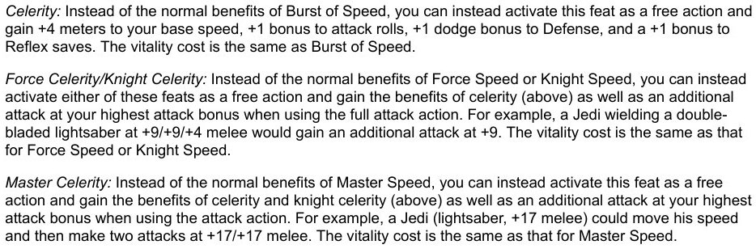
- **No single roster character (rules/setting/general)** — entry/section: Errata: Force camouflage: "A: Consider this to be errata: Force camouflage is actually a form of physical concealment wherein the character uses the Alter feat in a unique way, electrokinetically bending light around himself. Unlike the Illusion skill or other mind-affecting Force powers, it will work on Yuuzhan Vong and droids. A dark side assassin who does not have the Alter feat cannot use Force camouflage." Source: *Jedi Counseling 81* (SWRPG d20 Revised Core), scan p.3
  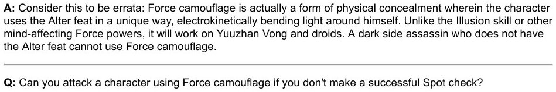

## scan p.4 (scan page 4)

Page contents: Stealth field cost; Juhani; Lightning Stealth errata; Bastila; Mandalorian iron (hand-read)

- **Juhani** — entry/section: Juhani's Cathar camouflage: "Q: Juhani, a Cathar Jedi, is capable of doing some sort of natural camouflage with an effect similar to the stealth field generator. However, the Cathar in the Ultimate Alien Anthology have no such ability. Is Juhani unique?
A: No, but she's not the most common type of Cathar. Juhani is a member of a somewhat stealthier subspecies with the ability to alter the pigments in their fur very quickly, thus creating a sort of instant camouflage (50% concealment as per a stealth field generator, above, except that it grants no bonus to characters using sensors to detect the Cathar). Using this ability requires focus and concentration on the part of the Cathar, who must use an attack action to activate or maintain this ability. This subspecies has less prominent claws than its larger relatives, so they do not have natural weapons (as per the Cathar species traits)." Source: *Jedi Counseling 81* (SWRPG d20 Revised Core), scan p.4
  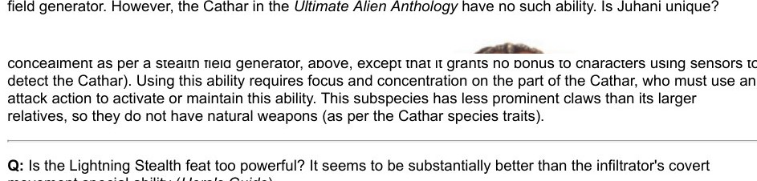
- **No single roster character (rules/setting/general)** — entry/section: Errata: Lightning Stealth is a Force feat: "A: Yes, consider this to be errata. The Lightning Stealth feat should be a Force feat. Add Force-Sensitive, Control, and Force level 3rd to its prerequisites." Source: *Jedi Counseling 81* (SWRPG d20 Revised Core), scan p.4
  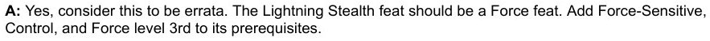
- **Bastila Shan; Meetra Surik** — entry/section: Bastila's battle meditation: "Q: It's always seemed to me that the Battle Meditation feat (Power of the Jedi Sourcebook) doesn't accurately represent the "battle meditation" used by Bastila; for example, it only has a range of 10 meters, but Bastila uses it to change the outcome of entire space battles! Am I missing something?
A: Yes. Bastila isn't using just the Battle Meditation feat. In space battles, she would actually be using Inspire (a Force skill that requires Battle Meditation), which can potentially affect allies throughout an entire sector. For close-range battles, she (or the Jedi exile in Knights of the Old Republic II) may instead use Battle Meditation to aid allies or the Battle Influence skill (also requiring Battle Meditation feat) to confuse enemies. All of these are found in the Power of the Jedi Sourcebook." Source: *Jedi Counseling 81* (SWRPG d20 Revised Core), scan p.4
  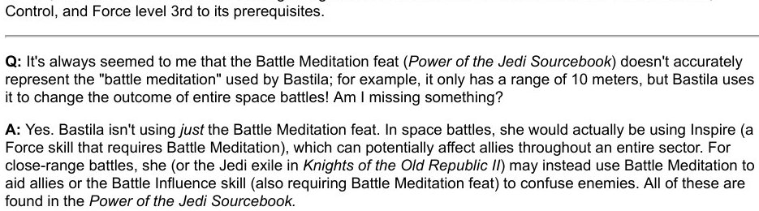
- **No single roster character (rules/setting/general)** — entry/section: Mandalorian iron: "A: Mandalorian iron is a nearly-indestructible metal with DR 20 and 16 wound points per cm of thickness, and it retains its damage reduction against lightsabers (making it an excellent defense against Jedi and Sith). However, the exact means of producing it is a closely-guarded secret of the Mandalorians: Only someone with a minimum of 15 ranks in Knowledge (Mandalore) knows the process to create it, and even then the Craft DC necessary to create the item is increased by +15. Finally, you must have access to the appropriate constituent metals to create an object out of Mandalorian iron. The GM may make these raw materials as hard or easy to find as he feels is appropriate in his campaign." Source: *Jedi Counseling 81* (SWRPG d20 Revised Core), scan p.4
  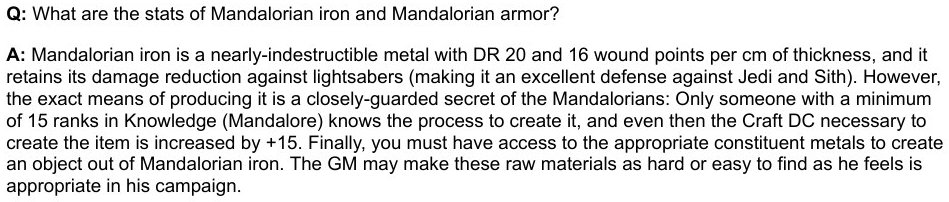

## scan p.5 (scan page 5)

Page contents: Mandalorian iron costs; Mandalorian armor; IG-88/4-LOM/Gonk tactic Q (hand-read)

- **Canderous Ordo** — entry/section: Mandalorian armor; Mandalore in KOTOR II: "As for the armor worn by the Mandalorian mercenaries in the game, it's usually just heavy battle armor made out of Mandalorian iron (42,000 credits, DR 8). Higher-ranking Mandalorian officers would have had suits with a higher mastercraft bonus: 84,000 credits for DR 9; 168,000 credits for DR 10; and 336,000 credits for DR 11, worn by Mandalore himself in Knights of the Old Republic II." Source: *Jedi Counseling 81* (SWRPG d20 Revised Core), scan p.5
  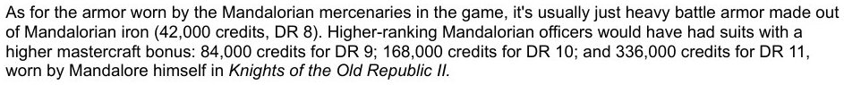

## scan p.6 (scan page 6)

Page contents: Gonk ruling; Recon; Tow Cable/Flight; Melee Reach Cleave; Yoda Lightsaber Reflect Q (hand-read)

- **IG-88; 4-LOM** — entry/section: IG-88, 4-LOM and the Gonks: illegal: "A: It's illegal: Your friend is reading the card wrong. Extra Attack gives that character one extra attack on top of his normal attacks when not moving, so someone with Double Attack (who can normally make two attacks when not moving) standing next to two Gonk Power Droids using Power Coupling on him (+1 Extra Attack for each) could make a total of four attacks in a single turn." Source: *Jedi Counseling 81* (SWRPG d20 Revised Core), scan p.6
  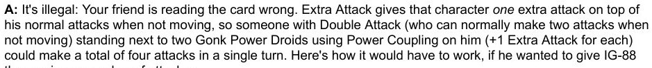
- **R2-D2** — entry/section: Tow Cable with a Flight character: "A: Yes, he can tow a character who has Flight. The towed character doesn't gain Flight (because he already has it), but the movement described in Tow Cable still takes place." Source: *Jedi Counseling 81* (SWRPG d20 Revised Core), scan p.6
  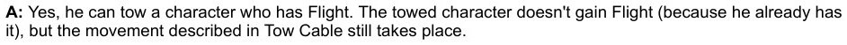
- **IG-88**: "They have Self-Destruct 20, so if you defeat them with 10+ points of damage you'll also do 20 points to IG-88 and -- depending on where they are positioned -- 20 points to the other Gonk droid, blowing it up as well." Source: *Jedi Counseling 81* (SWRPG d20 Revised Core), scan p.6
  
- **IG-88**: "This can possibly inflict 40 points of damage to IG-88 and deny him the use of the Gonk's Extra Attacks (because they are defeated and thus no longer adjacent to him)." Source: *Jedi Counseling 81* (SWRPG d20 Revised Core), scan p.6
  

## scan p.7 (scan page 7)

Page contents: Natural 20 answer; author bio (hand-read)

