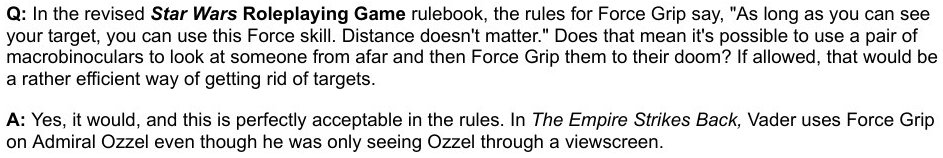
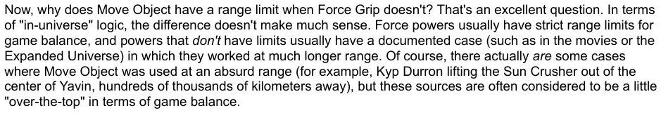
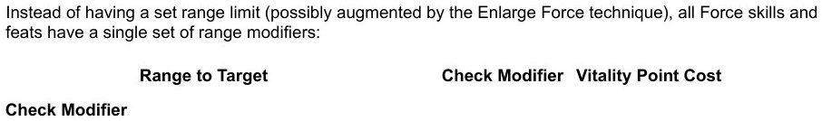
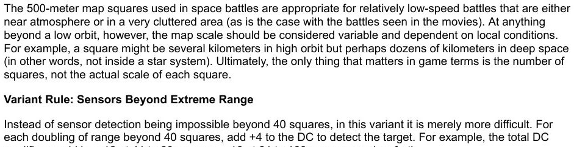
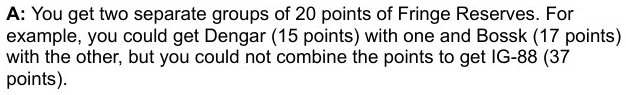
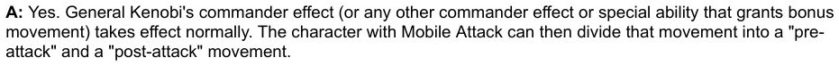
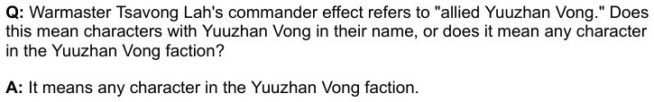
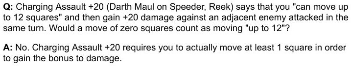

# Owner Material 037 — Star Wars D20 Drive folder (Core, Revised Core and Saga Edition): Jedi Counselling/Jedi Counseling 82.pdf [Star Wars Roleplaying Game Revised Core (d20, 2002)]

- **Source:** Wizards of the Coast Star Wars Roleplaying Game books, web enhancements, Living Force campaign modules and articles (2000–2010), from the owner's "Star Wars D20" Drive folder (only the three edition subfolders; "General" was not read, as instructed). Secondary source (licensed Legends reference). Scan OCR'd on the box; the scan stays box-only and is **not** published.
- **Method:** every scanned page was OCR'd and machine-screened sentence by sentence for power-relevant statements (fights, kills, defeats, Force feats, rankings, superweapons) that name a character on our roster; each kept sentence is quoted verbatim from the OCR text and has a crop of the printed passage directly under it. Pages with nothing power-relevant are still listed with what is on them.
- **Citation:** "*Jedi Counseling 82* (SWRPG d20 Revised Core), p.X" by printed page ("scan p.X" where no printed number applies). **Weight:** Licensed RPG material: a secondary source. Narrative text sums up Legends lore; game statistics are rules for players, not canon power levels, and rank lowest.

## scan p.1 (scan page 1)

Page contents: Force Grip at range (Vader/Ozzel); Move Object range (Kyp Durron); variant Long-Range Force Use and table (hand-read)

- **Darth Vader (Anakin Skywalker); Admiral Kendal Ozzel** — entry/section: Force Grip through a viewscreen: "Q: In the revised Star Wars Roleplaying Game rulebook, the rules for Force Grip say, "As long as you can see your target, you can use this Force skill. Distance doesn't matter." Does that mean it's possible to use a pair of macrobinoculars to look at someone from afar and then Force Grip them to their doom? If allowed, that would be a rather efficient way of getting rid of targets.
A: Yes, it would, and this is perfectly acceptable in the rules. In The Empire Strikes Back, Vader uses Force Grip on Admiral Ozzel even though he was only seeing Ozzel through a viewscreen." Source: *Jedi Counseling 82* (SWRPG d20 Revised Core), scan p.1
  
- **Kyp Durron** — entry/section: Kyp Durron lifting the Sun Crusher: "Now, why does Move Object have a range limit when Force Grip doesn't? That's an excellent question. In terms of "in-universe" logic, the difference doesn't make much sense. Force powers usually have strict range limits for game balance, and powers that don't have limits usually have a documented case (such as in the movies or the Expanded Universe) in which they worked at much longer range. Of course, there actually are some cases where Move Object was used at an absurd range (for example, Kyp Durron lifting the Sun Crusher out of the center of Yavin, hundreds of thousands of kilometers away), but these sources are often considered to be a little "over-the-top" in terms of game balance." Source: *Jedi Counseling 82* (SWRPG d20 Revised Core), scan p.1
  
- **No single roster character (rules/setting/general)** — entry/section: Variant Rule: Long-Range Force Use: "Instead of having a set range limit (possibly augmented by the Enlarge Force technique), all Force skills and feats have a single set of range modifiers:" Source: *Jedi Counseling 82* (SWRPG d20 Revised Core), scan p.1
  

## scan p.2 (scan page 2)

Page contents: Skill exceptions; space ranges and sensors variants; Hutt battle armor (hand-read)

- **No single roster character (rules/setting/general)** — entry/section: Variant Rule: Space Ranges: "The 500-meter map squares used in space battles are appropriate for relatively low-speed battles that are either near atmosphere or in a very cluttered area (as is the case with the battles seen in the movies). At anything beyond a low orbit, however, the map scale should be considered variable and dependent on local conditions. For example, a square might be several kilometers in high orbit but perhaps dozens of kilometers in deep space (in other words, not inside a star system). Ultimately, the only thing that matters in game terms is the number of squares, not the actual scale of each square." Source: *Jedi Counseling 82* (SWRPG d20 Revised Core), scan p.2
  

## scan p.3 (scan page 3)

Page contents: Hutt armor DR 7; Force Immunity; affecting checklist; Rodian Vigos; Mobile Attack errata; General Kenobi; Tsavong Lah (hand-read)

- **Dengar; Bossk; IG-88** — entry/section: Two Rodian Black Sun Vigos and Fringe Reserves: "A: You get two separate groups of 20 points of Fringe Reserves. For example, you could get Dengar (15 points) with one and Bossk (17 points) with the other, but you could not combine the points to get IG-88 (37 points)." Source: *Jedi Counseling 82* (SWRPG d20 Revised Core), scan p.3
  
- **Obi-Wan Kenobi** — entry/section: General Kenobi's commander effect and Mobile Attack: "A: Yes. General Kenobi's commander effect (or any other commander effect or special ability that grants bonus movement) takes effect normally. The character with Mobile Attack can then divide that movement into a "preattack" and a "post-attack" movement." Source: *Jedi Counseling 82* (SWRPG d20 Revised Core), scan p.3
  
- **Tsavong Lah** — entry/section: Tsavong Lah's "allied Yuuzhan Vong": "Q: Warmaster Tsavong Lah's commander effect refers to "allied Yuuzhan Vong." Does this mean characters with Yuuzhan Vong in their name, or does it mean any character in the Yuuzhan Vong faction?
A: It means any character in the Yuuzhan Vong faction." Source: *Jedi Counseling 82* (SWRPG d20 Revised Core), scan p.3
  

## scan p.4 (scan page 4)

Page contents: Charging Assault (Darth Maul on Speeder); ASP-7; author bio (hand-read)

- **Darth Maul** — entry/section: Charging Assault needs at least 1 square: "Q: Charging Assault +20 (Darth Maul on Speeder, Reek) says that you "can move up to 12 squares" and then gain +20 damage against an adjacent enemy attacked in the same turn. Would a move of zero squares count as moving "up to 12"?
A: No. Charging Assault +20 requires you to actually move at least 1 square in order to gain the bonus to damage." Source: *Jedi Counseling 82* (SWRPG d20 Revised Core), scan p.4
  
