# Owner Material 037 — Star Wars D20 Drive folder (Core, Revised Core and Saga Edition): Jedi Counselling/Jedi Counseling 83.pdf [Star Wars Roleplaying Game Revised Core (d20, 2002)]

- **Source:** Wizards of the Coast Star Wars Roleplaying Game books, web enhancements, Living Force campaign modules and articles (2000–2010), from the owner's "Star Wars D20" Drive folder (only the three edition subfolders; "General" was not read, as instructed). Secondary source (licensed Legends reference). Scan OCR'd on the box; the scan stays box-only and is **not** published.
- **Method:** every scanned page was OCR'd and machine-screened sentence by sentence for power-relevant statements (fights, kills, defeats, Force feats, rankings, superweapons) that name a character on our roster; each kept sentence is quoted verbatim from the OCR text and has a crop of the printed passage directly under it. Pages with nothing power-relevant are still listed with what is on them.
- **Citation:** "*Jedi Counseling 83* (SWRPG d20 Revised Core), p.X" by printed page ("scan p.X" where no printed number applies). **Weight:** Licensed RPG material: a secondary source. Narrative text sums up Legends lore; game statistics are rules for players, not canon power levels, and rank lowest.

## scan p.1 (scan page 1)

Page contents: Move Object problems (Yoda vs guards); new Move Object skill and table (hand-read)

- **Yoda; Palpatine (Darth Sidious)** — entry/section: Yoda slammed two of Palpatine's guards into a wall: "Finally, even though Move Object can do so much damage by tossing a target into the air, it seems that it doesn't have the ability to hurt a target very much by tossing him directly into an obstacle, regardless of level -- you always deal 1d6 points of damage, no matter your skill level. In contrast, Yoda knocked out two of Palpatine's guards by slamming them into a wall, but that 1d6 points of damage shouldn't have taken them out given the strength of Royal Guard armor." Source: *Jedi Counseling 83* (SWRPG d20 Revised Core), scan p.1
  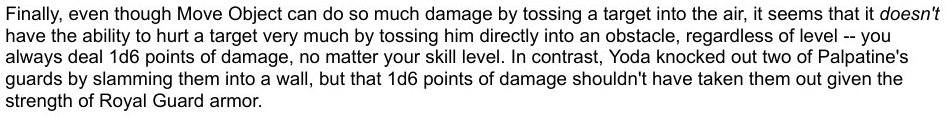
- **No single roster character (rules/setting/general)** — entry/section: Errata: Move Object (introduction): "A: Yes, this has been coming for a while. The Move Object rules are cumbersome and a little prone to abuse, and the expansion in Jedi Counseling 70 (allowing the hurling of larger objects) was specifically written to fit as closely as possible into the existing rules. Unfortunately, that caused the problems you describe in terms of slowing down the game. Therefore, let's introduce some errata. Use the following version of Move Object instead of the versions in the revised Star Wars Roleplaying Game rulebook and in Jedi Counseling 70:" Source: *Jedi Counseling 83* (SWRPG d20 Revised Core), scan p.1
  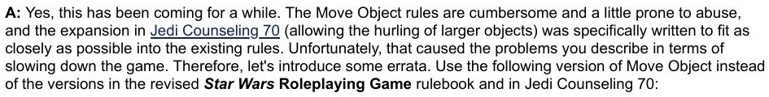

## scan p.2 (scan page 2)

Page contents: Move Object text (moving objects/characters/vehicles, Hurl Object, time); Force Push, Force Jump, Force Fall errata (hand-read)

- **No single roster character (rules/setting/general)** — entry/section: Move Object: Moving a Character: "Moving a Character: Using the Move Object skill on a character (in other words, a living being or droid) allows it a Will saving throw against the listed DC. If the target fails its save, treat it as an object for purposes of determining distance moved. If the target succeeds, the skill has no effect and you still expend the vitality point cost. A target can willingly forgo its saving throw. A character can move himself with Move Object, albeit at a -10 penalty to his Move Object check." Source: *Jedi Counseling 83* (SWRPG d20 Revised Core), scan p.2
  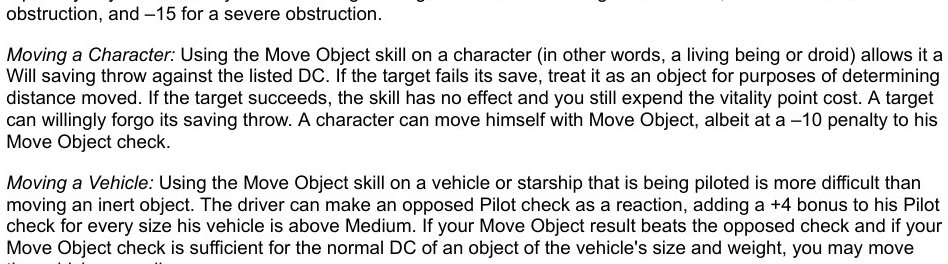
- **No single roster character (rules/setting/general)** — entry/section: Move Object: Moving a Vehicle: "Moving a Vehicle: Using the Move Object skill on a vehicle or starship that is being piloted is more difficult than moving an inert object. The driver can make an opposed Pilot check as a reaction, adding a +4 bonus to his Pilot check for every size his vehicle is above Medium. If your Move Object result beats the opposed check and if your Move Object check is sufficient for the normal DC of an object of the vehicle's size and weight, you may move the vehicle normally." Source: *Jedi Counseling 83* (SWRPG d20 Revised Core), scan p.2
  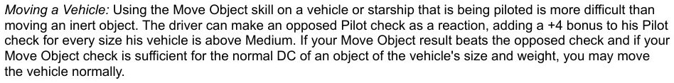
- **No single roster character (rules/setting/general)** — entry/section: Move Object: Hurl Object: "Hurl Object: Move Object can be used to attack by throwing objects or characters. If your check result is high enough for the object's size or weight (whichever is greater), you may hurl the object up to 4 meters to strike another target. If you exceed this result by 5 or more points, the distance you can move the hurled object doubles (as above), and it inflicts extra damage because you are hurling it with more energy." Source: *Jedi Counseling 83* (SWRPG d20 Revised Core), scan p.2
  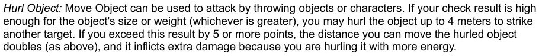
- **No single roster character (rules/setting/general)** — entry/section: Errata: Force Push: "Force Push (Jedi Counseling 60): The pushed character moves in a straight line directly away from you and takes 1d6 points of damage (no save) if he hits an obstacle. The obstacle takes damage according to the pushed character's size (see Move Object table, above). If the obstacle is a character, he may make a Reflex save (DC 15 or as listed in table above, whichever is higher) to take half damage." Source: *Jedi Counseling 83* (SWRPG d20 Revised Core), scan p.2
  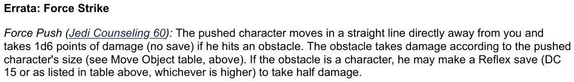
- **No single roster character (rules/setting/general)** — entry/section: Errata: Force Jump and Force Fall: "Force Jump (Hero's Guide): Instead of the listed vitality cost, Force Jump requires the same vitality necessary to move an object of the character's size and weight, as per Move Object. Additionally, the last sentence should read: "If you use this option, the distance jumped and your maximum jump distance are tripled."
Force Fall (Hero's Guide): Instead of the listed vitality cost, Force Fall requires the same vitality necessary to move an object of the character's size and weight, as per Move Object." Source: *Jedi Counseling 83* (SWRPG d20 Revised Core), scan p.2
  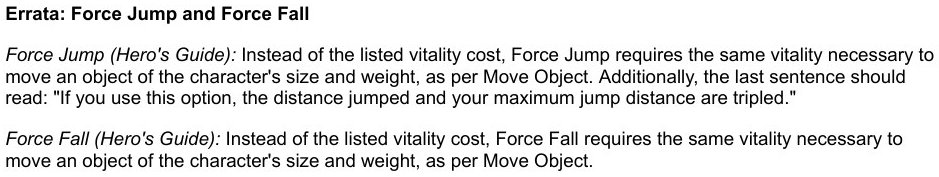

## scan p.3 (scan page 3)

Page contents: Falling errata; Force Aptitude optional rule; legal maps (hand-read)

- **No single roster character (rules/setting/general)** — entry/section: Errata: Falling and Falling Objects: "Falling damage (including damage from falling objects) is applied to a character's vitality (or wounds, if the character has no vitality remaining). If the character makes the Reflex save to avoid a falling object (Table 12-22, page 289), the character take half damage. If the character takes wound damage and the falling object is at least three size categories larger than the character, the character is pinned normally. If a character does not take wound damage from a falling object, he is automatically moved to the nearest safe square; any movement required must be accounted for on the character's next action." Source: *Jedi Counseling 83* (SWRPG d20 Revised Core), scan p.3
  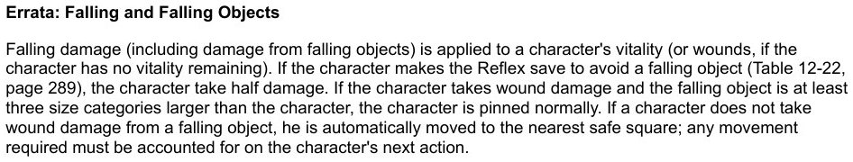
- **No single roster character (rules/setting/general)** — entry/section: Optional Rule: Force Aptitude: "In this optional rule, all Force-using classes have a natural aptitude with Force skills, even those that are untrained. This is represented by a Force bonus to all Force skills based on the character's class level and the natural Force affinity of the character's class(es):" Source: *Jedi Counseling 83* (SWRPG d20 Revised Core), scan p.3
  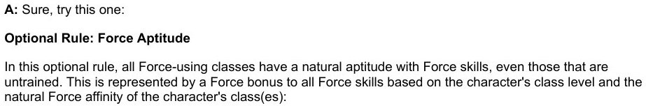

## scan p.4 (scan page 4)

Page contents: Maps list; starting areas; Airlock; Xizor Pheromones; Yoda Force Valor (hand-read)

- **Prince Xizor** — entry/section: Prince Xizor's Pheromones: "Q: The card text for Prince Xizor's Pheromones says it only applies to attacks made against Prince Xizor. The Universe booster insert definition of Pheromones doesn't limit it to attacks against Prince Xizor. Which one is right?
A: The additional restriction imposed by the stat card is correct: Prince Xizor's Pheromones only applies against attacks made against Prince Xizor. See Jedi Counseling 82 or the FAQ for details.
Q: Another question on Pheromones: Does it work against Droids?
A: Yes. If it helps, imagine that the Droids have olfactory sensors whose input is disrupted and confused by the Pheromones, making targeting more difficult." Source: *Jedi Counseling 83* (SWRPG d20 Revised Core), scan p.4
  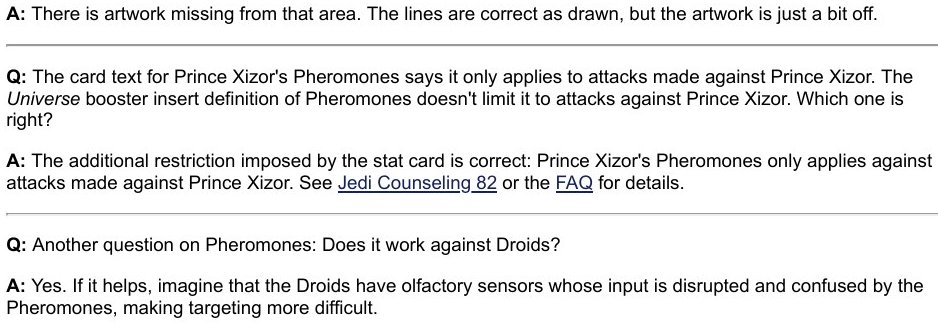
- **Yoda** — entry/section: Yoda's Force Valor: followers only: "Q: The card text for Yoda's Force Valor says that it provides the commander effect to followers, but the rulebook's definition of Force Valor says that it provides the commander effect to allies. Which one is right?
A: Again, the additional restriction imposed by the stat card is correct: Yoda's Force Valor only applies to followers." Source: *Jedi Counseling 83* (SWRPG d20 Revised Core), scan p.4
  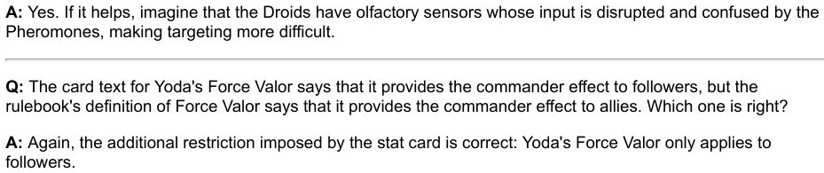

## scan p.5 (scan page 5)

Page contents: Wat Tambor Droid Reinforcements; Nom Anor no crab armor; author bio (hand-read)

- **Wat Tambor** — entry/section: Wat Tambor's Droid Reinforcements: non-Unique: "A: As before, the additional restriction imposed by the stat card is correct: Wat Tambor's Droid Reinforcements only allow non-Unique droids." Source: *Jedi Counseling 83* (SWRPG d20 Revised Core), scan p.5
  
- **Nom Anor** — entry/section: Why doesn't Nom Anor have Vonduun Crab Armor?: "A: Nom Anor isn't really a dedicated warrior, per se, but more of an infiltrator. When the Yuuzhan Vong invasion began, his cover was as the leader of an anti-Jedi, anti-technology cult called the Red Knights of Life. In reality, of course, he was an agitator trying to disrupt the cohesion of the New Republic prior to the Yuuzhan Vong invasion. As such, he was in disguise for quite some time -- wearing obviously alien Yuuzhan Vong biotechnology (such as Vonduun Crab Armor) would have made people question his origin and apparently Human appearance." Source: *Jedi Counseling 83* (SWRPG d20 Revised Core), scan p.5
  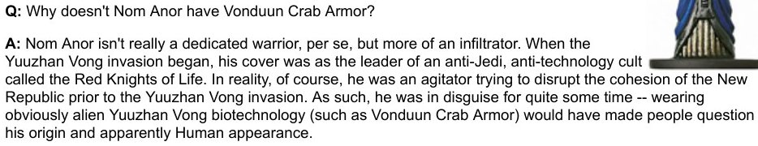
