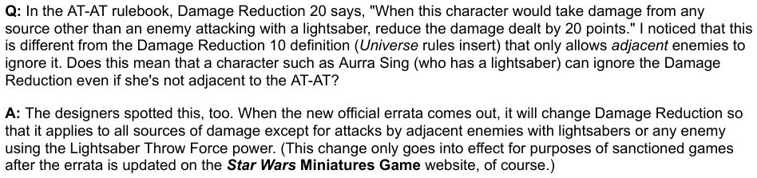
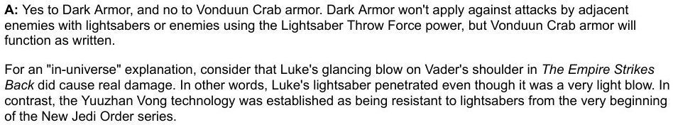
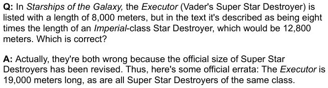
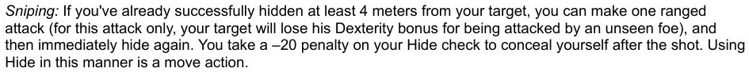
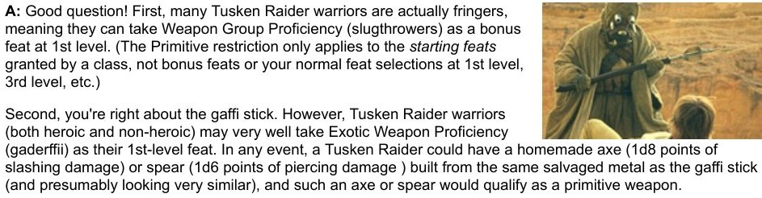
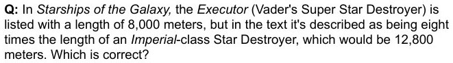
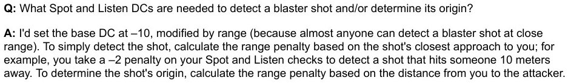
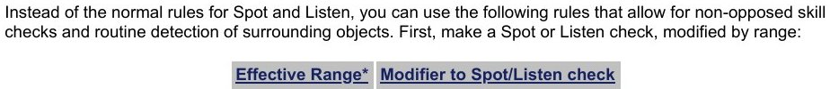

# Owner Material 037 — Star Wars D20 Drive folder (Core, Revised Core and Saga Edition): Jedi Counselling/Jedi Counseling 84.pdf [Star Wars Roleplaying Game Revised Core (d20, 2002)]

- **Source:** Wizards of the Coast Star Wars Roleplaying Game books, web enhancements, Living Force campaign modules and articles (2000–2010), from the owner's "Star Wars D20" Drive folder (only the three edition subfolders; "General" was not read, as instructed). Secondary source (licensed Legends reference). Scan OCR'd on the box; the scan stays box-only and is **not** published.
- **Method:** every scanned page was OCR'd and machine-screened sentence by sentence for power-relevant statements (fights, kills, defeats, Force feats, rankings, superweapons) that name a character on our roster; each kept sentence is quoted verbatim from the OCR text and has a crop of the printed passage directly under it. Pages with nothing power-relevant are still listed with what is on them.
- **Citation:** "*Jedi Counseling 84* (SWRPG d20 Revised Core), p.X" by printed page ("scan p.X" where no printed number applies). **Weight:** Licensed RPG material: a secondary source. Narrative text sums up Legends lore; game statistics are rules for players, not canon power levels, and rank lowest.

## scan p.1 (scan page 1)

Page contents: DR errata (Aurra Sing); Dark Armor vs crab armor; commander effects AT-AT/Tower/Turret; splash damage; Tower targeting (hand-read)

- **Aurra Sing** — entry/section: Damage Reduction errata: Aurra Sing and the AT-AT: "Q: In the AT-AT rulebook, Damage Reduction 20 says, "When this character would take damage from any source other than an enemy attacking with a lightsaber, reduce the damage dealt by 20 points." I noticed that this is different from the Damage Reduction 10 definition (Universe rules insert) that only allows adjacent enemies to ignore it. Does this mean that a character such as Aurra Sing (who has a lightsaber) can ignore the Damage Reduction even if she's not adjacent to the AT-AT?
A: The designers spotted this, too. When the new official errata comes out, it will change Damage Reduction so that it applies to all sources of damage except for attacks by adjacent enemies with lightsabers or any enemy using the Lightsaber Throw Force power. (This change only goes into effect for purposes of sanctioned games after the errata is updated on the Star Wars Miniatures Game website, of course.)" Source: *Jedi Counseling 84* (SWRPG d20 Revised Core), scan p.1
  
- **Darth Vader (Anakin Skywalker); Luke Skywalker** — entry/section: Vader's Dark Armor vs Vonduun Crab armor: "A: Yes to Dark Armor, and no to Vonduun Crab armor. Dark Armor won't apply against attacks by adjacent enemies with lightsabers or enemies using the Lightsaber Throw Force power, but Vonduun Crab armor will function as written.
For an "in-universe" explanation, consider that Luke's glancing blow on Vader's shoulder in The Empire Strikes Back did cause real damage. In other words, Luke's lightsaber penetrated even though it was a very light blow. In contrast, the Yuuzhan Vong technology was established as being resistant to lightsabers from the very beginning of the New Jedi Order series." Source: *Jedi Counseling 84* (SWRPG d20 Revised Core), scan p.1
  

## scan p.2 (scan page 2)

Page contents: Tower attacks; Heavy Laser Cannons example; Executor errata; aid another; Sniping; Tusken Raider proficiencies (hand-read)

- **Darth Vader (Anakin Skywalker)** — entry/section: Errata: the Executor is 19,000 meters: "Q: In Starships of the Galaxy, the Executor (Vader's Super Star Destroyer) is listed with a length of 8,000 meters, but in the text it's described as being eight times the length of an Imperial-class Star Destroyer, which would be 12,800 meters. Which is correct?
A: Actually, they're both wrong because the official size of Super Star Destroyers has been revised. Thus, here's some official errata: The Executor is 19,000 meters long, as are all Super Star Destroyers of the same class." Source: *Jedi Counseling 84* (SWRPG d20 Revised Core), scan p.2
  
- **No single roster character (rules/setting/general)** — entry/section: Hide: New Use (Sniping): "Sniping: If you've already successfully hidden at least 4 meters from your target, you can make one ranged attack (for this attack only, your target will lose his Dexterity bonus for being attacked by an unseen foe), and then immediately hide again. You take a -20 penalty on your Hide check to conceal yourself after the shot. Using Hide in this manner is a move action." Source: *Jedi Counseling 84* (SWRPG d20 Revised Core), scan p.2
  
- **No single roster character (rules/setting/general)** — entry/section: Tusken Raider weapon proficiencies: "A: Good question! First, many Tusken Raider warriors are actually fringers, meaning they can take Weapon Group Proficiency (slugthrowers) as a bonus feat at 1st level. (The Primitive restriction only applies to the starting feats granted by a class, not bonus feats or your normal feat selections at 1st level, 3rd level, etc.)
Second, you're right about the gaffi stick. However, Tusken Raider warriors (both heroic and non-heroic) may very well take Exotic Weapon Proficiency (gaderffii) as their 1st-level feat. In any event, a Tusken Raider could have a homemade axe (1d8 points of slashing damage) or spear (1d6 points of piercing damage ) built from the same salvaged metal as the gaffi stick (and presumably looking very similar), and such an axe or spear would qualify as a primitive weapon." Source: *Jedi Counseling 84* (SWRPG d20 Revised Core), scan p.2
  
- **Darth Vader (Anakin Skywalker)**: "Q: In Starships of the Galaxy, the Executor (Vader's Super Star Destroyer) is listed with a length of 8,000 meters, but in the text it's described as being eight times the length of an /mperial-class Star Destroyer, which would be 12,800 meters." Source: *Jedi Counseling 84* (SWRPG d20 Revised Core), scan p.2
  

## scan p.3 (scan page 3)

Page contents: Two gaderffii; blaster shot detection; variant Range and Detection tables (hand-read)

- **No single roster character (rules/setting/general)** — entry/section: Detecting a blaster shot: "A: I'd set the base DC at -10, modified by range (because almost anyone can detect a blaster shot at close range). To simply detect the shot, calculate the range penalty based on the shot's closest approach to you; for example, you take a -2 penalty on your Spot and Listen checks to detect a shot that hits someone 10 meters away. To determine the shot's origin, calculate the range penalty based on the distance from you to the attacker." Source: *Jedi Counseling 84* (SWRPG d20 Revised Core), scan p.3
  
- **No single roster character (rules/setting/general)** — entry/section: Variant Rule: Range and Detection: "Instead of the normal rules for Spot and Listen, you can use the following rules that allow for non-opposed skill checks and routine detection of surrounding objects. First, make a Spot or Listen check, modified by range:" Source: *Jedi Counseling 84* (SWRPG d20 Revised Core), scan p.3
  

## scan p.4 (scan page 4)

Page contents: Spot DC and Listen DC tables; author bio (hand-read)

