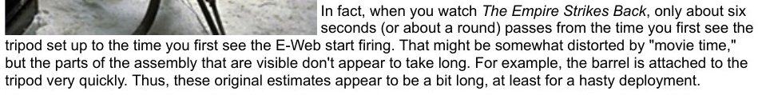
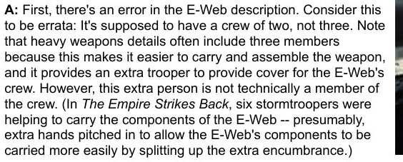
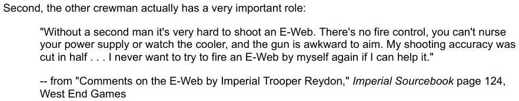
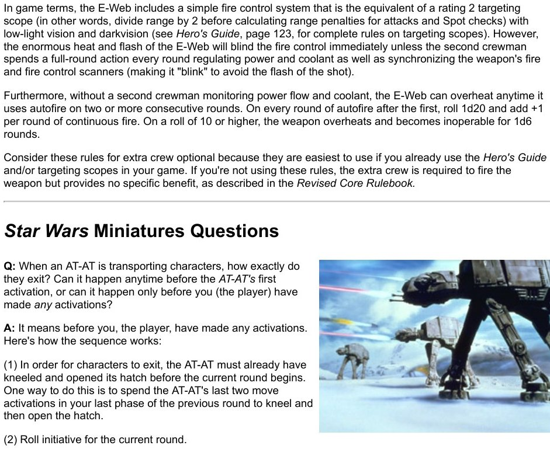
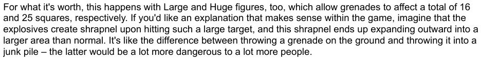

# Owner Material 037 — Star Wars D20 Drive folder (Core, Revised Core and Saga Edition): Jedi Counselling/Jedi Counseling 85.pdf [Star Wars Roleplaying Game Revised Core (d20, 2002)]

- **Source:** Wizards of the Coast Star Wars Roleplaying Game books, web enhancements, Living Force campaign modules and articles (2000–2010), from the owner's "Star Wars D20" Drive folder (only the three edition subfolders; "General" was not read, as instructed). Secondary source (licensed Legends reference). Scan OCR'd on the box; the scan stays box-only and is **not** published.
- **Method:** every scanned page was OCR'd and machine-screened sentence by sentence for power-relevant statements (fights, kills, defeats, Force feats, rankings, superweapons) that name a character on our roster; each kept sentence is quoted verbatim from the OCR text and has a crop of the printed passage directly under it. Pages with nothing power-relevant are still listed with what is on them.
- **Citation:** "*Jedi Counseling 85* (SWRPG d20 Revised Core), p.X" by printed page ("scan p.X" where no printed number applies). **Weight:** Licensed RPG material: a secondary source. Narrative text sums up Legends lore; game statistics are rules for players, not canon power levels, and rank lowest.

## scan p.1 (scan page 1)

Page contents: Uncanny dodge; E-Web setup question and six move actions (hand-read)

- **No single roster character (rules/setting/general)** — entry/section: E-Web setup time in The Empire Strikes Back: "In fact, when you watch The Empire Strikes Back, only about six seconds (or about a round) passes from the time you first see the tripod set up to the time you first see the E-Web start firing. That might be somewhat distorted by "movie time," but the parts of the assembly that are visible don't appear to take long. For example, the barrel is attached to the tripod very quickly. Thus, these original estimates appear to be a bit long, at least for a hasty deployment." Source: *Jedi Counseling 85* (SWRPG d20 Revised Core), scan p.1
  

## scan p.2 (scan page 2)

Page contents: E-Web setup steps, moving assembled, weights; size/tripod; crew errata; Reydon quote (hand-read)

- **No single roster character (rules/setting/general)** — entry/section: Errata: E-Web crew of two: "A: First, there's an error in the E-Web description. Consider this to be errata: It's supposed to have a crew of two, not three. Note that heavy weapons details often include three members because this makes it easier to carry and assemble the weapon, and it provides an extra trooper to provide cover for the E-Web's crew. However, this extra person is not technically a member of the crew. (In The Empire Strikes Back, six stormtroopers were helping to carry the components of the E-Web -- presumably, extra hands pitched in to allow the E-Web's components to be carried more easily by splitting up the extra encumbrance.)" Source: *Jedi Counseling 85* (SWRPG d20 Revised Core), scan p.2
  
- **Imperial Trooper Reydon** — entry/section: "Without a second man it's very hard to shoot an E-Web.": ""Without a second man it's very hard to shoot an E-Web. There's no fire control, you can't nurse your power supply or watch the cooler, and the gun is awkward to aim. My shooting accuracy was cut in half. . . I never want to try to fire an E-Web by myself again if I can help it."
-- from "Comments on the E-Web by Imperial Trooper Reydon," Imperial Sourcebook page 124, West End Games" Source: *Jedi Counseling 85* (SWRPG d20 Revised Core), scan p.2
  

## scan p.3 (scan page 3)

Page contents: Fire control, overheating; AT-AT exit sequence; Surprise Move/Echo Base; transported characters (hand-read)

- **No single roster character (rules/setting/general)** — entry/section: E-Web fire control and overheating: "In game terms, the E-Web includes a simple fire control system that is the equivalent of a rating 2 targeting scope (in other words, divide range by 2 before calculating range penalties for attacks and Spot checks) with low-light vision and darkvision (see Hero's Guide, page 123, for complete rules on targeting scopes). However, the enormous heat and flash of the E-Web will blind the fire control immediately unless the second crewman spends a full-round action every round regulating power and coolant as well as synchronizing the weapon's fire and fire control scanners (making it "blink" to avoid the flash of the shot).
Furthermore, without a second crewman monitoring power flow and coolant, the E-Web can overheat anytime it uses autofire on two or more consecutive rounds. On every round of autofire after the first, roll 1d20 and add +1 per round of continuous fire. On a roll of 10 or higher, the weapon overheats and becomes inoperable for 1d6 rounds." Source: *Jedi Counseling 85* (SWRPG d20 Revised Core), scan p.3
  

## scan p.4 (scan page 4)

Page contents: Grenades on AT-AT; Shockwave; author bio (hand-read)

- **No single roster character (rules/setting/general)** — entry/section: Grenades on an AT-AT: shrapnel explanation: "For what it's worth, this happens with Large and Huge figures, too, which allow grenades to affect a total of 16 and 25 squares, respectively. If you'd like an explanation that makes sense within the game, imagine that the explosives create shrapnel upon hitting such a large target, and this shrapnel ends up expanding outward into a larger area than normal. It's like the difference between throwing a grenade on the ground and throwing it into a junk pile -- the latter would be a lot more dangerous to a lot more people." Source: *Jedi Counseling 85* (SWRPG d20 Revised Core), scan p.4
  
