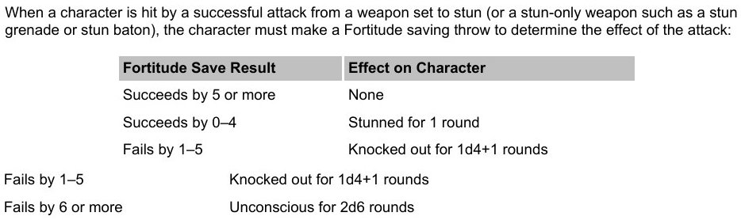
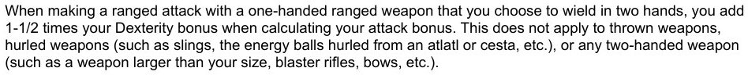
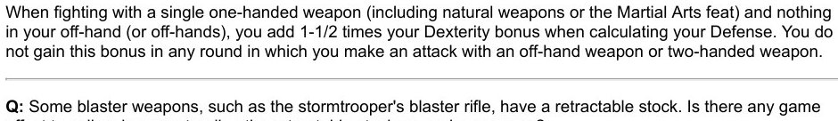
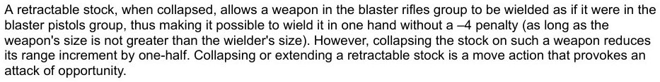
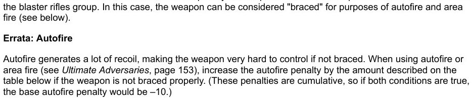
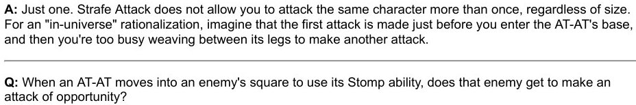

# Owner Material 037 — Star Wars D20 Drive folder (Core, Revised Core and Saga Edition): Jedi Counselling/Jedi Counseling 86.pdf [Star Wars Roleplaying Game Revised Core (d20, 2002)]

- **Source:** Wizards of the Coast Star Wars Roleplaying Game books, web enhancements, Living Force campaign modules and articles (2000–2010), from the owner's "Star Wars D20" Drive folder (only the three edition subfolders; "General" was not read, as instructed). Secondary source (licensed Legends reference). Scan OCR'd on the box; the scan stays box-only and is **not** published.
- **Method:** every scanned page was OCR'd and machine-screened sentence by sentence for power-relevant statements (fights, kills, defeats, Force feats, rankings, superweapons) that name a character on our roster; each kept sentence is quoted verbatim from the OCR text and has a crop of the printed passage directly under it. Pages with nothing power-relevant are still listed with what is on them.
- **Citation:** "*Jedi Counseling 86* (SWRPG d20 Revised Core), p.X" by printed page ("scan p.X" where no printed number applies). **Weight:** Licensed RPG material: a secondary source. Narrative text sums up Legends lore; game statistics are rules for players, not canon power levels, and rank lowest.

## scan p.1 (scan page 1)

Page contents: Stun errata; one- vs two-handed weapons discussion (hand-read)

- **No single roster character (rules/setting/general)** — entry/section: Errata: Setting Weapons on Stun: "When a character is hit by a successful attack from a weapon set to stun (or a stun-only weapon such as a stun grenade or stun baton), the character must make a Fortitude saving throw to determine the effect of the attack:
Fortitude Save Result Effect on Character Succeeds by 5 or more None
Succeeds by 0-4 Stunned for 1 round
Fails by 1-5 Knocked out for 1d4+1 rounds Fails by 6 or more Unconscious for 2d6 rounds" Source: *Jedi Counseling 86* (SWRPG d20 Revised Core), scan p.1
  

## scan p.2 (scan page 2)

Page contents: Two-handed ranged and one-handed optional rules; retractable stocks errata; autofire errata (hand-read)

- **No single roster character (rules/setting/general)** — entry/section: Optional Rule: Using Ranged Weapons in Two Hands: "When making a ranged attack with a one-handed ranged weapon that you choose to wield in two hands, you add 1-1/2 times your Dexterity bonus when calculating your attack bonus. This does not apply to thrown weapons, hurled weapons (such as slings, the energy balls hurled from an atlatl or cesta, etc.), or any two-handed weapon (such as a weapon larger than your size, blaster rifles, bows, etc.)." Source: *Jedi Counseling 86* (SWRPG d20 Revised Core), scan p.2
  
- **No single roster character (rules/setting/general)** — entry/section: Optional Rule: One-Handed Weapons: "When fighting with a single one-handed weapon (including natural weapons or the Martial Arts feat) and nothing in your off-hand (or off-hands), you add 1-1/2 times your Dexterity bonus when calculating your Defense. You do not gain this bonus in any round in which you make an attack with an off-hand weapon or two-handed weapon." Source: *Jedi Counseling 86* (SWRPG d20 Revised Core), scan p.2
  
- **No single roster character (rules/setting/general)** — entry/section: Errata: Retractable Stocks: "A retractable stock, when collapsed, allows a weapon in the blaster rifles group to be wielded as if it were in the blaster pistols group, thus making it possible to wield it in one hand without a -4 penalty (as long as the weapon's size is not greater than the wielder's size). However, collapsing the stock on such a weapon reduces its range increment by one-half. Collapsing or extending a retractable stock is a move action that provokes an attack of opportunity." Source: *Jedi Counseling 86* (SWRPG d20 Revised Core), scan p.2
  
- **No single roster character (rules/setting/general)** — entry/section: Errata: Autofire: "Autofire generates a lot of recoil, making the weapon very hard to control if not braced. When using autofire or area fire (see Ultimate Adversaries, page 153), increase the autofire penalty by the amount described on the table below if the weapon is not braced properly. (These penalties are cumulative, so if both conditions are true, the base autofire penalty would be -10.)" Source: *Jedi Counseling 86* (SWRPG d20 Revised Core), scan p.2
  

## scan p.3 (scan page 3)

Page contents: Strafe Attack vs AT-AT; Stomp AoO; AT-AT AoO; Stomp vs Turret/Tower; Tower under base; base on map (hand-read)

- **No single roster character (rules/setting/general)** — entry/section: Strafe Attack against an AT-AT: "A: Just one. Strafe Attack does not allow you to attack the same character more than once, regardless of size. For an "in-universe" rationalization, imagine that the first attack is made just before you enter the AT-AT's base, and then you're too busy weaving between its legs to make another attack." Source: *Jedi Counseling 86* (SWRPG d20 Revised Core), scan p.3
  

## scan p.4 (scan page 4)

Page contents: Molecular Shielding vs AT-AT; author bio (hand-read)

