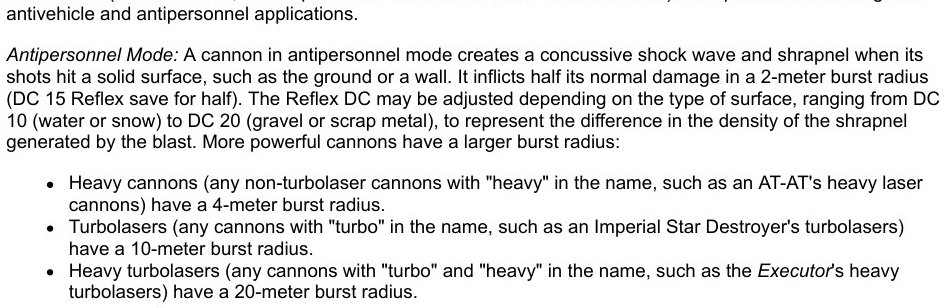
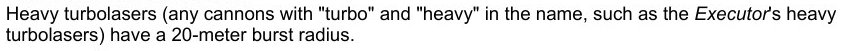
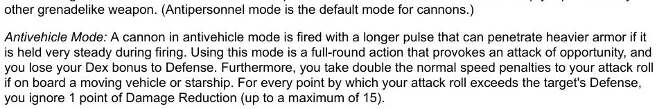
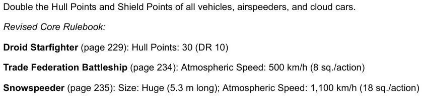
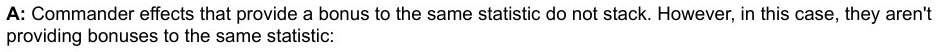
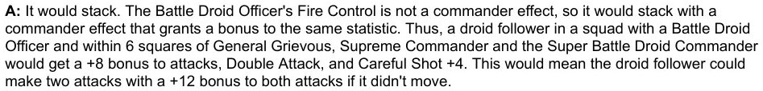

# Owner Material 037 — Star Wars D20 Drive folder (Core, Revised Core and Saga Edition): Jedi Counselling/Jedi Counseling 87.pdf [Star Wars Roleplaying Game Revised Core (d20, 2002)]

- **Source:** Wizards of the Coast Star Wars Roleplaying Game books, web enhancements, Living Force campaign modules and articles (2000–2010), from the owner's "Star Wars D20" Drive folder (only the three edition subfolders; "General" was not read, as instructed). Secondary source (licensed Legends reference). Scan OCR'd on the box; the scan stays box-only and is **not** published.
- **Method:** every scanned page was OCR'd and machine-screened sentence by sentence for power-relevant statements (fights, kills, defeats, Force feats, rankings, superweapons) that name a character on our roster; each kept sentence is quoted verbatim from the OCR text and has a crop of the printed passage directly under it. Pages with nothing power-relevant are still listed with what is on them.
- **Citation:** "*Jedi Counseling 87* (SWRPG d20 Revised Core), p.X" by printed page ("scan p.X" where no printed number applies). **Weight:** Licensed RPG material: a secondary source. Narrative text sums up Legends lore; game statistics are rules for players, not canon power levels, and rank lowest.

## scan p.1 (scan page 1)

Page contents: Blaster cannon; optional rule antipersonnel/antivehicle modes; vehicle stats question (hand-read)

- **No single roster character (rules/setting/general)** — entry/section: Optional Rule: Antipersonnel Mode for cannons: "Antipersonnel Mode: A cannon in antipersonnel mode creates a concussive shock wave and shrapnel when its shots hit a solid surface, such as the ground or a wall. It inflicts half its normal damage in a 2-meter burst radius (DC 15 Reflex save for half). The Reflex DC may be adjusted depending on the type of surface, ranging from DC 10 (water or snow) to DC 20 (gravel or scrap metal), to represent the difference in the density of the shrapnel generated by the blast. More powerful cannons have a larger burst radius:" Source: *Jedi Counseling 87* (SWRPG d20 Revised Core), scan p.1
  
- **Darth Vader (Anakin Skywalker)** — entry/section: Heavy turbolasers (the Executor's): "Heavy turbolasers (any cannons with "turbo" and "heavy" in the name, such as the Executor's heavy turbolasers) have a 20-meter burst radius." Source: *Jedi Counseling 87* (SWRPG d20 Revised Core), scan p.1
  
- **No single roster character (rules/setting/general)** — entry/section: Optional Rule: Antivehicle Mode for cannons: "Antivehicle Mode: A cannon in antivehicle mode is fired with a longer pulse that can penetrate heavier armor if it is held very steady during firing. Using this mode is a full-round action that provokes an attack of opportunity, and you lose your Dex bonus to Defense. Furthermore, you take double the normal speed penalties to your attack roll if on board a moving vehicle or starship. For every point by which your attack roll exceeds the target's Defense, you ignore 1 point of Damage Reduction (up to a maximum of 15)." Source: *Jedi Counseling 87* (SWRPG d20 Revised Core), scan p.1
  

## scan p.2 (scan page 2)

Page contents: Why vehicle stats differ; Errata: Vehicles and Starships list (hand-read)

- **No single roster character (rules/setting/general)** — entry/section: Errata: Vehicles and Starships (core): "Double the Hull Points and Shield Points of all vehicles, airspeeders, and cloud cars. Revised Core Rulebook:
Droid Starfighter (page 229): Hull Points: 30 (DR 10)
Trade Federation Battleship (page 234): Atmospheric Speed: 500 km/h (8 sq./action)
Snowspeeder (page 235): Size: Huge (5.3 m long); Atmospheric Speed: 1,100 km/h (18 sq./action)" Source: *Jedi Counseling 87* (SWRPG d20 Revised Core), scan p.2
  

## scan p.3 (scan page 3)

Page contents: Errata continued; Grievous/SBD Commander stacking; Battle Droid Officer; San Hill Q/A (hand-read)

- **General Grievous** — entry/section: Grievous and the Super Battle Droid Commander stack: "A: Commander effects that provide a bonus to the same statistic do not stack. However, in this case, they aren't providing bonuses to the same statistic:" Source: *Jedi Counseling 87* (SWRPG d20 Revised Core), scan p.3
  
- **General Grievous** — entry/section: Battle Droid Officer + Grievous: two attacks at +12: "A: It would stack. The Battle Droid Officer's Fire Control is not a commander effect, so it would stack with a commander effect that grants a bonus to the same statistic. Thus, a droid follower in a squad with a Battle Droid Officer and within 6 squares of General Grievous, Supreme Commander and the Super Battle Droid Commander would get a +8 bonus to attacks, Double Attack, and Careful Shot +4. This would mean the droid follower could make two attacks with a +12 bonus to both attacks if it didn't move." Source: *Jedi Counseling 87* (SWRPG d20 Revised Core), scan p.3
  

## scan p.4 (scan page 4)

Page contents: San Hill sequence; Savage and doors; author bio (hand-read)

