# Owner Material 037 — Star Wars D20 Drive folder (Core, Revised Core and Saga Edition): Jedi Counselling/Jedi Counseling 88.pdf [Star Wars Roleplaying Game Revised Core (d20, 2002)]

- **Source:** Wizards of the Coast Star Wars Roleplaying Game books, web enhancements, Living Force campaign modules and articles (2000–2010), from the owner's "Star Wars D20" Drive folder (only the three edition subfolders; "General" was not read, as instructed). Secondary source (licensed Legends reference). Scan OCR'd on the box; the scan stays box-only and is **not** published.
- **Method:** every scanned page was OCR'd and machine-screened sentence by sentence for power-relevant statements (fights, kills, defeats, Force feats, rankings, superweapons) that name a character on our roster; each kept sentence is quoted verbatim from the OCR text and has a crop of the printed passage directly under it. Pages with nothing power-relevant are still listed with what is on them.
- **Citation:** "*Jedi Counseling 88* (SWRPG d20 Revised Core), p.X" by printed page ("scan p.X" where no printed number applies). **Weight:** Licensed RPG material: a secondary source. Narrative text sums up Legends lore; game statistics are rules for players, not canon power levels, and rank lowest.

## scan p.1 (scan page 1)

Page contents: Whirlwind Attack errata; Stray Attacks optional rule (hand-read)

- **No single roster character (rules/setting/general)** — entry/section: Errata: Whirlwind Attack: "When using Whirlwind Attack, you cannot gain any extra attacks that turn from any other source (including feats such as Cleave and Heroic Surge or fighting with two weapons). Note that this does not prevent you from using attacks of opportunity later in the round." Source: *Jedi Counseling 88* (SWRPG d20 Revised Core), scan p.1
  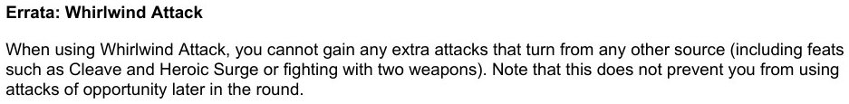
- **No single roster character (rules/setting/general)** — entry/section: Optional Rule: Stray Attacks (miss chance and pass-through): "3. If your attack misses but the total attack roll including all modifiers was 5 or more, your shot might hit another target. Trace a straight line from your square through the target's square (or the target's closest square, in the case of targets larger than Medium size) and extending it outward. Any target in a square that this line crosses is attacked (attack bonus +0, 50% miss chance), starting with the closest. If the shot misses due to miss chance or as outlined in (2) above, the shot continues in its path. Continue until the shot stops, the shot scores a hit, or no characters remain in its path." Source: *Jedi Counseling 88* (SWRPG d20 Revised Core), scan p.1
  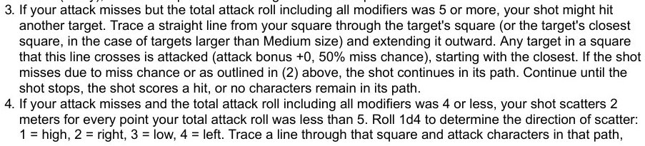

## scan p.2 (scan page 2)

Page contents: Stray attacks cont.; orbital bombardment; spotters; ARC Troopers Order 66; Luke Force Point Q (hand-read)

- **No single roster character (rules/setting/general)** — entry/section: Orbital bombardment: "A: Use atmospheric weapon ranges (see Jedi Counseling 62), but multiply the range increments of all weapons by 20 when attacking surface targets. (Thus, a long-range starship weapon has a 20-km range increment, a medium-range starship has a 10-km range increment, and a short-range starship has a 5-km range increment.) The reason for this very long range is that you're shooting down through the atmosphere, most of which is very thin until you get close to the surface." Source: *Jedi Counseling 88* (SWRPG d20 Revised Core), scan p.2
  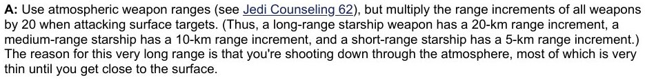
- **No single roster character (rules/setting/general)** — entry/section: Bombarding cities: only the Empire and the Sith: "Casualties in a building or city are approximately proportional to the percentage of Hull Points lost, with two-thirds of these being wounded and the rest killed. However, it's generally known that only the Galactic Empire and the Sith Empire before them are callous enough to obliterate entire cities." Source: *Jedi Counseling 88* (SWRPG d20 Revised Core), scan p.2
  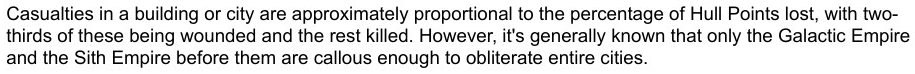
- **No single roster character (rules/setting/general)** — entry/section: ARC Troopers and Order 66: "A: The reversal of the ruling came as a result of feedback from Lucasfilm, actually. The idea is that ARC Troopers should count as clone troopers because -- while it's certainly possible that some would not have followed Order 66 -- most (on average) would have done so simply because of their training. In other words, you don't have to be genetically altered to follow an immoral or unethical order. After all, real-world human history has plenty of tragic examples of normal people following such orders." Source: *Jedi Counseling 88* (SWRPG d20 Revised Core), scan p.2
  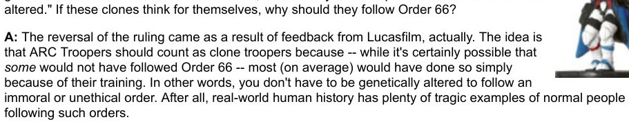
- **Luke Skywalker**: "If Luke is defeated, do the characters that gained a Force Point from Luke's commander effect at the start of the game lose a Force Point?" Source: *Jedi Counseling 88* (SWRPG d20 Revised Core), scan p.2
  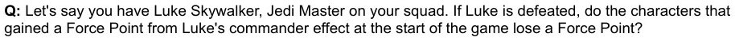

## scan p.3 (scan page 3)

Page contents: Luke answer; Lightsaber Sweep vs Ysalamiri; walls; Xizor/B'omarr; Nom Anor; Yoda x2; author bio (hand-read)

- **Luke Skywalker; Grand Admiral Thrawn** — entry/section: Lightsaber Sweep vs Thrawn's Ysalamiri: "A: Yes. The Ysalamiri ability prohibits characters within 6 squares from spending Force Points, and it prevents any character within 6 squares from being affected by a Force power. In the scenario you describe above, Luke does neither: He is not within 6 squares of Thrawn when he uses his Force Point to use Lightsaber Sweep, and Lightsaber Sweep itself does not actually affect enemies -- it just boosts Luke by allowing him to make more attacks than normal." Source: *Jedi Counseling 88* (SWRPG d20 Revised Core), scan p.3
  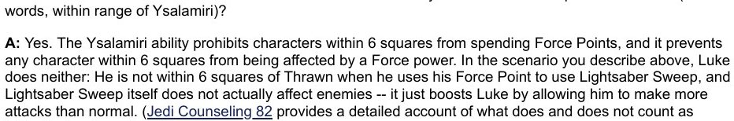
- **Prince Xizor** — entry/section: Xizor's Accurate Shot and Dominate: "Q: Let's say Xizor gives Accurate Shot to a Biomarr Monk. Can the monk use Dominate against anybody in sight, even characters with cover who aren't the closest enemy?
A: No. Accurate Shot specifies that you can "attack an enemy regardless of whether it has cover." Dominate is not an attack: It's a "replaces turn" ability." Source: *Jedi Counseling 88* (SWRPG d20 Revised Core), scan p.3
  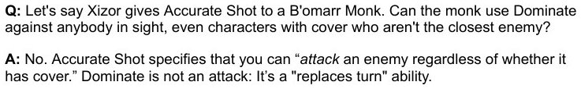
- **Nom Anor** — entry/section: Nom Anor gives Self-Destruct 20 to himself: "A: Yes. Nothing in the rules prevents a commander effect from affecting the commander, and nothing in this commander effect indicates that it would not work on Nom Anor. In fact, the first half of Nom Anor's commander effect does point out that Nom Anor himself is affected." Source: *Jedi Counseling 88* (SWRPG d20 Revised Core), scan p.3
  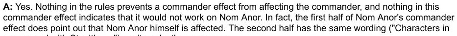
- **Yoda** — entry/section: Yoda's Force Defense: "A: Yoda's Force Defense will work against any Force power used by a character within 6 squares. The target (if any) doesn't matter at all." Source: *Jedi Counseling 88* (SWRPG d20 Revised Core), scan p.3
  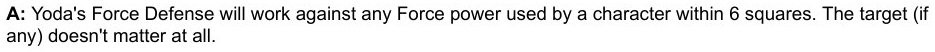
- **Yoda; Darth Maul; Palpatine (Darth Sidious)** — entry/section: Yoda adjacent to Maul and Sidious: "A: Yoda may attack either character. The "closest enemy" requirement applies only to enemies with cover, and adjacent enemies never have cover. Thus, all adjacent enemies are equally legal targets." Source: *Jedi Counseling 88* (SWRPG d20 Revised Core), scan p.3
  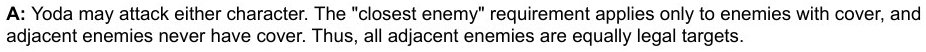

## scan p.4 (scan page 4)

Page contents: Copyright line only (hand-read)

