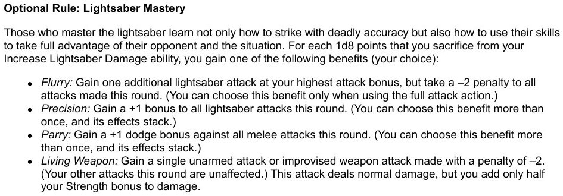
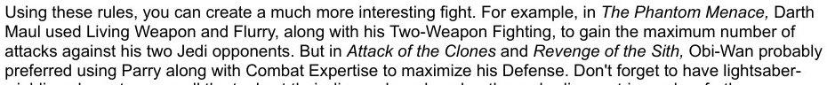
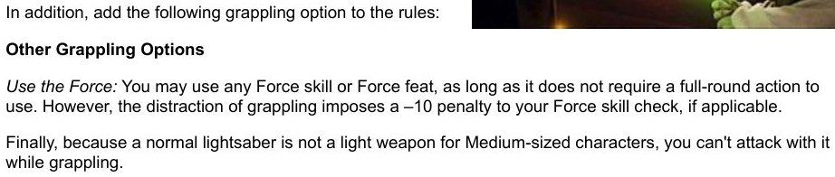
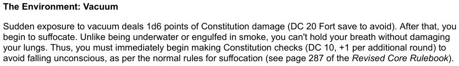
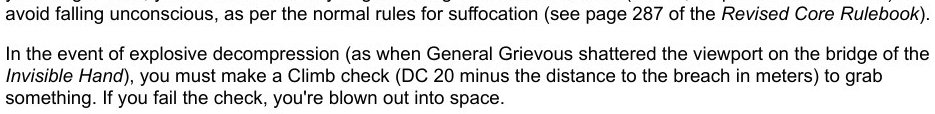
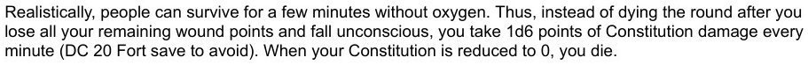
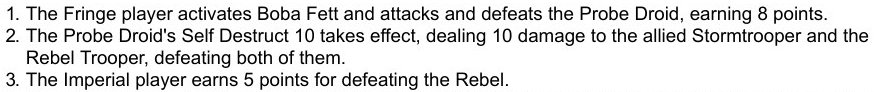
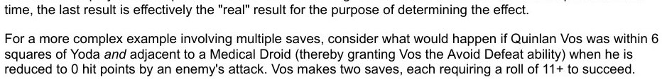
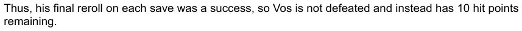

# Owner Material 037 — Star Wars D20 Drive folder (Core, Revised Core and Saga Edition): Jedi Counselling/Jedi Counseling 89.pdf [Star Wars Roleplaying Game Revised Core (d20, 2002)]

- **Source:** Wizards of the Coast Star Wars Roleplaying Game books, web enhancements, Living Force campaign modules and articles (2000–2010), from the owner's "Star Wars D20" Drive folder (only the three edition subfolders; "General" was not read, as instructed). Secondary source (licensed Legends reference). Scan OCR'd on the box; the scan stays box-only and is **not** published.
- **Method:** every scanned page was OCR'd and machine-screened sentence by sentence for power-relevant statements (fights, kills, defeats, Force feats, rankings, superweapons) that name a character on our roster; each kept sentence is quoted verbatim from the OCR text and has a crop of the printed passage directly under it. Pages with nothing power-relevant are still listed with what is on them.
- **Citation:** "*Jedi Counseling 89* (SWRPG d20 Revised Core), p.X" by printed page ("scan p.X" where no printed number applies). **Weight:** Licensed RPG material: a secondary source. Narrative text sums up Legends lore; game statistics are rules for players, not canon power levels, and rank lowest.

## scan p.1 (scan page 1)

Page contents: Lightsaber Mastery optional rule (hand-read)

- **No single roster character (rules/setting/general)** — entry/section: Optional Rule: Lightsaber Mastery: "Those who master the lightsaber learn not only how to strike with deadly accuracy but also how to use their skills to take full advantage of their opponent and the situation. For each 1d8 points that you sacrifice from your Increase Lightsaber Damage ability, you gain one of the following benefits (your choice):
Flurry: Gain one additional lightsaber attack at your highest attack bonus, but take a -2 penalty to all attacks made this round. (You can choose this benefit only when using the full attack action.)
Precision: Gain a +1 bonus to all lightsaber attacks this round. (You can choose this benefit more than once, and its effects stack.)
Parry: Gain a +1 dodge bonus against all melee attacks this round. (You can choose this benefit more than once, and its effects stack.)
Living Weapon: Gain a single unarmed attack or improvised weapon attack made with a penalty of -2. (Your other attacks this round are unaffected.) This attack deals normal damage, but you add only half your Strength bonus to damage." Source: *Jedi Counseling 89* (SWRPG d20 Revised Core), scan p.1
  

## scan p.2 (scan page 2)

Page contents: Maul/Obi-Wan examples; Reduced Lightsaber Damage; saber lock; vacuum; decompression (hand-read)

- **Darth Maul; Obi-Wan Kenobi** — entry/section: Maul's Flurry, Obi-Wan's Parry: "Using these rules, you can create a much more interesting fight. For example, in The Phantom Menace, Darth Maul used Living Weapon and Flurry, along with his Two-Weapon Fighting, to gain the maximum number of attacks against his two Jedi opponents. But in Attack of the Clones and Revenge of the Sith, Obi-Wan probably preferred using Parry along with Combat Expertise to maximize his Defense." Source: *Jedi Counseling 89* (SWRPG d20 Revised Core), scan p.2
  
- **No single roster character (rules/setting/general)** — entry/section: Saber lock: Use the Force while grappling: "Use the Force: You may use any Force skill or Force feat, as long as it does not require a full-round action to use. However, the distraction of grappling imposes a -10 penalty to your Force skill check, if applicable.
Finally, because a normal lightsaber is not a light weapon for Medium-sized characters, you can't attack with it while grappling." Source: *Jedi Counseling 89* (SWRPG d20 Revised Core), scan p.2
  
- **No single roster character (rules/setting/general)** — entry/section: The Environment: Vacuum: "Sudden exposure to vacuum deals 1d6 points of Constitution damage (DC 20 Fort save to avoid). After that, you begin to suffocate. Unlike being underwater or engulfed in smoke, you can't hold your breath without damaging your lungs. Thus, you must immediately begin making Constitution checks (DC 10, +1 per additional round) to avoid falling unconscious, as per the normal rules for suffocation (see page 287 of the Revised Core Rulebook)." Source: *Jedi Counseling 89* (SWRPG d20 Revised Core), scan p.2
  
- **General Grievous** — entry/section: Explosive decompression (the Invisible Hand): "In the event of explosive decompression (as when General Grievous shattered the viewport on the bridge of the Invisible Hand), you must make a Climb check (DC 20 minus the distance to the breach in meters) to grab something. If you fail the check, you're blown out into space." Source: *Jedi Counseling 89* (SWRPG d20 Revised Core), scan p.2
  

## scan p.3 (scan page 3)

Page contents: Slower Suffocation; own-character points; Self Destruct example; Yoda rerolls; Quinlan Vos; Maul speeder (hand-read)

- **No single roster character (rules/setting/general)** — entry/section: Variant Rule: Slower Suffocation: "Realistically, people can survive for a few minutes without oxygen. Thus, instead of dying the round after you lose all your remaining wound points and fall unconscious, you take 1d6 points of Constitution damage every minute (DC 20 Fort save to avoid). When your Constitution is reduced to 0, you die." Source: *Jedi Counseling 89* (SWRPG d20 Revised Core), scan p.3
  
- **Boba Fett** — entry/section: Boba Fett and the Probe Droid's Self Destruct: "1. The Fringe player activates Boba Fett and attacks and defeats the Probe Droid, earning 8 points.
2. The Probe Droid's Self Destruct 10 takes effect, dealing 10 damage to the allied Stormtrooper and the Rebel Trooper, defeating both of them." Source: *Jedi Counseling 89* (SWRPG d20 Revised Core), scan p.3
  
- **Yoda; Quinlan Vos** — entry/section: Quinlan Vos rerolls under Yoda's commander effect: "For a more complex example involving multiple saves, consider what would happen if Quinlan Vos was within 6 squares of Yoda and adjacent to a Medical Droid (thereby granting Vos the Avoid Defeat ability) when he is reduced to 0 hit points by an enemy's attack. Vos makes two saves, each requiring a roll of 11+ to succeed." Source: *Jedi Counseling 89* (SWRPG d20 Revised Core), scan p.3
  
- **Yoda**: "Q: What happens with Yoda's commander effect in the case of Avoid Defeat?" Source: *Jedi Counseling 89* (SWRPG d20 Revised Core), scan p.3
  
- **Quinlan Vos**: "Thus, his final reroll on each save was a success, so Vos is not defeated and instead has 10 hit points remaining." Source: *Jedi Counseling 89* (SWRPG d20 Revised Core), scan p.3
  

## scan p.4 (scan page 4)

Page contents: Speeder hover heights; author bio (hand-read)

