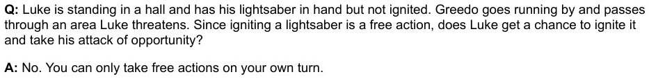
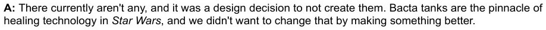
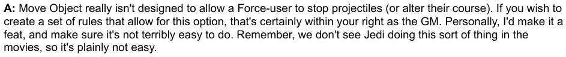
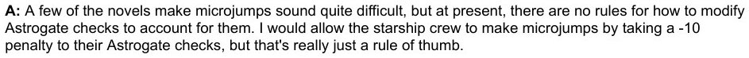
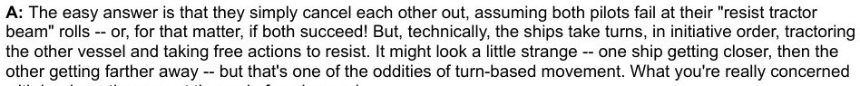

# Owner Material 037 — Star Wars D20 Drive folder (Core, Revised Core and Saga Edition): Jedi Counselling/Jedi Counseling 9 - Spinning Ships.pdf [Star Wars Roleplaying Game Revised Core (d20, 2002)]

- **Source:** Wizards of the Coast Star Wars Roleplaying Game books, web enhancements, Living Force campaign modules and articles (2000–2010), from the owner's "Star Wars D20" Drive folder (only the three edition subfolders; "General" was not read, as instructed). Secondary source (licensed Legends reference). Scan OCR'd on the box; the scan stays box-only and is **not** published.
- **Method:** every scanned page was OCR'd and machine-screened sentence by sentence for power-relevant statements (fights, kills, defeats, Force feats, rankings, superweapons) that name a character on our roster; each kept sentence is quoted verbatim from the OCR text and has a crop of the printed passage directly under it. Pages with nothing power-relevant are still listed with what is on them.
- **Citation:** "*Jedi Counseling 9 - Spinning Ships* (SWRPG d20 Revised Core), p.X" by printed page ("scan p.X" where no printed number applies). **Weight:** Licensed RPG material: a secondary source. Narrative text sums up Legends lore; game statistics are rules for players, not canon power levels, and rank lowest.

## scan p.1 (scan page 1)

Page contents: Luke/Greedo AoO; healing items; Move Object weight; Cooperation; lightsaber vs Vong; batteries; spin recovery (hand-read)

- **Luke Skywalker; Greedo** — entry/section: Luke can't ignite his lightsaber for an AoO on Greedo: "Q: Luke is standing in a hall and has his lightsaber in hand but not ignited. Greedo goes running by and passes through an area Luke threatens. Since igniting a lightsaber is a free action, does Luke get a chance to ignite it and take his attack of opportunity?
A: No. You can only take free actions on your own turn." Source: *Jedi Counseling 9 - Spinning Ships* (SWRPG d20 Revised Core), scan p.1
  
- **No single roster character (rules/setting/general)** — entry/section: No healing potions: bacta is the pinnacle: "A: There currently aren't any, and it was a design decision to not create them. Bacta tanks are the pinnacle of healing technology in Star Wars, and we didn't want to change that by making something better." Source: *Jedi Counseling 9 - Spinning Ships* (SWRPG d20 Revised Core), scan p.1
  
- **No single roster character (rules/setting/general)** — entry/section: Move Object: Medium beings 51 to 500 kg: "A: That seems to be an error. Medium-size beings should fall under the range of 51 to 500 kg." Source: *Jedi Counseling 9 - Spinning Ships* (SWRPG d20 Revised Core), scan p.1
  
- **No single roster character (rules/setting/general)** — entry/section: Lightsabers vs Yuuzhan Vong weapons: "A: Judging by all the times Jedi have used lightsabers to try to cut through amphistaves, I'd say no, they don't ignore the hardness of Yuuzhan Vong weapons." Source: *Jedi Counseling 9 - Spinning Ships* (SWRPG d20 Revised Core), scan p.1
  

## scan p.2 (scan page 2)

Page contents: Spin cont.; pistol vs ship; Move Object projectiles; Quick Draw; Point Blank Shot; Sith swords; microjumps; tractor beams (hand-read)

- **No single roster character (rules/setting/general)** — entry/section: Stopping projectiles with Move Object: "A: Move Object really isn't designed to allow a Force-user to stop projectiles (or alter their course). If you wish to create a set of rules that allow for this option, that's certainly within your right as the GM. Personally, I'd make it a feat, and make sure it's not terribly easy to do. Remember, we don't see Jedi doing this sort of thing in the movies, so it's plainly not easy." Source: *Jedi Counseling 9 - Spinning Ships* (SWRPG d20 Revised Core), scan p.2
  
- **No single roster character (rules/setting/general)** — entry/section: Sith swords: hardness 10, 10 wound points: "A: I'd go with hardness 10 and 10 wound points. Sith swords don't shatter all that easily, even though they look like glass." Source: *Jedi Counseling 9 - Spinning Ships* (SWRPG d20 Revised Core), scan p.2
  
- **No single roster character (rules/setting/general)** — entry/section: Microjumps: "A: A few of the novels make microjumps sound quite difficult, but at present, there are no rules for how to modify Astrogate checks to account for them. I would allow the starship crew to make microjumps by taking a -10 penalty to their Astrogate checks, but that's really just a rule of thumb." Source: *Jedi Counseling 9 - Spinning Ships* (SWRPG d20 Revised Core), scan p.2
  
- **No single roster character (rules/setting/general)** — entry/section: Dueling tractor beams: "A: The easy answer is that they simply cancel each other out, assuming both pilots fail at their "resist tractor beam" rolls -- or, for that matter, if both succeed! But, technically, the ships take turns, in initiative order, tractoring the other vessel and taking free actions to resist. It might look a little strange -- one ship getting closer, then the other getting farther away -- but that's one of the oddities of turn-based movement." Source: *Jedi Counseling 9 - Spinning Ships* (SWRPG d20 Revised Core), scan p.2
  

## scan p.3 (scan page 3)

Page contents: Character creation; closing; copyright (hand-read)

