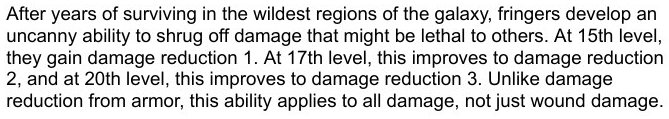
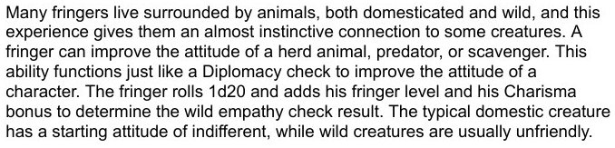
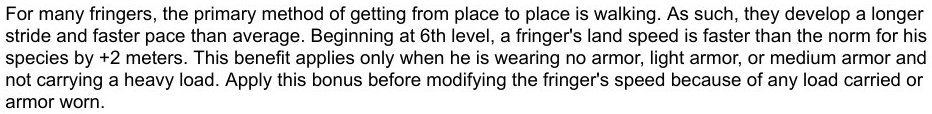
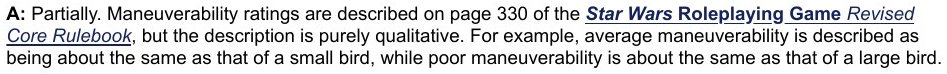
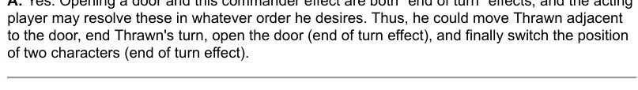
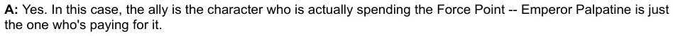
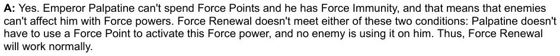
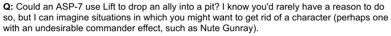
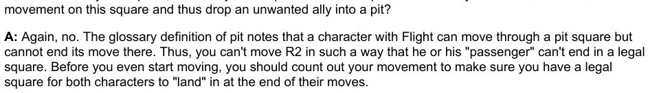

# Owner Material 037 — Star Wars D20 Drive folder (Core, Revised Core and Saga Edition): Jedi Counselling/Jedi Counseling 90.pdf [Star Wars Roleplaying Game Revised Core (d20, 2002)]

- **Source:** Wizards of the Coast Star Wars Roleplaying Game books, web enhancements, Living Force campaign modules and articles (2000–2010), from the owner's "Star Wars D20" Drive folder (only the three edition subfolders; "General" was not read, as instructed). Secondary source (licensed Legends reference). Scan OCR'd on the box; the scan stays box-only and is **not** published.
- **Method:** every scanned page was OCR'd and machine-screened sentence by sentence for power-relevant statements (fights, kills, defeats, Force feats, rankings, superweapons) that name a character on our roster; each kept sentence is quoted verbatim from the OCR text and has a crop of the printed passage directly under it. Pages with nothing power-relevant are still listed with what is on them.
- **Citation:** "*Jedi Counseling 90* (SWRPG d20 Revised Core), p.X" by printed page ("scan p.X" where no printed number applies). **Weight:** Licensed RPG material: a secondary source. Narrative text sums up Legends lore; game statistics are rules for players, not canon power levels, and rank lowest.

## scan p.1 (scan page 1)

Page contents: Fringer variants: Damage Reduction, Wild Empathy, Fast Movement (hand-read)

- **No single roster character (rules/setting/general)** — entry/section: Variant: Fringer Damage Reduction: "After years of surviving in the wildest regions of the galaxy, fringers develop an uncanny ability to shrug off damage that might be lethal to others. At 15th level, they gain damage reduction 1. At 17th level, this improves to damage reduction 2, and at 20th level, this improves to damage reduction 3. Unlike damage reduction from armor, this ability applies to all damage, not just wound damage." Source: *Jedi Counseling 90* (SWRPG d20 Revised Core), scan p.1
  
- **No single roster character (rules/setting/general)** — entry/section: Variant: Wild Empathy (fringer): "Many fringers live surrounded by animals, both domesticated and wild, and this experience gives them an almost instinctive connection to some creatures. A fringer can improve the attitude of a herd animal, predator, or scavenger. This ability functions just like a Diplomacy check to improve the attitude of a character. The fringer rolls 1d20 and adds his fringer level and his Charisma bonus to determine the wild empathy check result. The typical domestic creature has a starting attitude of indifferent, while wild creatures are usually unfriendly." Source: *Jedi Counseling 90* (SWRPG d20 Revised Core), scan p.1
  
- **No single roster character (rules/setting/general)** — entry/section: Variant: Fast Movement (fringer): "For many fringers, the primary method of getting from place to place is walking. As such, they develop a longer stride and faster pace than average. Beginning at 6th level, a fringer's land speed is faster than the norm for his species by +2 meters. This benefit applies only when he is wearing no armor, light armor, or medium armor and not carrying a heavy load. Apply this bonus before modifying the fringer's speed because of any load carried or armor worn." Source: *Jedi Counseling 90* (SWRPG d20 Revised Core), scan p.1
  

## scan p.2 (scan page 2)

Page contents: Maneuverability table and definitions (hand-read)

- **No single roster character (rules/setting/general)** — entry/section: Maneuverability ratings: "A: Partially. Maneuverability ratings are described on page 330 of the Star Wars Roleplaying Game Revised Core Rulebook, but the description is purely qualitative. For example, average maneuverability is described as being about the same as that of a small bird, while poor maneuverability is about the same as that of a large bird." Source: *Jedi Counseling 90* (SWRPG d20 Revised Core), scan p.2
  

## scan p.3 (scan page 3)

Page contents: Thrawn x2; Ysalamiri Large; Palpatine x2; ASP-7 Lift; R2-D2 Tow Cable; author bio (hand-read)

- **Grand Admiral Thrawn** — entry/section: Thrawn opens the door, then switches allies: "A: Yes. Opening a door and this commander effect are both "end of turn" effects, and the acting player may resolve these in whatever order he desires. Thus, he could move Thrawn adjacent to the door, end Thrawn's turn, open the door (end of turn effect), and finally switch the position of two characters (end of turn effect)." Source: *Jedi Counseling 90* (SWRPG d20 Revised Core), scan p.3
  
- **Palpatine (Darth Sidious); Grand Admiral Thrawn** — entry/section: Emperor Palpatine's Force Points under Ysalamiri: "A: Yes. In this case, the ally is the character who is actually spending the Force Point -- Emperor Palpatine is just the one who's paying for it." Source: *Jedi Counseling 90* (SWRPG d20 Revised Core), scan p.3
  
- **Palpatine (Darth Sidious)** — entry/section: Palpatine's Force Renewal under Ysalamiri: "A: Yes. Emperor Palpatine can't spend Force Points and he has Force Immunity, and that means that enemies can't affect him with Force powers. Force Renewal doesn't meet either of these two conditions: Palpatine doesn't have to use a Force Point to activate this Force power, and no enemy is using it on him. Thus, Force Renewal will work normally." Source: *Jedi Counseling 90* (SWRPG d20 Revised Core), scan p.3
  
- **Nute Gunray** — entry/section: Dropping Nute Gunray into a pit with Lift: "Q: Could an ASP-7 use Lift to drop an ally into a pit? I know you'd rarely have a reason to do so, but I can imagine situations in which you might want to get rid of a character (perhaps one with an undesirable commander effect, such as Nute Gunray)." Source: *Jedi Counseling 90* (SWRPG d20 Revised Core), scan p.3
  
- **R2-D2** — entry/section: R2-D2's Tow Cable can't drop an ally into a pit: "A: Again, no. The glossary definition of pit notes that a character with Flight can move through a pit square but cannot end its move there. Thus, you can't move R2 in such a way that he or his "passenger" can't end in a legal square. Before you even start moving, you should count out your movement to make sure you have a legal square for both characters to "land" in at the end of their moves." Source: *Jedi Counseling 90* (SWRPG d20 Revised Core), scan p.3
  

## scan p.4 (scan page 4)

Page contents: Closing; copyright (hand-read)

