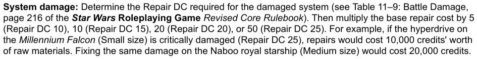
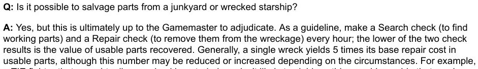
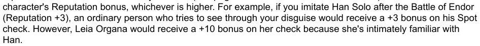
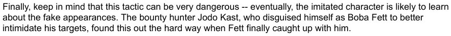
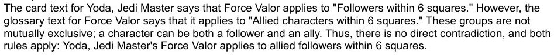
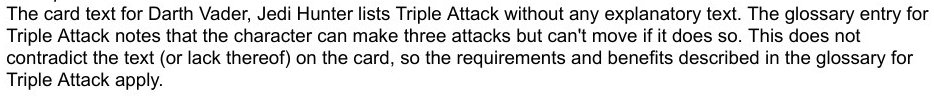
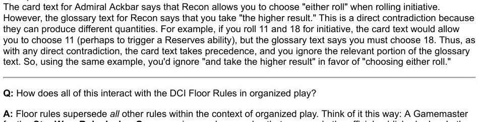
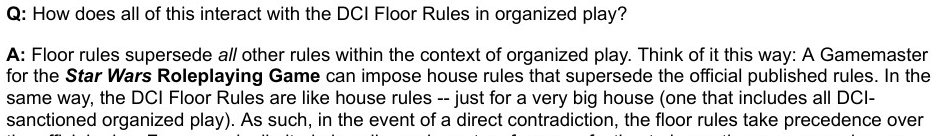

# Owner Material 037 — Star Wars D20 Drive folder (Core, Revised Core and Saga Edition): Jedi Counselling/Jedi Counseling 91.pdf [Star Wars Roleplaying Game Revised Core (d20, 2002)]

- **Source:** Wizards of the Coast Star Wars Roleplaying Game books, web enhancements, Living Force campaign modules and articles (2000–2010), from the owner's "Star Wars D20" Drive folder (only the three edition subfolders; "General" was not read, as instructed). Secondary source (licensed Legends reference). Scan OCR'd on the box; the scan stays box-only and is **not** published.
- **Method:** every scanned page was OCR'd and machine-screened sentence by sentence for power-relevant statements (fights, kills, defeats, Force feats, rankings, superweapons) that name a character on our roster; each kept sentence is quoted verbatim from the OCR text and has a crop of the printed passage directly under it. Pages with nothing power-relevant are still listed with what is on them.
- **Citation:** "*Jedi Counseling 91* (SWRPG d20 Revised Core), p.X" by printed page ("scan p.X" where no printed number applies). **Weight:** Licensed RPG material: a secondary source. Narrative text sums up Legends lore; game statistics are rules for players, not canon power levels, and rank lowest.

## scan p.1 (scan page 1)

Page contents: Repair cost table; hull and system damage examples (hand-read)

- **Han Solo** — entry/section: Millennium Falcon hyperdrive repair cost: "System damage: Determine the Repair DC required for the damaged system (see Table 11-9: Battle Damage, page 216 of the Star Wars Roleplaying Game Revised Core Rulebook). Then multiply the base repair cost by 5 (Repair DC 10), 10 (Repair DC 15), 20 (Repair DC 20), or 50 (Repair DC 25). For example, if the hyperdrive on the Millennium Falcon (Small size) is critically damaged (Repair DC 25), repairs would cost 10,000 credits' worth of raw materials. Fixing the same damage on the Naboo royal starship (Medium size) would cost 20,000 credits." Source: *Jedi Counseling 91* (SWRPG d20 Revised Core), scan p.1
  

## scan p.2 (scan page 2)

Page contents: Hired repairs; Make It Fit; salvage; disguise and Reputation (hand-read)

- **No single roster character (rules/setting/general)** — entry/section: Salvaging parts from wrecks: "A: Yes, but this is ultimately up to the Gamemaster to adjudicate. As a guideline, make a Search check (to find working parts) and a Repair check (to remove them from the wreckage) every hour; the lower of the two check results is the value of usable parts recovered. Generally, a single wreck yields 5 times its base repair cost in usable parts, although this number may be reduced or increased depending on the circumstances." Source: *Jedi Counseling 91* (SWRPG d20 Revised Core), scan p.2
  
- **Han Solo; Leia Organa Solo** — entry/section: Disguised as Han Solo: "For example, if you imitate Han Solo after the Battle of Endor (Reputation +3), an ordinary person who tries to see through your disguise would receive a +3 bonus on his Spot check. However, Leia Organa would receive a +10 bonus on her check because she's intimately familiar with Han." Source: *Jedi Counseling 91* (SWRPG d20 Revised Core), scan p.2
  

## scan p.3 (scan page 3)

Page contents: Jodo Kast; rules precedence order (hand-read)

- **Jodo Kast; Boba Fett** — entry/section: Jodo Kast found out the hard way: "Finally, keep in mind that this tactic can be very dangerous -- eventually, the imitated character is likely to learn about the fake appearances. The bounty hunter Jodo Kast, who disguised himself as Boba Fett to better intimidate his targets, found this out the hard way when Fett finally caught up with him." Source: *Jedi Counseling 91* (SWRPG d20 Revised Core), scan p.3
  

## scan p.4 (scan page 4)

Page contents: Examples 1-4; DCI Floor Rules; author bio (hand-read)

- **Yoda** — entry/section: Example #1: Yoda's Force Valor: "The card text for Yoda, Jedi Master says that Force Valor applies to "Followers within 6 squares." However, the glossary text for Force Valor says that it applies to "Allied characters within 6 squares." These groups are not mutually exclusive; a character can be both a follower and an ally. Thus, there is no direct contradiction, and both rules apply: Yoda, Jedi Master's Force Valor applies to allied followers within 6 squares." Source: *Jedi Counseling 91* (SWRPG d20 Revised Core), scan p.4
  
- **Darth Vader (Anakin Skywalker)** — entry/section: Example #2: Vader, Jedi Hunter's Triple Attack: "The card text for Darth Vader, Jedi Hunter lists Triple Attack without any explanatory text. The glossary entry for Triple Attack notes that the character can make three attacks but can't move if it does so. This does not contradict the text (or lack thereof) on the card, so the requirements and benefits described in the glossary for Triple Attack apply." Source: *Jedi Counseling 91* (SWRPG d20 Revised Core), scan p.4
  
- **Admiral Ackbar** — entry/section: Example #4: Admiral Ackbar's Recon: "The card text for Admiral Ackbar says that Recon allows you to choose "either roll" when rolling initiative. However, the glossary text for Recon says that you take "the higher result." This is a direct contradiction because they can produce different quantities. For example, if you roll 11 and 18 for initiative, the card text would allow you to choose 11 (perhaps to trigger a Reserves ability), but the glossary text says you must choose 18. Thus, as with any direct contradiction, the card text takes precedence, and you ignore the relevant portion of the glossary text." Source: *Jedi Counseling 91* (SWRPG d20 Revised Core), scan p.4
  
- **No single roster character (rules/setting/general)** — entry/section: DCI Floor Rules are house rules for a very big house: "A: Floor rules supersede all other rules within the context of organized play. Think of it this way: A Gamemaster for the Star Wars Roleplaying Game can impose house rules that supersede the official published rules. In the same way, the DCI Floor Rules are like house rules -- just for a very big house (one that includes all DCI-sanctioned organized play)." Source: *Jedi Counseling 91* (SWRPG d20 Revised Core), scan p.4
  
