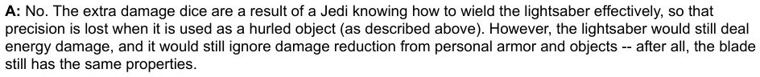
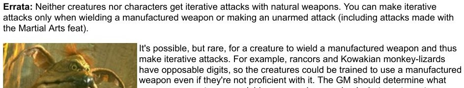
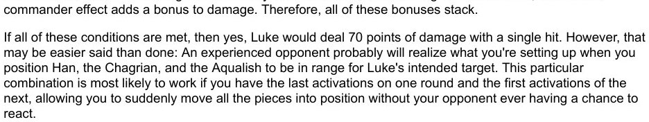
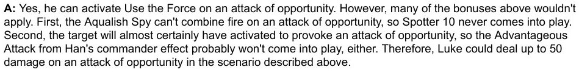
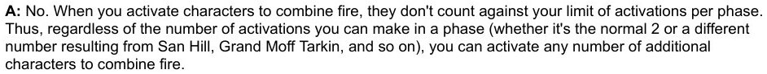

# Owner Material 037 — Star Wars D20 Drive folder (Core, Revised Core and Saga Edition): Jedi Counselling/Jedi Counseling 92.pdf [Star Wars Roleplaying Game Revised Core (d20, 2002)]

- **Source:** Wizards of the Coast Star Wars Roleplaying Game books, web enhancements, Living Force campaign modules and articles (2000–2010), from the owner's "Star Wars D20" Drive folder (only the three edition subfolders; "General" was not read, as instructed). Secondary source (licensed Legends reference). Scan OCR'd on the box; the scan stays box-only and is **not** published.
- **Method:** every scanned page was OCR'd and machine-screened sentence by sentence for power-relevant statements (fights, kills, defeats, Force feats, rankings, superweapons) that name a character on our roster; each kept sentence is quoted verbatim from the OCR text and has a crop of the printed passage directly under it. Pages with nothing power-relevant are still listed with what is on them.
- **Citation:** "*Jedi Counseling 92* (SWRPG d20 Revised Core), p.X" by printed page ("scan p.X" where no printed number applies). **Weight:** Licensed RPG material: a secondary source. Narrative text sums up Legends lore; game statistics are rules for players, not canon power levels, and rank lowest.

## scan p.1 (scan page 1)

Page contents: Hurled melee weapons; hurled vs thrown lightsaber; switching weapons in iterative attacks (hand-read)

- **No single roster character (rules/setting/general)** — entry/section: Hurling a lightsaber with Move Object: "A: No. The extra damage dice are a result of a Jedi knowing how to wield the lightsaber effectively, so that precision is lost when it is used as a hurled object (as described above). However, the lightsaber would still deal energy damage, and it would still ignore damage reduction from personal armor and objects -- after all, the blade still has the same properties." Source: *Jedi Counseling 92* (SWRPG d20 Revised Core), scan p.1
  

## scan p.2 (scan page 2)

Page contents: Creature iterative attacks errata; gundark example; Luke on Tauntaun 70 damage (hand-read)

- **No single roster character (rules/setting/general)** — entry/section: Errata: no iterative attacks with natural weapons: "Errata: Neither creatures nor characters get iterative attacks with natural weapons. You can make iterative attacks only when wielding a manufactured weapon or making an unarmed attack (including attacks made with the Martial Arts feat).
It's possible, but rare, for a creature to wield a manufactured weapon and thus make iterative attacks. For example, rancors and Kowakian monkey-lizards have opposable digits, so the creatures could be trained to use a manufactured weapon even if they're not proficient with it." Source: *Jedi Counseling 92* (SWRPG d20 Revised Core), scan p.2
  
- **Luke Skywalker; Han Solo** — entry/section: Luke on Tauntaun deals 70 damage: "If all of these conditions are met, then yes, Luke would deal 70 points of damage with a single hit. However, that may be easier said than done: An experienced opponent probably will realize what you're setting up when you position Han, the Chagrian, and the Aqualish to be in range for Luke's intended target. This particular combination is most likely to work if you have the last activations on one round and the first activations of the next, allowing you to suddenly move all the pieces into position without your opponent ever having a chance to react." Source: *Jedi Counseling 92* (SWRPG d20 Revised Core), scan p.2
  

## scan p.3 (scan page 3)

Page contents: Use the Force on AoO; Rancor regeneration; Mercenary; San Hill combine fire; author bio (hand-read)

- **Luke Skywalker** — entry/section: Use the Force on an attack of opportunity: "A: Yes, he can activate Use the Force on an attack of opportunity. However, many of the bonuses above wouldn't apply. First, the Aqualish Spy can't combine fire on an attack of opportunity, so Spotter 10 never comes into play. Second, the target will almost certainly have activated to provoke an attack of opportunity, so the Advantageous Attack from Han's commander effect probably won't come into play, either. Therefore, Luke could deal up to 50 damage on an attack of opportunity in the scenario described above." Source: *Jedi Counseling 92* (SWRPG d20 Revised Core), scan p.3
  
- **San Hill; Grand Moff Tarkin** — entry/section: San Hill and combined fire: "A: No. When you activate characters to combine fire, they don't count against your limit of activations per phase. Thus, regardless of the number of activations you can make in a phase (whether it's the normal 2 or a different number resulting from San Hill, Grand Moff Tarkin, and so on), you can activate any number of additional characters to combine fire." Source: *Jedi Counseling 92* (SWRPG d20 Revised Core), scan p.3
  
