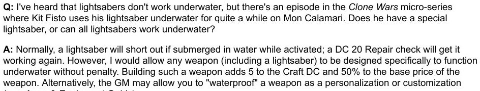
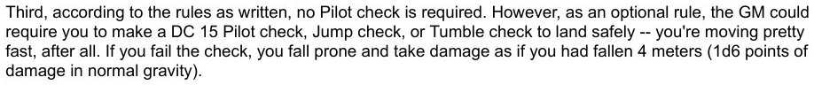
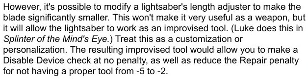
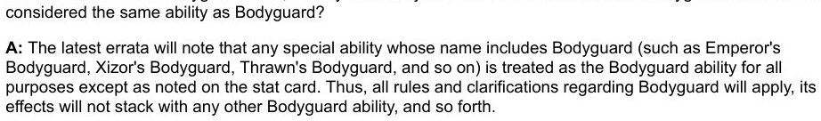

# Owner Material 037 — Star Wars D20 Drive folder (Core, Revised Core and Saga Edition): Jedi Counselling/Jedi Counseling 93.pdf [Star Wars Roleplaying Game Revised Core (d20, 2002)]

- **Source:** Wizards of the Coast Star Wars Roleplaying Game books, web enhancements, Living Force campaign modules and articles (2000–2010), from the owner's "Star Wars D20" Drive folder (only the three edition subfolders; "General" was not read, as instructed). Secondary source (licensed Legends reference). Scan OCR'd on the box; the scan stays box-only and is **not** published.
- **Method:** every scanned page was OCR'd and machine-screened sentence by sentence for power-relevant statements (fights, kills, defeats, Force feats, rankings, superweapons) that name a character on our roster; each kept sentence is quoted verbatim from the OCR text and has a crop of the printed passage directly under it. Pages with nothing power-relevant are still listed with what is on them.
- **Citation:** "*Jedi Counseling 93* (SWRPG d20 Revised Core), p.X" by printed page ("scan p.X" where no printed number applies). **Weight:** Licensed RPG material: a secondary source. Narrative text sums up Legends lore; game statistics are rules for players, not canon power levels, and rank lowest.

## scan p.1 (scan page 1)

Page contents: Personalization physical changes; lightsabers underwater (Kit Fisto); jump boots Q (hand-read)

- **Kit Fisto** — entry/section: Kit Fisto's lightsaber underwater: "Q: I've heard that lightsabers don't work underwater, but there's an episode in the Clone Wars micro-series where Kit Fisto uses his lightsaber underwater for quite a while on Mon Calamari. Does he have a special lightsaber, or can all lightsabers work underwater?
A: Normally, a lightsaber will short out if submerged in water while activated; a DC 20 Repair check will get it working again. However, I would allow any weapon (including a lightsaber) to be designed specifically to function underwater without penalty. Building such a weapon adds 5 to the Craft DC and 50% to the base price of the weapon." Source: *Jedi Counseling 93* (SWRPG d20 Revised Core), scan p.1
  

## scan p.2 (scan page 2)

Page contents: Jump boots answer; length adjuster; attacks vs replaces attacks checklist; Pheromones Q (hand-read)

- **No single roster character (rules/setting/general)** — entry/section: Optional rule: landing with jump boots: "Third, according to the rules as written, no Pilot check is required. However, as an optional rule, the GM could require you to make a DC 15 Pilot check, Jump check, or Tumble check to land safely -- you're moving pretty fast, after all. If you fail the check, you fall prone and take damage as if you had fallen 4 meters (1d6 points of damage in normal gravity)." Source: *Jedi Counseling 93* (SWRPG d20 Revised Core), scan p.2
  
- **Luke Skywalker** — entry/section: Lightsaber as an improvised tool (Splinter of the Mind's Eye): "However, it's possible to modify a lightsaber's length adjuster to make the blade significantly smaller. This won't make it very useful as a weapon, but it will allow the lightsaber to work as an improvised tool. (Luke does this in Splinter of the Mind's Eye.) Treat this as a customization or personalization. The resulting improvised tool would allow you to make a Disable Device check at no penalty, as well as reduce the Repair penalty for not having a proper tool from -5 to -2." Source: *Jedi Counseling 93* (SWRPG d20 Revised Core), scan p.2
  

## scan p.3 (scan page 3)

Page contents: Pheromones answers; Xizor's Bodyguard errata; author bio (hand-read)

- **Prince Xizor; Grand Admiral Thrawn** — entry/section: Xizor's Bodyguard is Bodyguard: "A: The latest errata will note that any special ability whose name includes Bodyguard (such as Emperor's Bodyguard, Xizor's Bodyguard, Thrawn's Bodyguard, and so on) is treated as the Bodyguard ability for all purposes except as noted on the stat card. Thus, all rules and clarifications regarding Bodyguard will apply, its effects will not stack with any other Bodyguard ability, and so forth." Source: *Jedi Counseling 93* (SWRPG d20 Revised Core), scan p.3
  
