# Owner Material 037 — Star Wars D20 Drive folder (Core, Revised Core and Saga Edition): Jedi Counselling/Jedi Counseling 94.pdf [Star Wars Roleplaying Game Revised Core (d20, 2002)]

- **Source:** Wizards of the Coast Star Wars Roleplaying Game books, web enhancements, Living Force campaign modules and articles (2000–2010), from the owner's "Star Wars D20" Drive folder (only the three edition subfolders; "General" was not read, as instructed). Secondary source (licensed Legends reference). Scan OCR'd on the box; the scan stays box-only and is **not** published.
- **Method:** every scanned page was OCR'd and machine-screened sentence by sentence for power-relevant statements (fights, kills, defeats, Force feats, rankings, superweapons) that name a character on our roster; each kept sentence is quoted verbatim from the OCR text and has a crop of the printed passage directly under it. Pages with nothing power-relevant are still listed with what is on them.
- **Citation:** "*Jedi Counseling 94* (SWRPG d20 Revised Core), p.X" by printed page ("scan p.X" where no printed number applies). **Weight:** Licensed RPG material: a secondary source. Narrative text sums up Legends lore; game statistics are rules for players, not canon power levels, and rank lowest.

## scan p.1 (scan page 1)

Page contents: Escape pods and lifeboats; fuel question (hand-read)

- **Han Solo** — entry/section: The Millennium Falcon's escape pods: "Not all escape pods are this size, of course. For example, light freighters sometimes carry very small one- and two-person escape pods that cost about 300 credits each. The Millennium Falcon carries five such escape pods beneath the floor plating in the rear compartment." Source: *Jedi Counseling 94* (SWRPG d20 Revised Core), scan p.1
  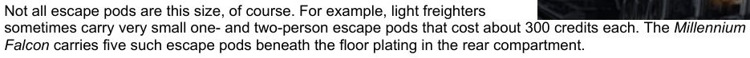
- **No single roster character (rules/setting/general)** — entry/section: Spacer law: enough escape pods for everyone: "Second, regarding the number of escape pods carried: Tramp Freighters and the starwars.com Databank both indicate that spacer law requires all starships to carry enough escape pods for all non-droid passengers and crew. In fact, the Star Wars Sourcebook mentions that a star destroyer carries "hundreds" of escape pods. As such, all starships should be assumed to have enough escape pods for everyone on board; the pods are included in the cost of life support (see Table 1-3: Life Support, Starships of the Galaxy page 7). Military starships are exempt from this law and can carry fewer escape pods." Source: *Jedi Counseling 94* (SWRPG d20 Revised Core), scan p.1
  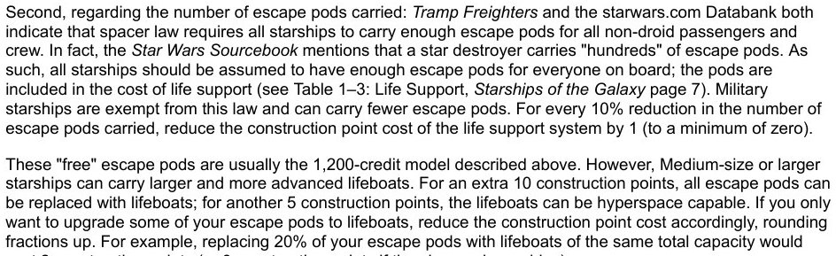
- **No single roster character (rules/setting/general)** — entry/section: Fuel: as much upkeep as the GM needs: "A: The simplest answer is that a ship requires exactly as much upkeep as the GM needs for the adventure, and not one bit more. In most games, you won't ever need to figure out the fuel consumption of a starship, except on the rare occasion that it serves as the motivation or hook for an adventure." Source: *Jedi Counseling 94* (SWRPG d20 Revised Core), scan p.1
  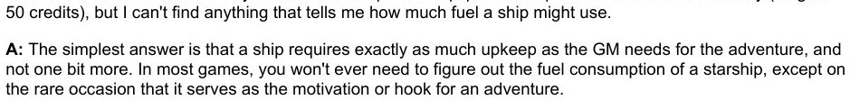

## scan p.2 (scan page 2)

Page contents: Advanced Starship Maintenance rules, examples, drop tanks, restock, tune-ups (hand-read)

- **Wedge Antilles** — entry/section: X-wing fuel range (the X-wing novels): "Example 1: An X-wing (with one week of consumables) has 5 fuel cells, so it can jump to lightspeed, travel for six hours, engage in a combat raid for up to one hour, jump to lightspeed, and travel six hours to return home. This limited range is quite similar to that shown in the X-wing series of novels." Source: *Jedi Counseling 94* (SWRPG d20 Revised Core), scan p.2
  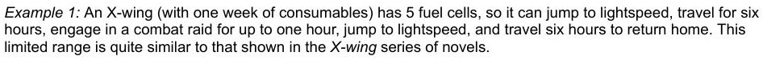
- **Obi-Wan Kenobi; Darth Vader (Anakin Skywalker)** — entry/section: Why Obi-Wan and Anakin rarely returned to Coruscant: "Example 2: A Venator-class Star Destroyer (with two years of consumables) has 736 fuel cells. Deploying a single Venator from Coruscant to the Outer Rim sieges during the Clone Wars requires a jump to hyperspace and an average of about 30 hours of hyperspace travel (assuming you get a decent Astrogate check result), which will empty six fuel cells (costing 30 million credits). Bringing the ship back to Coruscant would require as much fuel as remaining in orbit over a planetary battlefield for six months. This is one reason that Obi-Wan and Anakin didn't travel back to Coruscant very often during the Clone Wars -- moving a fleet of capital ships is very expensive, even for the Galactic Republic." Source: *Jedi Counseling 94* (SWRPG d20 Revised Core), scan p.2
  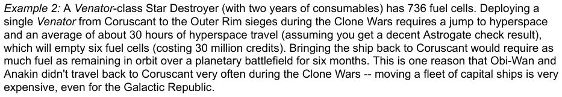
- **No single roster character (rules/setting/general)** — entry/section: Starfighter drop tanks: "Starfighters can carry external drop tanks that increase their fuel capacity. One drop tank costs 1,000 credits and includes one fuel cell, and a starfighter can carry drop tanks with extra fuel equal to double their normal fuel cells." Source: *Jedi Counseling 94* (SWRPG d20 Revised Core), scan p.2
  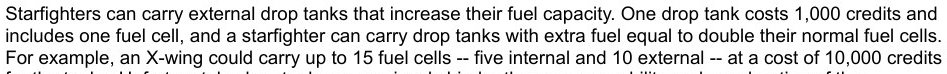

## scan p.3 (scan page 3)

Page contents: Starport multipliers; cargo income; Ulic; Gree; Champions abilities; Exar Kun; Republic Commandos (hand-read)

- **No single roster character (rules/setting/general)** — entry/section: Tramp freighter profits: "Given these costs, it might seem almost impossible to operate a starship as a profitable enterprise, but it can work -- as long as a tramp freighter captain is tenacious and keeps himself busy. As noted in Hero's Guide Web Enhancement #2, the standard fee for shipping a ton of cargo is 10 credits per day, so a YT-1300 with a full load can earn 1,000 credits each day. The trick, of course, is finding big jobs with regularity." Source: *Jedi Counseling 94* (SWRPG d20 Revised Core), scan p.3
  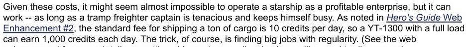
- **Ulic Qel-Droma** — entry/section: Ulic Qel-Droma's Mandalorians: "A: It's not a mistake. Mandalorians will appear in the Bounty Hunters set later this year. Ulic Qel-Droma's commander effect was written with this in mind, even though there wasn't room for any Mandalorians in Champions of the Force." Source: *Jedi Counseling 94* (SWRPG d20 Revised Core), scan p.3
  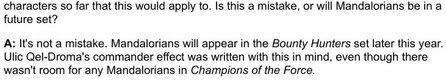
- **Commander Gree** — entry/section: Clone Commander Gree: both Order 66 and Mobile Attack: "A: It means "both Order 66 and Mobile Attack." If we had meant it to be read the second way, we would have said "Order 66 or Mobile Attack" to make it clear." Source: *Jedi Counseling 94* (SWRPG d20 Revised Core), scan p.3
  
- **Exar Kun** — entry/section: Exar Kun's Transfer Essence mid-Triple Attack: "Q: Could I use the abilities listed above between two attacks? For example, could Exar Kun attack and defeat one enemy, and then use Transfer Essence to move to a different space and continue a Triple Attack on another target?
A: Yes." Source: *Jedi Counseling 94* (SWRPG d20 Revised Core), scan p.3
  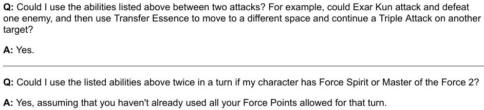

## scan p.4 (scan page 4)

Page contents: Delta Squad; Mas Amedda Booming Voice x2; Thrawn; Ysalamiri; author bio (hand-read)

- **Mas Amedda** — entry/section: Mas Amedda's Booming Voice: exactly 6 squares: "A: Booming Voice applies only to commander effects that have a range of exactly 6 squares." Source: *Jedi Counseling 94* (SWRPG d20 Revised Core), scan p.4
  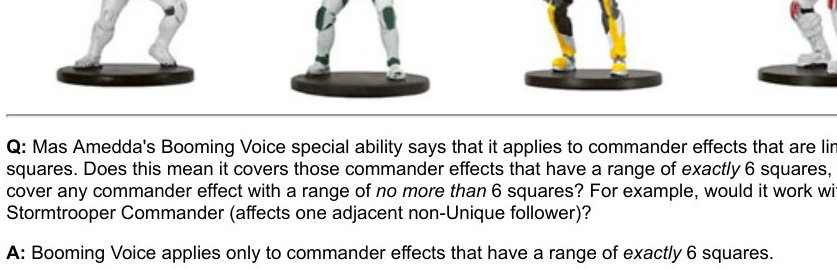
- **Mas Amedda; Grand Admiral Thrawn** — entry/section: Mas Amedda and Thrawn: "Q: If Mas Amedda is in an Imperial squad with Grand Admiral Thrawn, can Thrawn really swap allied characters anywhere on the map?
A: Yes, as long as Thrawn can count range to both allies that he wants to swap.
Q: In the same situation, does Ysalamiri apply to every allied character on the map?
A: No. Even though Ysalamiri has a range of 6 squares, it is not a commander effect." Source: *Jedi Counseling 94* (SWRPG d20 Revised Core), scan p.4
  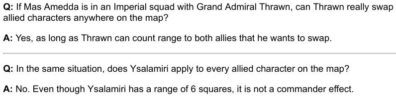
