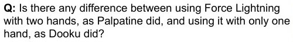
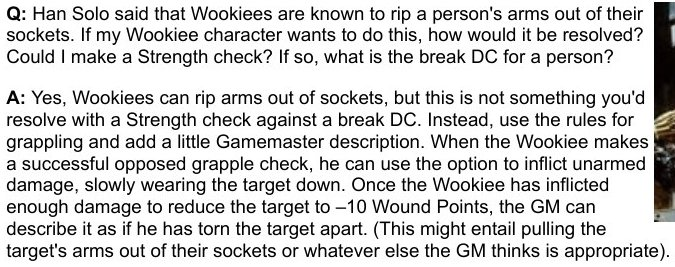
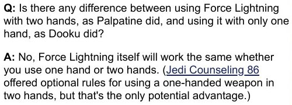
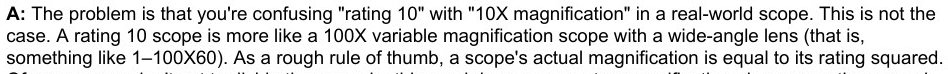
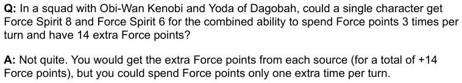
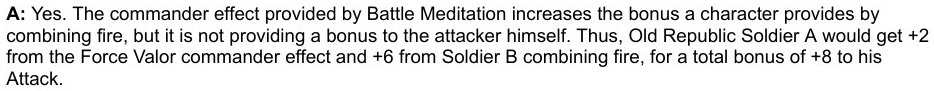
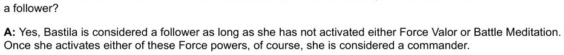
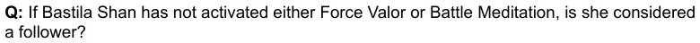
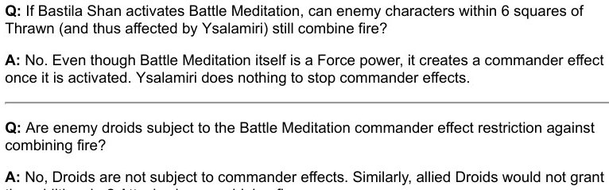

# Owner Material 037 — Star Wars D20 Drive folder (Core, Revised Core and Saga Edition): Jedi Counselling/Jedi Counseling 95.pdf [Star Wars Roleplaying Game Revised Core (d20, 2002)]

- **Source:** Wizards of the Coast Star Wars Roleplaying Game books, web enhancements, Living Force campaign modules and articles (2000–2010), from the owner's "Star Wars D20" Drive folder (only the three edition subfolders; "General" was not read, as instructed). Secondary source (licensed Legends reference). Scan OCR'd on the box; the scan stays box-only and is **not** published.
- **Method:** every scanned page was OCR'd and machine-screened sentence by sentence for power-relevant statements (fights, kills, defeats, Force feats, rankings, superweapons) that name a character on our roster; each kept sentence is quoted verbatim from the OCR text and has a crop of the printed passage directly under it. Pages with nothing power-relevant are still listed with what is on them.
- **Citation:** "*Jedi Counseling 95* (SWRPG d20 Revised Core), p.X" by printed page ("scan p.X" where no printed number applies). **Weight:** Licensed RPG material: a secondary source. Narrative text sums up Legends lore; game statistics are rules for players, not canon power levels, and rank lowest.

## scan p.1 (scan page 1)

Page contents: Starship evasion; Wookiee arm-ripping; coup de grace; Force Lightning hands; scope weights Q (hand-read)

- **Palpatine (Darth Sidious); Count Dooku** — entry/section: Jedi Counseling 95: "Q: Is there any difference between using Force Lightning with two hands, as Palpatine did, and using it with only one hand, as Dooku did?" Source: *Jedi Counseling 95* (SWRPG d20 Revised Core), scan p.1
  
- **Han Solo; Chewbacca** — entry/section: Wookiees ripping arms out of sockets: "Q: Han Solo said that Wookiees are known to rip a person's arms out of their sockets. If my Wookiee character wants to do this, how would it be resolved? Could I make a Strength check? If so, what is the break DC for a person?
A: Yes, Wookiees can rip arms out of sockets, but this is not something you'd resolve with a Strength check against a break DC. Instead, use the rules for grappling and add a little Gamemaster description. When the Wookiee makes a successful opposed grapple check, he can use the option to inflict unarmed damage, slowly wearing the target down. Once the Wookiee has inflicted enough damage to reduce the target to -10 Wound Points, the GM can describe it as if he has torn the target apart. (This might entail pulling the target's arms out of their sockets or whatever else the GM thinks is appropriate)." Source: *Jedi Counseling 95* (SWRPG d20 Revised Core), scan p.1
  
- **Palpatine (Darth Sidious); Count Dooku** — entry/section: Force Lightning: Palpatine's two hands, Dooku's one: "Q: Is there any difference between using Force Lightning with two hands, as Palpatine did, and using it with only one hand, as Dooku did?
A: No, Force Lightning itself will work the same whether you use one hand or two hands. (Jedi Counseling 86 offered optional rules for using a one-handed weapon in two hands, but that's the only potential advantage.)" Source: *Jedi Counseling 95* (SWRPG d20 Revised Core), scan p.1
  

## scan p.2 (scan page 2)

Page contents: Scope answer; Force Spirit stacking; Master Speed; Bastila Battle Meditation stacking; follower status (hand-read)

- **No single roster character (rules/setting/general)** — entry/section: Targeting scope ratings: magnification = rating squared: "A: The problem is that you're confusing "rating 10" with "10X magnification" in a real-world scope. This is not the case. A rating 10 scope is more like a 100X variable magnification scope with a wide-angle lens (that is, something like 1-100X60). As a rough rule of thumb, a scope's actual magnification is equal to its rating squared." Source: *Jedi Counseling 95* (SWRPG d20 Revised Core), scan p.2
  
- **Obi-Wan Kenobi; Yoda** — entry/section: Obi-Wan and Yoda of Dagobah: Force Spirit stacking: "Q: In a squad with Obi-Wan Kenobi and Yoda of Dagobah, could a single character get Force Spirit 8 and Force Spirit 6 for the combined ability to spend Force points 3 times per turn and have 14 extra Force points?
A: Not quite. You would get the extra Force points from each source (for a total of +14 Force points), but you could spend Force points only one extra time per turn." Source: *Jedi Counseling 95* (SWRPG d20 Revised Core), scan p.2
  
- **Bastila Shan** — entry/section: Bastila's Battle Meditation and Force Valor stack: "A: Yes. The commander effect provided by Battle Meditation increases the bonus a character provides by combining fire, but it is not providing a bonus to the attacker himself. Thus, Old Republic Soldier A would get +2 from the Force Valor commander effect and +6 from Soldier B combining fire, for a total bonus of +8 to his Attack." Source: *Jedi Counseling 95* (SWRPG d20 Revised Core), scan p.2
  
- **Bastila Shan** — entry/section: Bastila is a follower until she activates: "A: Yes, Bastila is considered a follower as long as she has not activated either Force Valor or Battle Meditation. Once she activates either of these Force powers, of course, she is considered a commander." Source: *Jedi Counseling 95* (SWRPG d20 Revised Core), scan p.2
  
- **Bastila Shan**: "Q: Here's the situation: Bastila Shan has activated Battle Meditation and Force Valor." Source: *Jedi Counseling 95* (SWRPG d20 Revised Core), scan p.2
  
- **Bastila Shan**: "Q: If Bastila Shan has not activated either Force Valor or Battle Meditation, is she considered a follower?" Source: *Jedi Counseling 95* (SWRPG d20 Revised Core), scan p.2
  

## scan p.3 (scan page 3)

Page contents: Battle Meditation vs Ysalamiri; droids; Force Alter; Bodyguard vs Splash; author bio (hand-read)

- **Bastila Shan; Grand Admiral Thrawn** — entry/section: Battle Meditation vs Ysalamiri: "Q: If Bastila Shan activates Battle Meditation, can enemy characters within 6 squares of Thrawn (and thus affected by Ysalamiri) still combine fire?
A: No. Even though Battle Meditation itself is a Force power, it creates a commander effect once it is activated. Ysalamiri does nothing to stop commander effects." Source: *Jedi Counseling 95* (SWRPG d20 Revised Core), scan p.3
  
