# Owner Material 037 — Star Wars D20 Drive folder (Core, Revised Core and Saga Edition): Jedi Counselling/Jedi Counseling 96.pdf [Star Wars Roleplaying Game Revised Core (d20, 2002)]

- **Source:** Wizards of the Coast Star Wars Roleplaying Game books, web enhancements, Living Force campaign modules and articles (2000–2010), from the owner's "Star Wars D20" Drive folder (only the three edition subfolders; "General" was not read, as instructed). Secondary source (licensed Legends reference). Scan OCR'd on the box; the scan stays box-only and is **not** published.
- **Method:** every scanned page was OCR'd and machine-screened sentence by sentence for power-relevant statements (fights, kills, defeats, Force feats, rankings, superweapons) that name a character on our roster; each kept sentence is quoted verbatim from the OCR text and has a crop of the printed passage directly under it. Pages with nothing power-relevant are still listed with what is on them.
- **Citation:** "*Jedi Counseling 96* (SWRPG d20 Revised Core), p.X" by printed page ("scan p.X" where no printed number applies). **Weight:** Licensed RPG material: a secondary source. Narrative text sums up Legends lore; game statistics are rules for players, not canon power levels, and rank lowest.

## scan p.1 (scan page 1)

Page contents: Level pacing and downtime/training; Spring Attack + Charge Q (hand-read)

- **No single roster character (rules/setting/general)** — entry/section: Downtime: no 16-year-old 20th-level Jedi Masters: "You might require a PC to have a number of weeks of downtime equal to his new character level. Until he takes that rest, he receives only half his normal XP due to mental and emotional burnout. Adjust this as you see fit; one month of downtime per level would not be unreasonable, and it would help make sure that no 16-year-olds become 20th-level Jedi Masters." Source: *Jedi Counseling 96* (SWRPG d20 Revised Core), scan p.1
  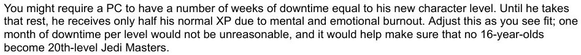
- **No single roster character (rules/setting/general)** — entry/section: Training time for skills and feats: "Another idea (from the D&D Dungeon Master's Guide) is to require training time to acquire new skills and feats. According to those rules, a character must spend 1 week per rank gained in a skill, and 2 weeks to gain a new feat. He can train to acquire up to two things (two skills, two feats, or one skill and one feat) at the same time." Source: *Jedi Counseling 96* (SWRPG d20 Revised Core), scan p.1
  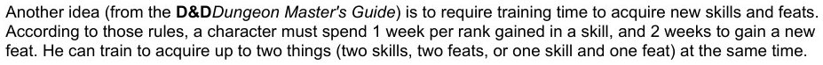

## scan p.2 (scan page 2)

Page contents: Charge answer; Mirialans; Move Object gravity; Exar Kun Dark Force Spirit; Mara Jade; Anakin/Vader; Nihilus; Exar Kun CE (hand-read)

- **Luminara Unduli; Barriss Offee** — entry/section: Mirialans: "Q: I want to create a Mirialan character, but I don't see that species in Ultimate Alien Anthology, though they are in Power of the Jedi. (We see the species represented by Luminara Unduli and Barriss Offee, but no one else as far as I know.) Where can I find information about Mirialan commoners, their home planet, and so on?
A: Mirialan is a near-Human species (that is, its stats are the same as a Human in game terms), so there's really no need for species-specific stats. As for Mirial itself, as of this writing, the only information available is that it's a cold desert world. Just make up whatever additional details are needed for your own game." Source: *Jedi Counseling 96* (SWRPG d20 Revised Core), scan p.2
  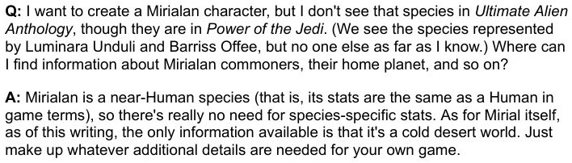
- **No single roster character (rules/setting/general)** — entry/section: Move Object in heavy or light gravity: "A: You can calculate the effective weight of the object based on the higher gravity, but really, this will make a difference only in extreme cases. Do the same thing in lower gravity, to a minimum of 10% of the normal weight. (Even in zero gravity, objects still have mass and inertia, so they always require a significant effort to move -- that's what the 10% minimum is meant to represent.)" Source: *Jedi Counseling 96* (SWRPG d20 Revised Core), scan p.2
  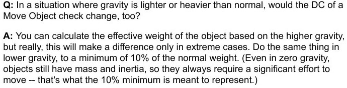
- **Exar Kun; Grand Admiral Thrawn** — entry/section: Exar Kun's spirit can't enter where the Force is blocked: "For an "in-universe" explanation, imagine that Exar Kun's spirit is still present on the battlefield after he is defeated. Every time a character is about to act (that is, activates), Exar Kun uses his powers to interfere with them and block their connection to the Force. However, he can't enter a place where the Force is blocked, such as near ysalamiri, so he can't reach the character when he wants to disrupt their actions." Source: *Jedi Counseling 96* (SWRPG d20 Revised Core), scan p.2
  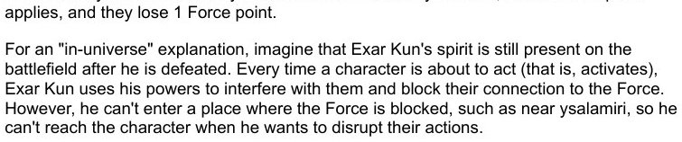
- **Mara Jade Skywalker; Palpatine (Darth Sidious)** — entry/section: Mara Jade's Hand of the Emperor still works with Emperor Palpatine, Sith Lord: "Q: The new definition of "named/name contains" says a named character must match the name exactly. The FAQ says that Mara Jade's Hand of the Emperor ability and the Royal Guard's Emperor's Bodyguard ability also work with Emperor Palpatine, Sith Lord, but the name doesn't match. Is the FAQ still correct?
A: Yes. The new definition is intended for clarity with this and future sets, but it shouldn't be interpreted to overrule older rulings. Those stat cards weren't written with the new wording in mind." Source: *Jedi Counseling 96* (SWRPG d20 Revised Core), scan p.2
  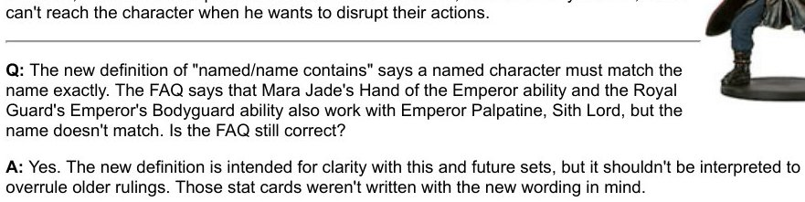
- **Darth Vader (Anakin Skywalker)** — entry/section: Anakin Skywalker, Sith Apprentice counts as Darth Vader: "A: No. Anakin Skywalker, Sith Apprentice counts as Darth Vader for purposes of the Unique restriction, but his name does not actually contain "Vader."" Source: *Jedi Counseling 96* (SWRPG d20 Revised Core), scan p.2
  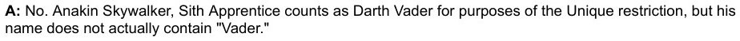
- **Darth Nihilus** — entry/section: Darth Nihilus's Sith Hunger: "Q: Using Sith Hunger, can Darth Nihilus go over his starting hit points or Force points?
A: He can go over his starting Force points, but not over his starting hit points." Source: *Jedi Counseling 96* (SWRPG d20 Revised Core), scan p.2
  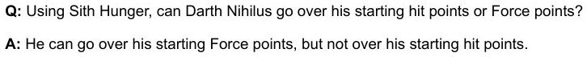
- **Exar Kun** — entry/section: Exar Kun's commander effect: Jedi Hunter and Momentum: "A: Yes. As mentioned in a previous "Jedi Counseling" and the Star Wars Miniatures FAQ, the bonuses granted by different special abilities stack with one another. It doesn't matter if a particular special ability is granted by a commander effect or if it is on the stat card of the character in question." Source: *Jedi Counseling 96* (SWRPG d20 Revised Core), scan p.2
  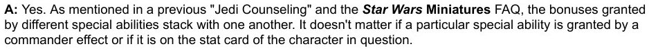
- **Exar Kun**: "Q: Let's say Exar Kun is defeated and his Dark Force Spirit ability comes into play." Source: *Jedi Counseling 96* (SWRPG d20 Revised Core), scan p.2
  
- **Exar Kun**: "Q: Would characters affected by Ysalamiri at the time Exar Kun is defeated be immune to Dark Force Spirit for the rest of the skirmish?" Source: *Jedi Counseling 96* (SWRPG d20 Revised Core), scan p.2
  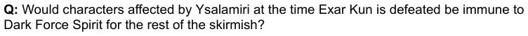

## scan p.3 (scan page 3)

Page contents: Amidala + Cody; Yoda/Obi-Wan Force points; Bacara super stealth vs Jango example; author bio start (hand-read)

- **Padmé Amidala; Clone Commander Cody** — entry/section: Queen Amidala and Commander Cody: "Q: If I have Queen Amidala and Clone Commander Cody in the same squad, could I stack their two abilities and get Clone Troopers for 2 points less?
A: Yes." Source: *Jedi Counseling 96* (SWRPG d20 Revised Core), scan p.3
  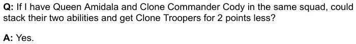
- **Yoda; Obi-Wan Kenobi** — entry/section: Yoda of Dagobah's Force points twice per turn: "A: Yes and yes. The language about not spending Force points more than once per turn is not meant to further restrict the ability. It simply clarifies that the normal rule (one Force point per turn) is still enforced despite having two sources of Force points. Other abilities that increase the number of Force points a character can spend in a turn apply normally." Source: *Jedi Counseling 96* (SWRPG d20 Revised Core), scan p.3
  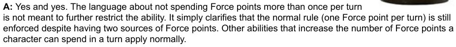
- **Clone Commander Bacara; Jango Fett** — entry/section: Bacara's "super stealth" vs Jango Fett: "In this situation, Jango Fett can't attack anyone. Bacara can't be targeted because of the commander effect, and the Jedi has cover and is not the nearest enemy. If Jango wants to attack someone, he must stay more than 6 squares from Bacara, get adjacent to one of the enemy characters, or wait for one or both of them to move out of cover.
Naturally, all of the above applies to Nom Anor's commander effect as well." Source: *Jedi Counseling 96* (SWRPG d20 Revised Core), scan p.3
  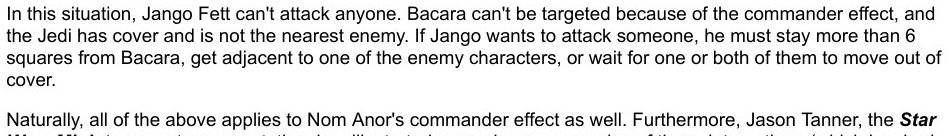

## scan p.4 (scan page 4)

Page contents: Author bio end; copyright (hand-read)

