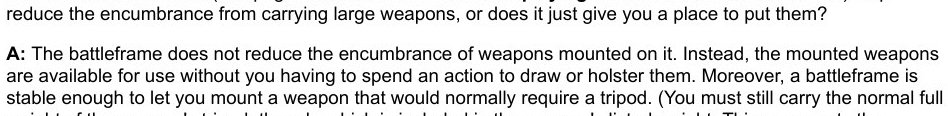
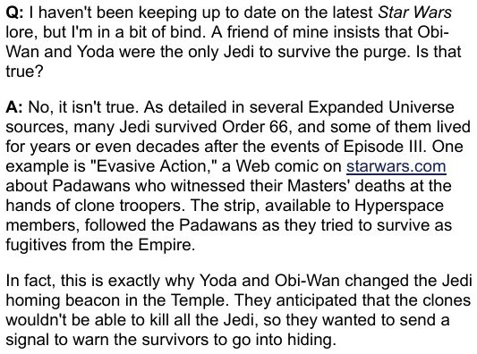
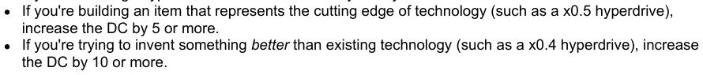
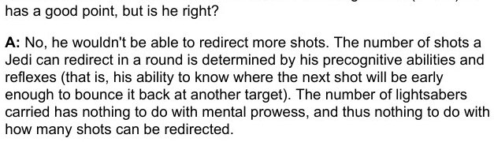
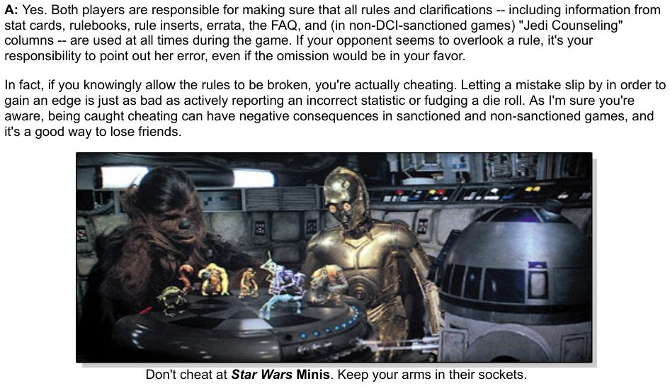
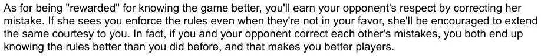
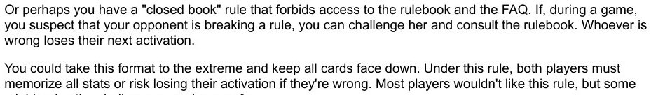

# Owner Material 037 — Star Wars D20 Drive folder (Core, Revised Core and Saga Edition): Jedi Counselling/Jedi Counseling 97.pdf [Star Wars Roleplaying Game Revised Core (d20, 2002)]

- **Source:** Wizards of the Coast Star Wars Roleplaying Game books, web enhancements, Living Force campaign modules and articles (2000–2010), from the owner's "Star Wars D20" Drive folder (only the three edition subfolders; "General" was not read, as instructed). Secondary source (licensed Legends reference). Scan OCR'd on the box; the scan stays box-only and is **not** published.
- **Method:** every scanned page was OCR'd and machine-screened sentence by sentence for power-relevant statements (fights, kills, defeats, Force feats, rankings, superweapons) that name a character on our roster; each kept sentence is quoted verbatim from the OCR text and has a crop of the printed passage directly under it. Pages with nothing power-relevant are still listed with what is on them.
- **Citation:** "*Jedi Counseling 97* (SWRPG d20 Revised Core), p.X" by printed page ("scan p.X" where no printed number applies). **Weight:** Licensed RPG material: a secondary source. Narrative text sums up Legends lore; game statistics are rules for players, not canon power levels, and rank lowest.

## scan p.1 (scan page 1)

Page contents: Battleframe; skill points minimum; purge survivors; equipment design (hand-read)

- **No single roster character (rules/setting/general)** — entry/section: Battleframe and tripod weapons: "A: The battleframe does not reduce the encumbrance of weapons mounted on it. Instead, the mounted weapons are available for use without you having to spend an action to draw or holster them. Moreover, a battleframe is stable enough to let you mount a weapon that would normally require a tripod." Source: *Jedi Counseling 97* (SWRPG d20 Revised Core), scan p.1
  
- **Obi-Wan Kenobi; Yoda** — entry/section: Obi-Wan and Yoda were not the only Jedi to survive the purge: "Q: I haven't been keeping up to date on the latest Star Wars lore, but I'm in a bit of bind. A friend of mine insists that Obi-Wan and Yoda were the only Jedi to survive the purge. Is that true?
A: No, it isn't true. As detailed in several Expanded Universe sources, many Jedi survived Order 66, and some of them lived for years or even decades after the events of Episode III. One example is "Evasive Action," a Web comic on starwars.com about Padawans who witnessed their Masters' deaths at the hands of clone troopers. The strip, available to Hyperspace members, followed the Padawans as they tried to survive as fugitives from the Empire.
In fact, this is exactly why Yoda and Obi-Wan changed the Jedi homing beacon in the Temple. They anticipated that the clones wouldn't be able to kill all the Jedi, so they wanted to send a signal to warn the survivors to go into hiding." Source: *Jedi Counseling 97* (SWRPG d20 Revised Core), scan p.1
  
- **No single roster character (rules/setting/general)** — entry/section: Designing new technology with Craft: "If you're building an item that represents the cutting edge of technology (such as a x0.5 hyperdrive), increase the DC by 5 or more.
If you're trying to invent something better than existing technology (such as a x0.4 hyperdrive), increase the DC by 10 or more." Source: *Jedi Counseling 97* (SWRPG d20 Revised Core), scan p.1
  

## scan p.2 (scan page 2)

Page contents: Craft electronics; rapid strike vs devastating strike; two lightsabers and deflect; etiquette and cheating (hand-read)

- **No single roster character (rules/setting/general)** — entry/section: Two lightsabers don't redirect more shots: "A: No, he wouldn't be able to redirect more shots. The number of shots a Jedi can redirect in a round is determined by his precognitive abilities and reflexes (that is, his ability to know where the next shot will be early enough to bounce it back at another target). The number of lightsabers carried has nothing to do with mental prowess, and thus nothing to do with how many shots can be redirected." Source: *Jedi Counseling 97* (SWRPG d20 Revised Core), scan p.2
  
- **Aurra Sing** — entry/section: Aurra Sing's Jedi Hunter: point out your opponent's mistake: "A: Yes. Both players are responsible for making sure that all rules and clarifications -- including information from stat cards, rulebooks, rule inserts, errata, the FAQ, and (in non-DCI-sanctioned games) "Jedi Counseling" columns -- are used at all times during the game. If your opponent seems to overlook a rule, it's your responsibility to point out her error, even if the omission would be in your favor.
In fact, if you knowingly allow the rules to be broken, you're actually cheating. Letting a mistake slip by in order to gain an edge is just as bad as actively reporting an incorrect statistic or fudging a die roll. As I'm sure you're aware, being caught cheating can have negative consequences in sanctioned and non-sanctioned games, and it's a good way to lose friends.
Don't cheat at Star Wars Minis. Keep your arms in their sockets." Source: *Jedi Counseling 97* (SWRPG d20 Revised Core), scan p.2
  
- **No single roster character (rules/setting/general)** — entry/section: Earn your opponent's respect: "As for being "rewarded" for knowing the game better, you'll earn your opponent's respect by correcting her mistake. If she sees you enforce the rules even when they're not in your favor, she'll be encouraged to extend the same courtesy to you. In fact, if you and your opponent correct each other's mistakes, you both end up knowing the rules better than you did before, and that makes you better players." Source: *Jedi Counseling 97* (SWRPG d20 Revised Core), scan p.2
  

## scan p.3 (scan page 3)

Page contents: Etiquette continued; house rules; author bio (hand-read)

- **No single roster character (rules/setting/general)** — entry/section: House rule: closed book: "Or perhaps you have a "closed book" rule that forbids access to the rulebook and the FAQ. If, during a game, you suspect that your opponent is breaking a rule, you can challenge her and consult the rulebook. Whoever is wrong loses their next activation." Source: *Jedi Counseling 97* (SWRPG d20 Revised Core), scan p.3
  
