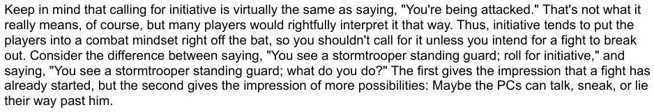
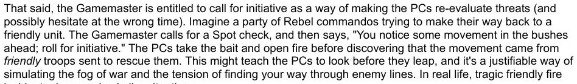
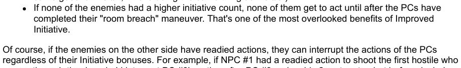
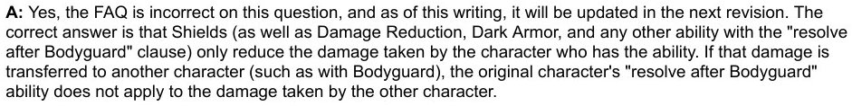
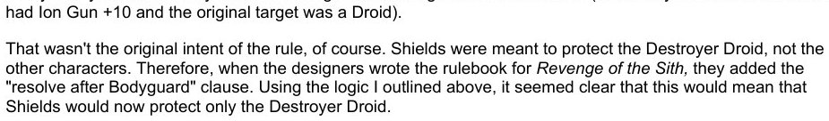

# Owner Material 037 — Star Wars D20 Drive folder (Core, Revised Core and Saga Edition): Jedi Counselling/Jedi Counseling 98.pdf [Star Wars Roleplaying Game Revised Core (d20, 2002)]

- **Source:** Wizards of the Coast Star Wars Roleplaying Game books, web enhancements, Living Force campaign modules and articles (2000–2010), from the owner's "Star Wars D20" Drive folder (only the three edition subfolders; "General" was not read, as instructed). Secondary source (licensed Legends reference). Scan OCR'd on the box; the scan stays box-only and is **not** published.
- **Method:** every scanned page was OCR'd and machine-screened sentence by sentence for power-relevant statements (fights, kills, defeats, Force feats, rankings, superweapons) that name a character on our roster; each kept sentence is quoted verbatim from the OCR text and has a crop of the printed passage directly under it. Pages with nothing power-relevant are still listed with what is on them.
- **Citation:** "*Jedi Counseling 98* (SWRPG d20 Revised Core), p.X" by printed page ("scan p.X" where no printed number applies). **Weight:** Licensed RPG material: a secondary source. Narrative text sums up Legends lore; game statistics are rules for players, not canon power levels, and rank lowest.

## scan p.1 (scan page 1)

Page contents: When to roll initiative; coordinating actions (hand-read)

- **No single roster character (rules/setting/general)** — entry/section: Initiative: "what do you do?": "Keep in mind that calling for initiative is virtually the same as saying, "You're being attacked." That's not what it really means, of course, but many players would rightfully interpret it that way. Thus, initiative tends to put the players into a combat mindset right off the bat, so you shouldn't call for it unless you intend for a fight to break out. Consider the difference between saying, "You see a stormtrooper standing guard; roll for initiative," and saying, "You see a stormtrooper standing guard; what do you do?" The first gives the impression that a fight has already started, but the second gives the impression of more possibilities: Maybe the PCs can talk, sneak, or lie their way past him." Source: *Jedi Counseling 98* (SWRPG d20 Revised Core), scan p.1
  
- **No single roster character (rules/setting/general)** — entry/section: Calling for initiative to simulate the fog of war: "That said, the Gamemaster is entitled to call for initiative as a way of making the PCs re-evaluate threats (and possibly hesitate at the wrong time). Imagine a party of Rebel commandos trying to make their way back to a friendly unit. The Gamemaster calls for a Spot check, and then says, "You notice some movement in the bushes ahead; roll for initiative." The PCs take the bait and open fire before discovering that the movement came from friendly troops sent to rescue them. This might teach the PCs to look before they leap, and it's a justifiable way of simulating the fog of war and the tension of finding your way through enemy lines." Source: *Jedi Counseling 98* (SWRPG d20 Revised Core), scan p.1
  

## scan p.2 (scan page 2)

Page contents: Room breach sequence; Initiative Cards; Shields/Bodyguard FAQ correction (hand-read)

- **No single roster character (rules/setting/general)** — entry/section: Room breach: benefit of Improved Initiative: "If none of the enemies had a higher initiative count, none of them get to act until after the PCs have completed their "room breach" maneuver. That's one of the most overlooked benefits of Improved Initiative." Source: *Jedi Counseling 98* (SWRPG d20 Revised Core), scan p.2
  
- **No single roster character (rules/setting/general)** — entry/section: FAQ correction: "resolve after Bodyguard": "A: Yes, the FAQ is incorrect on this question, and as of this writing, it will be updated in the next revision. The correct answer is that Shields (as well as Damage Reduction, Dark Armor, and any other ability with the "resolve after Bodyguard" clause) only reduce the damage taken by the character who has the ability. If that damage is transferred to another character (such as with Bodyguard), the original character's "resolve after Bodyguard" ability does not apply to the damage taken by the other character." Source: *Jedi Counseling 98* (SWRPG d20 Revised Core), scan p.2
  

## scan p.3 (scan page 3)

Page contents: Correction sequence continued; how the error occurred; author bio (hand-read)

- **No single roster character (rules/setting/general)** — entry/section: Shields were meant to protect the Destroyer Droid: "That wasn't the original intent of the rule, of course. Shields were meant to protect the Destroyer Droid, not the other characters. Therefore, when the designers wrote the rulebook for Revenge of the Sith, they added the "resolve after Bodyguard" clause. Using the logic I outlined above, it seemed clear that this would mean that Shields would now protect only the Destroyer Droid." Source: *Jedi Counseling 98* (SWRPG d20 Revised Core), scan p.3
  
