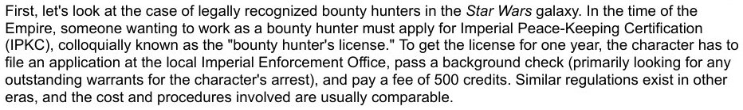
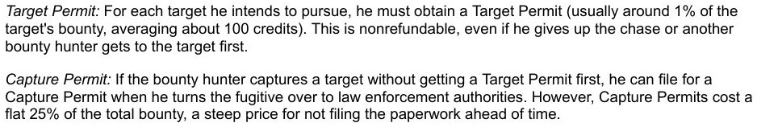
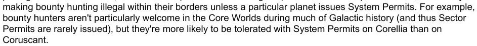
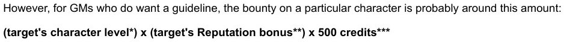
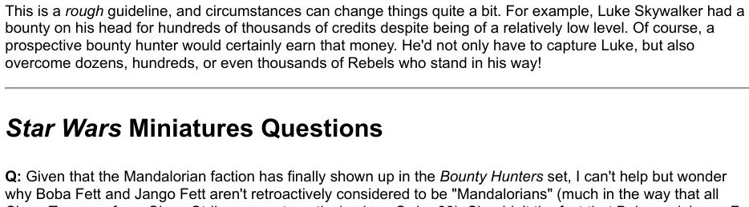
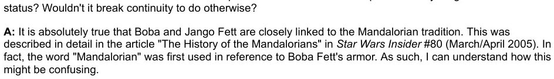
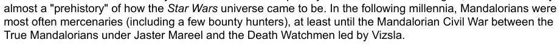
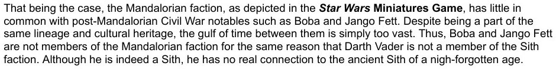
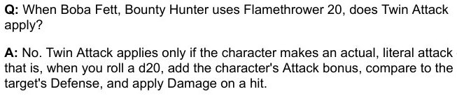
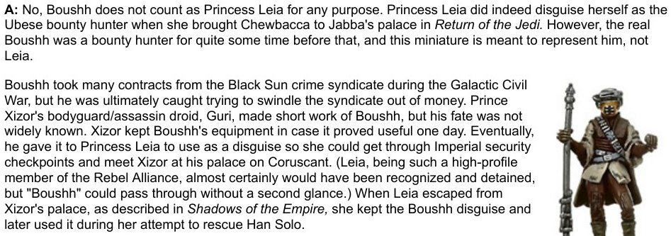

# Owner Material 037 — Star Wars D20 Drive folder (Core, Revised Core and Saga Edition): Jedi Counselling/Jedi Counseling 99.pdf [Star Wars Roleplaying Game Revised Core (d20, 2002)]

- **Source:** Wizards of the Coast Star Wars Roleplaying Game books, web enhancements, Living Force campaign modules and articles (2000–2010), from the owner's "Star Wars D20" Drive folder (only the three edition subfolders; "General" was not read, as instructed). Secondary source (licensed Legends reference). Scan OCR'd on the box; the scan stays box-only and is **not** published.
- **Method:** every scanned page was OCR'd and machine-screened sentence by sentence for power-relevant statements (fights, kills, defeats, Force feats, rankings, superweapons) that name a character on our roster; each kept sentence is quoted verbatim from the OCR text and has a crop of the printed passage directly under it. Pages with nothing power-relevant are still listed with what is on them.
- **Citation:** "*Jedi Counseling 99* (SWRPG d20 Revised Core), p.X" by printed page ("scan p.X" where no printed number applies). **Weight:** Licensed RPG material: a secondary source. Narrative text sums up Legends lore; game statistics are rules for players, not canon power levels, and rank lowest.

## scan p.1 (scan page 1)

Page contents: Becoming a bounty hunter: IPKC, Target/Capture/System/Sector Permits; illegal bounties (hand-read)

- **No single roster character (rules/setting/general)** — entry/section: Imperial Peace-Keeping Certification: "In the time of the Empire, someone wanting to work as a bounty hunter must apply for Imperial Peace-Keeping Certification (IPKC), colloquially known as the "bounty hunter's license." To get the license for one year, the character has to file an application at the local Imperial Enforcement Office, pass a background check (primarily looking for any outstanding warrants for the character's arrest), and pay a fee of 500 credits. Similar regulations exist in other eras, and the cost and procedures involved are usually comparable." Source: *Jedi Counseling 99* (SWRPG d20 Revised Core), scan p.1
  
- **No single roster character (rules/setting/general)** — entry/section: Target and Capture Permits: "Target Permit: For each target he intends to pursue, he must obtain a Target Permit (usually around 1% of the target's bounty, averaging about 100 credits). This is nonrefundable, even if he gives up the chase or another bounty hunter gets to the target first.
Capture Permit: If the bounty hunter captures a target without getting a Target Permit first, he can file for a Capture Permit when he turns the fugitive over to law enforcement authorities. However, Capture Permits cost a flat 25% of the total bounty, a steep price for not filing the paperwork ahead of time." Source: *Jedi Counseling 99* (SWRPG d20 Revised Core), scan p.1
  
- **No single roster character (rules/setting/general)** — entry/section: Bounty hunters in the Core Worlds: "For example, bounty hunters aren't particularly welcome in the Core Worlds during much of Galactic history (and thus Sector Permits are rarely issued), but they're more likely to be tolerated with System Permits on Corellia than on Coruscant." Source: *Jedi Counseling 99* (SWRPG d20 Revised Core), scan p.1
  

## scan p.2 (scan page 2)

Page contents: Prestige class and license; bounty formula; Luke bounty; Mandalorian faction Q start (hand-read)

- **No single roster character (rules/setting/general)** — entry/section: Bounty guideline formula: "However, for GMs who do want a guideline, the bounty on a particular character is probably around this amount: (target's character level*) x (target's Reputation bonus**) x 500 credits***" Source: *Jedi Counseling 99* (SWRPG d20 Revised Core), scan p.2
  
- **Luke Skywalker** — entry/section: Luke Skywalker's bounty: "This is a rough guideline, and circumstances can change things quite a bit. For example, Luke Skywalker had a bounty on his head for hundreds of thousands of credits despite being of a relatively low level. Of course, a prospective bounty hunter would certainly earn that money. He'd not only have to capture Luke, but also overcome dozens, hundreds, or even thousands of Rebels who stand in his way!" Source: *Jedi Counseling 99* (SWRPG d20 Revised Core), scan p.2
  
- **Boba Fett; Jango Fett** — entry/section: Boba and Jango Fett and the Mandalorian tradition: "A: It is absolutely true that Boba and Jango Fett are closely linked to the Mandalorian tradition. This was described in detail in the article "The History of the Mandalorians" in Star Wars Insider #80 (March/April 2005). In fact, the word "Mandalorian" was first used in reference to Boba Fett's armor. As such, I can understand how this might be confusing." Source: *Jedi Counseling 99* (SWRPG d20 Revised Core), scan p.2
  

## scan p.3 (scan page 3)

Page contents: Mandalorian faction answer; Flamethrower/Twin Attack; Missiles/Penetration; Boushh; author bio (hand-read)

- **Jaster Mereel** — entry/section: Mandalorian Civil War: Jaster Mareel vs Vizsla: "In the following millennia, Mandalorians were most often mercenaries (including a few bounty hunters), at least until the Mandalorian Civil War between the True Mandalorians under Jaster Mareel and the Death Watchmen led by Vizsla." Source: *Jedi Counseling 99* (SWRPG d20 Revised Core), scan p.3
  
- **Boba Fett; Jango Fett; Darth Vader (Anakin Skywalker)** — entry/section: Fetts not Mandalorian faction, as Vader is not Sith faction: "That being the case, the Mandalorian faction, as depicted in the Star Wars Miniatures Game, has little in common with post-Mandalorian Civil War notables such as Boba and Jango Fett. Despite being a part of the same lineage and cultural heritage, the gulf of time between them is simply too vast. Thus, Boba and Jango Fett are not members of the Mandalorian faction for the same reason that Darth Vader is not a member of the Sith faction. Although he is indeed a Sith, he has no real connection to the ancient Sith of a nigh-forgotten age." Source: *Jedi Counseling 99* (SWRPG d20 Revised Core), scan p.3
  
- **Boba Fett** — entry/section: Boba Fett's Flamethrower and Twin Attack: "Q: When Boba Fett, Bounty Hunter uses Flamethrower 20, does Twin Attack apply?
A: No. Twin Attack applies only if the character makes an actual, literal attack -that is, when you roll a d20, add the character's Attack bonus, compare to the target's Defense, and apply Damage on a hit." Source: *Jedi Counseling 99* (SWRPG d20 Revised Core), scan p.3
  
- **Boushh; Leia Organa Solo; Guri; Prince Xizor; Chewbacca; Han Solo** — entry/section: Boushh does not count as Princess Leia: "A: No, Boushh does not count as Princess Leia for any purpose. Princess Leia did indeed disguise herself as the Ubese bounty hunter when she brought Chewbacca to Jabba's palace in Return of the Jedi. However, the real Boushh was a bounty hunter for quite some time before that, and this miniature is meant to represent him, not Leia.
Boushh took many contracts from the Black Sun crime syndicate during the Galactic Civil War, but he was ultimately caught trying to swindle the syndicate out of money. Prince Xizor's bodyguard/assassin droid, Guri, made short work of Boushh, but his fate was not widely known. Xizor kept Boushh's equipment in case it proved useful one day. Eventually, he gave it to Princess Leia to use as a disguise so she could get through Imperial security checkpoints and meet Xizor at his palace on Coruscant. (Leia, being such a high-profile member of the Rebel Alliance, almost certainly would have been recognized and detained, but "Boushh" could pass through without a second glance.) When Leia escaped from Xizor's palace, as described in Shadows of the Empire, she kept the Boushh disguise and later used it during her attempt to rescue Han Solo." Source: *Jedi Counseling 99* (SWRPG d20 Revised Core), scan p.3
  
