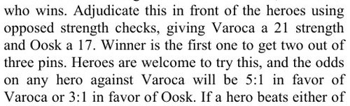
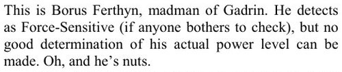
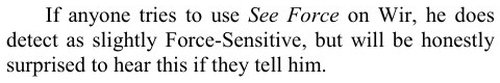
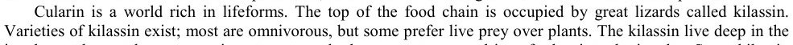

# Owner Material 037 — Star Wars D20 Drive folder (Core, Revised Core and Saga Edition): Living Force Campaign/Adventures/Among the Stars/Year 1/101 - Eye of the Sun - A Cularin Presence.pdf [Star Wars Roleplaying Game Revised Core (d20, 2002)]

- **Source:** Wizards of the Coast Star Wars Roleplaying Game books, web enhancements, Living Force campaign modules and articles (2000–2010), from the owner's "Star Wars D20" Drive folder (only the three edition subfolders; "General" was not read, as instructed). Secondary source (licensed Legends reference). Scan OCR'd on the box; the scan stays box-only and is **not** published.
- **Method:** every scanned page was OCR'd and machine-screened sentence by sentence for power-relevant statements (fights, kills, defeats, Force feats, rankings, superweapons) that name a character on our roster; each kept sentence is quoted verbatim from the OCR text and has a crop of the printed passage directly under it. Pages with nothing power-relevant are still listed with what is on them.
- **Citation:** "*101 - Eye of the Sun - A Cularin Presence* (SWRPG d20 Revised Core), p.X" by printed page ("scan p.X" where no printed number applies). **Weight:** Licensed RPG material: a secondary source. Narrative text sums up Legends lore; game statistics are rules for players, not canon power levels, and rank lowest.

## p.1 (scan page 1)

Page contents: Title, blurb, copyright (hand-read)

## p.2 (scan page 2)

Page contents: 906 words, 19 paragraphs | headings/entries: GM Overview; Encounter 1: A New Threat; Encounter 2: The Hunt; A Cularin Presence; Page 2

## p.3 (scan page 3)

Page contents: 894 words, 17 paragraphs | headings/entries: Encounter 3: In Broad Daylight; Encounter 4: Beggars and Choosers; Encounter 5: Into the Woods; Encounter 6: The Cartel, Back to Nature; Encounter 7: Piracy?; A Cularin Presence; Page 3

## p.2–3 (scan page 2)

Page contents: RPGA scoring/GM notes; overview; encounter summaries; judge note; opening crawl (hand-read)

## p.4 (scan page 4)

Page contents: 823 words, 22 paragraphs | headings/entries: Encounter 1: A New Threat; They see:; The Barkeep; A Cularin Presence; Page 4

## p.5 (scan page 5)

Page contents: 954 words, 16 paragraphs | headings/entries: The Rodians; The Humans; The Sullustans; The Band; A Cularin Presence; Page 5

- **No single roster character (rules/setting/general)** — entry/section: Varoca the Wookiee vs Oosk the Trandoshan arm-wrestling: "Adjudicate this in front of the heroes using opposed strength checks, giving Varoca a 21 strength and Oosk a 17. Winner is the first one to get two out of three pins. Heroes are welcome to try this, and the odds on any hero against Varoca will be 5:1 in favor of Varoca or 3:1 in favor of Oosk." Source: *101 - Eye of the Sun - A Cularin Presence* (SWRPG d20 Revised Core), p.5
  

## p.6 (scan page 6)

Page contents: 894 words, 17 paragraphs | headings/entries: Encounter 2: The Hunt; House Hirskaala; A Cularin Presence; Page 6

## p.4–6 (scan page 4)

Page contents: Velin Wir announcement; Encounter 1 cantina NPCs; Darin abduction (hand-read)

## p.7 (scan page 7)

Page contents: 839 words, 26 paragraphs | headings/entries: Peace and Security; The Metatheran Cartel Operations Office; A Cularin Presence; Page 7

## p.8 (scan page 8)

Page contents: 821 words, 21 paragraphs | headings/entries: The Laundry Service; The Docking Bay With the Sullustan Ship; The Garbage Pile Outside the City; Encounter 3: In Broad Daylight; A Cularin Presence; Page 8

## p.6–8 (scan page 6)

Page contents: Encounter 2: House Hirskaala, Nim'Ri stats, OPS, Cartel office, laundry, docking bay, garbage pile (hand-read)

## p.9 (scan page 9)

Page contents: 844 words, 28 paragraphs | headings/entries: A Cularin Presence; Page 9

## p.10 (scan page 10)

Page contents: 848 words, 20 paragraphs | headings/entries: Encounter 4: Beggars and Choosers; A Cularin Presence; Page 10

- **No single roster character (rules/setting/general)** — entry/section: Borus Ferthyn, Force-sensitive madman: "This is Borus Ferthyn, madman of Gadrin. He detects as Force-Sensitive (if anyone bothers to check), but no good determination of his actual power level can be made. Oh, and he's nuts." Source: *101 - Eye of the Sun - A Cularin Presence* (SWRPG d20 Revised Core), p.10
  

## p.8–10 (scan page 8)

Page contents: Encounter 3: hijack, Lars, Renna stats and job offer (hand-read)

## p.11 (scan page 11)

Page contents: 889 words, 23 paragraphs | headings/entries: Encounter 5: Into the Woods; A Cularin Presence; Page 11

## p.10–11 (scan page 10)

Page contents: Encounter 4: Borus Ferthyn and rumors (hand-read)

## p.12 (scan page 12)

Page contents: 965 words, 17 paragraphs | headings/entries: Eventually, the heroes will blast Bont into; A Cularin Presence; Page 12

## p.13 (scan page 13)

Page contents: 892 words, 23 paragraphs | headings/entries: Skills: Hide +6, Spot +4, Survival +2; Feats: Weapon Finesse (bite); Encounter 6: The Cartel, Back to Nature; A Cularin Presence; Page 13

## p.11–13 (scan page 11)

Page contents: Encounter 5: jungle, speeder chase (Kerner/Bont), mulissiki fight (hand-read)

## p.14 (scan page 14)

Page contents: 837 words, 21 paragraphs | headings/entries: Some answers to questions you might get:; A Cularin Presence; Page 14

## p.15 (scan page 15)

Page contents: Encounter 7: pirate base, pirate stats, options (hand-read)

- **No single roster character (rules/setting/general)** — entry/section: Velin Wir slightly Force-sensitive: "If anyone tries to use See Force on Wir, he does detect as slightly Force-Sensitive, but will be honestly surprised to hear this if they tell him." Source: *101 - Eye of the Sun - A Cularin Presence* (SWRPG d20 Revised Core), p.15
  

## p.13–15 (scan page 13)

Page contents: Encounter 6: Caarite guards, Dregz/thug stats, Velin Wir Q&A (hand-read)

## p.16 (scan page 16)

Page contents: 704 words, 27 paragraphs | headings/entries: Conclusion; Here Ends A Cularin Presence; Experience Point Summary; Adventure Experience Award:; Loot Summary; A Cularin Presence; Page 16

## p.17 (scan page 17)

Page contents: 176 words, 11 paragraphs | headings/entries: From Renna:; From Bont: ¢ One blaster pistol; A Cularin Presence; Page 17

## p.16–17 (scan page 16)

Page contents: Conclusion, XP, loot (hand-read)

## p.18 (scan page 18)

Page contents: Judge Aid #1: Cularin primer (hand-read)

- **No single roster character (rules/setting/general)** — entry/section: Kilassin: top of Cularin's food chain: "Cularin is a world rich in lifeforms. The top of the food chain is occupied by great lizards called kilassin. Varieties of kilassin exist; most are omnivorous, but some prefer live prey over plants." Source: *101 - Eye of the Sun - A Cularin Presence* (SWRPG d20 Revised Core), p.18
  

## p.19 (scan page 19)

Page contents: Critical event summary (hand-read)

