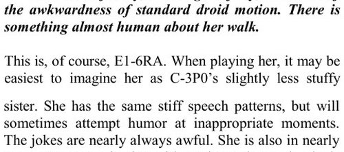
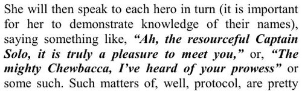
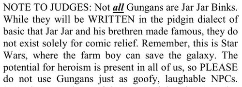
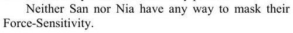
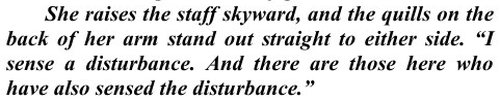
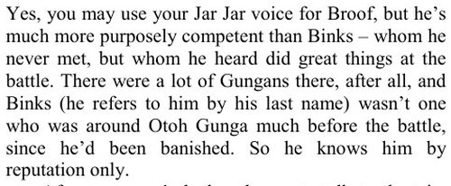
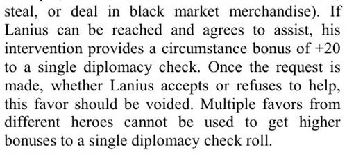

# Owner Material 037 — Star Wars D20 Drive folder (Core, Revised Core and Saga Edition): Living Force Campaign/Adventures/Among the Stars/Year 1/102 - Eye of the Sun - The Resistance Within.pdf [Star Wars Roleplaying Game Revised Core (d20, 2002)]

- **Source:** Wizards of the Coast Star Wars Roleplaying Game books, web enhancements, Living Force campaign modules and articles (2000–2010), from the owner's "Star Wars D20" Drive folder (only the three edition subfolders; "General" was not read, as instructed). Secondary source (licensed Legends reference). Scan OCR'd on the box; the scan stays box-only and is **not** published.
- **Method:** every scanned page was OCR'd and machine-screened sentence by sentence for power-relevant statements (fights, kills, defeats, Force feats, rankings, superweapons) that name a character on our roster; each kept sentence is quoted verbatim from the OCR text and has a crop of the printed passage directly under it. Pages with nothing power-relevant are still listed with what is on them.
- **Citation:** "*102 - Eye of the Sun - The Resistance Within* (SWRPG d20 Revised Core), p.X" by printed page ("scan p.X" where no printed number applies). **Weight:** Licensed RPG material: a secondary source. Narrative text sums up Legends lore; game statistics are rules for players, not canon power levels, and rank lowest.

## p.1 (scan page 1)

Page contents: Title, blurb, copyright (hand-read)

## p.2 (scan page 2)

Page contents: 897 words, 19 paragraphs | headings/entries: DM Overview; The Resistance Within; Page 2

## p.3 (scan page 3)

Page contents: 810 words, 18 paragraphs | headings/entries: Encounter 2: Overwhelmed, Understaffed; Encounter 3: Families, Friends, and Financiers; Encounter 4: The Hiironi; Encounter 5: Cloud Mines; Encounter 7: The Resistance; Opening Crawl; The Resistance Within; Page 3

## p.2–3 (scan page 2)

Page contents: RPGA scoring; DM overview; encounter summaries; judge note; opening crawl (hand-read)

## p.4 (scan page 4)

Page contents: 820 words, 21 paragraphs | headings/entries: Encounter 1: Your Reputation Precedes You; Feats: Cautious, Great Fortitude, Reflexes, Sharp-eyed; Lightning; The Resistance Within; Page 4

- **No single roster character (rules/setting/general)** — entry/section: E1-6RA, C-3PO's slightly less stuffy sister: "This is, of course, E1-6RA. When playing her, it may be easiest to imagine her as C-3PO's slightly less stuffy sister. She has the same stiff speech patterns, but will sometimes attempt humor at inappropriate moments. The jokes are nearly always awful." Source: *102 - Eye of the Sun - The Resistance Within* (SWRPG d20 Revised Core), p.4
  
- **Han Solo; Chewbacca** — entry/section: E1-6RA greets "Captain Solo" and "the mighty Chewbacca": "She will then speak to each hero in turn (it is important for her to demonstrate knowledge of their names), saying something like, "Ah, the resourceful Captain Solo, it is truly a pleasure to meet you," or, "The mighty Chewbacca, I've heard of your prowess" or some such." Source: *102 - Eye of the Sun - The Resistance Within* (SWRPG d20 Revised Core), p.4
  

## p.5 (scan page 5)

Page contents: 808 words, 36 paragraphs | headings/entries: Encounter 2: Overwhelmed, Understaffed; Gungan Security; Let the heroes briefly introduce themselves. Aervis; The Resistance Within; Page 5

- **Jar Jar Binks** — entry/section: Not all Gungans are Jar Jar Binks: "NOTE TO JUDGES: Not all Gungans are Jar Jar Binks. While they will be WRITTEN in the pidgin dialect of basic that Jar Jar and his brethren made famous, they do not exist solely for comic relief. Remember, this is Star Wars, where the farm boy can save the galaxy. The potential for heroism is present in all of us, so PLEASE do not use Gungans just as goofy, laughable NPCs." Source: *102 - Eye of the Sun - The Resistance Within* (SWRPG d20 Revised Core), p.5
  

## p.4–5 (scan page 4)

Page contents: Enc 1: E1-6RA stat block and briefing (hand-read)

## p.6 (scan page 6)

Page contents: 852 words, 23 paragraphs | headings/entries: House Hirskaala; Spirited Spirits; Dry Goods Emporium; Jax Warehouse; The Resistance Within; Page 6

## p.7 (scan page 7)

Page contents: 782 words, 29 paragraphs | headings/entries: Encounter 3: Family, Friends, and Financiers; The Gerarre Household; The Resistance Within; Page 7

## p.5–7 (scan page 5)

Page contents: Enc 2: Gungan Security, House Hirskaala, Spirited Spirits, Dry Goods Emporium, Jax Warehouse mural (hand-read)

## p.8 (scan page 8)

Page contents: 986 words, 16 paragraphs | headings/entries: The Resistance Within; Page 8

## p.9 (scan page 9)

Page contents: 848 words, 31 paragraphs | headings/entries: The Wahl Household; Things the Wahls can tell the party:; The Resistance Within; Page 9

## p.7–9 (scan page 7)

Page contents: Enc 3: Gerarre security trap, Wahl household, Polst fight (hand-read)

## p.10 (scan page 10)

Page contents: 824 words, 28 paragraphs | headings/entries: Encounter 4: The Hiironi; The Resistance Within; Page 10

- **No single roster character (rules/setting/general)** — entry/section: San Herrera and Nia Reston can't mask their Force-sensitivity: "Neither San nor Nia have any way to mask their Force-Sensitivity." Source: *102 - Eye of the Sun - The Resistance Within* (SWRPG d20 Revised Core), p.10
  

## p.11 (scan page 11)

Page contents: 887 words, 22 paragraphs | headings/entries: Encounter 5: Cloud Mines; The Resistance Within; Page 11

- **No single roster character (rules/setting/general)** — entry/section: Dariana senses a disturbance: "She raises the staff skyward, and the quills on the back of her arm stand out straight to either side. "I sense a disturbance. And there are those here who have also sensed the disturbance."" Source: *102 - Eye of the Sun - The Resistance Within* (SWRPG d20 Revised Core), p.11
  

## p.10–11 (scan page 10)

Page contents: Enc 4: San and Nia stats; Hiironi; Dariana (hand-read)

## p.12 (scan page 12)

Page contents: 1009 words, 16 paragraphs | headings/entries: The Resistance Within; Page 12

## p.13 (scan page 13)

Page contents: 872 words, 25 paragraphs | headings/entries: Encounter 6: None May Pass; The Resistance Within; Page 13

## p.11–13 (scan page 11)

Page contents: Enc 5: Cloud Mines; turbocart chase; security droids (hand-read)

## p.14 (scan page 14)

Page contents: 968 words, 19 paragraphs | headings/entries: The Resistance Within; Page 14

## p.15 (scan page 15)

Page contents: 903 words, 22 paragraphs | headings/entries: An Interview; The Resistance Within; Page 15

## p.13–15 (scan page 13)

Page contents: Enc 6: password, crushing walls, heat corridor, interview (hand-read)

## p.16 (scan page 16)

Page contents: 838 words, 29 paragraphs | headings/entries: Encounter 7: The Resistance; Nim'Ri can tell them:; Gerta can tell them:; The Resistance Within; Page 16

- **Jar Jar Binks** — entry/section: Broof Yurdel knows Binks by reputation: "Yes, you may use your Jar Jar voice for Broof, but he's much more purposely competent than Binks -- whom he never met, but whom he heard did great things at the battle. There were a lot of Gungans there, after all, and Binks (he refers to him by his last name) wasn't one who was around Otoh Gunga much before the battle, since he'd been banished. So he knows him by reputation only." Source: *102 - Eye of the Sun - The Resistance Within* (SWRPG d20 Revised Core), p.16
  

## p.17 (scan page 17)

Page contents: 937 words, 23 paragraphs | headings/entries: Conclusion; The Resistance Within; Page 17

## p.18 (scan page 18)

Page contents: 719 words, 23 paragraphs | headings/entries: Here Ends The Resistance Within; Experience Point Summary; Loot Summary; From E1-6RA; The Resistance Within; Page 18

## p.16–18 (scan page 16)

Page contents: Enc 7: resistance; Gerta Q&A; conclusion (hand-read)

## p.19 (scan page 19)

Page contents: 179 words, 8 paragraphs | headings/entries: From the Resistance (assuming success):; From San and Nia:; The Resistance Within; Page 19

- **No single roster character (rules/setting/general)** — entry/section: Lanius Qel'Bertuk's favor: +20 Diplomacy: "If Lanius can be reached and agrees to assist, his intervention provides a circumstance bonus of +20 to a single diplomacy check." Source: *102 - Eye of the Sun - The Resistance Within* (SWRPG d20 Revised Core), p.19
  

## p.18–19 (scan page 18)

Page contents: XP, loot, Lanius favor (hand-read)

## p.20 (scan page 20)

Page contents: Blank page (verified in image) (hand-read)

## p.21 (scan page 21)

Page contents: 24 words, 5 paragraphs | headings/entries: Gungan Security House Hirskaala Spirited Spirits; Dry Goods Emporium; Jax Warehouse; The Resistance Within Page 21

## p.22 (scan page 22)

Page contents: 132 words, 8 paragraphs | headings/entries: Player Handout B: Notable Missing Persons; The Resistance Within Page 22

## p.23 (scan page 23)

Page contents: 0 words, 0 paragraphs | headings/entries: 

## p.24 (scan page 24)

Page contents: 11 words, 2 paragraphs | headings/entries: Player Handout D: Mining Company Logo; The Resistance Within Page 24

## p.21–24 (scan page 21)

Page contents: Handouts A-D (C from image: Nim'Ri's notes) (hand-read)

## p.25 (scan page 25)

Page contents: 197 words, 11 paragraphs | headings/entries: DM Aid #1: Where Everything Is; Cartel warehouse; The Resistance Within; Page 25

## p.26 (scan page 26)

Page contents: 54 words, 11 paragraphs | headings/entries: Map of Shayne Gerarre's Home; DM Aid #2; Page 26; The Resistance Within

## p.27 (scan page 27)

Page contents: 117 words, 11 paragraphs | headings/entries: Critical Event Summary The Resistance Within; Yes No; The Resistance Within; Page 27

## p.25–27 (scan page 25)

Page contents: DM aids; map; critical event summary (hand-read)

