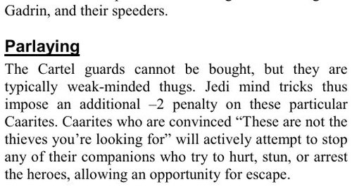
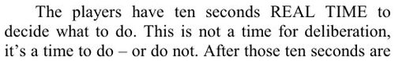
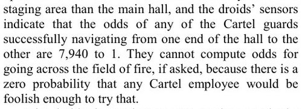
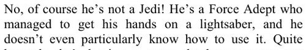
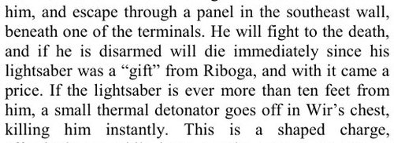
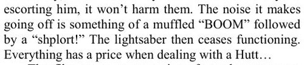

# Owner Material 037 — Star Wars D20 Drive folder (Core, Revised Core and Saga Edition): Living Force Campaign/Adventures/Among the Stars/Year 1/103 - Eye of the Sun - Revelation and Refutation.pdf [Star Wars Roleplaying Game Revised Core (d20, 2002)]

- **Source:** Wizards of the Coast Star Wars Roleplaying Game books, web enhancements, Living Force campaign modules and articles (2000–2010), from the owner's "Star Wars D20" Drive folder (only the three edition subfolders; "General" was not read, as instructed). Secondary source (licensed Legends reference). Scan OCR'd on the box; the scan stays box-only and is **not** published.
- **Method:** every scanned page was OCR'd and machine-screened sentence by sentence for power-relevant statements (fights, kills, defeats, Force feats, rankings, superweapons) that name a character on our roster; each kept sentence is quoted verbatim from the OCR text and has a crop of the printed passage directly under it. Pages with nothing power-relevant are still listed with what is on them.
- **Citation:** "*103 - Eye of the Sun - Revelation and Refutation* (SWRPG d20 Revised Core), p.X" by printed page ("scan p.X" where no printed number applies). **Weight:** Licensed RPG material: a secondary source. Narrative text sums up Legends lore; game statistics are rules for players, not canon power levels, and rank lowest.

## p.1 (scan page 1)

Page contents: Title, blurb, copyright (hand-read)

## p.2 (scan page 2)

Page contents: 924 words, 18 paragraphs | headings/entries: DM Overview; Encounter 1: Arrested Development; Revelation and Refutation; Page 2

## p.3 (scan page 3)

Page contents: 790 words, 23 paragraphs | headings/entries: Encounter 2: Sneak & Peak; Encounter 3: Get Outta Town!; Encounter 4: A Crash Site; Encounter 5: Cloud Mountain, Redux; Encounter 6: Preemptive Strike; Encounter 7: Into the Hive; Opening Crawl; Encounter 1: Arrested Development; Revelation and Refutation; Page 3

## p.2–3 (scan page 2)

Page contents: RPGA scoring; DM overview; encounter summaries; judge note; opening crawl (hand-read)

## p.4 (scan page 4)

Page contents: 885 words, 22 paragraphs | headings/entries: Ortin steps aside. "After you."; Revelation and Refutation; Page 4

## p.5 (scan page 5)

Page contents: 879 words, 20 paragraphs | headings/entries: Both Contingencies; Revelation and Refutation; Page 5

## p.6 (scan page 6)

Page contents: 862 words, 40 paragraphs | headings/entries: Encounter 2: Sneak & Peek; Gathering Information About Daily; Activities; Gathering Information for a Night-Time Penetration; Revelation and Refutation; Page 6

## p.3–6 (scan page 3)

Page contents: Enc 1: Ortin; Gerta options; Baylan's datapad; speeders (hand-read)

## p.7 (scan page 7)

Page contents: 982 words, 17 paragraphs | headings/entries: Revelation and Refutation; Page 7

## p.8 (scan page 8)

Page contents: 754 words, 28 paragraphs | headings/entries: Encounter 3: Get Outta Town!; If It's Night; If It's Day; Fighting; Parlaying; Revelation and Refutation; Page 8

- **Obi-Wan Kenobi** — entry/section: "These are not the thieves you're looking for": "The Cartel guards cannot be bought, but they are typically weak-minded thugs. Jedi mind tricks thus impose an additional -2 penalty on these particular Caarites. Caarites who are convinced "These are not the thieves you're looking for" will actively attempt to stop any of their companions who try to hurt, stun, or arrest the heroes, allowing an opportunity for escape." Source: *103 - Eye of the Sun - Revelation and Refutation* (SWRPG d20 Revised Core), p.8
  

## p.6–8 (scan page 6)

Page contents: Enc 2: Cartel office; Gather Info DCs; safe; Wir datapad tracker; Borus (hand-read)

## p.9 (scan page 9)

Page contents: Enc 4: crash site search DCs (hand-read)

## p.8–9 (scan page 8)

Page contents: Enc 3: chase; Cartel Guard Squad; parlay/mind trick; running (hand-read)

## p.10 (scan page 10)

Page contents: 942 words, 17 paragraphs | headings/entries: Revelation and Refutation; Page 10

## p.11 (scan page 11)

Page contents: 841 words, 24 paragraphs | headings/entries: Encounter 6: Preemptive Strike; Revelation and Refutation; Page 11

## p.9–11 (scan page 9)

Page contents: Enc 5: Cloud Mountain; floor collapse; dua-wurm (hand-read)

## p.12 (scan page 12)

Page contents: 890 words, 23 paragraphs | headings/entries: Staying Here; Going to the Fight; Revelation and Refutation; Page 12

- **Yoda** — entry/section: Ten seconds real time: do -- or do not: "The players have ten seconds REAL TIME to decide what to do. This is not a time for deliberation, it's a time to do -- or do not." Source: *103 - Eye of the Sun - Revelation and Refutation* (SWRPG d20 Revised Core), p.12
  

## p.13 (scan page 13)

Page contents: 805 words, 24 paragraphs | headings/entries: Either Scenario; Encounter 7: Into the Hive; Revelation and Refutation; Page 13

## p.11–13 (scan page 11)

Page contents: Enc 6: debrief; Wahl; transmitter; firefight; Gerta rescue; Hit Squad stats (hand-read)

## p.14 (scan page 14)

Page contents: 850 words, 23 paragraphs | headings/entries: A1 — Personnel Office; A2 — Storage Room; B1 — Barracks; B2 — Mess Hall; B3 — Staging Area; Revelation and Refutation; Page 14

- **No single roster character (rules/setting/general)** — entry/section: Odds of navigating the hall: 7,940 to 1: "the droids' sensors indicate that the odds of any of the Cartel guards successfully navigating from one end of the hall to the other are 7,940 to 1. They cannot compute odds for going across the field of fire, if asked, because there is a zero probability that any Cartel employee would be foolish enough to try that." Source: *103 - Eye of the Sun - Revelation and Refutation* (SWRPG d20 Revised Core), p.14
  

## p.15 (scan page 15)

Page contents: 886 words, 27 paragraphs | headings/entries: C1 — Security Headquarters; C2 — Records; Revelation and Refutation; Page 15

- **No single roster character (rules/setting/general)** — entry/section: Velin Wir is no Jedi: "No, of course he's not a Jedi! He's a Force Adept who managed to get his hands on a lightsaber, and he doesn't even particularly know how to use it." Source: *103 - Eye of the Sun - Revelation and Refutation* (SWRPG d20 Revised Core), p.15
  

## p.16 (scan page 16)

Page contents: 839 words, 25 paragraphs | headings/entries: Conclusion; Here Ends Revelation and Refutation; Experience Point Summary; Adventure Experience Award:; Adventure Experience: Roleplaying Experience:; Revelation and Refutation; Page 16

- **No single roster character (rules/setting/general)** — entry/section: Velin Wir's lightsaber, a "gift" from Riboga: "He will fight to the death, and if he is disarmed will die immediately since his lightsaber was a "gift" from Riboga, and with it came a price. If the lightsaber is ever more than ten feet from him, a small thermal detonator goes off in Wir's chest, killing him instantly." Source: *103 - Eye of the Sun - Revelation and Refutation* (SWRPG d20 Revised Core), p.16
  
- **No single roster character (rules/setting/general)** — entry/section: Everything has a price when dealing with a Hutt: "The noise it makes going off is something of a muffled "BOOM" followed by a "shplort!" The lightsaber then ceases functioning. Everything has a price when dealing with a Hutt..." Source: *103 - Eye of the Sun - Revelation and Refutation* (SWRPG d20 Revised Core), p.16
  

## p.13–16 (scan page 13)

Page contents: Enc 7: Nim'Ri briefing; base rooms; guards; Velin Wir fight (hand-read)

## p.17 (scan page 17)

Page contents: 667 words, 23 paragraphs | headings/entries: Total Possible Experience: 1,000 xp; Total Possible Experience: 1,000 xp; Loot Summary; Premiere Only, Winter Fantasy 2001; From the various fights:; From the Cities of Gadrin and Hedrett:; Revelation and Refutation; Page 17

## p.16–17 (scan page 16)

Page contents: Conclusion; XP; loot (hand-read)

## p.18 (scan page 18)

Page contents: 41 words, 11 paragraphs | headings/entries: Player Handout 1: Crashed Ship's Manifest; Revelation and Refutation Page 18

## p.19 (scan page 19)

Page contents: 20 words, 4 paragraphs | headings/entries: DM Aid #1: Cartel Base Floorplan; Fo att; Revelation and Refutation Page 19

## p.20 (scan page 20)

Page contents: 77 words, 10 paragraphs | headings/entries: Critical Event Summary Revelation and Refutation; Yes No; Yes No, they just killed him; Revelation and Refutation; Page 20

## p.18–20 (scan page 18)

Page contents: Handout manifest; floorplan; critical event summary (hand-read)

